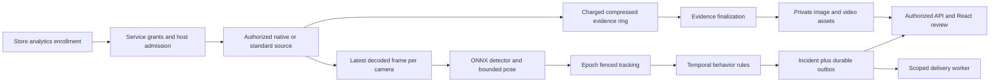

# CCTV behavior detection and incidents: Windows research and design

Analysis date: **2026-10-08, Asia/Seoul**. Status: **research/design only; none of
the proposed detection, incident, service-principal or video-evidence interfaces
below is implemented or accepted by this report**. Scope: a React/Next.js/Tailwind
incident experience backed by Python services running continuously on Windows,
including freezer climbing/sitting, running and hand-waving/help candidates.

## 1. Baseline, authority and observed implementation

The current implementation authority is the read-only worktree
`C:/Users/강지혜/.codex/worktrees/superlive-web-service/wisdom-super-observer`,
branch `codex/superlive-web-service`, HEAD
`6436748f37c799fd14ce03e1d72c86c79eda6b0f`, with retained reviewed Stage 1/Stage 2
working-tree changes. The writable primary checkout is `main` at
`211d1484aa16eb30f5d362758f149f98dec9dfdf`; it lacks those media changes. Its initial
status already contained edits to AGENTS/service analysis and the original-plan
audit. This report writes only its own Markdown path in the primary checkout.

Read-before-analysis references: the shared
`C:/Users/강지혜/.agents/analysis-policy.md`, both projects' AGENTS, the current
worktree service analysis, [original-plan audit](2026-10-08-original-plans-remaining-work.md),
`SERVICE_PLAN.md`, and T17–T23/Section 7.3 of the September 21 implementation plan.
Historical report claims were checked against the relevant current source. The
worktree service report has historical sections with older baselines and a stale
Chrome-close pointer: the October 8 original-plan audit records original Chrome
exit0/reap, with remaining protected context cleanup. That close request must not
be repeated. Existing raw2/raw4 evidence establishes bounded HEVC ingress and
normal cleanup; it does not establish twelve decoded browser streams or any
behavior detection. No live evidence was rerun here.

Selected current source fingerprints, SHA256:

| Worktree-relative source | SHA256 |
| --- | --- |
| `services/tvt-media/src/wso_tvt_media/native_source.py` | `85b1c1195c61149af7883c0fe29c48dd3c508956ef54bdce23939c96661bd6ac` |
| `services/tvt-media/src/wso_tvt_media/mux_source.py` | `d83bee16f17d21ee7593eb98851e9cfaf0445f3c75afd7c5fac039f606bb3ae3` |
| `packages/core/src/wso_core/tvt/local_media_mux_types.py` | `3615fb305a21ba985f08b0b0eaa257b18e4aaaab83ed5fe9c0ef42d93b8f7d44` |
| `packages/contracts/src/wso_contracts/assets.py` | `665ff00d806b58177decc48488c885b7ee39457eaaef3f955e3cc7cf35fabaf5` |
| `docs/superpowers/plans/2026-09-21-wisdom-super-observer-implementation-plan.md` | `8ee02f8d8ee4f4db64f8add272bf7503798ff9217d7476bd3c9b7ffcc04337e7` |

These are inspected local bytes, not a published release or a new independent
review of the whole branch. Source paths and line numbers below refer to this
worktree, not the primary checkout.

The service currently supplies tenant/store/connection management, Python API,
PostgreSQL authority/jobs, a protected Windows TVT bridge, continuous decode and
WebRTC browser media, and generic private image assets. `IncidentSummary` exists
as a wire model at `packages/contracts/src/wso_contracts/models.py:81`; it is not
an incident workflow. The API router registration at
`services/api/src/wso_api/main.py:144` includes stores, jobs, assets and TVT routes
without incident/rule/staff-mode routes. Targeted source searches found no
implemented YOLOX/ByteTrack/ONNX Runtime detector, behavior-rule pipeline or
incident persistence/UI in the inspected application source.

## 2. Requirements preserved from the original plan

The wider service supports multi-tenant store surveillance and human incident
review. This feature must implement observable behavior candidates, retain
evidence, notify permitted users and accept feedback. It must not label crime,
identity or inferred age. It is independent of whether a browser is open.

| Requirement | Original source and design consequence |
| --- | --- |
| Freezer climbing/sitting, running, hand waving/help | `SERVICE_PLAN.md:119`, `:127`, `:206`; person/pose/motion measurements plus temporal rules, not a generic zone-entry substitute |
| First detector/tracker baseline | September 21 plan `:1189`; isolated YOLOX and ByteTrack, replaceable behind adapters |
| Evidence target | Plan `:541`; 10 seconds before and 10 seconds after the event, with truthful actual coverage |
| Inference freshness | Plan `:545`; configured maximum 2 seconds, no reconnect-backlog incidents |
| Track isolation | Plan `:545`; reconnect increments epoch, track IDs never merge across sessions |
| Zones and behavior geometry | Plan `:547`; normalized polygons, freezer contact/pose rather than box overlap, calibrated or body-scale speed |
| Cooldown/grouping | Plan `:549`; initial 15 seconds for compatible same-camera/rule/track-epoch detections |
| Staff mode | Plan `:1214`; selected notification suppression only, automatic expiry, evidence/detection continue |
| Incident review | Plan `:1218`; `NEW/ACKNOWLEDGED/FALSE_POSITIVE/RESOLVED`, expected revision, measurements/model/rule versions |
| Summaries and delivery | T21–T23 `:1241`, `:1266`, `:1292`; summaries operate on selected evidence, initial alert does not await CLI |

The old example mentioning teenagers is not a permissible model assertion; the
later Section 7.4 explicitly excludes inferred age/crime/identity. Detecting a
wave suggests a help candidate; visible motion cannot prove a person's intent.
Kiosk difficulty and authoritative payment errors remain distinct future rules;
visual actions cannot establish a payment error without verified source events.

## 3. Existing media interfaces and the gaps that matter first

| Current code evidence | Reuse and required new boundary |
| --- | --- |
| `mux_source.py:29` constructs `NativeDecodedSource` from executor registration, source mode and original mux binding | Reuse proven decode/admission mechanics through a new authorized analytics adapter; this is currently a viewer factory, not a background service grant |
| `mux_source.py:86`, `:125`, `:220` retains the exact original IPC tuple and checks grant scope, authority identity, registration, slot/cut, expiry | Preserve exact ownership, ingress cuts and release ordering; a second consumer requires explicit rights and separately accounted ownership |
| `native_source.py:611`, `:679` publishes with bounded authority observation and lease expiry; `:1094` consumes the latest RGB frame | A single consumer cannot be attached simultaneously to both WebRTC and detection by calling `recv` twice; delivery is not a broadcast or archive feed |
| `native_source.py:695`, `:1156`; `live.py:128`/`:172` returns exact RGB credit and settles original source/thread owners | Inference, drop, cancel and shutdown paths must release the received frame exactly once and wait for genuine cleanup |
| `mux_budget.py:37`, `:59`, `:82`, `:92` uses the retained host ledger, single RGB slot and original credit tokens | Tensor/crop/archive allocations need their own charged bounds; retaining bytes after refunding original credit is invalid |
| `local_media_mux_types.py:180` scope contains tenant/epoch, actor user, web-session digest, wall, store/device, connection/generation, secret version, inventory revision and worker epoch | A service identity is a schema/SQL/proof extension, not a fake web session or an OWNER cookie |
| `infra/migrations/versions/0016_tvt_device_media_epochs.py:115` and `:169` enforce current OWNER membership and web session; `:134` ties inventory to that session | Service-principal inventory/permission lineage must be independently obtained and renewed; current human proof cannot be reused after logout |
| `local_live_mux_ownership.py:47` admits 2 base originals and 1 main original; `local_media_mux_service.py:1033` admits at most 12 viewers; SQL migration `:309` also caps active masters | Count AI and browser originals together. A separate worker must not create a duplicate budget or relax the caps |
| `windows_decode.py:134` RGB contains binding, dimensions, ordinal and `timestamp_us` | No verified camera wall-clock capture UTC or receipt-time field is carried here; add an explicit time basis before freshness/evidence claims |
| Contract `assets.py:21`/`:24` allows JPEG/PNG and 20 MiB; `asset_images.py:33` and core `assets.py:836` sniff images | `EVIDENCE` purpose exists, but MP4/container validation, video limits, service uploads and authorized Range reads do not follow automatically |

Two upstream timing domains must remain separate: the actual device/raw media
clock and R142's mapped monotonic decoder/RTP clock. A mapped timestamp is not
proof of camera capture UTC. From current metadata, the detector can measure
**validated ingress receipt to inference decision**; capture-to-inference age is
`UNKNOWN` until a tested clock mapping with uncertainty is available. Even a
freshly received keyframe can originate in a device backlog. Native epoch/cut
validation must discard old transport data; do not claim it bounds device delay.

### The simultaneous AI/live-wall capacity conflict

Separate AI principals and current browser actor/session principals cannot
quietly share an original. Two AI recorder masters would consume the entire
two-base budget. A separate twelve-camera browser wall then needs additional
originals and must receive capacity denial. Current same-scope NativeMux sharing
does not solve this conflict. Spawning another worker with another budget is not
a solution.

This is a product/integration gate, not a reason to postpone deterministic rules,
incident API/UI, model artifact preparation or offline replay work. A first native
pilot can explicitly admit a small analytics selection and show capacity state.
Full concurrent twelve-camera analytics and viewing needs either a verified
independent standard-stream capability with its measured physical connection
budget, or an expressly approved service-owned media publication design with
fresh consumer authorization. Neither capability is established today.

## 4. Architecture choices and recommended sequence

| Option | Advantages | Cost/limits and decision |
| --- | --- | --- |
| A. New service-principal NativeMux adapter, independent originals | Fits current Windows transport/decode knowledge; independent of browser lifetime; narrow initial analytics pilot | Requires new SQL/grant/inventory lineage. Shares global physical limits with viewing; same-device cross-principal pooling remains forbidden. **Recommended initial native adapter with explicit admission/BUSY** |
| B. Verified RTSP/standard-stream service adapter | Standard compressed evidence pipeline and independent Windows worker; adapter matches original T17 abstraction | Hardware/protocol/rights/physical-session capability has not been verified. Do not invent RTSP URLs, activate device settings or bypass current authority. Select only after authorized capability proof |
| C. Reviewed service-owned media broker, separately authorized consumers | Can eventually retain 2 recorder masters while delivering analytics and live media to separately permitted users | Changes original source/principal semantics and permission proof, fanout/credits, revoke behavior and SQL scope. Requires explicit design scope and independent source/runtime acceptance; **the long-term NativeMux coexistence route if B is unavailable** |

Build the replaceable ingestion port, offline replay, detector/tracker/rules,
incident storage/API/React and private evidence lifecycle first. Use optionA for
the first authorized Windows native acceptance. Treat B/C as an explicit
coexistence choice before promising simultaneous full-capacity production use.
Neither a browser screenshot loop nor a WebRTC subscriber using a retained user
cookie is suitable for 24/7 service operation.

Proposed pipeline:

New contracts below are proposed interfaces. Names do not imply existing source
implementation or permission to run/install a service.

## 5. Windows runtime and bounded scheduling

Run a Python analytics supervisor under a dedicated Windows service account.
Its configuration identifies enrolled stores/cameras and immutable model
manifests; it must not depend on a desktop user being signed in, browser tabs,
OIDC cookies or an app test fixture. API and Next.js supply control/review; the
analytics service continues through browser close and ordinary web-app restart.

Use separate owned processes for native ingest/decode, inference, evidence
finalization and notification work. Preserve Windows Job/original-handle custody
before launching child work. A timed-out inference process is terminated and
reaped before its charged memory/capacity is released; Python cannot safely
cancel an arbitrary native `InferenceSession.run` by stopping a thread. Recover
from a poisoned process with a new worker epoch and bounded restart/backoff,
rather than reusing uncertain custody. Persist failure/health separately from
incident review. Deployment packaging/SCM recovery remains unimplemented.

Suggested first benchmark profile, **provisional, not measured hardware capacity**:

| Resource | Initial proposed bound and overload behavior |
| --- | --- |
| Analytics cameras | One for first actual pilot; increase to 4/12 only after measured gates and admission authority |
| Detection cadence | Target 5 Hz/camera, latest frame only; replace queued frame and charge drop counts rather than FIFO backlog |
| Inference queue | One queued sample/camera plus explicit in-flight owner; bounded weighted round robin so one camera cannot starve others |
| Pose work | At most6 selected person crops/frame with separately bounded global pose work; selection/omissions recorded. Above limit camera is `DEGRADED`, not falsely fully covered |
| Wave sampling | Verify ordinary 5 Hz can observe the configured gesture; optional 8–10Hz burst only within measured budget. Unsupported sample rate disables the wave rule |
| Frame freshness | Reject samples/results beyond 2000 ms from validated receipt; if calibrated capture time exists, also reject beyond 2000 ms capture age including clock uncertainty |
| Model concurrency | One detector session and one bounded pose scheduler initially; CPU intra-op threads explicitly limited to preserve source/decode/API headroom |
| Evidence ring | Time target at least pre 10 s plus measured keyframe margin; independent hard byte/time caps, no 10 s RGB retention |
| Clip jobs | One active encoder per approved profile initially, bounded queue/TTL, per-camera pending event limit; explicit `PARTIAL/FAILED` coverage on overload |
| Spool | Explicit deployment byte quota/TTL and minimum-free-disk threshold; encrypted/ACL-restricted files; overflow emits evidence-loss health and cannot grow without bound |
| DB publication | Persist candidates/incidents/outbox, not every frame; batch bounded sanitized health aggregates; preserve existing live SQL budget while measuring new writes |

The exact process/job/RAM/disk limits must be pinned with measured model and
camera dimensions before activation. Process caps are not measured resident
memory and may not bound GPU VRAM. GPU provider workspace/VRAM needs separate
telemetry and admission. Do not transfer inference processing into native DLL
callbacks or block callback delivery on disk/DB/model work.

When the scheduler drops samples, trackers age in elapsed observation time,
not assumed 30 FPS. Predicted/occluded positions may aid association but cannot
accumulate verified dwell, surface contact, running or wrist motion. Late model
results are discarded even if the computation began on a timely frame.

## 6. Model/runtime research: official sources and selection

Research checked official project repositories, ONNX Runtime documentation and
upstream deployment guides on 2026-10-08. Their mutable `main` pages are research
references; production requires pinned commits, artifact hashes and compatible
runtime locks. No model weights or dependencies were downloaded in this session.

### Detector, pose and tracker candidates

| Component | Evidence, provenance and proposed role |
| --- | --- |
| YOLOX-tiny/s | Official project publishes COCO detectors and an [ONNX Runtime example](https://github.com/Megvii-BaseDetection/YOLOX/tree/main/demo/ONNXRuntime), with [Apache 2.0 code license](https://github.com/Megvii-BaseDetection/YOLOX/blob/main/LICENSE). Keep the original planned YOLOX adapter; benchmark tiny against s on actual small people. COCO person classification does not classify freezer behavior. [Upstream model repository](https://github.com/Megvii-BaseDetection/YOLOX) |
| RTMPose-s,17 body keypoints,256x192 | Official MMPose [COCO model table](https://github.com/open-mmlab/mmpose/blob/main/configs/body_2d_keypoint/rtmpose/coco/rtmpose_coco.md) distinguishes COCO-only and AIC+COCO artifacts. Prefer COCO-only s as the first proposed provenance baseline; export in a controlled build using the [official deployment procedure](https://github.com/open-mmlab/mmpose/blob/main/docs/en/user_guides/how_to_deploy.md). MMPose code is [Apache 2.0](https://github.com/open-mmlab/mmpose/blob/main/LICENSE). Runtime only needs approved ONNX, matching preprocessing/SimCC decode and ORT; a full training stack need not be installed on the production worker |
| ByteTrack | Original planned baseline. Its [official implementation](https://github.com/FoundationVision/ByteTrack) associates lower-score boxes with existing tracklets; [code license MIT](https://github.com/FoundationVision/ByteTrack/blob/main/LICENSE). Use an isolated tracker adapter with timestamp/epoch handling and no face/ReID identity. Low-score association is not evidence of a behavior trigger |
| OC-SORT | [Official alternative](https://github.com/noahcao/OC_SORT) emphasizes observation/motion association, including nonlinear motion; [MIT code license](https://github.com/noahcao/OC_SORT/blob/master/LICENSE). Compare only if actual crossing/occlusion tests show a concrete ByteTrack weakness; its full repo includes YOLOX and other dependencies whose notices remain relevant |
| Norfair | Optional simpler point/box/pose association adapter from [official documentation](https://tryolabs.github.io/norfair/2.2/) and [BSD 3-Clause license](https://github.com/tryolabs/norfair/blob/master/LICENSE). Useful for controlled keypoint experiments; it requires application-selected distance and lifetime behavior. It does not remove occlusion/identity ambiguity |

Recommendation: **YOLOX + ByteTrack + selectively scheduled RTMPose**, with the
tracker/model ports replaceable. Do not change the original baseline merely
because another package combines inference and tracking in a convenient API.
None of the evaluated components is established as an off-the-shelf pretrained
classifier for this store's freezer climbing/sitting, calibrated running or help
intent. Those labels require an explainable rule definition and local evaluation.

Code licenses, checkpoint distribution terms, training dataset provenance and
the project's deployment artifact acceptance are separate records. An ONNX export
does not replace upstream conditions. The [RTMPose project](https://github.com/open-mmlab/mmpose/tree/main/projects/rtmpose)
publishes several multi-dataset Body8 artifacts; do not select them as if they
were COCO-only. Avoid unverifiable third-party converted weights or mutable
first-request downloads. A COCO-only pose-training artifact reduces provenance
complexity; its pretrained backbone and export dependencies also need provenance
records. It does not by itself establish deployment approval or local quality.

Each `ModelArtifact` must record source URL, repository commit/config, checkpoint
SHA256, exported ONNX SHA256, dataset/provenance notes, license/notice copies,
class/keypoint definitions, input layout/color/normalization, resize/letterbox
and coordinate transforms, output/SimCC decode, opset, precision, exporter/tool
versions and validation tolerances. Validate export against known images and
upstream preprocessing before serving incidents. No hashes are fabricated here.

### ONNX Runtime on Windows

| Profile | Official evidence and operational consequence |
| --- | --- |
| CPU reference | [ORT Python](https://onnxruntime.ai/docs/get-started/with-python.html) supports the CPU package. Windows requires the documented [VisualC++ runtime](https://onnxruntime.ai/docs/install/). Use explicit CPU provider and bounded threads; benchmark exact Python/Windows Server/CPU rather than claiming12-camera capacity |
| NVIDIA CUDA | [CUDA provider documentation](https://onnxruntime.ai/docs/execution-providers/CUDA-ExecutionProvider.html) defines package-dependent CUDA/cuDNN compatibility and DLL preload behavior. Pin package, driver, CUDA/cuDNN/MSVC and GPU profile together. cuDNN major versions are not interchangeable. Log selected providers and actual placement/latency; do not hide a CPU fallback that violates the freshness budget |
| DirectML | Official [DirectML provider docs](https://onnxruntime.ai/docs/execution-providers/DirectML-ExecutionProvider.html) require compatible DirectX 12 device/driver, sequential execution, memory-pattern disabled and serialized Run per session; fixed shapes help. DirectML is in sustained engineering and newer Windows development is directed to WinML. Treat DirectML as an optional measured compatibility profile, not the primary Windows Server assumption |

The official [Windows start page](https://onnxruntime.ai/docs/get-started/with-windows.html)
now points new Windows applications toward WinML. The user requested Python, so
start with a stable explicit ORT CPU/CUDA profile and evaluate a WinML migration
only against its Python/service deployment compatibility. The official
[compatibility matrix](https://onnxruntime.ai/docs/reference/compatibility.html)
and selected wheels must be checked for the exact deployed Windows Server/Python
version. Documentation mentioning Windows/DirectX does not prove headless
service-account GPU availability on this server. Absence of `nvidia-smi` from
PATH is not evidence that a GPU is absent.

[ORT thread management](https://onnxruntime.ai/docs/performance/tune-performance/threading.html)
documents per-session thread pools and spinning costs. Multiple per-camera
sessions can oversubscribe cores. Start with bounded shared inference scheduling,
explicit intra-op counts and measured spinning settings. Published RTMPose/YOLOX
benchmark FPS/AP use their own inputs/hardware; they cannot establish this host's
decode-plus-detect-plus-pose-plus-archive throughput or behavior accuracy.

## 7. Proposed authority and ingestion contracts

`AnalyticsEnrollment` is created by an authorized store owner or explicitly
permitted manager. It binds tenant/store, configured cameras, enabled rules,
privacy mask/retention policy, service principal and grant revision. It is not an
arbitrary network URL. A dedicated service role can request only enrolled read
streams/evidence uploads; it cannot broadcast, alter recorder settings, register
devices or inspect unrelated tenants. Enrollment revocation is auditable.

`AnalyticsGrant` is an independently issued, short-lived private grant containing
principal ID/epoch, tenant/epoch, store/camera/channel/device, connection
generation and secret version, current independently acquired inventory and
permission proof, worker epoch, allowed source purpose, expiry and an issuer
seal. Renew from the durable enrollment and current device rights, not a human
web session. Native credentials remain inside the existing protected bridge;
the model process receives pixels and scoped metadata only. Exact SQL roles,
secret lineage and proof schema need implementation/review before live use.

`AnalyticsSource.open(grant, profile, cancel)` returns an owned handle with
`recv_latest() -> FrameLease`, health, and `close() -> CleanupReceipt`.
`FrameLease` includes an exact owned decoded frame and release callback; its
public metadata is separate from private bytes. A grant/permit check precedes
processing, private persistence and incident publication. Disable/revoke must
fence queued and in-flight output immediately at the appropriate current checks;
cleanup grace cannot renew media authority. Original receipt uncertainty retains
capacity instead of marking CLOSED.

`FrameMetadata` must include:

- Scoped camera/source identity and source epoch; native registration/cut/slot
  identity where relevant; decode/format epoch and model/rule configuration epoch.
- Frame ordinal, raw device timestamp and mapped decoder timestamp as separate
  values, source dimensions, orientation and coordinate-transform version.
- `received_monotonic` at the earliest validated trusted ingress and
  `received_at_utc`, carried through decode/inference rather than stamped anew.
- Optional `captured_at_utc`, clock-calibration version and uncertainty;
  `capture_time_basis=VERIFIED_DEVICE_CLOCK|UNKNOWN` and capture age nullable.
- Inference start/completion/decision monotonic timestamps, receipt age,
  calibrated capture age when known, omitted/dropped counters and source quality.

Track key is `(tenant,store,camera,source_epoch,analysis_epoch,track_id)`. A native
reconnect, decoder restart/format transformation change, service grant epoch,
rule geometry or model calibration change fences incompatible state. Minor
resolution changes can resume only with a tested transform and sufficient fresh
observations; never reuse a previously valid surface-contact dwell blindly.

`CompressedArchiveSink.accept(packet_lease, metadata)` is a **new port**. It
accepts validated encoded frames with a current service evidence grant. Before
detaching/copying bytes into the ring, reserve archive byte credit. Original IPC
batch credit stays with its original owner until all original consumers release;
ring memory is charged independently and cannot keep uncharged references after
refund. Callback dispatch does bounded work; archive rejection yields an explicit
coverage gap. It cannot indefinitely block or retain the decoder's packet queue.

## 8. Proposed behavior rules and explainable outputs

Use validated normalized polygons in `[0,1]`, source dimensions/orientation,
zone versions and optional calibrated floor homography. Reject nonfinite,
empty/self-intersecting polygons and inconsistent orientation. Separate floor,
approach and appliance-top/support semantics. A floor homography is valid on its
plane; it cannot estimate the height of a freezer contact on a different plane.

`TrackObservation` contains timestamps/quality, observed box, footpoint, visible
pose keypoints/confidence, measured displacement/speed, camera calibration,
association certainty and `observed|predicted|occluded`. `RuleCandidate` contains
rule ID/version, track key, trigger timestamp/time basis, condition measurements,
confidence components/limitations, supporting frame ordinals/evidence request,
model versions and deterministic idempotency key. Model scores are not calibrated
probabilities that the person performed the behavior.

| Behavior | Proposed temporal definition | Limits/negative controls |
| --- | --- | --- |
| Freezer climbing | Observe approach/floor-to-surface transition plus visible foot/ankle or other configured contact consistent with elevation, normalized upward motion and sustained contact. Use conservative condition conjunctions; first support threshold is camera calibrated | Mere person-box overlap, reaching toward freezer, walking behind it, camera perspective or occluded ankles cannot establish climb. 2D contact is still a candidate, not verified 3D height |
| Freezer sitting | Visible pelvis/hip near the configured support surface with compatible leg/knee posture and stable support over configured duration; surface relation and keypoint visibility required | Leaning, kneeling beside the freezer, standing behind it and hidden pelvis/legs produce uncertain/no supported sit candidate |
| Running | Track observed footpoint motion over a continuous interval and calibrated floor speed above camera-specific threshold; pose cadence/gait can add support. With no floor calibration use body-height-normalized displacement and explicitly mark `RUNNING_UNCERTAIN` | Pixel distance alone, pose jitter, abrupt ID swaps, camera movement, perspective scaling and teleport after occlusion cannot establish running. Do not report meters/second without verified calibration |
| Hand waving/help candidate | Repeated wrist motion relative to visible shoulder/torso, minimum amplitude, alternating excursions and minimum continuous sample support; arm elevation/camera-facing evidence optional with explicit uncertainty | Carrying goods, reaching shelves, grooming, cleaning and gesturing to another person are hard negatives. Wave motion does not prove help intent or camera-facing direction when unavailable |

Provisional tuning inputs for the first replay corpus: freezer contact/sit
duration 1.5–2 seconds; running interval 1–2 seconds; wave at least 2 validated
oscillations within 1.5–3 seconds. These are proposed starting values, not fixed
original requirements or accepted thresholds. Confidence/keypoint visibility,
minimum body pixels, motion amplitude and gap allowance must be measured and
versioned per camera. The system disables unsupported rules or reports
`INSUFFICIENT_VISIBILITY/UNCALIBRATED/UNDER_SAMPLED`, rather than pretending all
12 low-resolution substreams support pose behavior.

Deterministic temporal state: `IDLE -> OBSERVING -> TRIGGERED -> COOLDOWN`, with
`LOST/UNCERTAIN` cutting verified duration. Do not add separated visits or
predicted frames to continuous observed dwell. The initial 15-second cooldown
merges compatible candidates for the same camera/rule/track epoch, while storing
each underlying detection event and bounded measurements. Define merge anchor
and maximum incident extension explicitly so persistent motion cannot retain an
unbounded clip. Different people/rules or a new epoch cannot be silently merged.
Staff-mode suppression is evaluated for each delivery under current server time;
rule evaluation and evidence recording continue.

The observed raw gate resolutions include 352x240 and 704x480. Cropping/resizing
them to 256x192 does not recreate missing wrist/foot pixels. Person size and
keypoint visibility are activation gates. Main-stream inference/evidence may be
requested only under fresh grant and available main lane; it cannot preempt a
browser focus or silently add another native original.

## 9. Evidence, incidents, API and React contracts

### Evidence window and media lifecycle

The request window is `[trigger-10s, trigger+10s]` in a declared clock basis.
Use continuous compressed substream buffering, independently of the detector's
sample rate. On trigger reserve a bounded capture request and freeze relevant
prebuffer ownership; collect postbuffer until its deadline, then finalize. A
late or unavailable frame is never replaced by current media with a fabricated
timestamp. Multiple compatible triggers can share immutable segment references
under explicit refcounts and quotas; incident merges cannot extend storage
without a hard bound.

An event-time main-stream switch cannot supply the preceding 10 seconds of main
video. Prefer an already authorized continuous main buffer only where its
physical budget is measured and admitted. Otherwise retain substream evidence,
and optionally a fresh main snapshot/post-event fragment with its own clock,
coverage and quality. Show `SUBSTREAM`, `MAIN`, or genuinely segmented/mixed
evidence. Main unavailable is a visible degradation, not an incident failure.

Keyframes matter: FFmpeg's [official segment documentation](https://ffmpeg.org/ffmpeg-formats.html#segment_002c-stream_005fsegment_002c-ssegment)
explains that segment boundaries normally follow reference-stream keyframes;
exact split times require appropriate keyframe placement and may require
transcoding. Keep a measured GOP margin or re-encode a bounded event clip; do not
promise an exact 20-second file from arbitrary copied packets. H.265 source clips
and browser H.264 preview/transcoding are separate artifacts with measured cost.
Decoder/verifier records actual first/last playable frames and discontinuities.

`EvidenceCaptureManifest` records requested/actual start and end, clock basis and
uncertainty, continuous coverage intervals/gaps, source epochs/dimensions/codecs,
stream kind, representative-frame timestamps, mask/transform versions, hashes,
byte size, encoding version and reason for missing pre/post media. States are
`GATHERING/FINALIZING/READY/PARTIAL/FAILED/EXPIRED`; generic asset states remain
their existing lifecycle. A partial clip can be useful and honestly reviewable;
it must not be advertised as complete coverage. A missing clip preserves the
incident and available image with a clear failure state.

Extend the existing private asset lifecycle with a reviewed media type and
service upload protocol; do not simply widen the image MIME union. New bounded
MP4 validation checks container streams/codecs, dimensions, duration, actual
decodability, byte limit, checksums and metadata stripping in an owned process.
Reuse encrypted object storage, audit, READY gating, retention and delete/read
lease semantics. Representative JPEGs can reuse current image validation.
Video Range delivery must check current membership/store rights and grant
expiry for every request, support only validated bounded ranges and stop reads
at expiry/revocation. Never expose raw object keys, permanent URLs or credentials.
Retain asset acceptance failures recorded in the canonical service report until
the changed provider/runtime gates actually pass.

### Incident persistence and delivery

Proposed tables: `analytics_enrollments`, `analytics_grants`/private authority,
`camera_analysis_health`, versioned `camera_zones` and `behavior_rules`,
`detection_events`, `incidents`, `incident_evidence`, append-only
`incident_reviews`, `staff_visit_modes` and notification deliveries/outbox. Use
existing jobs/outbox/assets as appropriate rather than duplicating lifecycles.
New migration IDs must follow the current worktree sequence; the old plan's
`0009_incidents` number already conflicts with existing migrations.

Tenant/store/camera references are server-derived and checked together, including
queued service jobs and object access. Use RLS and a narrow service DB role;
authenticated users can review only permitted stores. A unique candidate key
prevents duplicate incident creation after crash/retry. Incident creation and
initial notification outbox commit atomically before waiting for the post 10 s
clip or optional summary. File completion updates the same incident using its
revision and another idempotent event. Review state, evidence state, summary
state and delivery status are separate columns.

Review transitions preserve the original `NEW/ACKNOWLEDGED/FALSE_POSITIVE/RESOLVED`
contract. Require `expected_revision` and append actor/time/decision/reason to
review history; stale concurrent edits return conflict. A feedback label is
provenance for later controlled datasets, not automatic online retraining.

Proposed HTTP/BFF routes:

| Route family | Response/control contract |
| --- | --- |
| `GET /incidents`, `GET /incidents/{id}` | Cursor pagination, permitted store/camera/time/rule/state filters; time basis, measurements, evidence/summary state and revision |
| `POST /incidents/{id}/review` | Expected revision, decision and optional feedback; no execution command |
| `GET /evidence/{id}/download` and content range route | Short-lived authenticated ticket/proxy; current rights/expiry on read, truthful coverage |
| Camera zones/rules read/create/update | Expected version; normalized geometry/orientation; confidence/duration/cooldown; snapshot preview and measured unsupported-rule reasons |
| Analytics enrollment/health routes | Authorized enable/disable, service state, capacity/BUSY/staleness/evidence-loss; no private native identity or secret values |
| `POST /staff-visit-modes`, `DELETE /staff-visit-modes/{id}` | Selected allowed rules/store, bounded expiry and actor; delivery suppression only |
| Authorized SSE/events | Stored event ID replay, reconnect gap handling and current per-store permission filtering |

React/Next.js/Tailwind experience: incident list with store/camera/time/action
and review state; detail with representative image, playable authorized clip,
actual coverage/gaps, measurements/calibration/uncertainty, model/rule versions,
review actions and summary availability. A zone editor uses a versioned snapshot
with dimensions/orientation; normalized vertices remain correct through responsive
letterboxing, pointer/keyboard editing and source rotations. Staff mode clearly
shows active rules and expiration. Capacity/source/model/evidence health is
visible without exposing infrastructure secrets. Initial UI labels use behavior
candidates and review decisions. No automatic broadcast or financial/identity
decision is introduced.

Durable in-app SSE and opt-in Web Push belong to T23. Push contains generic text
and scoped incident/store IDs, with fresh authorization on navigation; no
permanent evidence URL or private image payload. Idempotency key is
`(event_id,recipient_id,channel)`; retry/dead-letter/provider-accepted states are
observable. A summary update is a separate event. Existing Codex/Claude accounts
or subscription login cannot be copied into the detector service; T21/T22 need
their own isolated reviewed runner if included later.

## 10. Concrete acceptance and measurement gates

The first vertical slice must include the three requested behavior families;
zone entry/dwell alone does not complete the main feature. Acceptance has four
separate kinds of evidence: deterministic contracts, model quality, actual
Windows service execution and actual authorized web review. A passing synthetic
rule test cannot close actual pose/behavior quality.

| Gate | Required result and actual limit |
| --- | --- |
| Source/authority | Fresh independently reviewed service grant/SQL/ingestion/evidence interfaces; revoked enrollment, credential generation, tenant/store/camera and worker epochs fence all publication. Existing OWNER/browser routes still enforce their current scope |
| Deterministic rules | Exact duration/cooldown boundaries, out-of-order/duplicate frames, reconnect epochs, crossing ambiguity, missing pose, occlusion, normalized polygons/resize/rotation, true continuous dwell, uncalibrated speed and insufficient gesture samples. No fabricated behavior from predicted tracks |
| Export/model correctness | Pin model artifacts/terms/preprocessing; verify CPU ONNX outputs and coordinate transforms on known images. CUDA/DirectML profiles accepted separately if selected; report provider/node fallback and numerical/latency differences |
| All-three behavior corpus | Authorized held-out positives plus hard negatives for freezer climb/sit, running and wave; separate camera/lighting/person-size groups. Disjoint threshold-tuning and held-out sets. Record confusion matrix, event recall, false alerts/camera-hour, time-to-trigger, visibility abstentions and ID switches |
| First actual Windows pilot | One admitted real camera, no browser media dependency. At least 60-minute initial service run; close browser and restart web app without stopping detector. Exercise source loss/reconnect and revoke. Verify new epochs, no old-result incident, exact original cleanup and unchanged baseline sources |
| Evidence | Real complete warm-buffer event with visible pre10/post10 progression; startup/long-GOP/outage/overflow cases truthfully PARTIAL. Verify MP4 actual decode/checksum, authorized Range, deletion/expiry, private spool quota and cleanup after interruption |
| Incident/UI | Create initial incident before clip/summary finish, SSE replay/deduplication, review revision conflict, cross-tenant/store denial, staff expiry with evidence retained, keyboard/mobile zone editing and playable truthful evidence |
| Resource coexistence | Actual1/4/12 analytics windows, selected inference/pose rate, age p50/p95/p99/max, drops, starvation, native count, CPU/private bytes/GPU VRAM, disk/network and SQL. Include simultaneous browser load under the approved architecture; capacity denial is explicit and is not full coexistence acceptance |
|24/7 readiness | At least 24-hour target-load soak including night lighting, configured crash/restart/backoff, stale/DB/object-store outage, disk pressure and revoke. No unbounded queue/spool/custody. Original native processes/Jobs and credit ledgers settle at shutdown; degradation/coverage persisted |

Proposed pilot quality targets, to be ratified against the operator's acceptable
alert burden: at least 80% recall for **visible, calibrated, within-profile**
held-out events and no more than 1 false alert/camera/day per enabled rule. This
is a proposed release target, not a measured result or universal guarantee.
Always report recall on all labeled events as well, including abstentions and
unsupported conditions, so a visibility filter cannot conceal misses. Small
staged examples alone cannot establish a daily false-alert rate. With zero false
alerts in 72 independent camera-hours, the simple one-sided Poisson 95% upper
bound is approximately 1/day; it assumes stationarity/independence and does not
cover new cameras, correlated lighting or other rules. Prefer multiple days and
hard-negative coverage, with the actual sample size/confidence interval recorded.

Receipt-to-decision age must remain at most 2 seconds for accepted live candidates;
late results are discarded with counts. Unknown camera capture age remains
UNKNOWN in the acceptance report. This qualifies receive-side freshness only;
full original capture-to-decision freshness remains unaccepted until source delay
and clock calibration are proved. Effective inference/pose cadence must meet
each enabled rule's measured sampling requirement. CPU utilization, memory and
disk headroom thresholds are defined for the actual server before activation;
no fixed number of cameras is promised from upstream benchmark tables.

## 11. Priorities, decisions and remaining uncertainty

P0: explicit service identity and current independent device proof; global native
admission across AI/browser; trustworthy receipt/capture clock metadata; charged
archive ownership; private media asset extension. These determine whether an
implementation is safe and capable of the requested behavior.

P1: pinned YOLOX/ByteTrack/RTMPose adapters, deterministic all-three behavior
rules, private evidence finalization, incident persistence/API/BFF/React and
durable first notification. P2: camera calibration and quality evaluation,
actual coexistence and24-hour Windows soak. T21/T22 summaries can follow without
blocking initial alerts; mobile native app, broadcast, kiosk/payment correlation,
cross-day patterns and controlled model training remain separate original tasks.

Unresolved product/deployment choices with reasonable first defaults:

- Actual Windows Server version, CPU/RAM/GPU/driver, service account and storage
  quota: inspect only when authorized and pin the deployment profile; CPU is the
  first reference path, not a promise of 12-camera throughput.
- Which store/cameras/zones are initially enabled, supported body size/visibility,
  floor/surface calibration and retention/masking policy: first pilot one camera,
  explicitly selected by permitted operator, all requested rule families tested.
- Full AI/browser coexistence under 2 base/1 main: A provides visible admission;
  B requires capability proof; C requires approved new source/publication scope.
- Alert burden and false-alert/recall targets: use the proposed corpus metrics,
  revise camera thresholds with versioned operator feedback before release.
- Summary provider and web/mobile push provisioning: initial candidate workflow
  works with summary unavailable; production notification channels need their
  own credentials/runtime acceptance and may not be implied by generic jobs.

No dataset/model choice presently supports a crime claim, facial identity or
guaranteed help intent. No real detector, GPU benchmark, Windows service soak,
MP4 evidence or incident browser acceptance was executed in this analysis.

## 12. Verification performed and update log

Executed read-only: policy/AGENTS and relevant report/plan reads; `git status`
and `git rev-parse`; targeted `rg --files` and source searches; source inspection
at the cited interfaces; SHA256 of selected source/plan files; official web
documentation/repository reads for ORT/YOLOX/MMPose/ByteTrack/OC-SORT/Norfair and
FFmpeg. No product code, dependencies, database, device/browser process, model
download, private credential read or Git write was performed. The worktree was
not modified. Only this Markdown report was authored by this research task.

Verification limits: searches/reads establish current source interfaces and
absence in inspected feature modules, not a fresh whole-branch review. Saved
raw2/raw4/Chrome conclusions come from canonical reports and the October 8 audit;
the report does not rerun their receipts. Online references are mutable official
pages as retrieved today; production versions and checkpoint hashes remain to
be selected and verified. Proposed thresholds/resource limits/quality targets
are design inputs awaiting empirical acceptance.

Update log: **2026-10-08** — saved the original behavior/evidence requirements,
current NativeMux/image-asset gaps, explicit principal/capacity conflict, primary
model/runtime research, bounded Windows pipeline contracts and measurable
all-three-behavior acceptance. This report is a research input to the integrated
feature spec/plan, not implementation authorization or completed detection.
