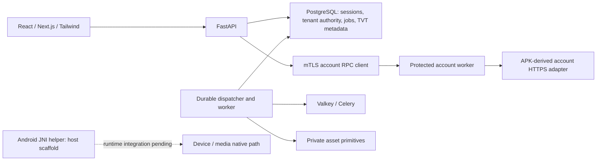

# Service implementation and remaining work

## Git integration checkpoint: 2026-10-11

Main now contains implementation commit `7f94c79` through merge `e454e9a`.
Primary-only research and historical instructions were preserved. Read
[Git integration record](analysis/2026-10-11-git-integration.md) before further
publication. Main frontend600, related Python210 and TypeScript checks passed;
fresh checkout preserved174 hash-qualified paths and nine required metadata
anchors. Private/runtime artifacts remain ignored. These are Git/test gates,
not new hardware or full-service acceptance. Main and feature publication were
verified by remote/local SHA equality; the Git record retains exact commits.
Earlier worktree-only/no-commit pointers are
dated history. R210 runtime evidence and remaining product/test limits below
remain unchanged.

## Latest actual checkpoint: R210, 2026-10-11

Read [R210 live acceptance](analysis/2026-10-11-r210-live-acceptance.md) first.
HEAD6436748 plus retained worktree changes passed the bounded real Chrome live
bug workflow: LOW313.614774s, HIGH311.790688s, RETURN/rapid transitions, ordered
Stop/reconnect and store2 channel2 sanity.244 observed API responses200. Original
runtime/coordinator0, worker/API settled, observation COMPLETE/writer settled,
context/ownedDB/source469/private0 normal cleanup passed; no force. Drops+13LOW/
+117HIGH are recorded. Historical R203slot/R207terminal attribution, twelve-camera/
APK/full-service/broad/runtime typing/publication remain open. Older checkpoints
below are dated history, not current authority. No commit/push was performed.

The following Oct8 research sections are historical. Their permission and
runtime statements are superseded by the latest dated checkpoint above.

## Selected delivery research and actual Chrome access — 2026-10-08

The two parallel research reports are saved and the proposed integrated design
is concrete: [selected APK operations](analysis/2026-10-08-apk-selected-features-research.md),
[incident pipeline](analysis/2026-10-08-cctv-incident-research.md), and
[service/incident design](superpowers/specs/2026-10-08-cctv-service-completion-design.md).
The proposed service-owned source broker separates persistent service grants
from fresh individual web publication grants; it requires a new architecture
review because the current session-owned two-base profile cannot support two
independent AI originals plus two independent web originals. Existing limits
are not silently duplicated/relaxed. MP4 evidence also requires an actual media
validation/storage/Range extension beyond JPEG/PNG assets. None of these new
brokers, model adapters, incident workflows or selected-feature executors was
implemented or runtime accepted while researching and writing the design.

The user selected live12/measurement/lifecycle, recorder playback/export,
capture/local recording/layouts, controls/settings, account/sharing and alarm/files,
and emphasized CCTV abnormal-behavior detection/incidents as the main feature.
Read [incident research](analysis/2026-10-08-cctv-incident-research.md) before
implementing the new ingestion/detection/evidence/incident subsystem. It reuses
the original YOLOX/ByteTrack/temporal-rule scope and distinguishes proposed
models/contracts from measured behavior. Current viewer-scoped streams and
JPEG/PNG assets do not provide a background analysis/archive port by themselves.

[Actual Chrome access test](analysis/2026-10-08-chrome-access-test.md): GPT Chrome
control connected and opened localhost3543 login, but the actual page showed
ERR_CONNECTION_REFUSED. Independent bounded HTTPS3543/HTTP3000 requests also
refused. Error screenshot saved; no certificate bypass, dummy server, product
change or runtime startup occurred. This is no application/CCTV acceptance.
The implementation worktree and Git metadata are read-only under current
permissions; normal runtime writes there are not available. Research/report
work proceeds in the writable primary checkout.

## Original-plan remaining-work audit — 2026-10-08

Current assessment: [Original plans and remaining work](analysis/2026-10-08-original-plans-remaining-work.md).
Read this update with the implementation worktree's canonical report and ledger;
the older primary-checkout snapshots below do not contain its latest source.
Source authority is `codex/superlive-web-service`, HEAD6436748 with63 modified
tracked and79 untracked status entries. All304 paths in its last browser source
approval still match. Main remains at211d148; no merge/publication occurred.

The audit checked SERVICE_PLAN, the original2026-09-21 wider-service plan,
the2026-09-27 APK plan (W00-W25), current multiview plans, source/API routes,
the141-row feature matrix,77-case static seed and actual saved receipts.
Recorded inventory counts remain2 real accepted/12 implemented-unaccepted/
14 partial/109 missing/4 not-applicable; these are unweighted historical feature
groups, not a new full APK re-inventory or completion percentage. MATCHED remains0.

Shared multiview source Tasks1-11 are complete. Actual bounded raw2/raw4 saved
receipts are COMPLETE, and actual Chrome eight/four inventories were verified
in the prior run. Twelve presented streams progressing together for300s,
1/4/12 load measurements, shared focus/lifecycle cases and final normal runtime
acceptance remain open. The latest readback confirms original Chrome exit0/reap;
its old context remains, while the expired overall run remains FAILED. Today's
CIM listening-port query failed, so current process/port liveness is unverified.

Substantial original work remains: account security/sharing writes, recorder
playback/export, capture/local recording, audio/Talk/doorbell, alarms/push,
PTZ/device settings, AI/face/plate, cloud/VAS/Tyco, files/preferences/remote pages,
actual APK comparison and production deployment. The wider plan also retains
sales/OrderQueen, product/wholesale/barcode intake, detection/incident/CLI summary,
mobile/notifications/broadcast and pilot delivery. Foundation models or generic
jobs/assets do not complete those workflows. APK release readiness remainsfalse.

Verification today was source and saved-evidence readback only; no application,
device/browser test, dependency installation or Git integration was executed.
The detailed report contains baselines, evidence, priorities and actual limits.

Analysis date: **2026-10-04 (Asia/Seoul)**. Retained implementation/probe evidence
below is dated2026-10-03 unless a later update is explicitly identified.

## Continuation update — 2026-10-04

### Multi-view stage-1 resumed — 2026-10-05 (Codex controller)

The user requested resumption after reboot checkpoint 2. Current baseline is
`6436748` on `codex/superlive-web-service`, three local commits ahead of the
locally recorded origin branch. Task 1/2 source and tests match their reviewed
tree `46af6579`; the new snapshot `693734b9` includes only three additional
checkpoint documents. The existing PostgreSQL cluster was started successfully
on loopback port57056 with all eight application role logins verified. No new
device/browser acceptance or test rerun is claimed at this resume checkpoint.
Task3 has been dispatched fresh; Tasks4–7 remain pending. Task1/2 changes remain
uncommitted, and stage-1 device acceptance still requires the combined native
review, new receipts and new source approval. Earlier accepted two-channel live
playback does not establish the new twelve-tile stage-1 target.

Task3 has subsequently completed source implementation and independent review
(spec compliant, quality approved, C0/I0/M0; immutable tree `effd7000`). The
main/sub choice is validated through provider, supervisor, child and parent;
matching1281/1285 acknowledgements and exact refusal forwarding preserve
independent codec checks. Author-reported verification:499 synthetic tests
(54 provider,309 socket,136 codec), causal RED41 failures, scoped static gates.
The reviewer checked source and original-owner boundaries without rerunning
tests. The stale renewal comment was corrected to bounded100ms observation.
Task4 is now implementing the10s no-signal outcome and bounded error forwarding.
No new device/browser acceptance or source receipts are granted by this update.

Task4 then completed and independently passed spec/quality review C0/I0/M0 at
tree `20bc7cbd`. R131 corrected the native pre-handoff gap: an accepted open ACK
starts a10s valid-keyframe wait, while decoded-source startup retains its own
10s first-frame bound. Mandatory frame/proof handoff and original cleanup,
authority/refusal/caller deadline precedence remain intact. The typed
`LOCAL_DEVICE_NO_SIGNAL`504 outcome propagates through the central core table,
mTLS/API and strict4096-byte web error projection to fixed Korean panel copy.
Author-reported verification:220 combined Python,33 final source,443 full web,
5 final panel tests and scoped static gates; independent review checked source
without test reruns. Actual response/retirement timing is pending Task7. Task5
is now implementing bounded capacity16 and migration0015. Two source-reviewed
controller measurement helpers are preparation only; original-custodian process
identity metadata and actual measurements remain required.

Task5 implementation is now frozen for independent review at tree `e65e3ec4`.
Real PostgreSQL reproduced the carried RF3 defect: sixteen long startup
transactions exhausted the8+8 pool and sticky-denied an already live lease.
R132 limits those long transactions to8 with a cancellation-aware10s bounded
semaphore, retaining8 slots for authority/control work and active capacity16.
Actor16/global64 and migration0015, native/media16 and RPC32 are implemented.
Root inspected actual SQL receipt `56958a74e0e841d185d90cbc8fed979b`:47 tests,
zero failures/errors/skips, original child reaped, owned DB removed, source DB
unchanged and zero known private occurrences. Author reports409 native and124
media tests plus scoped production static gates; historical runtime static debt
remains explicitly qualified. Review and actual recorder/browser sizing are
still required; no new source receipt or release-readiness claim is granted.

Task5 has now independently passed spec/quality review C0/I0/M0. The reviewer
matched all five SQLreceipt source hashes, immutable0013/0014 and exact0015
downgrade body, and confirmed original-custody/shared-deadline/semaphore
settlement and own-case fixture teardown boundaries. Task6 is implementing
the16-slot web scheduler, sub-grid/main-focus switching and terminal no-signal
UX. Actual twelve-tile playback, recorder substream formats, latency and sizing
remain unaccepted until Task7.

The combined native source review subsequently reproduced a registry race
(C0/I1/M7, seven inherited minor items): concurrent removal of confirmed
predecessors can make mutable-list admission checks omit an uncertain or
sixteenth live original, even under the startup lock. Its deterministic inert
sentinel stopped before SDK/process startup. This supersedes only Task5's
earlier no-overcap conclusion; prior SQL/custody evidence remains dated. A short
registry-lock/snapshot interface is being corrected before any source receipt.
Inherited memory-retention and slow-success limits are explicitly dispositioned
in R133 rather than silently changed.

Task6 code is frozen, but independent review found C0/I1/M0: with18 requested
channels, a busy focus-return replacement can lose its slot to an older ordinary
waiter. A focused pure scheduler probe establishes this source defect; no device
was involved. Author-reported final web455 passes and an intervening existing
account-test454/1 timing failure remain recorded, with the latter root cause
unproven. Native and UI corrections/re-reviews are pending; actual stage-1
capacity, stream/signal behavior and release readiness are still unaccepted.

Native fix1 independently passed C0/I0/M0 at tree `791f2ee9`: short registry
snapshot/append/identity-removal operations cover all production and runtime
consumers; original retirement never acquires the long startup lock. Author
reports464 native/runtime and83 core tests. All seven inherited minor items
were fixed or explicitly qualified underR133, including process-lifetime denied
token retention without a configured registry cap and approved slow-success
return semantics. UI fix1 also independently passed C0/I0/M0: replacement
priority persists through busy with an older ordinary waiter; author reports
51 focused and457 full web tests. Tasks1–6 source gates are now complete.

Task7 remains active. Optional owned-fixture observation metadata is being
prepared underR134 to establish original-process creation identities and safe
validated stream-kind/codec/warning and permit/withheld counts. It changes no
production policy and is not device acceptance. Final review, guarded current
SQL evidence, new LIVE/native receipts, c6 approval and actual1/4/12-tile Chrome
sizing/cleanup remain required. No new runtime or recorder execution occurred.

Root's fresh guarded SQL run `df37f981d8ff466f8edc0a13d3792509` on the corrected
admission source passed47/47 with no errors/skips, original child reaped,
owned DB removed, source DB unchanged and zero known private occurrences.
Current independently reviewed LIVE source and native source closures have new
immutable receipts; native `verify_review` validated12 owned files,14 dependencies
and14 bundle rows without loading SDK or calling devices. The small LIVE pointer
binding update is included in final review. Optional observation code and final
review/c6/device acceptance are still pending, so these source and SQL outcomes
do not establish the12-tile target or release readiness.

R134 observation implementation reached73 synthetic fixture/WebRTC passes and
scoped static gates, but independent review found C0/I1/M0: a blocked final
writer may publish stale clean completion after its bounded close timed out.
Only evidence integrity is affected; original service/native custody is not
retained by that observer. The author is correcting authoritative completion
and late-write failure handling before c6. Controller browser/SQL/process
observers passed their scoped source reviews, while original owner composition
helpers remain under review. No stage-1 recorder/Chrome execution has occurred.

Observation fix1 independently passed C0/I0/M0 at tree `aa734a38`: summary
schema2 carries stop-request only; original worker/runtime terminal records
are authoritative and sticky. Completion requires COMPLETE, actual writer
settlement, zero failures/omissions and canonical summary hash match. A late
final write cannot override FAILED. Author reports76 focused passes and scoped
static gates; no service/device run. Final whole-stage1 review is now running
against plan-start6436748 through the frozen corrected source. c6 generation
and actual recorder/Chrome sizing remain blocked on that final source gate.

Final composition r0 reviewed all57 paths and12,813 diff lines. It confirmed
source and LIVE/native receipt closure and found C0/I1/M1: the generic15s wall
start timer can cancel an otherwise valid typed no-signal outcome at16s (API20s,
client25s), creating retry/cooldown and delaying healthy queued tiles. An inert
probe used the actual scheduler/player, without services/devices. A WebRTC guide
statement also incorrectly excludes approved slow-success returns past expiry.
The single final fix wave is aligning bounded client phases/original-stop wait
and correcting the guide. c6 and actual device/browser execution remain pending.

### Actual stage-1 c6 attempt — 2026-10-05 (failed acceptance)

Final fix1 passed independent C0/I0/M0, and c6 pinned120 source/tool paths.
Root controlled its original isolated Chrome through the GPT Node/CDP tool
(Windows sky native pipe failed prescribed recovery). Normal trusted HTTPS,
synthetic OWNER login, actual recorder inventory8/4 and12 wall tiles succeeded.
Source-valid substream kind2/HEVC video rendered at1280×720 for store1 channel2
and store2 channel1, and704×480 for store1 channel4/store2 channel2. However,
every first start returned503 before retry succeeded, and all four successful
streams later ended with heartbeat404/DENIED. **Four/twelve concurrent playback
and five-minute target acceptance failed.** This does not supersede the earlier
dated two-main-channel acceptance or establish full APK parity.

One-live60s SQL observations were approximately19.6–21.8 transactions/s and
cluster WAL194–223 bytes/s, including measurement overhead; actual browser
frames advanced. Four-load measurement is invalid because streams retired.
Permit lapse/withheld counters stayed0. Parsed native dimensions differed on
some failed initial attempts; cause is not yet established. Read-only causal
diagnoses are running for systematic first503 and later heartbeat404.

Run `local-devices-1fc0e5420e704f4484958f2b0c0ca597` was normally retired:
eight issued leases were CLOSED with cleanup confirmed before shutdown;
original Chrome/coordinator exited0/reaped, API/worker settled, private state
removed, source unchanged, known private occurrences0. Observation completion
passed the independent terminal/hash gate. No sources changed during the run.
PG remains running; app/Chrome test ports3543/9333 are free. Failed-run evidence
and c6 are immutable; fixes/new review/approval are required before a rerun.

Read-only c6 diagnoses reproduced only candidate mechanisms, not the actual
first cause: adapter format/parameter validation can fail before binding, and
renewed expiry reaches the authority gate after its100ms freshness interval.
The retained logs are empty and existing records lack stage/timing/cause details.
No permanently cached startup expiry or recorder-format explanation is proven.
R136 adds default-off fixed-enum first-failure and bounded milestone timing
observations before a new reviewed diagnostic run. Authority/decoder/format/TTL
and retry policies remain unchanged pending causal evidence. Per-start browser
heartbeat timing is also being retained as safe ordinal aggregates.

R136 diagnostic implementation is frozen at tree `51951381` for independent
review:166 focused tests passed with two self-process probes excluded, scoped
Ruff/mypy checks passed. Source-attempt rows retain one fixed-enum first failure
and at most six milestone times; native/peer ordinal joins cover pre-peer
failures. Existing admission/format/decoder/TTL/retry decisions and terminal/hash
gate are preserved. This establishes diagnostic source only, not the actual c6
cause or a successful correction. c7 copies preserve c6 and require both prior
observation and new diagnostic review gates. No new approval or run yet.

R136 independently passed C0/I0/M0; nine authored hashes matched and a focused
snapshot-copy/milestone-bound probe passed. The source verdict confirms closed
privacy enums, callback isolation and preserved original decisions, not actual
root cause. Root is creating immutable c7 for a small recorder reproduction;
c6 evidence/approval stay preserved and full12-tile acceptance remains failed.

### Proven format-transition defect in c7 — 2026-10-06

Reviewed c7 run `local-devices-f9758a95e9194b2782dcf9d3b0db7af4` identified the
actual boundary. First store1/channel2 source began atHEVC352×240, produced a
decoded frame/binding/peer, then failed `adapter/format_changed` at2421ms.
Retry1280×720 remained live over nine minutes with56 successful heartbeats.
Starting another channel on that recorder was followed by the existing source's
format change at567671ms; its next heartbeat failed404 at572098ms. New channel4
likewise failed format change at17016ms, then heartbeat404 at23149ms. Another
recorder's channel remained live. These exact first-cause/timing records establish
format validation as the initiating failure for these attempts; no TTL/cache
policy correction is inferred.

All four issued leases were CLOSED/cleanup-confirmed before retirement; original
Chrome/coordinator exited0, API/worker settled, private context removed, source
unchanged/private0 and observation terminal/hash complete. Source was unchanged
during execution. c6/c7 approvals and evidence remain immutable.

R137 repairs the existing approved live/substream functionality with bounded
source-layer decoder rotation after a fully validated self-contained random-
access picture of the same codec. It retains original native socket/task/proof,
identity-only DecodeBinding and peer, global PTS/ordinal and authority; the exact
old decoder must actually retire before replacement. Transition wait5s, existing
FIFO16/4MiB/latestRGB1 and16 rotations per rolling60s bound churn. Invalid or
foreign frames remain failures. Source implementation is frozen at scoped tree
`20c4a7d7fe0ac45927124af9bd1b484793f6187b`; independent R137 review approved
the scoped source at C0/I0/M0 after verifying all six Python and four integration
guide paths. The author executed 92 combined source/observation/transition cases,
then 21 expanded transition cases, 138 existing Windows synthetic decoder,
worker and WebRTC cases, and one real local VP8 same-peer up/down resolution
case, all passing. Scoped Ruff and strict mypy pass. These are inert/synthetic
source gates; repaired recorder adaptation and twelve-tile acceptance remain
unexecuted. The original retiring decoder stays retained until confirmed closed,
late old output is suppressed, and optional bounded transition diagnostics retain
the existing terminal/hash completion gate. New immutable c8 approval follows
the completed independent review; c6/c7 evidence will remain unchanged. The
reviewer did not execute tests or devices; counts above remain author evidence.

### c8 actual run: transition pressure remains — 2026-10-06

Immutable c8 approval SHA256
`2dc9764cc2c8f2ab13980e940d08ee0db268dc6d096fabd840cee04727878dda`
pinned123 sources. Actual run
`local-devices-fd19103a86ff464081cc9b33930a1675` used normal fixture OWNER login
and trusted installed Chrome without certificate bypass. Both recorders verified
8/4 channels before streaming. The first substream started without retry and
played about150s. Its complete steady60s SQL window measured19.6–21.8 transactions/s
per live stream including observer queries, below the25 target; cluster-wide
WAL was about198–215B/s. This is a one-stream measurement only.

Adding three channels produced seven start attempts: four200/rendered and three
503/UNAVAILABLE. Six source attempts first failed `ingress_queue/overflow`.
The first source changed1280x720 to704x480 at153032ms, allocated its successor,
then overflowed at154735ms before successor output. Other failures occurred
about1.6–1.7s after a transition; one source overflowed during initial decoder
startup without any transition. One704x480-to1280x720 successor produced verified
output and continued until manual stop. R137 therefore removes the original
format rejection and can rotate successfully, but the finite ingress queue
still fails during startup/rotation pressure. The observations establish that
boundary, not a precise CPU, launch or queue-rate explanation; focused diagnosis
is in progress. Four concurrent/12-tile acceptance remains failed.

All seven issued leases CLOSED with confirmed cleanup. Original Chrome and
coordinator exited0/reaped, private context removed/private0. API/worker/source
settled unchanged; observation completion gate passed with terminal COMPLETE
and hash `232e100ba4bf135616bc95eda913437697e66ada107220b81f76298c86d0b052`.
c8 sources/evidence remain immutable. App3543/Chrome9333 are stopped;
PostgreSQL remains running. No repeated device run is planned before a causal
queue-pressure repair and independent review.

R138 design preserves finite memory through explicit producer credit: source
ingress reads only its free frame/byte capacity, and a native parent with queued
media defers consuming another IPC envelope/ACK until the consumer drains it.
Current authority, cancellation, expiry, original sequence and retirement remain
mandatory. Source16frames/4MiB, parent16frames/4MiB and callback256chunks/1MiB
stay unchanged. Pressure waits are bounded at5s or shorter existing deadlines.
Seven isolated inert decoder samples all retired; lazy first decode took
720–1848ms sequentially while constructor and steady decode were much shorter.
These corroborate a finite-queue/launch mismatch, without proving actual recorder
arrival rate. Focused implementation is authorized and in progress. Native
guard review, a new protected receipt and immutable c9 precede another live run;
upstream callback overflow remains a measured-risk question. R138 is now
author-frozen at scoped tree`387bcb12861a615d899dc070e9cb2b3b2590dd43`;75
parent/provider,102 source/transition/observation and139 actual Windows synthetic
decoder/WebRTC/worker cases passed, plus scoped Ruff9/strict mypy3. A faithful
original Source-to-native-parent/remote test preserved40 frames across1.8s blocked
first decoding, without exceeding source16/parent1 or altering pending ACK/order.
The independent scoped/native review approved C0/I0/M0 with all twelve authored
paths matching the frozen tree; this remains source/inert
evidence, not repaired recorder sizing acceptance.

The c8 CPU observer's final very short interval reported an impossible rate for
a newly observed child; no corrected c8 CPU total is asserted. A separate bounded
inert original-child probe reproduced the pre-counter batch-time error, then
verified per-handle counter-read brackets and midpoint intervals at99.807% for
one busy thread. The local controller helper now omits unsampled/short rates
and truncated closing intervals; seven-role original-identity and cleanup gates
remain. Fresh scoped review approved C0/I0/M0 after correcting a minor nonzero
inert-child exit disposal path. CPU aggregates are explicitly
surviving-process rates over individual windows, not an exact simultaneous
family measurement. This correction changes test instrumentation, not application
behavior; c9 will pin the reviewed helper. No full seven-role execution is yet
claimed for the corrected helper.

R138 review SHA256 is
`4854f301a7922227b17b6d0b5b74e51af1ba2259f500bd2bd8d65df5a1b7545e`;
CPU helper final review SHA256 is
`1469b87da537e6ab181156a4edd96bc6204e952c8951c406d567a438b4441db8`.
Root now refreshes the protected native closure and creates immutable c9 before
the authorized actual1/4/12 test. No repeated source tests or guarded SQL run
is required for unchanged admission/migrations; the current47/47 SQL source
gate retains its separate dated receipt.

### c9 actual sizing and remaining failures — 2026-10-06

Run`local-devices-e4c7006dd9664ef7a7d63e0bc4a5fa94` pinned127sources with
approval`bd378ec383f962fbfb82fed314a227c2ec55980b63c4b09b98ddae9b57cba10c`.
Trusted Chrome/normal fixture OWNER verified8/4 channels. Four streams played
concurrently and original same-source HEVC720→704x480→352x240→704x480 changes
produced verified successor output without the prior format/queue failures.
Maximum nine simultaneous tiles rendered. One deliberately stopped tile left
eight for the later steady sizing window. All measured stable60s SQL windows
remain below25tx/s/live:

| Live streams | Stable SQL samples | SQL tx/s/live range | CPU evidence |
| --- | --- | --- | --- |
| 1 | 6 | 19.500–22.065 | Five complete original-owner samples; worker-family surviving-process rates27.449–31.425% of one core, Chrome5.659–8.098% |
| 4 | 6 | 18.861–21.084 | Five complete samples; worker-family56.753–65.490%, Chrome8.883–12.424% |
| 8 | 6 | 19.538–20.850 | Five samples, none fully complete; no whole-family CPU aggregate asserted |

CPU sums use individual per-process counter windows, not an exact simultaneous
family interval or twelve-stream capacity claim. Cluster-wide WAL ranges were
186–450B/s,790–7629B/s and1619–5958B/s respectively; they include other cluster
activity/full-page effects and cannot be assigned wholly to a tile. Memory and
per-process raw safe rows remain in the ignored sizing artifacts; incomplete
eight-load coverage is preserved as a limit, not replaced with invented totals.

Remaining starts on store1channels6/7/8 returned502/PROTOCOL_INVALID. The
[new exact-result diagnosis](analysis/2026-10-06-c9-channel-open-diagnosis.md)
establishes native login handshake/rejected/0x20000030 before inventory or
live-open in eight privately matched child/owner results. APK login code maps
this to BUSY. Parent pipe closure loses that result before the provider maps it.
A post-stop retry also stayed busy; no universal five-connection limit or absent
channel is inferred. R139 preserves the exact bounded original child result
after confirmed reap, then maps only that proven login refusal to429, with
current/cancel/expiry/uncertain-custody precedence. This conditional repair is
explicitly within the approved stage1 sizing scope. Per-tile login architecture
and physical connection limitations remain separate from error classification.

Main focus1280x1936 and return to sub succeeded. Ten rapid focus/return cycles
ended with one current sub for that channel, but three other store1 sources
later failed adapter/timestamp_invalid at their937311/789983/787421ms boundaries.
Their different starts place the events near one overall episode; clock change,
reordering and malformed timestamps remain unproved. Browser instrumentation's
900s lifetime expired before the late focus portion, so its timing/counters do
not cover the complete late test. Native optional observations remained complete.
Store1channels1/3 actually produced valid352x240 substream placeholder video;
the historical main-stream no-signal assumption does not prove substream
NO_SIGNAL acceptance. No black-image heuristic is introduced.

R140 adds default-off first-failure-only bounded timestamp classification and
relative delta, while preserving the exact existing rejection/order/proof/custody.
The [source report](analysis/c9-timestamp-observation-report.md) records135
focused passes/two excluded identity probes, scoped Ruff/format4 and mypy2.
Independent source review approved C0/I0/M0, five selected paths match tree
`a56c67d370f229851615fdc8776603ff9929eaaf`; review digest
`0b1b395c77afdd31eb20ea7c9f354deefeeb4bb5f3bed961e3ccb46960c0ebbf`.
No tests were rerun by the reviewer and no timestamp playback correction is claimed.

All22 leases CLOSED/confirmed(main2/sub20), original Chrome/coordinator exited0
and reaped, API/worker/context settled, source unchanged/private0. Observation
terminal/hash gate passed with COMPLETE digest
`ba4559252e74036d6178afa60c67a8b66b01ab33285fe134eb6bc39356272d21`.
App3543/Chrome9333 stopped; PG runs. Twelve-tile acceptance remains incomplete.
No repeated unchanged device run follows: R139 review/receipt and reviewed R140
diagnostics precede new immutable c10. The public LIVE source manifest is also
being made portable, replacing its ignored-only source-code dependency with an
exact public copy and narrowly pinned existing line endings; private SDK and
runtime/provider approval artifacts remain private.

R139 is author-frozen at selected tree`dbbf2c277ea100f517f2e40a650184d6aff53999`.
Sixteen faithful original-child BUSY/negative/custody cases passed; the initial
443-case native/provider/inventory selection had429 passes/14 failures. Four
stale LIVE pins and one test's prematurely aborted exact-owner cleanup caused
the recorded failures/cascade. Targeted corrected pin4 and full provider/inventory
112 cases passed; unchanged311 native cases and16 new cases had passed in the
initial selection. No combined443 all-green rerun is claimed. Public receipt
pointer4 cases, scoped Ruff/format5 and strict mypy2 passed after the portable
pointer update. Fresh native review approved C0/I0/M0; nine selected paths match
the frozen tree. The public manifest preserves
exact be556205… bytes and the four referenced files' existing line endings;
no source content or old receipt was hidden or overwritten.

R139 review SHA256`86a5fece16e5e2bb8d032217882a23b99a067c955a9477313878020d6d1500aa`.
Recovery remains conditional on a completed exact-original result after reap;
missing/partial alternate interleavings retain502, with no grant. The public
manifest's review digest878244… is a historical snapshot, explicitly matching
immutable c6/c7/c8 native-review source pins. It does not assert that the current
append-only native report has those bytes. New c10 pins current source/reviews;
old receipts are unchanged. Reviewed R140 metadata and R139 classification now
permit a new bounded actual diagnostic run after protected native closure.

### c10 actual diagnosis, failed cleanup and reviewed corrections — 2026-10-06

Run`local-devices-39e833ce10b1449db3865e3cc87a5b49` pinned133sources;
approval`ad14894ef8d63fde7ef63723da607a9fa9aef180418ad96984ff93126be53f15`,
native receipt`0e7880d69bfec43f2286ec70fda044acb350d0fbc941e75661a485e955dac7d4`.
Normal fixture OWNER/trusted Chrome verified8/4channels. Five sources rendered,
main/sub switching and ten rapid cycles returned to a current substream.
Actual login BUSY now returned429/LOCAL_DEVICE_BUSY, not the former502; one
snapshot recorded12 such refusals and no metadata failures. A repeated oldest
BUSY target then starved later ready requests: sixLIVE/sixqueued, including
otherwise unreached second-recorder targets. This is a scheduler issue, not
proof those targets were themselves refused. Browser observation's900s limit
again excludes the late long-hold portion; no complete client timing claim.

The later hold lasted306.8s on main before return to sub. Source4/store1channel3
failed the original timestamp guard at1002342ms with qualified metadata
`duplicate/delta_us0/not-saturated`, observation failures0. This proves equality
of derived timestamps; payload replay, identical original ticks and c9 subtypes
remain unknown. The private codec already enforces strict wire frame indices and
quantizes device time to milliseconds. Targeted APK Java callback evidence
contains no equality fence; native player details remain opaque. See
[duplicate-time diagnosis](analysis/c10-duplicate-timestamp-diagnosis.md).

Normal all-stop did not settle:67issued leases comprised66CLOSED and one
STOPPING/unconfirmed. API exited0; the worker repeatedly returnedFalse from
LocalMediaWorker.shutdown. Read-only21-thread stacks locate the disposer at
runtime.settle_media:611 before native/admission shutdown. Permanent quarantine
and a pending async barrier were not distinguished by that evidence. See
[shutdown diagnosis](analysis/2026-10-06-c10-shutdown-diagnosis.md).

Existing cleanup controls were exhausted. A separately reviewed original-handle
recovery first corrected a failed-query-as-empty descendant gate. Final review
C0/I0/M0, digest`4c5cecec41073a111cc58c54e5ed85c2a402562e97b3bfd0b40dd30ec0c62da9`,
approved only an exact duplicate of the runtime's retained original worker
kernel handle, original births/parent provenance, zeroJobs/noactiveapplication
descendants and one canonical Microsoft-signed direct console host. Root's
bound approval digest`03596d4e1c064fda2ab03635be714b5db4885983ac37c92a0cff680352a63b04`
permitted one worker termination0x57534F01. Worker and console exited; no console,
Job, process-tree or PID-reacquired signal was sent. Original coordinator
exited1/reaped, private context removed/source unchanged/private0. Resources
record APIsettledtrue/workerSettledfalse and no completed observation terminal.
This is **FAILED exceptional retirement with unconfirmed media cleanup**, not
normal CLOSED confirmation or accepted cleanup. The67/66/1 snapshot is preserved.

R141 repairs BUSY head starvation with per-target3/6/12/15s parks, eligible
priority/FIFO selection, explicit replacement-slot reservations, stale-timer
fences and unchanged original Stop/runtime/player composition. Author126focused
and one fullweb481cases passed, plus lint/typegen/tsc. Independent source review
C0/I0/M0 at tree`1ecbae2f1c384536e000d4ac45163d0082e56895`;
digest`7c84ebd9a8e1ede7daf9249ee6886364c9848bf316d7597ea606f8e98142583b`.
[Implementation evidence](analysis/c10-busy-scheduler-report.md) retains the
global429 aggregate retry tradeoff and backend capacity/custody gates.

R142 separates raw derived time from presentation time. Missing/invalid/raw
regression remain rejected; equal raw values reach full existing media/proof
validation. Every accepted later packet maps max(raw,lastMapped+24us), rejects
int64 overflow before state commit, and preserves raw evidence, native wire
frame-index checks, lifetime ordering and original decoder/peer/custody. The24us
minimum preserves distinct exact90kHz conversion across signed zero. Author163
focusedsource cases/two identity exclusions,12 portabledecoder cases and one
actual synthetic same-peerVP8/RTP proof passed(received0/2/4/6 for four equalraw
frames), plus scoped static checks. Independent review C0/I0/M0 at the same
tree; digest`44b1487a9556830c0087aa5648ba49b7c4c6b3c21913f7c401bba63907aa4cc5`.
[Implementation evidence](analysis/c10-duplicate-timestamp-report.md) separates
synthetic reception from actual recorder acceptance. Reviewers did not rerun
author tests. These fixes neither rewrite c10 nor prove twelve-tile success.
The c11 continuation below supersedes this pre-execution checkpoint. Native
closure was unchanged by the frontend/source fixes.

### c11 actual continuation and normal retirement — 2026-10-06

Source baseline remains HEAD `6436748` plus the reviewed, uncommitted stage-1
changes. Run `local-devices-6480f49c264246779e1fd209d4a1b72b` used the immutable
140-source approval `4844c47eb8c341d2c18034638b810c861a9970731c9ca50ba5827fda61461d32`
and native receipt `0e7880d69bfec43f2286ec70fda044acb350d0fbc941e75661a485e955dac7d4`.
Normal fixture OWNER login, trusted installed Chrome and recorder inventories
of eight/four channels preceded live requests. At elapsed356.080s, the saved
browser observation records nine presented substreams: store1 channels1–5 and
store2 channels1–4. Store1 BUSY requests no longer prevented later store2 starts.
This is executed fairness evidence, not a twelve-channel capacity result.

The snapshot records nine successful starts,32 BUSY429 and two protocol502
responses. Start API latency p50/p95 was5.857/7.722s; first presented frame
p50/p95 was6.233/8.036s, nine samples each. These are one short run's samples,
not deployment guarantees. Store1 decoded352×240 and store2 decoded704×480.
Store1 channels1/3 provided valid substream frames; assigning NO_SIGNAL to
these frames would contradict observed media. Every snapshot source was still
playing, with observed video times214.946–295.396s. This snapshot alone does
**not** establish five minutes on every channel or long-duration timestamp
acceptance. Browser observation expires at900s and the subsequent uncontrolled
hold ended with login-session expiry; no final client timing record survived.

Before server shutdown, the owned SQL query found201 issued leases, allCLOSED
with confirmed cleanup. Original Chrome exited0/reaped. The durable owned
shutdown then retired the original coordinator0/reaped, API and worker settled,
private context removed, source unchanged and known private occurrences0.
This normal c11 cleanup does not repair c10's historical unconfirmed lease.

Observation acceptance failed separately: final resources report FAILED with
writer settled,6850 observation failures and snapshot digest
`0c10f5c5f1ebca05db365919680b9f04cd503fae84680d59e006a97b23fc2844`.
The last persisted intermediate snapshot has schema2,90 attempts, nine peers
and zero reported failures, but `stop_requested=false`. The terminal digest
matches that early snapshot. Its65055-byte publication approaches the existing
65536-byte writer limit; the final snapshot was not published. It cannot
satisfy the completed terminal/hash gate. Observer capacity and remaining502
results are being diagnosed; no COMPLETE observer or fully validated R142
long-hold claim is made. Ports3543/9333 have no listeners; only owned PostgreSQL remains.
No stage-1 commit, push, production acceptance or APK MATCHED status follows.

The [native-open diagnosis](analysis/2026-10-06-c11-native-open-diagnosis.md)
subsequently verified203 original results (two inventory and201 live),192
failed parent summaries all reaped with nonempty same-generation results:
190 known login BUSY and two non-BUSY failures before login. The two browser502
responses correspond to native connect=-1 and greeting return!=64 after a
successful transport connect. No inventory/open/send happened in either.
Exact native cause beyond these boundaries is unknown; neither justifies
generic502-to429 remapping. R139 did not lose a BUSY receipt in this run.
The [observation diagnosis](analysis/2026-10-06-c11-observation-diagnosis.md)
separately verifies the full approved launch/import/source-preservation chain
and the independent writer-budget defect. It provides no per-branch R142
execution telemetry and does not convert the frozen early snapshot to COMPLETE.

R143 is implemented and frozen for independent review: dedicated compact
canonical observation snapshots have a1MiB cap; the borrowed context writer's
64KiB cap and4KiB terminal reader are unchanged. The256/256/256 roster with
16 formats/six milestones/64bit counter envelope serializes to809267bytes;
conservative row-width arithmetic gives809807. This is a measured finite
design envelope, not a universal bound on arbitrary Python integers. Oversize
representations still fail closed before replacing the previous snapshot.
Author79 focused cases/two existing process-probe deselections and one maximum
envelope follow-up pass; scoped Ruff2/format2/strictmypyhelper1 pass. These are
offline author results; no repaired actual run yet. See the
[fix report](analysis/c11-observation-fix-report.md). A fresh reviewer owns the
current source gate at tree`cb0f0454363211d072522367be0bd4f58c16ade7`.

Fresh R143 review is now SPEC compliant/QUALITY approved, Current open counts
C0/I0/M0. All three source hashes and the portable fix report match that
candidate; the reviewer performed source/test-evidence inspection without
rerunning tests or runtime. A new immutablec12 is being created for actual
observer completion, continuous playback, switching and original-owner cleanup.
Inherited private parent ACL trust remains unchanged. Source gates alone do
not satisfy the actual twelve-tile target.

### c12 actual playback, sizing and COMPLETE retirement — 2026-10-06

Run`local-devices-790c686c772b4fe29db973dce986901a` pinned146 sources at
approval`d6cdf6e25790d751a51d7d7f6ec2beee03a6d0253220ff59e96efa0c8ef3cf5b`,
with native receipt`0e7880d69bfec43f2286ec70fda044acb350d0fbc941e75661a485e955dac7d4`.
Normal OWNER login and8/4-channel inventories preceded GPT-controlled trusted
Chrome playback, without certificate bypass. All twelve targets were requested;
nine rendered substreams (S1channels1–5,S2channels1–4), with remaining targets
BUSY or failed. Cancelling those pending targets gave a stable sizing window.

Nine videos all progressed during one common300.849s interval: total frame
deltas3008–3009 each, dropped deltas0–187 each. Total frames include dropped
frames; these are not nine lossless presentation counts. Initial nine starts
have API p50/p95=2.555/3.035s and first observed presentation3.025/3.391s.
Actual main focus rendered1280×1936, return rendered352×240, and ten rapid
focus/return click pairs ended with nine PLAYING subleases and one current
substream on the focused channel. This is not ten successful main-open cycles:
SQL issued three main leases, of which only one reached native OPEN_RETURNED.

Six stable9-stream SQL samples in60s measured19.722–20.789tx/s/live and
cluster-wide WAL1801.6–5707.2B/s. Five CPU counter samples had complete original
seven-role/descendant coverage: worker-family114.457–121.497% of one core,
Chrome-family10.932–14.024%; private memory728.1–734.3MiB/627.4–642.6MiB.
These sums use individual observed-process windows, not one simultaneous
family-wide window. They do not establish production or twelve-stream sizing.

Live-test elapsed1091.280s ended with nine progressing videos. Focus remounted
video elements, so their currentTime cannot identify native-source age. The
retained native/source records have no timestamp_invalid, queue overflow or
format_changed first failure. Expected stop/cancel outcomes comprise eleven
peer close_scheduled and one peer_connection connection_closed, alongside70
BUSY and eight startup protocol failures. The latter's c12 native cause has not
been independently projected; c11 connect/greeting results must not be reused
as c12 proof. No per-branch equal-time normalization telemetry was retained.
Browser observation window1 was saved/retired before900s and a separate window2
installed; timings are reported per window, without a combined-latency claim.

All-stop produced90 leases allCLOSED/confirmed (main3/sub87); the UI showed
zero live/queued. Original Chrome/coordinator exited0/reaped, API/worker settled,
context and owned database removed, source database preserved, approved source
unchanged and known private occurrences0. Final observer has schema2/stoptrue,
90 attempts/sources,12 peers, zero failures and zero omissions; terminal
COMPLETE/writer_settledtrue and strict complete_observation() returnedTrue,
digest`ccd899a5be25a7d53776cc8131948a0cfe0924460df526d7175fb3d197975ff2`.
Its45511-byte compact snapshot would occupy71089bytes in the previous pretty
encoding, exceeding the old64KiB limit. This is actual R143 publication and
normal cleanup acceptance; it neither rewrites c10/c11 nor meets the12-tile
target. Tasks1–6 are implemented/reviewed; Task7 retains that capacity gap.
The next architectural design is per-recorder multiplexing, already excluded
from stage1. Full service release_ready=false and APK MATCHED0 remain unchanged.

The [independent c12 acceptance audit](analysis/2026-10-06-multiview-stage1-acceptance.md)
verified the saved frame, SQL/CPU, source/terminal and database artifacts without
rerunning tests or accessing recorders. It records the original Chrome0/reaped
event as Root's retained-launch tool observation; the launcher did not persist
a separate final child receipt. No PID rediscovery was used. Post-retirement
documentation changes are distinct from the frozen146-source run.

### Stage2 architectural proposal — 2026-10-06

The [written shared-recorder design](superpowers/specs/2026-10-06-multiview-stage2-shared-recorder-design.md)
proposes two actor/session recorder masters with immutable substream slots,
separate channel retention/publication authority, honest viewer-versus-native
cleanup and one bounded dedicated main owner. Parked tasks continue consuming
upstream resources; authority revocation may retire the whole recorder master.
These are explicit proposed product/resource tradeoffs, not current behavior.
No shared provider, new schema/dependency or native probe has been implemented.

The [independent design review](analysis/2026-10-06-multiview-stage2-design-review.md)
found C0/I3/M1 on the first draft: inherited timing overclaim, pre-admission
buffer provenance and sole-viewer focus/return authority gaps, plus proof-stage
clarification. The revised spec qualifies R120/R133 slow-success timing,
requires exact-child local ingress cuts across callback/IPC/partial assembly,
and defines nonrenewable20s transition references across both focus gaps.
RETURN_PENDING atomically consumes MAIN_ACTIVE before main Stop. Camera/SDK
capture freshness remains unknown; only application-retained pre-cut bytes are
excluded. One presented functional handoff and ten cancellation request pairs
are separate acceptance cases. Latest spec SHA
`036908e32cbb72024e340d8a3fc3e298838e69e1c19db14427a2fafbad5e53ee`
is frozen for scoped re-review. User written-spec approval is required by
Superpowers brainstorming and stage1's explicit architectural scope boundary
before writing a stage2 implementation plan. It does not change release readiness.

Scoped re-review has now approved that exact final SHA: SPEC compliant/QUALITY
approved as a gated design, C0/I0/M0. Initial C0/I3/M1 findings remain in the
review history. No tests or runtime actions accompanied this paper review.
Written-spec user approval and all implementation/probe/12-tile gates remain
pending; the completed stage1 outcomes and unresolved capacity target are unchanged.

### Stage2 written-spec approval and planning — 2026-10-06

The user replied "진행해 승인" to the written shared-recorder design approval
question. Approval therefore covers the independently reviewed spec036908e3,
including its parked-resource and dedicated-main tradeoffs. This supersedes the
earlier pending design decision; it authorizes detailed plan writing. Root is
using Superpowers writing-plans, preserving the existing main/subagent execution
preference and approved Windows/React/Python/Tailwind stack. Native and SQL/API
source facts are being mapped in parallel read-only tasks; Root owns the plan
and its self-review. No new product source/dependency, native probe, schema
migration or runtime execution has occurred. The actual twelve-camera gate
remains open until reviewed implementation and owned acceptance succeed.

### Detailed stage2 plan saved and self-reviewed — 2026-10-06

Root saved the [twelve-task implementation plan](superpowers/plans/2026-10-06-multiview-stage2-shared-recorder-plan.md)
after the user's written-spec approval. Its native and SQL/API fact maps were
independent read-only source lookups, not implementation or delegated plan
review; Root performed the writing-plans self-review. Current baseline remains
HEAD6436748 plus uncommitted stage1R143, in the established Windows worktree.

The plan defines separate codec/callback/IPC/custody,0016 authority admission,
epoch coordinator, provider/media, strict API/BFF/UI and controller acceptance
tasks. It names future private types/functions, scope-specific grants/receipts,
post-cut frame contracts, short SQL startup transactions, persistent clocks,
explicit memory/Job limits,20s focus reservations, source/receipt gates and
owned2/4-task probes before12-camera acceptance. Proposed API/types are clearly
future implementation decisions; they are not current routes or a native proof.
Public legacy MediaLease remains unchanged and cleanup evidence stays internal.

Self-review corrected nonexistent adapter/protobuf names, distinguished master
login proof from channel permission, qualified cut admission expiry versus
renewed viewer lifetime, identified the actual runtime worker supervisor and
serialized shared file owners. Tasks1–6 are sequential; disjoint provider/media/
API follow in parallel. Existing main/subagent preference is preserved.

Verification here was UTF-8 source/document reads, scope/type/path comparison,
spec SHA and plan structure/whitespace checks. No source test, native DLL call,
SQL migration/probe, browser/runtime, installation, Git stage/commit/push or
production action was executed. Source mappings and future code assertions are
not executed acceptance. Superpowers writing-plans requires review of this now
concrete implementation plan before implementation; that plan review is pending.
The approved spec and historical nine-stream c12 outcomes are unchanged.

Plan structure verification completed with12 contiguous Tasks/12 Files/12
Interfaces blocks and seven completed Root self-review checks. No trailing
whitespace; `git diff --check` passed and the actual Git index was unchanged.
Saved plan SHA256 is
`122796f66f2b41061e6488b6e2d92ebe754d34e2e02c129ef13de5abc559c3f9`;
the approved spec SHA remained036908e3. Root presented that concrete plan for
the required review, preserving the prior execution method. No response to the
plan-review question has been received at this checkpoint; elapsed time is
not implementation authorization. These checks concern documentation structure,
not a passing source/runtime test or a completed twelve-camera service.

### Stage2 implementation authorized and Task1 started — 2026-10-06

The user approved plan122796f6 with "승인 진행해". Root started Superpowers
subagent-driven execution in the verified existing linked worktree (not main
or a submodule), preserving stage1 changes and the selected method. Plan-specific
ledger/brief/review workspace is
`.superpowers/sdd/2026-10-06-multiview-stage2-shared-recorder-plan/`.
Older pending-approval notes remain historical, superseded by this actual answer.

Root preflight records one row per task and shared file/interface pair. R145
resolves a forward-definition defect: pure scope/grant/cleanup/reservation types
referenced by native Task4 must be defined in Task1, with the exact approved
fields and stdlib-only native import closure. SQL protected mint/authorization
stays Task5; original budget stays4, coordinator6. This changes definition order,
not authority, native behavior or cleanup claims. Root snapshots use a temporary
index; actual Git index/HEAD are unchanged.

Fresh native/core implementer `stage2_task1_codec` is active from source tree
220d6d03ee4cce02f9a4f14757c4677e0c34a134. It owns the new immutable mux codec,
private types/tests and codec guide, with watched RED/GREEN, legacy regressions
and scoped static checks before a fresh independent review. At this checkpoint
no task is complete, no new test outcome is claimed and no source/runtime/native
receipt, SQL migration, decoder/recorder or Chrome execution is authorized by
implementation progress alone. Source-pinned runtime ports3543/9333 had zero
listeners at preflight; PostgreSQL remains the existing owned cluster.

### Stage2 Task1 source frozen for independent review — 2026-10-06

Task1 delivered separate MultiplexLiveCodec, byte-span provenance across raw/
fragment assembly, per-channel immutable slots and persistent raw/mapped clocks,
plus pure stdlib scope/grant/cleanup/reservation/port definitions. Legacy
local_live.py is unchanged. New source/test/guide closure is4 files at tree
fd77f3fc9609f46a6fb40f5b554b4b2f93d9e19f; codec7e4b977e/types e9132f59/
tests d348642d/guide53e66bd0. The
[codec guide](integrations/tvt-local-live-mux-codec.md) distinguishes absent wire
task fencing from the immutable-original-slot assertion and the later proof gates.

Author watched18 behavioral RED failures, then154 GREEN and182 final cases
(46 mux/136 unchanged legacy), scoped Ruff and mypy2 with follow-imports=silent,
and isolated Python -I/-S stdlib/core import closure. These are attributed focused
development results, not Root reruns or independent runtime acceptance. Fresh
reviewer stage2_task1_review owns SPEC/QUALITY at that exact frozen delta; Task1
is not complete until the source review gate closes. Actual callback stamping,
purpose-bound IPC cuts/filtering, grant issuer/current checks, native memory/
custody and SQL authority remain later tasks. No hardware/decoder/SQL/Chrome,
new native source/runtime receipt or twelve-stream acceptance has occurred.

Task1 independent source review has closed SPEC compliant/QUALITY approved
C0/I0/M0 on the four frozen hashes at fd77f3fc. It inspected report/diff/tests
and targeted unchanged source context without rerunning suites or native/SQL
operations. Root marked Task1 complete in the execution ledger and dispatched
fresh Task2 callback implementer from BASE12b3a8e384fc13d26985f019746b9d5ce0ea4f56.
R146 adds one-shot same-generation mux epoch binding to CallbackOwner before
cut creation, since its legacy handle/generation alone does not identify a
slot's original session. It does not authorize slots or replace the later
parent/provider grant and original-custody checks. This is a definition-order/
identity refinement under the approved spec, not another wire task fence.

Read-only host inventory reported15.6GiB physical RAM/12logical processors.
The proposed9.5GiB worst-case profile is not qualified by RAM capacity alone;
free/headroom and Windows Job/cold-load proof remain Task4/12. New source review
does not refresh historical SDK/native receipts or establish actual mux playback.

### Stage2 Task2 callback source frozen — 2026-10-06

Task2 added one-shot exact mux epoch binding, a separate256chunk/1MiB FIFO,
pre-copy ingress ordinals and typed batch/cut methods on original CallbackOwner.
Legacy take/live-batch/first-claim behavior remains in legacy mode. Copy-time
generation/context invalidation was caught by a separate causal RED and fixed
with post-copy checks before enqueue. Cut uses that same original guard and
binds epoch/slot/registration/control sequence/expiry; it does not authorize a
slot, prove a native task fence or supply camera capture time.

Author reports27 initial RED failures,54 focused GREEN, then2 copy-time RED
failures and56 final cases (35 new/21 legacy,294 deselected), scoped Ruff/format/
mypy and the actual bootstrap import path. Source-root-only isolation failed
on existing cryptography; using the existing approved venv third root succeeded
without BOOTSTRAP/main/SDK/Job execution. That import check preceded the final
function-body-only race fix; imports were unchanged. This differs from Task1's
pure stdlib closure and is not an attempt to remove an existing dependency.

Frozen worker3bf42605aa04f405df4285c8848f824ecb6845cff5e81aab1e44a7763871e07e
and callback tests e38cae54601179a17c44e25ff57a8810411b42b069aa88c790112ff2263b71ee
are frozen for independent review at tree30e898e5aa8ae189f831eadf430f8607444eb9a6;
the source gate is pending. Task1 hashes remain unchanged. Actual original
login/custody, purpose/grant/registered-slot controls and shared downstream
credits/cut eligibility remain Tasks3/4/5/7/8. No device/native DLL/SQL/Chrome/
decoder/receipt or twelve-camera acceptance occurred.

Task2 independent SPEC/QUALITY review closed C0/I0/M0 on the exact worker/test
hashes at30e898e5. Copy/cut concurrency, terminal races, retained credit/original
identity and legacy isolation were inspected; no suites or native/SQL/browser
were rerun by the reviewer. Root marked Task2 complete and handed the worker
file to fresh Task3 implementer at BASE8af7c6c57c2032aa7c22a37d833c3a380b8aee3a.
Task3 now implements bounded purpose-specific private IPC, original cut replies,
frame-byte provenance and shared credit. Parent/remote authority may not trust
a constructed cut/grant/frame or generic boolean as provenance. Source/core
Task1 remains frozen; actual original login/SQL/OS custody and recorder proof
are still later gates. No task source gate closes those actual outcomes.

Task3 causal RED established14 missing-IPC behavioral cases. Integration found
the Task1 batch feed could materialize many coalesced frames before parent
credit checks. R147 separates bounded unclassified raw callback/envelope storage
from classified per-slot picture credit, without claiming semantic picture
counts from unknown raw bytes. A narrow core integration adds optional reserve,
bounded one-result feed/drain and exact pending raw capacity/provenance; no-credit
retains the head without advancing format/clock/ordinal. Trusted picture storage
is reserved before materialization; late parsing/authority failure must settle
the exact pending reservation. Parent IPC retains one raw owner and no second
wire framer or hidden FIFO. Existing no-reserve behavior remains unchanged.
Original Task1 author owns only core codec/test/guide, while Task3 owns IPC/worker
in parallel. Both require scoped source and actual coupled inert credit review
before Task3 completion. No native/hardware/memory profile acceptance follows.

Task3 author reports43 provisional coupled IPC cases after watched missing-IPC/
dispatch RED failures and R147 integration. Those are not frozen/reviewed final
results. Further inspection identified fragment transfer's extend-before-delete
transient copy. R148 requires explicit paired reserve_scratch/release_scratch
hooks before allocation, charged against the shared1GiB host ledger. Logical
raw input/assembly/headers remain<=1MiB; bounded extra transfer scratch<=1MiB
is temporary, not another queued head/FIFO. No-credit preserves head/provenance,
current/cancel/pressure wins, and exactly reserved scratch releases in finally.
These costs do not bypass per-slot16pictures/4MiB classified credit. Credit-mode
fragment handling without paired hooks fails closed; unchanged default legacy
feed remains compatible. Both authors continue concrete allocation/cancellation
tests; independent core/IPC source review and actual resource probes remain open.

R147/R148 core delta is now frozen and independently SPEC/QUALITY approved
C0/I0/M0. Codec077fae6c858996542df03b5f391bc1c8dc50641347fdf67e146f206954f535ad,
tests e961e3d5/guide2eb5e56c match the reviewed three-path correction; pure types
and legacy codec are unchanged. Author reports194 focused cases (58mux/136legacy),
causal allocation/drain/scratch/exception RED checks, scoped Ruff and mypy1.
Reviewer inspected pre-credit allocation, provenance/raw/scratch accounting,
view release, current/denial/reentry and cleanup without rerunning tests.

Task3 host ledger must still compose exact pending-claim rollback, fixed raw IPC
staging, scratch and encoded/RGB/conversion charges. Its conservative8MiB raw
staging per original is a derived admission reservation, not measured OS memory:
callback/remote batch/serialization/parent/codec copies must fit it, and it only
releases after exact original plus IPC settlement. Core logical1MiB/scratch1MiB
are not a claim that all IPC processes collectively use only2MiB. Pressure,
cancel, returned-frame retention and actual memory/Job/recorder gates remain open.

### Stage2 Task3 source frozen for composition review — 2026-10-06

Task3 implements strict private binary IPC with closed bounded metadata,
original generation/session/sequence/purpose/slot/registration/deadline checks,
retained cut identity and original-owner binding. It consumes the reviewed
core preallocation/drain/scratch hooks; no private wire seal is imported to
construct a claimed frame. Codec is the only wire framer. Parent queued and
returned pictures retain exact encoded credit until release; pressure/current/
cancel/expiry fences the epoch instead of dropping active pictures.

Its raw staging model is explicitly8MiB/original: callback1, held remote batch1,
remote slice/response2, parent receive/decoded payload2, feed tail1 and codec
retention1 MiB. Binary bodies avoid base64 expansion; JSON metadata<=4092bytes,
total envelope<=1MiB. This is a conservative live-byte reservation, excluding
opaque SDK/OS pipe/object allocator costs; it is not measured process/RSS use.
Exact additional fragment scratch and classified encoded credit share the1GiB
host ledger. Task8 still needs to integrate RGB/conversion into that authority.
Fixed raw staging remains charged until exact original and IPC settle; caller-
returned pictures remain charged afterward. Inert confirmed flags are not
actual OS custody proof.

Author reports watched missing-IPC/dispatch and blocked-supplier caller-expiry
RED cases, then60 final cases (51IPC/9legacypressure) and7 selected provider
cases/59deselected, scoped Ruff3/mypy2 and imports. New worker change is inert
make_mux_dispatch only; default legacy main/native path is unchanged. Frozen
IPC d9ec9ce9/worker71160cbe/tests77a9abf8 at tree188cc8b217cf88ea5eb4cd8c4999b4c342da863a
are undergoing fresh Task3 composition review. No SDK/SQL/native process,
decoder/browser/recorder memory/12-stream acceptance was performed. Registered
actual custody, SQL grant issuers and runtime wiring remain future tasks.

Task3 fresh r0 review requires changes, C0/I3/M0. Three narrowly focused inert
probes reproduced source faults: final VIEWER denial after dequeue left an
unreturned frame held/charged; pump did not retain its shorter caller deadline
across a blocked codec authority callback, so the watchdog did not stop until
callback return; first-key cut expiry was checked before, rather than after,
the final authority callback. Root verified the corresponding source ranges.
The reviewer did not rerun a suite or SDK/SQL/native operations and preserved
the frozen r0 hashes.

The author is implementing scoped R1 causal tests and corrections: local staged
read ownership until successful handoff/refund on failure, whole-pump durable
deadline/cancel context with nested RPC restoring its outer guard, and a final
first-key cut check before activation/handoff. Already returned caller frames
remain charged; consumed cut expiry does not replace ongoing viewer authority.
Task3 remains incomplete until fresh re-review closes these important findings;
no later task/hardware gate is advanced to conceal them.

Task3 R1 now freezes two-path IPC/test correction at tree
0c34545be38af48d74ac3d41862f35952da2508d (IPCd252997b/tests8792b989).
Author watched7 causal RED cases plus an already-correct ongoing-viewer case,
then8 targeted GREEN and69 final cases (60IPC/9pressure), scoped Ruff2/mypy1.
Transactional queue ownership defers handoff/activation until final authority
and exact prefix/cut validation; whole-operation minimum deadline/cancellation
persists through codec callbacks and nested RPC; first-key read/watchdog is
clipped to cut expiry before and after suppliers. Threaded tests observe the
inert original stopped before releasing a blocked supplier, not actual native
Job/Popen termination. Prior caller-returned frame credit remains charged.
Worker/core/type hashes stayed unchanged. Fresh scoped reviewer owns the r1
gate; Task3 remains incomplete pending that result, with all actual gates open.

Scoped Task3 R1 review closed the original read-handoff and initial-cut findings
and fixed deadline-triggered Stop, but leaves C0/I1/M0 on actual active-operation
settlement. A focused inert probe observed close/confirmed_closed=True with a
reader and supplier still blocked, operation context retained and host credit
already refunded. The native inert owner flag cannot settle the retained reader
stack's payloads or IPC operation. Root verified close/confirmed_closed source;
no suite or native operation ran in review.

R2 is now scoped to independent active operation/supplier ownership: fence and
request original Stop immediately, but defer relevant buffer/credit/IPC/staging
refund and confirmation until actual stacks unwind. A reentrant RLock acquisition
is not quiescence proof; same-thread close must not confirm its own active call.
Already returned caller credit remains separately owned until release. The new
regression must assert false cleanup and retained applicable credit before
releasing the blocked supplier, then actual settled refund after it returns.
Task3 remains open; Root will not advance native ownership/hardware gates before
fresh scoped review closes this remaining important defect.

Task3 R2 now freezes IPC268e45d2/tests82499033 at tree96e6c39a2ec544a62a08c52cb2b4f6f2d80b9cbd.
Author watched4 causal settlement RED cases, then4 focused GREEN and73 final
cases (64IPC/9pressure), scoped Ruff2/mypy1. Each active invocation/supplier
has a separately tracked identity under a lifecycle lock; failure fences/Stops
immediately but cannot certify IPC/raw/encoded/scratch settlement while those
owners remain. Same-thread reentrant close returnsFalse, and queued/unreturned
credit refunds only at actual last unwind. Old caller-returned frames remain
separate until explicit release. Unwound exception cause/context payload frames
are cleared before final token refund; active outer calls retain their tokens.
Before-release tests assert false confirmation, live thread, unchanged credit
and open IPC for staged read and actual codec encoded/scratch suppliers. These
are inert Python ownership observations, not real Popen/Job retirement.
The final remaining-I2 source review is active; Task3 is still not complete.

Task3 final scoped R2 review closed SPEC compliant/QUALITY approved C0/I0/M0,
with six frozen source/spec identities verified. The remaining active-operation
custody defect is resolved; earlier read/cut/deadline fixes stay closed. No suite,
native process, SDK/SQL/decoder/browser probe was repeated by that reviewer.
Root marked Task3 complete and preserved r0/r1 failure history rather than
rewriting it. This closes source composition, not actual native original cleanup.

Fresh Task4 implementer starts at BASEaac9d983113c7b3dab77b15e7c219380c0c71167.
It owns original Windows provider launch, a sealed2base/1main budget and new
512MiB native Job profile. Existing original registry/Job-before-input ordering,
global uncertain custody, no PID adoption and exact issuer/scope/native parent
quiescence remain required. Plan-authorized inert owned Windows children can
verify Kernel Job flags/nested compatibility; real DLL/device and sustained
resource qualification remain later gates. No new Task4 result is claimed yet.

Task4 inspection found a concrete launch composition gap: current worker main
accepts the legacy provider wrapper, while Task3 supplies a bounded inner mux
packet and an inert dispatch factory, not an actual shared SDK session runner.
R149 requires a strict original provider/config/receipt/generation/Job/deadline/
IPC wrapper around that inner packet and mandatory pre-input exact custodian
binding before any child/Job acquisition. Task4 implements actual owned launch/
budget/Job sequencing with a reviewed test-only inert entry; production shared
SDK activation fails closed until Task7 implements its runner and the new source/
receipt gates authorize it. This staged boundary must not claim current device
support. Receipt construction must derive exact ChildOwner/Parent/IPC/writer/
watchdog/Job settlement, not imported seals plus caller booleans. Current worker/
IPC/core stay other owners' frozen paths; new bootstrap path requires explicit
ownership/closed-contract handoff. No new SDK/hardware action is needed to make
the original resource layer testable now.

Task4 provisional author evidence:15 ownership cases GREEN, including real
owned inert launch/reap and a child exiting while parent supplier remains
charged. Watched regressions corrected current callback accidentally executing
on the writer thread and replaced output handles wrongly certifiable as original.
These are not frozen/reviewed outcomes yet. An owned nested2GiB worker/15x512MiB
child-Job probe timed out at15s and remains FAILED pending retained safe-output
diagnosis; no unchanged rerun or profile qualification is assumed. Original
supervisor/Job cleanup must be confirmed before repeating any owned probe.

Current host inventory was15.60GiB RAM/4.10GiB free. The proposed9.5GiB maximum
process profile is not qualified by that current free headroom, despite limited
inert/actual previous resource tests. Do not pressure-allocate the whole ceiling
just to inspect limit configuration. Shared hardware profile remains disabled
until Windows Job compatibility and an actually qualified memory/load profile
pass; a lower profile needs its separate bounded design/acceptance decision.
Source implementation can continue with these actual limits recorded.

Task4 bounded15-child diagnostic retained fixed stages through child starts0–13
before deadline, without a completed summary. Original supervisor reap and
enclosing Job close were asserted; individual grandchild Popen reaps were not
certified after interruption. Scoped Job containment/termination is not a claim
of individually observed reaping. No unchanged third scale probe was run. The
evidence is consistent with aggregate startup budget exhaustion but does not
identify a confirmed nesting rejection or exact final-child failure cause.

A distinct one-child compatibility probe passed using real owned kernel objects:
2GiB outer flags0x2100 and512MiB inner flags0x2108/active1, with child Popen wait/
inner Job close in its original supervisor and outer wait0/Job close in parent.
This establishes the tested nested configuration, not15-child load, native SDK
compatibility or current headroom. Author reports40 focused source cases then
two causal slot/main-accounting RED cases and a targeted GREEN correction;
final42-case/static/hash report is being prepared. Source gate is not yet closed.

### Stage2 Task4 source frozen for native custody review — 2026-10-06

Task4 freezes provider2e3821dc/ownership2088b114/tests c8f4ffce at tree
67d0bf77c499bdf0b34d9211813a2dfaefc1fa4e. Final author selection43 cases
(19new/24legacy,357deselected), Ruff/format3/mypy2 and source import passed.
Additional causal tests guarded dedicated-main slot accounting and substituted
child Stop/finish; only the retained original can be signalled or certified.
The native runtime entry stays explicitly unavailable until Task7, despite
actual resource launch/budget/Job infrastructure. Real source/ACL/native receipt
gates remain production checks; inert tests replace only their fixture boundary.

The fixed sealed custodian binds exact registered ChildOwner before any Job or
child creation/input, retains constructor activity/uncertain Popen attempt,
actual process/Job/writer/outputs/pipe and exact parent operation settlement.
Only that custodian can mint the exact receipt accepted by its issuing budget;
copied/foreign/viewer receipts cannot release quota. Main counts one physical
slot. Full callback/IPC/thread quiescence remains distinct from child exit.
Worker/IPC/core/types remain unchanged. Fresh native source review is active;
Task4 is incomplete pending that review. One nested inert child proof does not
close the failed15-child scale or current headroom qualification gates.

Task4 r0 independent review requires changes, C0/I3/M0. Kernel-disabled pure
Python probes reproduced three ownership faults: constructor-exit snapshots
could accept substituted output resources and refund quota while originals
remained open; parent attachment accepted an exact same-owner MuxParentAuthority
using a foreign pipe; and startup lock wait did not reevaluate cancellation/
current at50ms, potentially waiting the full ten-second deadline. Frozen hashes
were preserved and no new child/Job/SDK/SQL/browser probe ran in review.

Root verified the source and authorized scoped R1 causal tests/corrections:
retain original resources immediately at acquisition instead of after mutation,
bind and recheck exact parent-owner-pipe/epoch provenance during settlement,
and bounded polling/current/cancel checks while waiting for the startup lock.
Unsettled originals stay charged/quarantined; scope/type/receipt booleans cannot
substitute for custody. Native Job flags/SDK runner/profile are unchanged, so
no repeated scale or one-child probe is needed just for metadata corrections.
Task4 remains incomplete and Task5 has not started pending a fresh source gate.

Task4 R1 provisional evidence reports four causal REDs for original outputs/
parent endpoint/lock cancel/current, followed by17 direct GREEN variants and
scoped mypy2. Two further direct I1 REDs fixed resource substitution during a
current callback before the next launch step and in-place changes to the original
output container. The custodian retains individual output handles immediately,
plus Job/writer/pipe/parent at acquisition; parent is owned while unbound before
initialization so failed bind cannot escape retirement. Fresh original parent/
endpoint/epoch checks guard finish/receipt. New mux-only lock polling checks
current/cancel at<=50ms while preserving the shorter original10s wait deadline.
No new Kernel/Popen/Job probe is needed for unchanged flag/profile metadata;
final source/static/freeze and fresh scoped re-review remain pending.

Task4 R1 now freezes provider2ce4a55f/ownershipafa75344/tests0ebe3dd7 at tree
ad97e447ef48f885cc3725134fec7d5771c9e5cd. Author reports40 bounded pure cases
(29ownership/11legacy,7native deselected), Ruff/format3/mypy2/import checks.
The Kernel-prohibited test guard initially interfered with pre-existing Colorama
runner startup; initialized runner before applying the guard, then final run
passed. No new Popen/Job/SDK/SQL/browser probe occurred for these corrections.

Custodian-owned attach_parent now takes an unbound exact parent, original epoch/
capability/deadline/cancel and retains it before existing bind_original initializes
the original connection. Health/finish/receipt check those relationships before
and after settlement callbacks; failed initialization cannot replace its owner.
This exact handoff is a required Task7 integration contract, not a current native
session proof. Original per-handle resources are retained at acquisition and
checked after current callbacks before proceeding. Mux lock wait checks current/
cancel in50ms slices with unchanged legacy path. Fresh scoped re-review is active;
Task4 remains incomplete, scale/headroom and source/native receipt gates stay open.

Task4 R1 scoped review closed original-resource acquisition and50ms lock-wait
findings but leaves C0/I1/M0 on late parent-confirmation substitution. A single
Kernel-disabled inert probe changed the pipe inside confirmed_closed(); code
then called the foreign pipe's close before final identity refusal. Receipt was
None and quota was not refunded, but the foreign cleanup call had already run.
The reviewer restored original resources and confirmed their local cleanup;
no SDK/Job/Popen/SQL/browser operation or suite ran.

R2 is scoped to rechecking exact original parent/owner/pipe/endpoint/epoch/scope
immediately after arbitrary confirmation callbacks and before any subsequent
cleanup. Cleanup must dereference the captured original pipe, never the current
mutable property; retain the after-close check too. Foreign changes quarantine/
retain originals without signalling or closing substituted resources. New tests
must assert zero foreign cleanup calls and charged original ownership before
restoration, then normal exact-original settlement. No profile/Job/API change
is needed; Task4 remains open until this final scoped source gate closes.

Task4 R2 freezes ownership974324fb/tests5ebe11db at treea143bb5e8fa7000cfee7155c34ee0692e9aac2af;
provider2ce4a55f and all core/IPC/worker dependencies remain unchanged. Author
watched four pipe/endpoint-by-receipt/release RED cases, then21 guarded pure
GREEN cases (17R1/4R2), Ruff/format2/mypy1. Endpoint substitution in RED could
close a foreign endpoint and erase its own provenance intoNone, causing false
receipt/refund; that causal failure remains disclosed. R2 captures original
parent/pipe before callbacks, validates full identity immediately afterward
before cleanup, and calls only the captured original pipe with post-close checks.
Tests assert zero foreign cleanup, no receipt/refund, retained BUSY quota and
normal exact-original restoration/cleanup. No Kernel/Popen/Job/SDK/SQL/browser
probe was repeated. Final narrow source re-review is active; actual hardware
profile and shared session runner remain separate future gates.

Task4 final scoped R2 review has closed SPEC/QUALITY C0/I0/M0; all nine frozen
identities matched, with no repeated tests or native probes. Earlier I1/I3
closures remain and confirmation now checks provenance before cleanup of the
captured original. Root marked Task4 complete and dispatched fresh Task5 SQL
implementer at BASE4d1561480a3651acfb009b71f76a556d69f25b3c. Kernel/resource
compatibility evidence and failed scale/headroom gates remain separately qualified.

### Stage2 Task5 authority/schema implementation started — 2026-10-06

Task5 source mapping found a real approved-plan type defect: connection secret
and legacy media lease version_id are UUID, while the proposed pure scope used
an integer. R150 preserves the actual UUID exactly, changing only pure scope
types/synthetic fixtures under the original type owner while SQL implementation
proceeds independently. No numeric/hash surrogate or historical SQL mutation
is introduced. The approved scope's version identity is unchanged in meaning.

SQL rows cannot provide an actual wire session/generation, so slot admission
requires a separate private OriginalMuxBinding from the retained original
provider: exact full scope/master/SQL native UUID/actual wire epoch/channel/
original login proof and retained issuer identity. Admission registers the exact
issuer/custodian once per reservation and accepts their exact returned binding/
receipt object with fresh scope/post-callback checks, not an owns_binding True
or copied sealed value. Pure protocols avoid Core importing the bridge. Real
producer/custodian proof remains Task7; tests use controlled inert issuers and
do not count them as hardware acceptance. No new migration or SQL test has been
executed at this checkpoint; guarded owned DB wrapper is being prepared.

R150 pure-type correction is now source-approved SPEC/QUALITY C0/I0/M0 on
types3615fb30/coretests57130291/ownershipfixture8eefc47a. Author watched17 RED
and4 already-valid cases, then29 type/core and27 pure ownership GREEN, Ruff3/
mypy1 and isolated stdlib import. Reviewer verified the narrow diff/three hashes
without rerunning tests, SQL or hardware; codec077fae6c remained unchanged.
SQL/current issuer/custodian correspondence still belongs Task5/7, not the seal.

R151 adds an explicit dedicated-main close path requiring both local viewer
retirement and its own exclusive original custodian's exact receipt. A base
master receipt cannot close a dedicated main lease; partial cleanup stays
STOPPING/charged. MAIN_ACTIVE is separate current-main/wall/slot authority,
bounded<=30s; it does not extend the immutable20s pending FocusGrant. RETURN
reservation is admitted while main current and atomically consumes MAIN_ACTIVE
before main Stop. These ordinary interface refinements implement the approved
typed cleanup/reference design; no new migration or actual SQL proof is claimed.

### Stage2 Task5 initial owned PostgreSQL gate — 2026-10-06

After the author temporarily froze0016/admission/integration/offline tests and
R150 types, Root executed the new isolated owned SQL wrapper. Run
b5bf897b124147cb9a0611a65dbe3363 passed3 selected real PostgreSQL cases, zero
failures/errors/skips: new RLS/execute/caps, STOPPING blocks shared issue and
legacy pending cleanup is not reclassified. Wrapper returned0 with original
child reaped, owned DB removed, source DB unchanged, source pins unchanged and
known private occurrences0. This installs the new schema only in the fixture's
fresh marked DB; no source/production DB migration or SDK operation occurred.

This initial selected gate is not Task5 completion or all-purpose/concurrency/
focus acceptance. Source freeze released only after that terminal cleanup.
The author continues exact registered native binding/proof correspondence,
short locking mutation predicates for credential/actor revocation races, and
read-only/no-XID observe. Dedicated-main, MAIN_ACTIVE/RETURN and immutable
refresh/expired-denial variants require further owned coupled SQL tests. No
stronger delayed-SQL freshness SLA or receipt-from-boolean proof is inferred.

The next frozen16-case actual owned SQL run
ec4caa082a3e4fa9ade23f2f3a94dc90 returned15pass/1failure/zeroerrors/skips.
The failed retained-slot revocation assertion found current_transport stillTrue
after a known local slot denial; source cache freshness cannot override that
denial. It is not accepted or hidden in a broad success count. Original child
exited1/reaped; owned DB removed, source DB and source pins unchanged, known
private occurrences0. Source freeze released only after that terminal cleanup.
The author adds a causal cached-master regression and scoped master/associated
grant denial, preserving SQL STOPPING expectations. Remaining mutation/revocation
race and affected legacy selections have not executed. No SDK or source/
production DB migration occurred.

The known-slot-denial cached-master defect was reproduced offline and fixed by
exact scope-associated local denial. Targeted owned SQL run
50d62b93851f4d75824635f9e3fc8d3e then passed retained-slot revocation and the
actual actor-revoke row-lock race, plus one cleanup order, but failed the native-
first last-viewer cleanup order (3pass/1failure/zeroerrors/skips). Both local and
original receipts had arrived yet state was not the expected CLOSED/confirmed.
This actual causal RED drives order-independent final closure; no assertion is
weakened. Child exited1/reaped, owned DB removed/source and pins unchanged,
private occurrences0; source freeze released only after the terminal receipt.

R154 clarifies follower reservations: return a distinct sealed creator=False
handle referencing the same stable original master record/transport, rather
than returning the creator=True object itself. Retain exact follower objects in
the private registry and forbid login/original-registration/activation on them.
SQL one-shot creation is still required; the public internal API must not
misrepresent a follower as creator. This changes neither epoch identity nor
authorization; copied/foreign handles still cannot join or replace uncertain
originals. Further coupled SQL proof and final source review remain open.

After order-independent final closure and follower-role fixes, a frozen22-case
owned SQL run0324903f74cc4b7188f787979061419d returned21pass/1failure/zeroerrors/
skips. The remaining failure is uncertain master commit-response ownership;
Root supplied only its safe test-name projection, keeping raw SQL traces local.
Other cleanup order, follower, focus/dedicated/refreshed-grant and actor-revoke
cases in that selection passed, not yet a full final task gate. Child exited1/
reaped, owned DB removed, source DB/source pins unchanged, private occurrences0.
Source freeze released after cleanup; causal uncertain-commit correction and
targeted recheck precede another final selection. A lost response never proves
rollback or permits a new original/SQL-only cleanup confirmation.

The uncertain-commit failure was a synthetic RuntimeError outside the existing
SQLAlchemy boundary. Fixture now injects SQLAlchemyError after actual commit;
production catch-all was not broadened. Targeted owned run460a8090451d4c8495d7e51eaaea1d59
passed four actual cases: pending authority/no replacement after lost response,
both last-viewer cleanup orders and actor-revocation lock race. All original
child/DB/source/pin/private cleanup gates passed before further source work.

Final frozen new25-case SQL runffc29067fc0a499db67b03d74c0f8d12 passed zero
failures/errors/skips, including two real SQL quota tests: third base rejected
while two includingSTOPPING remain charged, and seventeenth retained channel
rejected after one active/fifteen parked slots. A separate owned lifetime
be7de9a6be73432e9272fc973408e5e7 passed19 affected legacy role/current/expiry/
tombstone/cleanup/observe/cap/startup-pressure cases. Both wrappers returned0,
original child reaped, owned DB removed, source DB/source pins unchanged and
known private occurrences0. These are executed PostgreSQL gates, not native
actor/callback/camera proof. The full foundation or unrelated services were
not rerun.

Author reports scoped Ruff/format4/mypy1 and offline migration3pass on final
source:0016 9f514ec5, admission0f71ec13, integrationa1a7afb7, offline3e5e4a78.
Source freeze released only after both terminal receipts; production/test bytes
stay frozen while portable guide/report are added. Task5 still requires fresh
independent SQL/security source review. All prior failed/selected runs remain
dated evidence; actual shared-recorder/12-camera and production gates stay open.

Task5 five-path candidate is now frozen at treee1fb613def9abaaa22cc295816989472a0208aa1
with the [shared SQL/admission guide](integrations/tvt-local-media-mux-admission.md)
4056ec99. Final new25-case owned execution includes18 DB-fixture and7 pure
facade cases; this distinction is now explicit. Offline migration3 and affected
legacy19 remain separate evidence. Fresh reviewer stage2_task5_review reads
SQL/Python issuer/current/custody composition and exact five frozen hashes;
no source gate is claimed yet. Native/OS/profile/SDK runtime remains later work.

Task5 independent full source review requires changes, C0/I2/M0. Five frozen
source hashes, eleven final SQL pins and approved spec/plan identities matched;
the reviewer verified saved new25(18DB/7pure)/legacy19 JUnit and cleanup receipts
without rerunning SQL or suites. Full catalog/facade inspection found two actual
path gaps: refresh denial/exception did not propagate known denial to cached
master/associated grants, and wall finalization occurred only in epoch_close,
stranding native-first/local-last, dedicated-last or empty/already-retired Stop
All inSTOPPING and blocking subsequent wall creation.

Root authorized scoped R1 causal pure and actual owned SQL cases before fixes.
Known refresh failures must use the same exact-master local denial; unrelated
masters remain independent. A short locking finalization helper must run at
all relevant order-independent cleanup/Stop/retry points, but close a wall only
after all actual required local/original/reference barriers have settled. SQL
timers or copied flags cannot certify native cleanup. Historical0013–0015 stay
unchanged and prior test runs remain evidence. Task5 stays incomplete until
watched new RED/GREEN and fresh source review close these important findings.

Task5 R1 watched four pure refresh-failure RED cases and owned SQL RED
d34e49b4eba645fda9348514ba77ced3 (four failures/one already-correct cleanup order,
zeroerrors/skips). Expected-RED wrapper0 means causality/cleanup, not suite pass.
After source fixes, exact-master refresh failures fence known authority on
NULL/exception/entry expiry/inflight expiry; superseded closed capability is
separate. Final-wall helper uses short locks and actual masters/slots/viewers/
references settlement, called at viewer/epoch/dedicated/focus/Stop/retry paths,
without TTL or Boolean native confirmation. Targeted run47d14fe7c7b3438281d4730b616018c8
passed all five real wall-closure cases.

Frozen final R1 run e8a9ab2bb8bb4c6ba6290433c30a89a5 passed34 new cases;
separate legacy lifetime c3f4013a405541929daba8f68ba8796c passed19 affected cases,
each with zerofailures/errors/skips, child0/reaped, ownedDBdeleted, source DB/
pins unchanged and knownprivate occurrences0. Source freeze released after both
terminals for guide/report amendments only. Code/tests remain frozen awaiting
fresh scoped review; SQL execution does not replace independent source approval
or imply native recorder/12-camera acceptance.

Task5 R1 four-path correction is frozen at57e5a0a06698ceb7bf490cd8250c8bee3d582c69:
migration0bb53a08/admission17748622/integration30eea141/guideefe06490; offline
migration tests are unchanged. Final new34 includes23 DB-fixture and11 pure
cases, with legacy19 separately executed. The fresh scoped reviewer checks
refresh-failure exact-scope/sticky denial and final-wall helper prerequisites/
call-site ordering/privileges against the watched RED/GREEN and saved receipts.
No suites or actual hardware are needed merely to confirm those saved results.
Task5 is still incomplete until that source gate closes; native/custody/session/
memory/12-stream and release gates remain separate, not implied by SQL success.

Task5 fresh scoped R1 review has closed SPEC/QUALITY C0/I0/M0; four correction
hashes, unchanged offline hash, spec/plan and corrected-run SQL pins matched.
Saved causal RED/target GREEN/new34(23DB/11pure)/legacy19 JUnit and original
cleanup/source/private receipts were independently read without SQL/test reruns.
Root marked Task5 complete and dispatched Task6 coordinator implementer from
BASEb0c3073cd51dfdc2a5f7c9f6570a099e90605a1e. Tasks1–5 source/selected SQL gates
are complete; actual shared provider/decoder/browser/native profile/12-camera
acceptance remains future work. Task6 owns creation coalescing, exact current
purpose-holder refresh, parking and focus/last-owner cleanup composition using
the now-frozen native and SQL ports; no new task result is claimed yet.

Final fix1 independently approved C0/I0/M0 at tree `f9a872b9`; all eight fixed
paths matched. R135 phase/attempt/current-player fences preserve original Stop
and late accepted-lease cleanup; delayed in-budget NO_SIGNAL reaches its terminal
branch. M1 guide now accurately states R133. Author reports112 focused and467
full web tests plus ESLint/typegen/tsc/diff checks. No new reviewer execution is
claimed. Source gates are complete; Root is preparing immutable c6 closure and
actual1/4/12-tile recorder/Chrome sizing. No actual stage-1 video success yet.

### Post-reboot continuation — 2026-10-04 (Claude Code controller)

Resumed per the [reboot handoff](analysis/2026-10-04-reboot-handoff.md) in the
`codex/superlive-web-service` worktree (HEAD `211d1484…`, media work still
uncommitted). The Superpowers plugin (6.4.1, `claude-plugins-official`) was
installed at the user's request; this session followed its subagent-driven
development and review process from the plugin's skill files. The author-frozen
hashes of `native_source.py` and `live.py` matched, and Root reran the focused
media selection: 42 passed, 0 skipped.

Findings and fixes are recorded in the
[liveness review](analysis/2026-10-04-local-media-liveness-review.md):

- Worker wiring from handoff section 3 was implemented and reviewed (fast
  permit, off-loop SQL with identity re-checks).
- Two independent reviews found that the 200 ms emission permit made playback
  liveness depend on decoded-frame cadence: one ~220 ms gap, a ≤5 fps channel,
  or ~20 ms SQL latency permanently closed the peer in inert reproductions.
- Root measured the media admission's `NullPool` SQL path on this machine at
  p50 25 ms / p95 ~125 ms / max 182 ms per transaction (pooled: 0.4–2.3 ms).
  This is consistent with, but does not prove the cause of, the earlier failed
  runs' native queue saturation.
- Corrections (rulings R106–R110): bounded pooled media admission engine; a
  third owned authority-heartbeat thread renewing the permit every 50 ms from
  fresh SQL; non-terminal staleness in the WebRTC transport (drop while stale,
  fence after 2 s, revocation/stop/expiry still terminal); fewer serialized SQL
  checks; proof/retirement SQL off the event loop; honest quarantine when an
  aiortc original close raises.
- Executed in this session: owned real-SQL admission suite with pooling
  15 passed / 0 skipped with owned-database cleanup and source preservation;
  Root's final combined unit run 111 passed with Ruff, Ruff format and strict
  mypy clean. Re-reviews addressed all 17 original findings and the follow-up
  round (2000 ms read deadline restored, quarantine semantics, `max()`
  permit); final verdict for that delta: open blocking findings C0/I0.

The owned PostgreSQL 17 cluster was started with its existing
`runtime.py start` (exit 0, data and credentials unchanged). A new immutable
source approval (`root-source-approval-c1.json`, 91 sources) was created and the
original coordinator was launched as run
`local-devices-30b1015b9f664d85908abc5400de9f2e`. Per the user's instruction the
controller launched Chrome itself (dedicated profile, DevTools protocol on
localhost, ordinary trusted HTTPS, no certificate bypass).

**Actual acceptance results (real recorders, real Chrome):**

- Accepted: trusted HTTPS; OWNER login; device checks 8 and 4 channels; real
  1280×1936 video at ~10 fps in Chrome for store 1 channel 2 and store 2
  channel 1 with server-confirmed PLAYING; both stores playing at the same time;
  user stop → `CLOSED` with confirmed cleanup; reopen after stop; all six leases
  `CLOSED` with confirmed cleanup; clean runtime shutdown (all exits 0, state
  removed, no retained custody, 0 known private values).
- **Not accepted: continuous playback.** Every session stopped delivering
  video 29–30 s after the native session opened. Diagnosis ruled out SQL
  authority, ICE consent, network loss and CPU starvation. The decompiled
  official client sends an 8-byte N9000 heartbeat every 6 s (`fu3.N1` →
  `cw3.v5()`), while our native live loop never sends one, so the recorder ends
  the stream ~30 s after open. Ruling R111 adds the keepalive in
  `windows_socket_worker.serve_live`; it requires an independent native review
  and a new native receipt before the next device run.

**Keepalive fix and continuous acceptance (executed).** The native keepalive
(K1) was implemented, passed an independent native review with C0/I0/M0 and
received a new immutable native receipt; approval c2 then ran as
`local-devices-06c7327498f845e787824d8dd019f081`. Results on the real
recorders in Chrome: store 1 played continuously for about five minutes and
store 2 for 81.7 s at the same time (~10 fps, server-confirmed PLAYING, frames
presented on screen with distinct real images); heartbeats and SQL TTL renewal
held throughout; stop/reopen worked while the other store kept playing; all
leases closed with confirmed cleanup; the runtime shut down cleanly and all 91
approved sources were unchanged afterwards. **Continuous two-store Chrome
playback is now accepted for these two channels.**

Open items from this run: (1) two starts within the same few seconds return
429 for the second (no client retry); (2) resolved — the user observed wrong
picture proportions; the streams are 1280×1936 half-width encodes without
aspect information and the official app stretches to fill by default (its
"original scale" switch is off by default), so the web player now fills its
16:9 box (R112, reviewed C0/I0); in run
`local-devices-6bfe84c4179f468c8335280eef4b69ce` (approval c3, 92 sources) the
user visually confirmed the proportions and chose to keep 16:9 — an "original
scale" toggle remains an APK-parity follow-up; (3) a quarantined
lease would hold SQL capacity past restart (recovery path needed for production
bootstrap). `release_ready=false` and `MATCHED=0` are unchanged: production
media bootstrap wiring and the remaining APK features are still outstanding.

**APK feature parity review (2026-10-04, read-only, independent).** The
[parity review](analysis/2026-10-04-apk-feature-parity-review.md) inventories
141 APK features (137 applicable): **2 accepted against the real recorders in
Chrome** (device verification/inventory; single-channel continuous live video),
12 implemented but unaccepted (synthetic/fixture evidence only), 12 partial,
**111 missing** and 4 not applicable. Absent areas include recorded playback and
export, multi-split live view, audio/two-way talk, PTZ and camera actuators,
snapshot/recording/album, alarms and push, device configuration, sharing writes,
AI search, cloud/VAS, doorbell and Tyco. Verdict: the service is a guarded
vertical slice, not yet an APK replacement.

For the user-requested all-stores/all-cameras dashboard the review documents
the APK model (one long-lived connection per recorder carrying many channel
tasks, sub streams in every split, up to 16 tiles) against our limits (2 native
live owners, 2 media sources, 4 leases per user and one lease per channel,
main stream only, one device login per tile, no TURN, media not wired in the
production bridge). The dashboard page (`/monitoring`, designed on a Claude
Design canvas) is being implemented with a scheduler bound to today's limit;
true all-at-once viewing follows the review's section 5.4 roadmap (per-device
multiplexer, sub streams, upstream/viewer fan-out, measured caps, viewer role,
production wiring and TURN).

**Publication — 2026-10-05 (user-approved).** After an independent final
whole-branch review (C0/I3/M9), one fix wave (I1/I2 in unpublished migration
0013, the R116 revival race, M1/M2/M6/M7 and R117) and a clean scoped re-review,
the continuous-media feature, its fixes, tests and reports were committed
locally to `codex/superlive-web-service` (commit `0834efb`). The agent's push
(branch and `main` fast-forward) was blocked by the Claude Code permission
system, so **publishing to origin requires the user's own push**; until then
`origin/main` remains at `211d148`. Pre-publication evidence on the committed set: owned SQL
suite 29 passed / 0 skipped with the migration hash pinned (run `288e51e5…`);
Python media selection 116 passed; web 20 files / 373 tests passed with
typecheck and lint clean; secret scan of every committed file found no database
or device secrets, keys or tokens. The broader Python run (`tests/tvt_parity`
and `tests/contract`, before the fix wave) had 5,704 passed / 34 skipped /
15 failed / 114 errors: the errors are the recorded historical directory and
account source gates (98 + 16, not repinned) and the failures are environmental
(PowerShell 7 absent; an unset Android tool path) — none exercise changed
modules. **Not in this commit:** the `/monitoring` live wall page (in review and
pending a real-device multi-tile check).

**Live wall (`/monitoring`) — 2026-10-05.** Implemented from the Claude Design
canvas, reviewed (D1 C0/I0 after one fix round; D2 back-off C0/I0) and checked
on the real recorders: 12 tiles render from saved inventories, no autoplay,
real video in tiles with `object-fill`, a capacity-aware scheduler (2 streams,
sequential starts, cool-down after failures, 429 re-queue) and clean lease
retirement. Limits: at most 2 live tiles today; store-1 channels 1 and 3 send no
video and the backend reports that as HTTP 429 after ~13 s (masked as
`LOCAL_DEVICE_UNAVAILABLE` by the proxy), which costs slot time. Committed
locally as a separate commit; all-cameras-at-once needs the
[multi-view plan](superpowers/plans/2026-10-04-multiview-live-plan.md). The device acceptance runs predate the
fix wave; the next device run needs a new source approval.
`release_ready=false`, `MATCHED=0`.

**Multi-view Phase 0 measurement — 2026-10-05 (measurement only, no source
change).** A run on the real recorders with the unchanged approval c5
([liveness review §6c](analysis/2026-10-04-local-media-liveness-review.md)) measured
the per-stream cost:

- **SQL and WAL.** One main stream costs about 665 SQL transactions/s and
  200 KB/s of WAL. Two cost 1,263 tx/s and 393 KB/s.
- **CPU.** The runtime Python process used 54% of a core for one stream and
  134% for two, and Chrome began dropping frames.
- **Cause.** The authority hot path runs a pooled, `FOR SHARE`-locking SQL
  check (plus a pre-ping) about 33 times per frame. Final-review item I3 is
  therefore the first scaling blocker; caps alone cannot reach twelve streams.
- **No-video channel, corrected.** Store 1 channel 1 alone ends at the 20 s
  start deadline with HTTP 504. The earlier 429s came from concurrent starts on
  the wall.
- **APK comparison.** The official app reads no recorder connection or stream
  limits locally. It opens sub streams with command 1285, whose reply carries
  only an advisory code, and routes media by channel GUID only.

The detailed stage-1 plan, **proposed and awaiting the user's approval**, is
[`2026-10-05-multiview-stage1-plan.md`](superpowers/plans/2026-10-05-multiview-stage1-plan.md):

- a 100 ms per-lease authority cache over a non-locking SQL check;
- sub-stream opens;
- 16-stream caps with bounded waits;
- a 10 s first-frame bound with a distinct no-signal code;
- a wall policy of sub streams in the grid and the main stream when enlarged;
- a sizing gate on the real recorders.

Nothing in that plan was implemented when this entry was written.

**Stage-1 progress — 2026-10-05 (reboot checkpoint).** The user approved the
plan ("1단계 진행").

- **Task 1 (authority cache and non-locking `observe`, migration 0014)** is
  implemented and reviewed (C0/I0). The guarded PostgreSQL suite passed
  44/0/0/0 and the media selection 139 tests.
- **Task 2 (sub-stream 1285 acknowledgement and refusal reasons in the codec)**
  is implemented and reviewed (C0/I0). The codec suite passed 136 tests and the
  contract suites 290 + 23.
- **Not yet established:**
  - any device or browser run of these changes;
  - the native review and receipts;
  - Tasks 3–7.
- **State at the checkpoint:** the changes are uncommitted by design, and
  Task 3 restarts after the reboot.

Resume from [reboot handoff §9](analysis/2026-10-04-reboot-handoff.md).

### Reboot checkpoint — 2026-10-04, approximately 19:47 KST

The user requested work cleanup and durable records before reboot. Read the
[reboot handoff](analysis/2026-10-04-reboot-handoff.md) before restarting work.
The baseline remains `211d1484aa16eb30f5d362758f149f98dec9dfdf`; latest media
changes are saved but uncommitted in the `codex/superlive-web-service` worktree.
Primary `main` does not contain these implementation changes.

The media author has now finished the ingress, shielded-close and 200 ms permit
corrections and reports 38 focused tests passing plus Ruff/mypy. These are
author-reported results; Root has not independently verified the latest delta.
Source inspection confirms `worker.py` still passes `source.current`, so worker
wiring, independent review and actual Chrome acceptance remain pending.

No application listener was found on 3543 and no active media Python worker was
found. All listed subagents are completed. Root gracefully stopped the owned
PostgreSQL runtime using its verified stop routine: exit 0, data preserved.
No new tests, device calls, commit, push or OS reboot occurred for this request.
Full parity and release readiness remain unaccepted. The handoff records exact
resume order, existing runtime paths and the required new source-review gate.

### User-requested status checkpoint — 2026-10-04

The current source baseline remains `211d1484aa16eb30f5d362758f149f98dec9dfdf`
on `codex/superlive-web-service`. The continuous-media implementation and its
reports are modified/untracked working-tree changes, not a new published commit.
This checkpoint inspected `git status --short --branch`, `git log -1`, the media
source boundaries and local TCP listeners; it did not rerun earlier acceptance.

Previously executed evidence establishes trusted local HTTPS, actual Chrome
inventory/readback for the two authorized recorders (8 and 4 channels), and
bounded Windows-native capture/decoding. It does **not** establish continuous
Chrome playback or full APK parity. The current test server is stopped: no
listener was found on port3543 at this checkpoint.

The active media implementer is correcting receive starvation and incomplete
peer shutdown. Source inspection now shows separate ingress/decoder owners and
retained shielded close tasks. A bounded200ms transport permit is also present
to remove synchronous SQL from packet callbacks. Integration is incomplete:
`worker.py` still passes `current=source.current`; wiring, independent review
and an actual-device/browser rerun remain required. The implementer's reported
focused tests are progress evidence only; Root has not independently verified
this latest source window.

Next acceptance priorities are the corrected composition, normal runtime startup,
actual CCTV video in Chrome for more than60 seconds, both-store operation,
stop/reopen and original-resource retirement. Production bootstrap media wiring
and remaining APK feature acceptance are still outstanding. Existing full-suite
failures below remain unresolved; `release_ready=false` and `MATCHED=0` remain.
No new product decision or phone connection is required for the current fixes.

### Continuous media implementation in progress after Git cleanup

Follow-up observations after FIFO coalescing: normal run `8a1bbbcc6e6244cb8795a4ae0b1eed6a`
and diagnostic `927159220bcc450ba1af64ec13376866` progressed beyond native handoff.
The signaling diagnostic `ba9d960d96a84e1fab2c8ac5e21e3c7d` found Chrome's42 codec
entries exceeded the transport's32-entry bound; all other recorded offer shape
checks passed. The client now explicitly offers the supported VP8 codec, with a
failing-then-passing preference regression and10 focused frontend tests/type/lint
passing. Server bounds were not raised.

The subsequent VP8 attempts `c7fad019cfe4438cb6222986d125f7ca` and
`fccdeb002f61446698b81f696f82f1f1` exposed sustained receive starvation after
handoff: the native queue again filled256 chunks/299812 bytes while the same
consumer waited for decoder work. A separate bounded ingress stage is being
implemented. They also exposed a real shutdown defect: a three-second timeout
cancelled aiortc's original `close()` coroutine after its internal closed future
was installed, so later closes waited indefinitely. The source/peer close tasks
must remain owned and shielded when a reporting deadline expires.

These two runs did **not** shut down normally. Read-only py-spy stack inspection
(without locals) showed the media loop idle and the original main worker waiting
in media settlement; there were no surviving Python native/decoder children.
After checking each exact worker's parent PID, unique run command, creation time
and pinned process handle, Root terminally retired those two broken test workers.
Their original runtime/coordinator custodians then completed with failure exit1,
removed private state and the owned databases, and preserved the source database.
This operational recovery is not graceful-cleanup acceptance. Every other listed
actual run was normally retired. No live video success is claimed from these runs.

Actual composite attempts: `local-devices-2097208293564729805d4506a0fcd9b9`
verified both8/4 rosters through normal Chrome login, but store1 channel2 live
failed after native login/metadata/open ACK. Parent-only diagnostic run
`local-devices-061e7103937847b38616a02a57f8d79a` isolated a child pipe closure
after5.234 seconds with440 current checks, no denied current callback, no expiry
and no cancellation. A separately approved Job-admitted child observation in
`local-devices-8719e9f6ffad426ba6c1e81fe551fec2` then recorded an actual callback
queue failure:255 queued chunks /287643 bytes, valid context, active authority,
unexpired remote and no prior remote close. The first frame had reached parent
handoff before this later closure. The small-chunk queue saturated well below
its byte cap because the service drained one chunk per authority roundtrip.
An independent inert small-chunk producer reproduced that boundary without SDK
calls. Bounded FIFO dequeue coalescing is now being corrected; quotas and bytes
must remain intact. These failed attempts are not continuous browser acceptance.
All three original coordinators exited0; private state and owned databases were
retired with source stability/preservation and no known-private Root output hits.

Baseline `211d1484aa16eb30f5d362758f149f98dec9dfdf` was clean before this continuation.
Chrome was opened with the GPT browser-control tool. New local media contracts,
0013 authority/leases, continuous Windows sessions, continuous isolated decoder,
VP8 WebRTC and React/API/RPC composition are being implemented in the existing
worktree. [The web integration guide](integrations/tvt-local-media-web.md) records
the exact interfaces and playback/retirement conditions.

Executed scoped evidence so far: owned media SQL13/13 passed in run
`a1056ae425954233abb0160c235afb5c`, with source database preservation and owned
cleanup; native transport344 tests passed; WebRTC23 inert cases passed; continuous
decoder71 selected native cases passed, including260 frames and more than256MiB
RGB per codec in one original process. These numbers cover their stated earlier
source points, not automatic acceptance of every subsequent integration change.

Reviews identified and corrected expiry renewal, uncertain/concurrent retirement,
and fixed-error boundaries. The composite review additionally required browser
frame acknowledgement before PLAYING and decoder/peer retirement before SQL
CLOSED; those corrections add a playing-purpose ticket and a private retirement
barrier, with fresh SQL/composite review still underway. The controller's NAL
marker scan now stops at129 matches before allocation can exceed its128-unit cap.
No actual continuous CCTV-to-Chrome acceptance is claimed yet. User credentials
remain private; no phone or Android runtime is required for this Windows path.

### Git hygiene and checkout synchronization

At the user's follow-up cleanup request, remote `main` was at `bd70738` while
the primary local checkout was49 commits behind. Its24 local Markdown files
were copied to a hash-verified ignored backup before fast-forward pull. The
modified tracked plan already matched remote main; duplicate/older audit copies
were replaced by current tracked versions. Three previously untracked historical
reports were preserved for source control, retaining their original analysis dates.

The remaining asset-process code, dependency declaration/lock, diagnostics and
tests are source changes and are included in the cleanup commit, rather than
ignored. Fresh focused verification passed247 tests in31.69 seconds; this does
not establish native Linux acceptance or resolve the full-suite failures below.
Next's generated `next-env.d.ts` is removed from tracking but kept locally;
`typecheck` now runs `next typegen` first so fresh checkouts regenerate it.
Conversation attachments, accidental `%SystemDrive%` cache output, local TLS
material and native binary artifacts are explicitly ignored. Existing runtime,
APK, capture and environment exclusions remain. No stash or destructive reset
was used; the private backup remains under the primary checkout's `.superpowers`.

### Requested main publication checkpoint — 2026-10-04

The user explicitly requested committing and pushing the current service work
to `main`. Publication is a source checkpoint, not full implementation or release
acceptance. The selected117 files exclude unrelated asset-process work, its
dependency edits and generated Next environment declarations; private runtime
data, credentials, certificates, DLLs and APKs remain outside the commit.
Known database/device secret scanning passed for the selected source.

Fresh pre-publication verification on the Windows working tree:

- `pnpm test`:355 passed across16 files; `pnpm typecheck` and `pnpm lint`:exit0.
- `python -m pytest -q --tb=short`:5634 passed,599 skipped,3 failed,138 setup
  errors in461.62 seconds. This run included the separate uncommitted asset
  changes and is not an isolated test of the staged tree.
-16 account fixture and98 directory gate setup errors arise from historical
  approved-source hashes no longer matching the extended API/protobuf sources.
  Those gates were not silently repinned. Another24 setup errors require actual
  Linux S3/HTTP or Celery/Valkey acceptance, unavailable in this Windows run.
- Three failures remain: account-flow and directory loopback requests exceeded
  deadlines; the account-process blocked-write test observed an unsettled child.
  These are unresolved execution outcomes, not proven harmless flakes.
- A focused codec check also passed169 cases; `git diff --cached --check` passed.

Previous actual Chrome8/4 inventory acceptance remains valid for its recorded
source/run, but does not override the full-suite failures. Release readiness
remains false. The original `main` checkout contains separate local changes;
publication advances remote `main` without overwriting that checkout.

### Actual Chrome OWNER-to-CCTV inventory acceptance — 07:50–07:53 KST

Root directly controlled Chrome with the GPT browser tool against trusted
`https://localhost:3543/api/auth/login`. No certificate interstitial or validation
bypass occurred. After normal signed login as the synthetic OWNER, the actual
connection-management page verified the two user-authorized recorders through
Next, FastAPI, scoped SQL tickets, mTLS RPC and the Windows native provider:

- Store1: **8 channels** displayed after device verification.
- Store2: **4 channels** displayed after device verification.
- After an actual page reload, both **Saved channels** actions read back8/4
  through the service. Device credentials remained outside browser DTOs.
- Run `local-devices-9e7306d5c44147679eadc16b86311733`: original coordinator,
  runtime and Next exited0; API/worker settled; private context and the owned
  database were removed. Source database snapshots and tested source hashes
  were unchanged. Captured Root evidence had zero known private-value hits.

The first failed browser run below led to a narrowly reproduced launcher fix:
the direct base Python child now restores its admitted venv prefix. Next now
exits after awaited app closure, and the test login text accurately distinguishes
the synthetic OWNER from real devices. Root independently ran22 focused tests
(all passed); independent Fix3 review returned C0/I0/M0. The exact54-file Root
browser approval is `67d5e57013dfa5bec90565d5f75333f2e77950b7e7989fe0b470d1c7e87b7c41`.

Evidence: `.superpowers/verification/local-device-browser-root/` contains the
run's `chrome-proof.json`, two screenshots and original-process receipt; the
matching `local-device-browser-runtime/` folder contains database, source and
coordinator receipts. Fixture guide: [OWNER browser runtime](integrations/tvt-local-device-browser-runtime.md).
The successful screenshot was independently viewed by Root. Full-page capture
timed out; the saved viewport capture clearly shows both channel lists.

This establishes real Windows-backed web inventory and saved readback. It does
not establish continuous browser video, playback, audio, control, mobile layout
for this new panel, or full APK parity. The general connection card still shows
its separate NOT_VERIFIED status while the inventory panel shows confirmed
channels; unifying these user-facing status descriptions remains a UI follow-up.
M3/M4 local media lifetime, signaling and browser playback remain next in the
approved integration plan. `MATCHED=0`; `release_ready=false`. Test server was
stopped after successful lifecycle verification; no commit/push was performed.

### Real OWNER SQL to Windows inventory — 2026-10-04

After independently reviewed Windows pipe error109 handling, Root executed both
user-authorized devices through encrypted ConnectionService creation, current
OWNER SQL admission and the actual Windows native provider. Run
`e7ad4bbcfb19412fbd25a719521f81b2` returned AVAILABLE with8 channels for store1
and4 for store2. Current-authority checks ran38/39 times on the original caller
thread. No native owners remained; the owned database was removed, the source
database remained unchanged, and captured output contained zero known private
values. Corrected M1 source receipt is
`06aea3adedc19e179aac515e9c962baf6a525ee36dad9b480ad18dde32410483`.
The earlier post-publication protocol failure remains historical evidence.
This execution proves the core/SQL/native path, not API/RPC/browser acceptance
or persistent video playback. Normal OWNER Chrome testing is the next gate.

The first normal OWNER Chrome run, `local-devices-fbeb291abe8c414ca9cb5158531737f5`,
loaded trusted HTTPS without an interstitial, completed signed login, rendered
both linked connections, and returned the correct empty saved-inventory view.
Store1 verify returned a fixed service-unavailable error. Its native staging
receipt remained empty; no successful SDK result or saved inventory was claimed.
The fixture launched the worker with the base Python executable but did not
restore the admitted virtual-environment prefix; the native interpreter gate
requires that prefix. This difference was reproduced and corrected in Fix3;
the successful retry above supersedes the current blocker, retaining this failure.
API/worker and runtime settled, private context was removed, sources were stable
and Root output scan found zero private values. Coordinator exit1/abnormal Next
termination remains a failed shutdown outcome despite resource retirement.

### Both stores: fresh capture and Windows decode — 04:50–04:57 KST

Both supplied stores completed fresh, inventory-bound capture and decoding:
store1 position2 and store2 position1 each produced4 usable HEVC1280x1936 frames.
Each attempt accepted one live-open response, sent one close and reaped its
original native process. Each separate decoder produced batches1,1,1,1,0,
preserved source timestamps/ordinals, exited0 and was reaped. Root independently
viewed a fresh decoded PNG from each store and confirmed distinct clear store
interiors. Store1 position1's earlier heartbeat-only attempt is retained as an
unresolved channel outcome, not a credential failure or whole-store failure.

[The native acceptance report](integrations/tvt-windows-live-acceptance.md)
records exact source/proof references and the remaining limits. These are bounded
four-frame captures followed by decoding, not persistent sessions or browser
streaming. A zero-Send private historical roster export retains actual8/4 channel
mappings; it explicitly carries no current SQL service authority.

The public local-device milestone is now being implemented across core SQL
admission, [API/RPC](integrations/tvt-local-device-api.md), and React connection
views. The frontend adds store selection, explicit verify/saved-channel reads,
safe inventory rendering, cancellation and stale-response fencing;18 focused
frontend tests pass, with independent review and actual integration still pending.
Native M1 must enforce the service's current-authority callback and cancellation
in its original process before this path can be enabled for real OWNER requests.

Subsequent M0 review: API/RPC11 and frontend7 passed independent C0/I0/M0 source
review. The API body-budget coroutine ordering issue was corrected and38 focused
independent checks passed without warnings. Frontend verification now totals37
passing tests including existing registration/connection cases. Core/SQL review
found two Important issues: committed ticket redemption could lose cleanup
ownership on postcommit cancellation/expiry, and the SQL expiry test setup could
violate its own timestamp constraint. The core author is correcting both before
Root runs the10 gated PostgreSQL cases. No current SQL/native/web integration is
claimed from these source reviews. The pre-existing auth/session/tenant database
connect/pool waits do not yet have a proven20-second hard wall-clock bound;
post-expiry dispatch is fenced and the browser proxy has a25-second abort budget.

Core Fix1 closed both review findings (C0/I0/M0). Root then executed the guarded
owned SQL suite:9 passed,5 failed,0 skipped; the owned database was removed and
the source database content/owners were preserved. The initial Root summary
misread the structured source-preservation field as a boolean; a separate
correction preserves that original observer result and confirms preservation.
A second two-case diagnostic run reproduced the common failure as PostgreSQL
42702 at the `wso_tvt_local_use` call before credential decryption/provider use.
The new PL/pgSQL table-return function has a column/output-variable name
collision. The author is qualifying that predicate before another owned run.
No real-device verification was attempted through this failed SQL path.
The new frontend production build and TypeScript compilation also pass.

The single-line SQL qualification Fix2 passed independent C0/I0/M0 review.
Root's fresh run `a56b11e8d32b4411b520a9880e2d6583` then passed all14 selected
cases with0 failures/errors/skips. Original child retirement, owned database
removal, source database preservation and zero known-private output hits were
confirmed. This includes real encrypted credential roundtrip, safe channel
projection, cancellation, expiry, current scope and stale inventory after
membership/link/store restoration. It uses an inert native provider; current
real-device authority still requires M1. A new owned OWNER browser runtime is
being assembled for the actual registration-to-verification UI path, using the
same trusted local TLS and dedicated disposable database custody.

### First actual Windows CCTV decode — 04:46 KST

The accepted isolated Windows decoder successfully decoded one real store2
archived HEVC keyframe at1280x1936 into7,434,240 RGB bytes. Root and the native
integration owner visually inspected the private PNG: clear store aisles,
shelves/freezers and the camera overlay are present. This used zero additional
device Sends. The original source device timestamp and ordinal were preserved;
the separate original decoder process exited0 and was reaped.

This confirms a real Windows-native TVT receive-to-image path using the supplied
device, with no phone or Android runtime in that path. It is an offline decode
of the captured frame from the earlier route0-rejected attempt, not successful
continuous live capture. Four-frame fresh-session verification, store1 imagery,
public media delivery and APK native presentation-time parity remain pending.
The image/proof remain in the private original store2 capture directory outside
Git. The browser service tests below used synthetic vendor responses and are
not evidence of browser CCTV playback. `MATCHED=0`; release readiness is false.

The next public integration is specified in
[the local service integration design](integrations/tvt-local-service-integration.md).
Root authorized the bounded OWNER/store-linked verification milestone using a
separate local UUID scope, purpose-bound tickets and generation-scoped inventory.
Contract, migration and core admission/worker implementation is in progress;
existing generic credential leases and cloud identity tables remain separate.
Actual native inventory export, API/RPC/FE wiring and real public acceptance are
still required. An injected inert provider is test evidence only and must never
be enabled as production success.

### Executed service browser acceptance — 04:13–04:18 KST

Root ran the accepted TLS Fix2 source with the persistent trusted localhost
certificate and controlled Chrome directly. Normal signed OIDC login succeeded
without a certificate interstitial. STAFF could enter SuperLivePlus from the
stores menu for the selected tenant, and the newly published test identity was
visible. All six readonly directory paths executed through the actual Next,
FastAPI, PostgreSQL ticket/admission, mTLS RPC and worker transport: device list,
channel list, device detail, channel detail, sent shares and received shares.
The synthetic upstream supplied native channel indices7 and42; selecting42
retained that index in its detail. Sent/received fields remained distinct.

Root additionally injected the fixture's controlled upstream503 response,
observed the fixed error with the previous list retained, restored the upstream,
and observed successful refresh. The390px Chrome viewport had375px document
width and no horizontal overflow; the private marker was absent from visible
page text. Three actual screenshots and a Root browser receipt are retained in
`.superpowers/verification/directory-current-root/` for run
`472e59554d2542539fa8c1e2e493b230`.

The coordinator, Next and API/runtime settled successfully with exit0. The
owned database and private state were removed, source database rows/owners were
unchanged, and source/implementation snapshots matched. Runtime receipts record
six decoded paths and9 requests. Known-private output hits were0. TLS Fix2 source
receipt is7f7c0d68b8c2815108f31deb6b42b03f4d2ff6053389728db9fe4ff1e148c9b5;
TLS Fix2 and STAFF navigation independently passed C0/I0/M0 review.

This is actual service execution with an invented identity and synthetic vendor
responses. It does not establish real CCTV browser playback or APK functional
parity. Both-store native video acceptance remains a separate ongoing task.
The following subsections preserve the correction history leading to this run.

### Trusted Windows development TLS

The user explicitly requested a durable fix for the test certificate warning.
The previous fixture generated an untrusted test-ca/server chain with about one
hour of validity for every owned run. Root added
`scripts/dev/setup-local-https.ps1`, using official mkcert1.4.4 and the SHA256
published in Microsoft's winget manifest. The dedicated CA/key/server files
remain outside Git under a Windows ACL limited to the current user and SYSTEM.
Only that CA certificate was added to CurrentUser/Root; no machine-wide trust
store or browser validation flag was changed. The localhost leaf also covers
127.0.0.1 and ::1, expires2029-01-03 UTC, and passes Windows chain verification.
Root directly opened fresh Chrome tabs at HTTPS localhost and127.0.0.1 port8765;
both rendered the certificate-check page without a warning. The latter address
had no previous manual warning exception. A screenshot records the check.
This is actual TLS/browser acceptance; the full service fixture is being updated
to consume these same persistent files through an explicit test-only setting.
Its internal bridge mTLS certificates retain their separate ownership.

The optional TLS/publication Fix1 passed independent C0/I0/M0 review and Root
verification of6 sources plus57 new artifacts (receipt71dc188e03106178f31f836828bdb2e57ea16a6df48fecad855241f7c43105ee).
Fresh owned startup then exposed a compatibility error before browser readiness:
the helper required the optional BasicConstraints extension on an end-entity
leaf. Official mkcert omits it; its CA has BasicConstraints and both signatures,
SANs and Windows/Chrome trust remain valid. The scoped correction accepts absent
leaf BasicConstraints while continuing to reject a CA leaf and require a valid
CA. This follows [RFC5280 section4.2.1.9](https://www.rfc-editor.org/rfc/rfc5280#section-4.2.1.9).
Failed run75dacc180db549edbc5aa86dca24bb2e fully settled with exit1, removed
owned state/database and zero known-private output hits; it is not service
acceptance. The original author is adding the missing regression before retry.

Sources: [mkcert official documentation](https://github.com/FiloSottile/mkcert),
[pinned Windows release checksum](https://github.com/microsoft/winget-pkgs/blob/master/manifests/f/FiloSottile/mkcert/1.4.4/FiloSottile.mkcert.installer.yaml),
[Chrome locally managed certificate support](https://chromium.googlesource.com/chromium/src/+/main/net/data/ssl/chrome_root_store/faq.md).

### Native and browser implementation status

Current accepted device execution: both Windows-native store sessions accepted
login and three metadata replies; the original processes were reaped. The
source-bound rosters contain8 and4 channels respectively. Both user replies have
an empty authGroupId element; the next source correction follows the APK's
legacy three-read branch. That correction and the bounded first-keyframe/four-frame
capture implementation have since passed source review and reached the actual
live attempts described next. One archived store2 CCTV frame has now decoded as
documented above; continuous browser playback remains unproved. The registration16-file slice
has independently passed source review and Root acceptance as detailed below.

Later native execution reached a concrete media boundary. Reviewed live provider
Fix1 removed admin-only group eligibility and requires the selected GUID's actual
live permission for group-present sessions; the exact empty-group legacy branch
for both supplied stores remains source-bound. Store1 accepted its live-open
request but delivered heartbeats only until the60-second deadline; its original
process was reaped. Store2 accepted the same staged flow and delivered97007 bytes,
including a96483-byte HEVC media payload for the requested channel at1280x1936,
before the helper rejected source route0. The current codec supports route2 only.
The native owner is implementing the APK-derived taskless route under an exclusive
first-open original connection, matching channel and current authorization; it
will replay the archive before further requests. Actual received media is now
established for store2; successful decode and continuous browser video remain
unproved. Root does not duplicate the native owner's device requests.

The independently reviewed exclusive-first-task route0 correction subsequently
replayed that same store2 archive with zero new Sends. It admitted one matching
keyframe: h265,1280x1936,96483 payload bytes. Bounded structural inspection found
Annex B at offset0 and VPS32/SPS33/PPS34/IDR19 NAL units, with one VCL first slice;
both original source timestamp fields were retained. This establishes a concrete
source-validated encoded frame, not yet decoded pixels. The native owner is
rebinding the fresh-session provider and preparing bounded offline decoding.

The following paragraphs preserve the chronological correction history; earlier
pending statements describe their recorded stage, not the current summary above.

Root reused the same managed Windows worktree and rechecked HEAD/current status.
HEAD remains36fc954e4754d69721596e190c35f9cf14de3e4c; all current native/media
changes are unpublished. At that earlier checkpoint, the device artifact was store1's archived
success-form response, structurally replayed without another credential Send:
key extracted and serial matched, security0 proof unverified, original connection
closed. The source-ignored tail auxiliary correction passed independent review
and Root189-file custody/166-text scanning. A second zero-Send replay of the
same response now admits8 channels with matching serial and supported tail;
user/permission metadata and current service authority remain absent. Actual
metadata reads on either device and CCTV video remain pending. The new
same-session Windows inventory provider4 has one Important review correction:
recheck deadline/current admission after ctypes buffer preparation immediately
before metadata Send. An inert reviewer probe confirmed dispatch after expiry
during preparation. Fix1 and the auxiliary codec dependency rebind are in progress;
Fix1 passed same-reviewer C0/I0/M0 and Root571-file custody/566-text scanning.
Root executed its actual store1 inventory mode on2026-10-04 01:05:35–36 KST:
the direct interpreter/Job, DLL load, transport and login succeeded, one BASIC
query was sent, and the original process was reaped. The receive loop then
stopped unsupported on a known2561/sequence0/encoding0/body92 notification
after the accepted login. It committed no metadata reply. Fix2 is adding exact
source-supported notification dispatch during the diagnostic query phase,
without another login, query resend, deadline reset or authority grant. Fix2
subsequently passed C0/I0/M0 and Root641-file custody/635-text scanning. Its actual
store1 retry at01:29:10–12 KST accepted login, handled known notifications and
received the BASIC response, then stopped at XML parsing with0 committed replies.
The original process was reaped. Private offline diagnosis found a116-byte prefix
before the XML declaration in the5970-byte response body. The APK explicitly
removes that prefix; the helper had omitted the rule. The actual response uses
cmdUrl/cmdId attributes, includes a types catalog and has no content@id. A scoped
source-fidelity correction is reconciling all four metadata readers and joins
before another device request. XMLFix3 is implemented with29 focused passes and
is under review correction: without an original login channel roster, a detail
reply must not mark the complete roster known. The separate source roster path
is not implemented by the detail query. The known8-channel tail case remains
the actual store1 baseline. The native integration owner coordinates the scoped
fix and rereview before archived replay or another device call. The composite
XML correction then passed C0/I0/M0; the integration owner verified274 custody
files and251 bounded private text files and issued receipt2b8b158ef441ec374dc237c21157562c4fe02ce8fdcd76dadfe78cf8df686e9e.
Its replay of the same7590-byte store1 capture made0 new Sends, handled10
notifications and successfully parsed1 BASIC reply with8 channels retained.
The original connection remains closed; proof/current authority remain false.
The provider dependency/fixture rebind is now in progress before actual further
metadata reads.
The reply body stays private; only tag/attribute
names and fixed structural diagnostics were recorded outside the capture folder.
The decoder's Job-release/reaper interruption custody and ordinary-checkout
test dependence were corrected in Fix1. Same-reviewer spec/quality C0/I0/M0 and
Root842-file custody/753-text scanning passed; its source is accepted unpublished.
Preserved synthetic H264/HEVC proofs and one changed-close native cancellation
proof remain distinct from CCTV acceptance. No parity/release gate or
direct Chrome acceptance advanced in this continuation.

### Web connection integration findings — 2026-10-04

The existing connection API and React form already support the TVT_DEVICE kind,
OWNER/CSRF/tenant/store checks and encrypted credential storage. Their current
credential payload contains only username/password; no private serial/country
or QR-image input is connected to that flow. Saving a TVT_DEVICE row therefore
does not yet provide the Windows adapter's complete input or verify the device.
The next W07 slice adds a private device selector, canonical encrypted local
credentials and browser-local QR-image decoding through the existing form.
Public connection metadata/status remains unchanged until real verification.
This slice now has16 frozen implementation files and has passed independent
review with no Critical, Important or Minor findings. Root accepted the unchanged
source after176-file custody verification and a bounded private-value scan;
receipt SHA256 is1cf7d4c3530e65f2e0ddf2e4fc9f5594aef94fd0bd2ffde541c7af245d4e9780.
It remains unpublished. Final author evidence records102 portable Python passes,21 focused
frontend passes, scoped lint/types and a Next production build. Root's final
dedicated SQL run repeated3 passes with0 skips after the private codec change;
its owned database was removed and the source database was unchanged. Actual
browser PNG decoding and direct Chrome visual acceptance remain pending.
The selected registration SQL tests
will run through the existing guarded disposable-database owner with private
role URLs, exact database identity cleanup and a source-database preservation
check. No existing database is migrated to test this new slice. Root executed
the dedicated3-case SQL acceptance on2026-10-04 02:45 KST:3 passed,0 skipped,
canonical encrypted credential/worker readback and public/audit redaction,
protected kind/legacy metadata behavior, and owner/CSRF/tenant/store cases.
The owned database was removed, source database unchanged and known-private
output scan had0 occurrences. An initial helper import-path error occurred
before database creation and was corrected separately. The final owned SQL run
at02:54 KST also passed3 cases with0 skips and verified database cleanup/source
preservation. Browser acceptance is now being prepared using an isolated inert
component fixture importing the unchanged production form and QR decoder. This
will test actual Chrome image acquisition and form behavior, separately from the
full HTTPS/auth/API flow, whose earlier certificate interstitial was not bypassed.

The current full-service Chrome run exposed an orchestration issue: the execution
tool's stdin EOF immediately triggered the Root launcher's cooperative shutdown
after readiness. Both API/runtime and Next exited0, and the owned database/state
were removed. The settled Node coordinator retained its open stdin; Root verified
the exact original process identity and completed-resource receipt before retiring
that otherwise idle coordinator. The attempt is recorded as a failed browser run,
not acceptance. The ignored Root launcher now supports explicit file control and
closes coordinator stdin on shutdown. A fresh owned run stays ready; Chrome
reports its local certificate privacy interstitial. Root requested the tool-required
human handoff and made no trust-store change or warning bypass. The independent
inert component test remains separate from that authenticated service run.

Root subsequently executed direct GPT-controlled Chrome acceptance against the
unchanged production ConnectionForm/jsQR imports on an isolated loopback fixture.
The normal Chrome file chooser selected the accepted inert PNG (no synthetic
File/DataTransfer helper button was used). Actual browser ImageBitmap/canvas/jsQR
filled the device number and username; submitting the inert password produced
all11 expected boolean checks, including canonical selector, QR match, retained
human location, cleared private DOM inputs and empty browser storage. An invalid
PNG produced the fixed error and cleared fields; subsequent manual lowercase
device input submitted successfully with canonical uppercase and no QR payload.
This proves the browser component path, not an HTTP credential save or device
connection. A desktop screenshot is saved in the ignored component evidence
folder. The attempted390px viewport override did not affect the existing tab
(actual innerWidth1701), so mobile acceptance is not claimed.

The user completed the local certificate handoff in a fresh tab. Root then
executed the normal signed OIDC test login and reached the real stores page.
The prepared tenant has its synthetic store and accepted-consent state, but the
device screen reports no linked TVT account. Source investigation found that
the unchanged vault publication grants expire after5 minutes; the certificate
handoff consumed that interval before the signed login. Store membership and
consent remain, matching the observed UI. The fixture correction will publish
the same synthetic identity through protected issuance after a valid one-use
OIDC exchange, preserving the production five-minute TTL and rejection filters.
Root did not accept new terms, inject cookies, change trust settings or alter
the live fixture database. STAFF access to `/connections` correctly displayed
the owner-required page. The run was cooperatively stopped before fixture edits:
Next exited0, runtime exited1, owned state/database were removed, and the
known-private output scan found0 occurrences. Its final source guard detected
concurrent changes only to windows_socket.py and windows_socket_worker.py; this
is a source-stability failure, separate from the account-expiry finding. The
component server also stopped cleanly and all16 accepted registration source
hashes still match; Root saved two screenshots and a browser receipt. Full
service browser acceptance remains incomplete.

A separate browser navigation gap is confirmed in current source: StoresView
derives `connectionTenant` only from OWNER membership, while ServiceShell also
uses that same property to show the SuperLivePlus entry. A STAFF actor can reach
the authorized TVT route directly but has no menu entry on the stores page.
Selected-tenant TVT navigation must be separated from owner-only connection
management navigation; direct route acceptance does not close that UI gap.
Root implemented that separation in the existing shell and store view: selected
membership supplies a separate TVT tenant, explicit null suppresses an unknown
selection, and other shell callers retain their prior default. Owner connection
management and backend authorization are unchanged. Three causal regression
cases failed before the fix; afterward the store and TVT-shell suites passed36
tests, scoped ESLint and web TypeScript passed. The exact three-file change is
under independent review before the next browser run.
Sources: `apps/web/src/components/stores-view.tsx` and `service-shell.tsx`.

The existing TVT domain identity FK is specifically bound to TVT_ACCOUNT, while
generic connection storage already supports TVT_DEVICE. Local SN/password access
must use that device connection and a scoped worker capability; it must not
manufacture a cloud USER token or TVT account identity. Native diagnostics and
the future public actor/store admission remain separate integration layers.
Sources inspected: `infra/migrations/versions/0002_connections.py`,
`0004_tvt_domain.py`, `packages/core/src/wso_core/connections.py`,
`services/api/src/wso_api/connections/router.py`, and
`apps/web/src/features/connections/connection-form.tsx`.

### Actual two-store metadata — 2026-10-04

The integration owner executed the reviewed Windows provider source
8504601902f757b0795d02aba0db47b45c8f57f41349b3ef4710e2eb51e70771
after695 custody-file and688 private-text checks. Store1 ran02:49:03–05 KST;
store2 ran02:49:55–57 KST. Both accepted login, sent and committed3 metadata
queries, then stopped unsupported before the permission-group query. Both
original processes were reaped. Private zero-Send replay confirmed matched
serials, complete observed channel rosters of8 and4 respectively, and current
user metadata. Neither response supplied authGroupId; default_admin was false.
The final SafeResult intentionally withholds projection on incomplete attempts,
so its zero counts do not mean the devices lack channels.

APK e8 calls the group query only when a group is present. The selected helper
had required four reads unconditionally. The source legacy permission branch
is being traced before changing completion/live eligibility; no group or admin
grant will be invented. Both stores have working Windows login and metadata
transport; actual live capture, decoded CCTV frames and web playback remain
unverified. No genuine credential rejection or password-guessing occurred.

## Latest implementation continuation — 2026-10-03

Current published executable baseline: **`756946ca73cff31d7ebb23141873088b470a96b4`**;
documentation HEAD: **`36fc954e4754d69721596e190c35f9cf14de3e4c`**,
branch `codex/superlive-web-service`. The existing managed Windows worktree is
the development environment. GitHub Actions runs separate Ubuntu 24.04 jobs;
these jobs do not imply Linux/WSL installation or local service acceptance.

Report reuse: the current continuation read the shared analysis policy, project
AGENTS.md and this existing report before updating it. Git HEAD and working-tree
status were inspected again. The initial tree already contained unpublished
local transport/bootstrap/QR/SID/runtime work and separate private-asset changes;
those changes are not covered by the published CI baseline. Root retains the
private-asset batch and generated next-env.d.ts outside this native publication.

- At `e216133`, reviewed W06 registration/recovery core/SQL/RPC/API/React and
  the private six-read directory adapter were published. At `d1ce6b1`, reviewed
  browser fixture/source docs and the exact generated-protobuf lint configuration
  were published. Current `756946c` publishes the reviewed61-file directory
  protected core/RPC/API/UI/navigation/CI/browser-source integration and private
  profile/contact/password adapter, including three explicit consumed-preimage
  overrides. Every task has a clean final C0/I0/M0 source review.
- Six directory reads are reachable through explicitly opted-in /tvt/devices:
  device list/channel list/device detail/channel detail/sent shares/received shares.
  Current SQL actor/session/member/consent/profile/USER-generation authority,
  committed one-use tickets, shared verified mTLS, contained HTTPS, safe presence
  projection and UI denial/context/generation ownership are implemented. The
  source-derived fields never grant commands or assert inventory completeness.
- [Current foundation at `756946c`](https://github.com/himangga01/wisdom-super-observer/actions/runs/37083395408)
  succeeded: **4,930 Python passes and one optional private source-vector skip**,
  10 actual recovery passes,315 frontend passes and26 HTTPS authentication browser
  passes. Selected PostgreSQL has zero skips. Static/type/build/contract/evidence
  checks, actual Valkey persistence smoke and owned database cleanup pass. Expected
  outage messages and existing development-certificate/color warnings are retained.
- [Current account-browser run](https://github.com/himangga01/wisdom-super-observer/actions/runs/37083395314)
  succeeded after the two stale source pins were corrected:45 host passes,
  desktop1 pass16.6s and mobile1 pass15.8s in separate owned lifetimes. It uses
  synthetic accounts/precreated session entrance and the real account API/RPC/
  HTTPS path. It does not establish real vendor/APK equivalence or direct root
  GPT-controlled Chrome testing. Current directory Chrome coverage is still pending.
- Private W06 security adapter8 Fix1 provides exact profile/contact/password/
  inventory/dynamic-code protocols, SID/native AES helpers and typed private results.
  Original83 passes include eight contained verified HTTPS methods; malformed
  JSON-text review defect has causal4 failures then29 focused passes and clean
  re-review. No public security routes or current protected SID/key persistence
  are implemented by that private slice. Successful login/renewal SID capture5
  is independently reviewed and root accepted as unpublished source; its 70 scoped
  tests pass. Protected write/vault/API/React integration remains pending.
- Windows directory browser runtime5 is independently reviewed and root accepted.
  Root actually started its signed synthetic issuer, real API/session entrance,
  independently owned0011 database and six-read pipeline. GPT-controlled Chrome
  reached the local HTTPS certificate warning, which prevented UI acceptance.
  Root did not bypass the warning or change certificate trust. The original
  coordinator was cooperatively stopped to release resources for native work;
  exit1 and its generic failure were retained, with the state folder removed and
  owned directory database absent. This is startup/cleanup evidence, not a passing
  Chrome flow. A current read-only local observation found 18 public base tables
  at `0003a_assets`; historical source36 shorthand is not a fresh table-count claim.
- Both supplied CCTV QR records parse through the reviewed SN_USER parser. Their
  distinct device identities and user-supplied common credential remain outside
  Git under current-user Windows DPAPI. Root has now connected to both requested
  serials through the independently reviewed Windows raw primitives and received
  their64-byte initial responses. The separate APK-derived Android helper has
  since confirmed type20001 for both stores. Two supplied-credential attempts
  on store1 reached the login receive loop but stopped on pre-login events;
  accepted/rejected authentication, channel authority and video remain unproved.
  A physical phone is not a runtime prerequisite.
- Separate local NatTraveral transport8 Fix1 and bootstrap3 are independently
  approved C0/I0/M0 and root accepted, unpublished. The transport has 175 scoped
  host checks; negative NAT2 status preserves the APK's independent polling path.
  Bootstrap has 69 cases and 248 resource-country comparisons. KR selects the
  source AP region; the final JNI identity is private SINGLE_ID, not Build.MODEL.
  Static sourceDoc1 Fix2 corrects that provenance and retains complete X7 DEX
  control flow. These results do not establish a credential handshake or frame.
- Two actual Windows-owned Android guests booted: API30 x86_64 with ARM translation
  for development/debug, and official API24 ARM32 under the installed Windows ARM
  engine with nativeBridge0. The latter needs no separate Linux host or translator,
  but has a 2016 security baseline and no ARM64 proof. Neither is production-ready.
  The permissionless local JNI probe6 is reviewed through Fix1; root built the
  exact signed APK with both pinned NatTraveral ABIs. Root's actual install tests
  exposed Windows artifact-path and ADB status-output compatibility defects;
  explicit ASCII staging successfully installed and removed the package with UID
  guards. Root then directly ran the unchanged reviewed APK on both guests:
  **ARM32 and ARM64 library loading, descriptor matching, JNI bootstrap and handle
  allocation all passed**, with callback removal and interrupt/destroy requested.
  Both packages were force-stopped/uninstalled under UID guards and confirmed
  absent. Native callback quiescence remains unproved. These permissionless runs
  contained no device serial/password, discovery, authentication or media.
  Controller Fix2 then passed independent C0/I0/M0 review and actual execution on
  both guests: staging/install/UID/result/package removal and verified-file cleanup
  passed. The Python Windows diagnostic controller is implemented and executed;
  the distinct network-enabled serial discovery helper now has an implemented
  six-file candidate and 46 recorded offline passes. Its independent review found
  one Important defect: default runner ownership can be lost after an unreaped
  child or unfinished pipes. Fix1 adds retained supervision and fifteen affected
  passes; its rereview keeps I1 open for initial drain/feed thread admission failure
  after successful spawn. Fix2 and the actual package-history adapter Fix3
  subsequently passed C0/I0/M0 review. Root verified912 custody files and575
  bounded private textual scans, then built the signed helper. Actual Google30
  install/UID admission now passes, but context-only `am start -W` timed out at
  both15 and30 seconds. A fresh escalated Fix4 task is replacing UI launch waiting
  with bounded private readiness observation. Packages and own staged APKs were
  confirmed removed; no serial request or credential was submitted in those
  failed context attempts.
  Actual execution then exposed private request delivery failure despite adb
  exit0. Fix5's literal argv plus exact UID-scoped readback passed C0/I0/M0 and
  Root1032-file custody/693-text private scanning. Root built the reviewed helper
  and actually ran both supplied serials: type20001, transport open, initial80
  bytes and structural greeting6/security0/capability0 all passed. Both packages
  and staged APKs were confirmed absent/removed. Native cleanup is quarantined/
  unproved; these are discovery/greeting results, not credentials/live.
- Static extraction of the official Windows NVMS package recovered 21 AMD64
  binaries, including NatClientSDK, NetClientSDK and NetSocket. Source evidence
  establishes a Windows SN/P2P2 transport and live command0x501. The scoped physical
  observer ABI and fifteen primitive bindings are now independently reviewed;
  device authentication and persistent live sessions remain unexecuted.
  Separate Root DLL attachment, initialization and two-serial transport probes
  have passed. Start's
  constant success byte and callback lifetime hazards are explicitly recorded.
  The extraction document passed independent static review C0/I0/M1 and root
  custody/private scanning. The ABI/header task resolves those warnings with
  claim-specific original-byte evidence and its final Fix1 review is C0/I0/M0.
  Root verified 293 custody files and scanned 232 textual files against the bounded
  known private values. Fourteen exact client AMD64 dependencies were staged in
  a protected private Windows package and every copied identity matched.
  The Windows Python ctypes provider has a four-file candidate with49 recorded
  inert passes. Independent review C0/I2/M2 requires acquired-child interruption
  custody and atomic callback failure/success sealing, plus bounded result/history
  corrections. Those findings and the fixture regression were closed through
  final Fix2 C0/I0/M0 review. Root verified244 custody files and241 textual private
  scans and issued a protected source receipt. Actual provider load then failed
  the mapped-runtime gate: its system/architecture/crypto import sequence also
  preloads CPython VCRUNTIME140_1. A narrow fixed-runtime Fix3 is active; this
  failure precedes initialization or device input. Fix3's fixed two-runtime gate
  passed independent C0/I0/M0 review and Root313-file custody/310-text private scan.
  Root rebound protected receipts and actually executed the four-file provider:
  **load, initialize, connect-store1 and connect-store2 all passed**. Each safe
  result is complete/failure-none/reaped, with two disclosed runtime substitutions.
  Both store connections have status1, transport=true and greeting64. Subsequent
  supplied-credential execution is recorded separately below; accepted login
  replies, channel authority and live frames remain unproved.
  Root's isolated device-free LoadLibrary probe passed with13 exact package
  dependencies plus the one pinned Microsoft runtime, all15 decorated exports
  resolved, child exit0/reaped and empty stdout/stderr. No Initial, serial,
  observer, credential or media function was called. Public SDK catalog
  emptiness is no longer the only Windows library availability evidence.
  A subsequent separate Root initialization probe also passed: first
  Initial(0,0,NULL,0) returned true, one Quit call returned, and the original
  isolated child exited0/reaped without a deadline kill. Native logs106/222 bytes
  are retained privately; stderr contains log4cxx initialization diagnostics.
  Callback quiescence is unproved. These device-free ABI probes do not execute the
  new four-file provider or establish real transport/authentication.
- The pure Python ordinary N9000 login codec3 is independently approved through
  Fix1 C0/I0/M0 and Root accepted as unpublished source. Exact greeting/framing,
  legacy257 and newer261 requests/replies, source RSA parameters and safe provider
  exceptions are implemented. Historical 56 cases and ten focused Fix1 cases are
  recorded evidence; this continuation did not rerun unchanged suites. Root's
  212-file custody and 190-file bounded private scan passed. Real credential
  validity, returned serial/channel identity and authority remain unproved.
- Root subsequently executed one actual QR-derived serial connection attempt for
  each supplied store using the accepted Windows primitive ABI and exact private
  package. Both original hidden children exited0/reaped without a deadline kill.
  Both had PopConnectResult out1 AND CheckConnectState true, then received exactly
  64 cached greeting bytes once. The approved N9000 greeting parser admitted
  version6/security0/capability0 for both. This is compatible greeting evidence,
  not GetVersionType confirmation. Destroy and Quit returned; native quiescence
  remains unproved. No credential, Send, caller observer, channel or media command
  executed. Both diagnostic connections are closed, not persistent live sessions.

### Current login receive evidence — 2026-10-03

Root ran two store1 supplied-credential attempts through the independently
reviewed Windows provider. Each submitted one legacy257 request of260 bytes and
reaped its original helper process. The first,11:17:20–11:17:21UTC, received68
bytes: heartbeat8 plus ordinary60, peer6/command2563/sequence0/flags0/encoding0/
body36. It stopped in the original strict parser, with no accepted or rejected
login result. Complete APK receiver evidence established that this command is a
separate notification. The receive codec3 and caller adaptation4 passed separate
independent C0/I0/M0 reviews and Root custody/private-value scans; the caller binds
the greeting and continues on a nonterminal notification without another Send,
deadline reset or permission grant.

The second,12:52:38–12:52:40UTC, received124 bytes: heartbeat8 plus ordinary116,
peer6/command2561/sequence0/flags0/encoding0/body92. It stopped with unsupported,
again without an accepted/rejected credential result. The complete APK Z9 switch
has29 keys and command2561 follows its default return with no body parser/login
effect. The narrowly scoped source correction now passed independent spec and
quality review, C0/I0/M0: exact2561 opaque92,2562 parsed40 and2563 parsed36 return
nonterminal notification results only in the bounded startup context. Root
verified403 custody files and358 bounded private textual scans and issued the
new immutable source receipt. The caller is being rebound to its exact codec
identity before further execution. Author evidence records53 focused passes
and three caught mutants; the reviewer inspected without replay. The92-byte
bound is observed interoperability evidence,
not an invented APK body schema. Other unknown shapes remain unsupported.
No alternate/default password was tried; no credential rejection has been
observed, and store2 credential execution has not occurred.

The new caller then passed independent C0/I0/M0 review, Root425-file custody and
422-text private scanning; its protected source receipt was rebound. Root's third
store1 attempt,14:06:48–14:06:50UTC, sent260 once and received372 bytes, with its
original process reaped. Saved provider output says rejected/code5121, but the
actual raw header is success0x10000101/sequence1/peer6/flags0/encoding1/body340
plus heartbeat8. Source investigation found the codec had incorrectly treated
the parsed int at body offset16 as a mandatory zero success status. Complete
APK Z9's257 success branch does not test this field; it is not a proved rejection
code. This is a source-semantic defect, not evidence of a wrong password. The
saved erroneous classification remains immutable, with this qualification.
The correction passed independent C0/I0/M0 review and Root524-file custody/
462-text scanning. Root replayed that same archived response privately, with
zero submitted wires: reply accepted, key extracted, peer6 and returned serial
matching the supplied store1 QR. Proof remains unverified under actual security0;
the original nonce was not saved and was not recovered or represented as verified.
The original connection is closed, and replay grants no current service authority.
No further credential submission was made for that replay.
Actual key/serial/channel acceptance is still not established by a success header
alone. The current inventory parser reports unsupported tail and zero admitted
channels, rather than an empty device. Numeric-only tail inspection found208
bytes: serial extension kind2/aux1/width32/count1; channel extension kind1/aux1/
width20/count8, with normal source scalar type/window/raw/reserved fields. The
parser's conservative aux0 requirement conflicts with the observed aux1, while
the selected APK C7/t7 consumers ignore that field. Its source handling needs a
scoped correction; no GUID, serial, password or payload was forwarded. Store2
credentials have not been submitted.

Both sanitized observations and the unique private binary captures are retained.
Root changed diagnostic summary names to include the attempt generation so
future runs cannot overwrite the archived summary. The existing fixed latest
summary is only an index. An unbound-parser diagnostic in the stored header
summary reports a stricter error than the bound production parser; it is not
the production attempt outcome. Device identities, password and captured bodies
remain outside public documentation and Git.

The private read-only inventory codec3 exists; its first independent review
found an actor-revocation gap after XML parsing. Fix1 adds a final guard before
evidence/state commit, with4 focused passes and a causal guard-removal failure.
Independent rereview accepted spec and quality, C0/I0/M0. Root verified130 custody
files and112 bounded textual scans, including the owned3 current/frozen hashes,
and issued the immutable unpublished source receipt. Its records cannot grant
live authority; BASIC
child ID has no proved mapping to the login device GUID. The separate live wire
codec now implements source-proven1281/1282/1285 requests and a bounded65537→X7
unencrypted video path. Independent review accepts its R96 stream1 source scope
with an evidence qualification: final-source57 tests and40 Java request
comparisons have captured receipts, but early exploratory reads and two initial
nested JVM receipt identities are incomplete. Root retains that Important
historical-custody qualification rather than claiming a fully reproduced TDD
history. Root verified228 custody files and167 bounded textual scans and issued
an immutable qualified source receipt retaining the reviewer C0/I1/M1 counts and
their dispositions. No blocking final-source defect was found. A Minor fragment-boundary
coverage follow-up is recorded before receive-policy expansion. Raw SHFL magic,
strict echoed correlation/empty ACK fields and index limits are conservative
helper bounds, not observed universal device behavior;1285 replies and encrypted/
audio/playback media remain unsupported.
No admitted real channel inventory, permission join, live acknowledgement or
decoded CCTV frame is established by these source tasks. A separate Windows
PyAV19.0.1/FFmpeg9.0.2 decoder candidate has43 recorded scoped passes and real
synthetic H264/HEVC four-picture proofs each with RGB/PTS/ordinal/reap checks.
Independent review is assessing its cleanup-interruption custody and test
portability; this candidate is not yet source accepted. The decoder uses a
separate actual interpreter and owned Job, keeping its DLLs out of the TVT
process. No camera bytes or production throughput were tested.

Update log2026-10-03: refreshed published/current source boundaries and Windows
provider/helper execution; froze both nonterminal credential observations;
closed inventory Fix1 and startup notification source reviews; started the
reviewed-caller binding and independent live wire implementation. The owned
Google30 and AOSP24 diagnostic guests were cooperatively stopped by their
original supervisors at13:12:43UTC, with emulator exit0 (AOSP ADB exit0). Their
retained boot/helper evidence remains historical; no guest runtime is required
by the Windows DLL provider. No MATCHED/release gate
was advanced by these findings.

### Windows implementation decision and executed limits

Android APK libraries cannot be loaded as Windows DLLs. Two concrete local routes
are now available: the already executed Windows-owned Android diagnostic runtime,
and the recovered Windows AMD64 raw transport package. The selected Windows
provider uses precise ctypes bindings inside one separately owned helper process.
The Python [ctypes documentation](https://docs.python.org/3.12/library/ctypes.html)
supports calling DLL functions and requires retaining callback objects. Microsoft's
[LoadLibraryEx documentation](https://learn.microsoft.com/en-us/windows/win32/api/libloaderapi/nf-libloaderapi-loadlibraryexw)
defines the restricted dependency-search flags used in the implementation brief.
These primary references verify the interop method; they do not establish vendor
compatibility or real device success.

The current CPython process already maps Microsoft vcruntime140.dll14.42.34438.0,
which differs from the exact SDK14.28 package payload. Root read the existing
mapped module identity and verified all26 vendor-imported symbols through that
existing module handle, without loading/calling vendor code. A single immutable
runtime-override receipt permits this exact Microsoft runtime for development
probes; no vendor DLL or generic same-name replacement is allowed. Microsoft's
[v14 compatibility guidance](https://learn.microsoft.com/en-us/cpp/porting/binary-compat-2015-2017?view=msvc-170)
supports newer runtimes for earlier v14 components but requires qualification
against the newest tools used. The Python MSC1943 banner versus runtime14.42
does not establish that final production qualification; actual transport calls
and deployment runtime validation remain required. DLL attachment passed using
that exact runtime. Package files have protected
explicit current-user/SYSTEM ACLs; installed Python runtime ACLs were not changed.

Actual product-worker tracing found an additional existing CPython
VCRUNTIME140_1.dll14.42.34438.0 (49776 bytes) before the TVT load. Its name/path/hash
differs from the packaged runtime and was correctly rejected. A new immutable
two-runtime receipt preserves the original evidence and pins both Microsoft
files;26 plus1 required vendor imports resolve on those existing modules. Only
these exact runtime identities may be admitted. All original fourteen package
bytes remain required and TVT/vendor substitutions remain rejected. No installed
runtime or global ACL was changed. Development-only and unproved production
toolset qualification remain explicit.

Native callbacks must only copy bounded bytes into a private queue. The physical
observer and DLLs remain alive until helper-process termination because vendor
callback quiescence is unproved. The parent owns the original child handle and
pipe capture through confirmed completion; it must fence further attempts on
uncertain cleanup. Credentials are admitted privately once and login responses
are interpreted through the approved APK-derived codec. Transport connected,
greeting64, positive Send, code0 and extracted key are separately recorded stages;
none alone grants device/channel commands or claims a usable frame.

New verification in this continuation: read-only Git baseline/status inspection;
full independent discovery and ABI Fix1 review reads; the scoped Root
`close-windows-socket-abi-root.py` custody/private closure (exit0); protected private
directory creation with current-user/SYSTEM rules; and `stage-windows-sdk-root.py`
exact fourteen-file copy/hash checks (exit0). The two existing guest supervisors
were observed alive, with no cooperative stop request. No installer,
protocol-family discovery, login, channel command, media or additional
Chrome acceptance was executed in this continuation.

Additional new Windows check: existing Microsoft CRT pathname/size/SHA and PE
AMD64 identity, file versions and26 import resolutions passed. The check did not
invoke a CRT/vendor function beyond the standard Windows module-query APIs and
does not constitute native transport acceptance. Subsequently Root executed
`run-windows-load-root.py`: the isolated original child completed in under one
second, exit0, no deadline kill, mapped13 exact package dependencies and
one fixed Microsoft runtime, resolved15 exports and produced zero stdout/stderr.
Only DLL attachment/export lookup executed; native shutdown quiescence and device
transport/authentication remain unproved.

Root subsequently executed the reviewed primitive initialization-only probe:
`run-windows-load-root.py --initialize`, exit0. It verified physical argument
widths, called Initial with no NAT/device configuration and attempted one Quit.
The safe result records true initialization and returned Quit; it does not claim
callback joining. Full private logs and their identities are retained. A bounded
private-value scan and encoding-aware classification found log4cxx setup output
in UTF16 stderr; these diagnostics are disclosed rather than described as empty
or warning-free output. Device serials, credentials and observer objects were
absent from this probe.

Actual Windows transport probes: `run-windows-load-root.py --store store1` and
`--store store2`, each exit0. Private QR serials entered through bounded stdin,
never argv/environment/public logs. Each uses a separate original child and
source KR NAT2 resource selection, and receives only the first64 bytes. Safe
receipts record connected status1/state=true, greeting64, compatible parser
version6/security0/capability0, attempted cleanup returns, original reap and
authenticated/live=false. Full native logs and raw greetings remain private.
These direct primitive probes are separate from source-review acceptance of
the candidate four-file product provider, whose fixes are still pending.

Actual integration failures: provider4 load returned custody at mapped
VCRUNTIME140_1 identity; parent review/package/ACL checks passed, the original
worker was reaped and no device input was used. Safe fail-site tracing isolated
the mapped module without recording inputs. The Android helper initially rejected
unrelated package history; reviewed Fix3 fixes that exact real fixture. Its next
signed-helper attempts time out at context launch, with original child/package/
staged-file cleanup confirmed. These are separate from the earlier direct Windows
two-device transport/greeting results; none is authentication/media acceptance.

The corrected product provider4 now has actual acceptance for load/initialize and
both private store connect modes. This exercises real source receipt and Windows
ACL checks, exact package/runtime loading, initial transport, cached greeting,
custom observer registration/start/close attempts and original-worker reap. No
post-login callback data was received in these connect-only modes, so real callback
delivery, credential reply parsing and media remain unproved. Safe results keep
authorized/live/quiescence/production-ready false. These are implemented product
module results, distinct from the earlier Root direct-primitive diagnostics.

One actual supplied-credential Windows handshake was attempted for store1 after
source helper confirmed type20001. It sent the legacy257 packet260 bytes and
received68 callback bytes, then terminated with codec failure and original-worker
reap. The private capture consists of one heartbeat plus a complete unsolicited
command2563/action0/sequence0/body36 with peer inner-version6. The current strict
login-only/version3 receive parser rejects that legitimate pre-login event before
an accepted login reply. No password rejection or authentication success was
observed, and no alternative/default password or second-store credential attempt
was made. The original codec author is implementing a source-derived bounded
receive variant and exact notification skip; provider adaptation and executed
acceptance remain pending. Raw payload, username/password and GUIDs stay private.

Update log, 2026-10-03: adopted the shared read-before/update-after analysis policy;
refreshed discovery review status, accepted Windows ABI/dependency evidence,
N9000 codec source acceptance, actual DLL attachment/initialization and concrete Python helper
architecture. Remaining
real-device acceptance is preserved as pending.

Remaining W07 enrollment/sharing writes, W06 protected security/provider/avatar/QR/
removal, native device/media and later W08–W25 domains remain incomplete. Earlier
full14/native failures and the canceled d1 automatic asset run remain historical
open evidence. **MATCHED=0**, six G-P1 families blocked, `release_ready=false`.

### Earlier 2026-10-03 integration snapshot (preserved history)

This snapshot precedes `756946c`; its pending states are superseded above.

- Reviewed account-flow core/SQL, eight-method RPC, authenticated API/proxy,
  registration/recovery React forms, the exact lost-lease test actor correction
  and six-method private directory adapter were published together at `e216133`.
  The UI Fix2 review closed stale/uncertain-final-state regressions; its 48
  focused tests pass. API evidence includes one actual restricted PostgreSQL →
  verified mTLS → contained verified HTTPS fixture, using synthetic upstream data.
- Two successive source-guard reviews corrected the Linux fixture inventory:
  exact canonical0010 roster65, plus only the structurally validated optional
  recovery table. Partitioned/foreign/extra tables fail before any row read.
  Guard Fix2 was published at `b25df5`; the new uncommitted directory0011 extends
  the canonical roster to66. The unchanged local source remains Windows36 at
  `0003a_assets`; acceptance databases are independently owned and removed.
- [Actual foundation at `b25df5`](https://github.com/himangga01/wisdom-super-observer/actions/runs/37024579799)
  passed **4,462 ordinary PostgreSQL cases and 10 actual Linux recovery cases**,
  with the required zero-skip guard passing. It then failed Ruff on the pinned
  generated protobuf pair (UP009/I001/F401). Owned database cleanup passed;
  later static/frontend/browser/Valkey gates did not execute. A narrowly scoped
  generated-pair discovery exclusion was independently approved and published
  at `d1ce6b1`. This older run is not a passing overall CI result.
- [Actual foundation at `d1ce6b1`](https://github.com/himangga01/wisdom-super-observer/actions/runs/37078288152)
  completed successfully: **4,487 PostgreSQL cases,10 actual recovery cases,213
  frontend tests and26 HTTPS authentication browser cases**; strict skip gates,
  static/type checks, contract/evidence checks, build and real Valkey persistence
  smoke passed. Owned database cleanup passed. Expected outage-test messages and
  existing development-certificate/color warnings remain in the logs. This is
  the published source baseline; uncommitted W07/security work is not covered.
- W07 protected directory10 Fix1 is independently approved C0/I0/M0 and root
  custody accepted, but unpublished. Historical evidence includes 20 owned
  database attempts with preserved source36; overlapping SQL selections are not
  summed. Fix1 records two causal terminal-race failures followed by39 worker
  passes. Current authority is checked again at publication; source projection
  never grants device operations.
- Directory RPC9 Fix1 and API/proxy9 are independently approved C0/I0/M0 and
  root accepted, unpublished. RPC canonical UTF8→ASCII size rejection is fixed
  with two causal failures then19 focused passes. The API's single actual
  six-read restricted PostgreSQL→verified mTLS→contained verified HTTPS case
  passed18.63s; subsequent real session revocation rejected a seventh call.
  Root verified the owned database absent, current source36 identity unchanged,
  131 paired readsets,191 packet artifacts and21 deterministic exports.
- Readonly React own8 Fix1 retains denial/recovery above tab disposal after a
  review found ordinary navigation reset the guard. Causal15 failures then63
  focused passes, typecheck/lint clean; same-reviewer follow-up is pending.
  A separate startup/navigation author is adding only a trusted third exact
  menu tuple and guarded /tvt/devices route composition; final frozen verification
  waits for UI Fix1 approval. The accepted API generated pair is its consumed
  preimage; only startup-menu schema evolution is permitted.
- W06 post-login source docs2 Fix1 is independently approved and root accepted,
  and published at `d1ce6b1`, with124 frozen source snapshots and12 precisely
  bound inherited captures.
  It resolves SID/AES derivation, profile/contact/password/provider payloads,
  multipart avatar and user QR contracts. These are implementation references;
  the remaining security workflows are not implemented merely by documenting them.
  A separate private profile/contact/password protocol/crypto/client author is
  implementing exact source-derived methods; that candidate is not yet accepted.
- Browser fixture6 Fix1 and the exact two-byte workflow EOF correction were
  independently approved and published at `d1ce6b1`. Historical desktop/mobile
  proof used older consumed frontend checkpoints. [Dedicated browser run at
  `d1ce6b1`](https://github.com/himangga01/wisdom-super-observer/actions/runs/37078288088)
  passed25 host contracts then failed coordinator startup; no browser case ran.
  Inspection confirms current source does not match the fixture's old main/RPC-fixture
  pins. Current-source pin integration and runtime validation remain required.
- The root pyproject lint change automatically triggered the unchanged private
  asset workflow. Root canceled exact-head run37078288075; cancellation reached
  the execute14 step, so partial execution is possible. Owned database cleanup
  passed; the result checker was skipped. This is neither a new full14 acceptance
  nor proof the workflow never started. Earlier accepted failure history remains.
- Root connected GPT web-control to Chrome and inspected the public design
  reference only. Current Windows servers and direct Chrome service acceptance
  have not run. A remote automated browser result does not replace that requirement.

Remaining work includes W07 route/UI/composition and device enrollment/sharing
writes, W06 security workflows, working Android device/media transport, and the
later W08–W25 feature domains listed below. Unchanged native/full14 failures remain
open. **MATCHED=0**, six G-P1 family gates blocked, `release_ready=false`.

### Historical continuation — 2026-10-02

The following continuation is preserved as a dated historical record; its pending
statuses are superseded by the 2026-10-03 section and refreshed current tables.

The earlier assessment below is a dated snapshot at `4df15be`. The current
published source is **`850e19692f15efd6bc6531dbeebdaf7ae2a22c8c`**. Four reviewed
batches published the account-flow APK reference, strict native-test selection,
private registration/recovery adapter and public models, account-menu opt-in,
the closed test-selection inventory correction and forward asset read-denial
migration, source-country phone login, two runtime activation flags and strict
Windows/Git-LF migration identity checks, and an operation diagnostic callback
repair. None declares the full service complete.

- A fresh handset extraction is saved privately as
  `C:/wso-private/superliveplus/1.18.1-2026-10-02-handset/base.apk`, 170,064,551
  bytes. Version 1.18.1/code 20267 and SHA-256 exactly match the original analyzed
  APK. Static evidence therefore uses the same source; runtime equivalence is
  still unexecuted.
- Source comparison found an actual phone-login gap: APK country code plus `+`
  plus local number was rejected by the old web input. Ten-file correction adds
  separate inputs, all 196 source countries and private native `userName` binding.
  Original 64 Python/91 frontend results are retained. Independent review found
  late aborted cleanup could erase replacement inputs; Fix1 has eight meaningful
  RED cases and 57 passing account tests. Fix1 re-review is clean and the ten
  files are published at `1e9cd00`.
- Protected registration/recovery worker/SQL integration is independently
  source approved, with
  current session/actor/consent checks, key commitments, durable uncertain-final
  holds and private registry ownership. Its final original checkpoint records
  64 focused passes. Review found post-lock ticket expiry checks were missing;
  Fix1 adds them and records two meaningful expired-lock RED cases plus 14
  focused PostgreSQL passes and offline emission. Re-review is clean. Eight-method
  RPC/worker composition has a clean independent source review, 59 owned and 57
  affected bridge passes with synthetic verified TLS proof. Both remain unpublished.
- API/proxy/typed client implementation has a frozen nine-file review packet:
  73 Python passes / one explicit opt-in skip, 71 proxy passes, type/lint checks,
  21 deterministic exports and 19 unchanged exports. One actual restricted SQL
  issuer → verified mTLS worker → verified loopback HTTPS case passed, including
  shutdown key/config cleanup. The original incorrect test-clock attempt is
  retained; the same case was repeated for clock synchronization and cleanup.
  Three owned databases were dropped and source36 stayed unchanged. These are
  synthetic upstream results, not vendor acceptance. Independent API review is
  clean; the separately owned Register/Recover React forms are in progress.
- Parent read-denial migration Fix1 is independently approved at SHA-256
  `3a2fc52bb33a86058d5f13d36f6112986f1ef4117032c64cc268e2e88f61572e`.
  Offline SQL emission, actual emitted SQL execution, exact roundtrip, ordinary
  revalidation and 16 drift rejections are captured. Native HTTP/provider
  acceptance remains separate.
- [Linux foundation at `1e9cd00`](https://github.com/himangga01/wisdom-super-observer/actions/runs/37003051975)
  produced **10 failures / 4,060 passes**. Activated account RPC/operation cases
  now run. The operation error callback attempts to write to an absent ignored
  evidence directory; FileNotFoundError replaces expected permission-denial SQL
  errors. The narrow callback fix has 16 focused passes and a clean independent
  review; it is published at `850e196`. Changed-source Linux run37008112989 is
  in progress, with no passing conclusion yet. Cleanup of the earlier run passed;
  downstream gates did not run. Earlier `93f8183` produced 4,004 passes / 32 skips
  then failed the strict skip guard. Historical failed results remain retained.
- Pending W06 SQL/API acceptance is locally guarded to the approved Windows
  source database. Linux CI portability is being implemented with the existing
  managed container guard and exact platform-specific source metadata before
  activating those cases. Actual inspection confirms all four parent/protected
  source raw hashes already equal their Git LF hashes; no API pin repair is needed.
- During an initial stopped-development-DB connection error, a local admin URL
  and password appeared in private tool output. The incident is retained without
  values; later captures use private files and 18-value redaction. No source DB
  reset, credential rotation or prepared account mutation occurred. This report
  does not claim all historical output was secret free.

The next integration chain remains React forms → device directory
→ live media, alongside the specific CI fixes. The user requires final server
startup and direct Chrome interaction through GPT web-control tools after
implementation. This acceptance has not yet run. **MATCHED=0** and
`release_ready=false`; source comparison and synthetic checks are not live APK
comparison. W07's six readonly source contracts are reviewed with four small
precision corrections retained for follow-up, and no directory adapter is
implemented yet. Later functional packages remain as listed below.

## Source baseline and purpose

The intended service provides the complete functional behavior of SuperLive Plus
as a React/Next.js and Tailwind frontend with Python/FastAPI backend, protected
workers and a managed gateway where the APK uses device-native communication.
The supplied APK analysis is the implementation authority. A separate vendor SDK
or API document is not a prerequisite for continuing development.

This refreshed review uses branch `codex/superlive-web-service`, published baseline
`756946ca73cff31d7ebb23141873088b470a96b4`, and the inspected uncommitted changes
in the existing `superlive-web-service` worktree. The earlier `4df15be` assessment
and subsequent failed runs remain dated historical evidence. The APK baseline is
SuperLive Plus **1.18.1**, SHA-256
`f57ff98226fcc7a0ec3587b077d5538facb57cc5b713a0938d1ee02b0f72f281`.
The [implementation plan](superpowers/plans/2026-09-27-superlive-plus-web-parity-implementation-plan.md)
contains 26 work packages, W00–W25, and a frozen seed of 77 comparison cases /
199 candidate operation boundaries. These are inventories, not completed features.

Unpublished work includes private SID acquisition5, directory browser runtime5,
targeted device-access source completion, reviewed daemon-helper9, and root
status documentation. `apps/web/next-env.d.ts` is an unowned generated change and
is excluded from reviewed publication. No unfinished file is approved by presence.

## Architecture actually present

The published API has startup, six TVT account routes and eight account-flow
routes. Six readonly directory routes and their opted-in React views are published; the full device/media/cloud API surface remains pending. Account worker
configuration and token-vault access belong to the
separate worker; API construction creates its RPC client. Database-issued authority
and current membership checks prevent a caller-supplied identity or UUID from
authorizing another user's credentials. The Android helper and frame-parser
scaffolding do not establish working device or video sessions.

## Implemented behavior and remaining work by plan package

“Implemented subset” below means code is present with recorded source or test
evidence. It does not mean production acceptance or APK equivalence.

| Package | Implemented subset / present evidence | Remaining work |
| --- | --- | --- |
| W00 evidence inventory | Frozen 77-case seed, 199-operation baseline, evidence schema/checker and desktop API preflight | Actual applicable support matrix, trusted runtime observations and comparisons; keep discovered branches in the denominator |
| W01 operation handoff | APK audits, declaration/route inventories, account source decoding, per-operation handoff structure; development routes are selected from APK evidence | Decode unresolved fields for each subsequent operation; replay working success/error/timeout behavior in the selected runtime; six family acceptance gates remain blocked |
| W02 domain and persistence | Typed identity/device/media/event/cloud/Tyco models, tenant-scoped metadata and credential boundaries, generic durable sensitive-operation engine | Actual per-feature executors and readback, public route/React/OpenAPI coverage, extending SQL role tests for new tables and the formal 42-case scoped-domain acceptance gate; a generic model/engine is not a working feature |
| W03 startup | Authenticated consent/locale/timezone shell, exact trusted settings/account/devices navigation and bundled policies; device page composed with current scope | Configure reviewed runtime profile, remaining startup/deep-link branches and direct reference-design/Chrome acceptance |
| W04 bridge | Published account6/flow8/directory6 verified mTLS; unpublished reviewed Windows ctypes provider with actual load/initialization/two-store transport; APK helper confirms20001 for both | Finish pre-login receive handling, accepted supplied-credential reply and current channel/permission joins; integrate protected API/worker and live media; native quiescence and production runtime remain unproved |
| W05 login/profile | Published login/challenge/profile/USER renew/logout,196-country phone binding; current synthetic desktop/mobile account fixture passes | Configured real endpoints/profiles, direct Windows Chrome and prepared-account/APK comparison; P2P/DEVICE lifecycle |
| W06 account security | Published registration/recovery core/RPC/API/React, source handoff and private profile/contact/password/crypto adapter8 Fix1 | Successful SID capture and scoped encrypted vault/write/worker/API/React; provider/avatar/QR/removal and real account acceptance |
| W07 devices/sharing | Published six-read private/protected/RPC/API/React/menu paths, current SQL/TLS composition and selected CI pass; safe observations grant no commands | Direct Windows directory Chrome and real APK comparison; capability/permission joins, enrollment/manual/QR/LAN discovery, sorting, sharing writes/revoke/readback |
| W08 live/multiview | Media contracts/post-native parser; unpublished qualified raw live codec3; Windows decoder4 with preserved synthetic H264/HEVC proof and open Fix1 corrections | Actual current permission/channel/source framing, native live session and decoded CCTV; protected media broker/single camera adapter, lease/signaling/UI layouts/quality/snapshot/recording and cleanup acceptance |
| W09 audio/doorbell | Static APK analysis | Listen/Talk codecs, microphone delivery, busy/stop behavior, doorbell signaling and answer/reject/hangup, custom alarm audio; actual consented device results |
| W10 recording search | Static APK analysis / media models | Recorder queries, channel/date/event filters, calendar/timeline and playback controls, API/UI and returned-record checks |
| W11 playback/export | Generic job/asset infrastructure | Playback media, seek/speed/audio/frame/reverse behavior, recorder/cloud export and backup, progress/download UI, byte integrity and token-expiry recovery |
| W12 web/gateway capabilities | Limited desktop API preflight | Browser camera/microphone/notification/storage permission layer, QR scanner, managed gateway enrollment and LAN/AP/Wi-Fi onboarding, background/closed/PWA behavior |
| W13 alarms/push | Event models / APK analysis | Authenticated event ingress, replay/deduplication, messages/read/delete/detail/navigation, subscriptions/service worker and push delivery |
| W14 device controls/settings | Operation engine and APK analysis | PTZ/presets/cruise, fisheye/lens/light/siren/wiper/unlock/RS485, defense/schedule/PIR/sensor controls and remote HTML settings; capability checks and authoritative readback |
| W15 sensitive actions | Confirmation, intent holds, fencing and unknown-outcome primitives | Concrete device/account writers and reconcilers for deletion, firmware, restart/power and related actions; confirmation UI, no duplicate uncertain submission |
| W16 AI/face/plate | Domain/static evidence | Search filters/history/results, text/speech/translation/image/target/face/plate queries, enrollment/libraries, actual recorder rights/results and UI |
| W17 cloud | Cloud models / APK analysis | Entitlement/channel/date/record queries, cloud media, image/MP4 download/delete and encryption settings; byte/permission/expiry acceptance |
| W18 VAS/payment | Operation primitives / APK analysis | Catalog/eligibility/order/subscription/renewal/auto-renew/payment-return flows, authoritative order reconciliation and no double charge |
| W19 Tyco | Separate Tyco models / APK analysis | Separate login/registration, panel/device/partition/output controls, events/troubles/users/time/settings and notifications; retain independent credentials/domain |
| W20 files | Private JPEG/PNG image metadata, crypto, upload/download/image/job primitives; this is not general video-file support | User-facing image/video collection/search/view/play/download/share/delete, general media formats and retention/storage-error behavior; T05A provider acceptance remains open |
| W21 personalization | Locale/timezone preferences from W03 | Auto-connect, orientation/OSD/PTZ gesture, snapshot/record preferences, favorites/start screen/cache/Wi-Fi/domain and effect verification |
| W22 help/web content | Four bundled terms/privacy routes | Help/About/version/experience and brand/debug pages, delivered H5 action semantics, household/resident-manager flows, safe navigation and branch reachability |
| W23 security/operations | Existing tenant/credential/CSRF/mTLS and job recovery controls | Apply/test those boundaries across every new feature; device/media reconnect, expiry, audit/redaction/metrics/alerts and orphan-session reconciliation |
| W24 APK comparison | Static ledger/checker | Full APK reference/web candidate runner, trusted comparison/reporting, same-state success/denial/offline/expiry/unsupported cases and independent acceptance |
| W25 release/deployment | Generic Linux CI and existing deployment primitives | TVT gateway/service deployment, production identity/key/certificate/profile provisioning, dependency readiness, restore/upgrade/rollback, drift monitoring and release decision |

### W06 and W07 current working-tree detail

Published directory core10/RPC9/API9/UI8/navigation12/CI5/browser-source3 and
private security8 have clean final task reviews. Generated2 and API-test1 use
explicit reviewed consumed-preimage overrides. Actual selected Linux directory
acceptance and synthetic account desktop/mobile pass on756946c. Direct Windows
normal-OIDC directory runtime5, private SID capture5 and native access source1
are active unpublished work. Protected security write admission/persistence/public
routes, device/media and later domains are still required.

## Actual verification limits and current failures

| Evidence | Actual outcome | Work still required |
| --- | --- | --- |
| [Foundation at `756946c`](https://github.com/himangga01/wisdom-super-observer/actions/runs/37083395408) | SUCCESS:4930Python/1optional private-vector skip,10recovery,315FE,26HTTPSauth; selectedPGzero skips, static/type/build/contract/Valkey/cleanup pass | Published source and synthetic acceptance; real vendor/APK and direct root Chrome remain pending |
| [Account browser at `756946c`](https://github.com/himangga01/wisdom-super-observer/actions/runs/37083395314) | SUCCESS:45host,desktop1/mobile1; separate owned lifetimes and PostgreSQL cleanup pass | Synthetic precreated-session W05 flow; normal OIDC/current directory Chrome mode is a subsequent test-runtime slice |
| [Foundation at `d1ce6b1`](https://github.com/himangga01/wisdom-super-observer/actions/runs/37078288152) | SUCCESS:4487PG/10recovery/213FE/26HTTPSauth browser; static/type/build/contract/Valkey and cleanup pass | Published baseline only; uncommitted W07/security and direct GPT Chrome acceptance remain separate |
| [Account browser at `d1ce6b1`](https://github.com/himangga01/wisdom-super-observer/actions/runs/37078288088) | 25 host contracts pass; coordinator fails before browser; owned PostgreSQL cleanup pass | Replace precisely proven stale source pins with accepted current source, independently review and validate changed fixture |
| [Foundation at `b25df5`](https://github.com/himangga01/wisdom-super-observer/actions/runs/37024579799) | 4,462 PostgreSQL and10 actual recovery cases passed, zero-skip guard passed; generated protobuf Ruff failure; cleanup passed | Historical failure; exact lint config was later published and d1 foundation passes |
| [Foundation at `4df15b`](https://github.com/himangga01/wisdom-super-observer/actions/runs/36946167510) | 3,790 ordinary cases passed / 35 skipped, then the strict selected-PostgreSQL skip gate failed; owned database cleanup passed | Historical failed run; selection correction was subsequently published. This run did not execute downstream recovery/static/FE/browser/Valkey gates |
| [Private asset full14 at `9876730`](https://github.com/himangga01/wisdom-super-observer/actions/runs/36940214555) | 9 failed / 5 passed in 1,442.52 seconds; cleanup passed; authoritative result checker failed | Resolve actual upload/read/lifecycle/crash failures, then verify changed source. A successful wrapper step is not suite success |
| [Native private-asset diagnostics at `9876730`](https://github.com/himangga01/wisdom-super-observer/actions/runs/36940214600) | Parent-read and both prefork crash diagnostics failed | Historical parent-read409; reviewed forward read-specific migration is now published, but these native cases have not been rerun on changed source. Reviewed daemon-helper Fix1 is locally verified source, not Linux/native acceptance or proof of the historical first cause |
| Formal TVT domain/credential acceptance | Focused source-development proof exists; formal 42-case gate remains pending | `scripts/verify.ps1 -WithPostgres -WithTvtDomain` requires exactly 3 scope and 39 credential cases, zero skips. The ordinary Linux workflow does not select `-WithTvtDomain`; an ordinary foundation pass cannot close this gate |
| Account browser Fix1 | Desktop and mobile each passed in separate owned lifetimes, 30.7 / 29.9 seconds; owned resources removed | Fix1/EOF source published; current fixture startup fails stale source pins and direct Chrome remains pending. Runs use synthetic accounts and controlled HTTPS upstream; they do not prove prepared TVT account login or APK parity. The consumed W06 checkpoint is historical |
| APK functional parity | **0 independently accepted MATCHED cases**, six G-P1 family gates blocked; `release_ready=false` | Execute actual comparative acceptance after the corresponding web function works |

The original report-only analysis executed no device calls. The dated Windows
continuation above separately records actual DLL/helper/device runs and source
development tests, with exact limits; no deployment/database migration or APK
comparative acceptance was executed. Evidence was read from current code,
source/review packets and retained actual run receipts. There
is no defensible service-completion percentage or fixed completion date from
these results. Zero matched cases does not mean zero code implemented.

## Priorities and execution order

1. **Finish current handoffs:** review private SID capture and current Windows
   directory browser runtime, then root starts servers and operates Chrome through
   GPT web-control. Keep ordinary synthetic CI and direct/live acceptance separate.
2. **Complete protected security:** scope encrypted SID/key lineage to current
   USER credential, add durable write admission/readback, API/RPC/React for profile,
   phone/email and password, then provider/avatar/QR/removal. Use exact APK source
   contracts; no missing vendor document prerequisite.
3. **Build the core surveillance path:** readonly device/channel directory and
   capability/permission state, then native/gateway session transport, live video
   and multiview. Recording search/playback/export, Talk and controls follow their
   decoded contracts, with independent local work in parallel.
4. **Repair actual storage/runtime failures in parallel:** parent-read denial,
   daemon-helper publication/POSIX proof, and remaining full14 initiating failures.
   These are needed by media/file features; unchanged failing heavy suites should
   not be repeatedly rerun without a relevant fix.
5. **Complete all remaining domains:** events/push, onboarding, AI, cloud, VAS,
   Tyco, file manager, personalization and remote/help/household pages. Local UI
   work need not wait for a separate vendor document.
6. **Close comparison and deployment:** all reachable applicable cases, role
   isolation/expiry/offline/permission variants, production runtime/restore and
   final independent release review.

## Risks and product questions

- The previous implementation ledger's broad “W03–W25 pending” row is stale.
  W03–W05 have substantial implemented subsets; this report separates those from
  the still-missing user flows. Old test counts remain dated historical evidence.
- APK-only static evidence can establish a request contract without proving the
  working server response, native callback ordering, codecs or deployment ABI.
  Resolve each remaining field through targeted decode and actual use; do not
  invent constants or treat `/sdk/*` dispatch labels as web endpoints.
- Native binary deployment rights/runtime compatibility and provider/merchant
  configuration are release questions for applicable paths. They are not an
  excuse to suspend unrelated APK-derived development.
- Production identity provider, gateway placement, device/model/firmware and
  account role/entitlement matrix need explicit deployment evidence. The user has
  stated that equipment and logged-in accounts are ready for testing; their
  preparation does not itself establish a completed web path.
- Payments, unlock/alarm, firmware, deletions and other live side effects retain
  the existing scoped authorization/readback requirements. UNKNOWN outcomes must
  not be silently retried or counted as success.
- [The supplied design reference](design/2026-09-30-dashboard-reference.md) is
  available. Remaining screens and final visual acceptance still need it applied;
  development screenshots are not final production design acceptance.

## Evidence references

- [Implementation ledger and historical milestones](implementation/ledger.md).
- [Frozen APK parity ledger](integrations/tvt-parity-ledger.md).
- [Current account runtime deployment](integrations/tvt-account-runtime.md),
  [account session and token-kind boundaries](integrations/tvt-session-contracts.md),
  [account UI scope](integrations/tvt-account-ui.md),
  [registration/recovery APK source](integrations/tvt-account-flows-source.md),
  [private flow adapter](integrations/tvt-account-flow-adapter.md).
- Actual route wiring: `services/api/src/wso_api/main.py`,
  `services/api/src/wso_api/tvt/{startup,account}.py`; actual menu/screen boundary:
  `apps/web/src/features/tvt/shell/{FeatureMenu,TvtShell}.tsx`.
- RPC exposes six account methods in `packages/contracts/proto/tvt_bridge.proto`;
  registration/recovery/device methods are not connected there yet.
- Two independent read-only audits checked functional remaining work and the
  foundation/verification/deployment inventory. Their USER-only renewal,
  image-only asset foundation and separate formal-domain-gate clarifications are
  incorporated above. These audits did not execute acceptance or approve drafts.
- Current source/review custody and actual CI receipts are retained locally under
  the ignored plan-specific `.superpowers/sdd/` and `.superpowers/verification/`
  directories. This public report contains no raw logs, credentials or key values.

## Task 6 integration rulings (2026-10-06, Asia/Seoul)

Ruling: R155 — Prepare and retain the original recorder custody before native
work. RecorderMasterFactory.prepare_master returns a PreparedRecorderMaster
implementing OriginalMuxBindingIssuer and EpochReceiptIssuer. Register that
exact issuer/custody with SQL admission before start(credentials, transport,
budget). binding_for returns None until the original login establishes the
actual wire epoch. Preparation performs no SDK/login or unowned OS work.
Short SQL prepare_viewer/prepare_dedicated selection methods return before any
native wait; credentials are decrypted only for the dedicated path or creator.
Why: the draft open_master return occurred too late for original registration,
and legacy open retains a transaction across a native callback. Cost if wrong:
provider/admission port rework; no relaxed ownership or fabricated wire identity.

Ruling: R156 — Worker focus reservation redeems a purpose-bound ticket;
reserve_focus(ticket, budget) delegates to admission.redeem_focus. Session,
direction and selector belong to the app-role ticket issuer in Task 9. Public
wall stop also redeems a stop-purpose ticket before using its retained wall
scope. A wall UUID alone is insufficient worker authority. Why: app-role issue
cannot be performed by the worker or reconstructed from an opaque lease.
Cost if wrong: RPC/coordinator contract rework, never wider worker authority.

Ruling: R157 — Dedicated main remains a distinct exclusive lease/session path.
prepare_dedicated returns PreparedDedicatedMain with exact native and viewer
receipt issuers before operations; register_dedicated precedes start. Shared
executor read_dedicated_frames serves main stream 1 and read_mux_frames serves
validated substream 2. Legacy read_frames rejects in shared mode. Why: mux slot
identity/validated frames deliberately restrict stream 2, and original cleanup
must be registered before starting main. Cost if wrong: separate media/provider
adapter rework; no main frame relabelled as a mux substream.

Ruling: R158 — Prepare and retain each viewer before cut/decode/peer work.
PreparedMuxViewer implements MuxViewerHandle and ViewerReceiptIssuer; exact
register_viewer_custodian precedes start. Partial/uncertain resources stay
retained. replace_grant takes the exact retained old object and a fresh grant
of the same immutable purpose/scope and swaps references atomically while
denying obsolete publications. Why: cleanup issuers must predate operations,
and immutable refresh must not leave consumers using obsolete authority.
Cost if wrong: provider/media contract rework and retained pending resources.

Task 6 remains active; Tasks 1–5 retain their completed source gates. The narrow
Task 5 selection/control facade refinement is delegated to its original author
in disjoint files while Task 6 works on coordinator ports and inert tests.
No stage2 SDK, decoder, recorder or Chrome acceptance has run.

Ruling: R159 ? Add worker-only0016 viewer_selection(AUTH), returning only
channel selection under locking current wall/actor/worker/channel/source/secret
predicates while leaving the lease LOGIN. Do not invoke legacy media_use for
shared sub selection or broaden viewer_admit to CLAIMED. Selection runs before
master_reserve, so no already-created master is required. Dedicated main still
uses media_use exactly once after its original custody registration. Why:
media_use transitions LOGIN to CLAIMED, preventing the required viewer_admit
operation and unnecessarily exposes encrypted credential columns. Cost if
wrong: additive SQL/facade rework;0013?15 remain untouched. The facade's wall
stop redemption checks the actual embedded STOP purpose before any coordinator
mutation; a heartbeat ticket cannot acquire stop authority.
The original SQL author owns this narrow refinement, with watched causal SQL
RED, scoped GREEN and fresh review required. Task6 remains active; no new
recorder/native/Chrome execution is implied.

Ruling: R160 ? Credential-free viewer_selection/prepare_viewer supports both
valid stream selectors for executor dispatch, superseding only R159's sub-only
restriction. Main additionally requires its exact current FORWARD pending
focus, original master and matching worker/channel/wall/source/secret under
locking LIVE. No decryption or LOGIN transition occurs. It does not issue mux
substream authority. Dedicated preparation still registers separate exact
native and viewer issuers before once-only legacy media_use and starts outside
SQL. Why: an opaque lease exposes no stream, and the executor must select the
appropriate distinct path before operations. Cost if wrong: selector/focus
predicate rework; main is never labelled as a mux slot/frame.

Ruling: R161 ? Add explicit WALL_HEARTBEAT control purpose. App-role issue
performs wall_read(session,wall,true) in the same transaction; a denied renewal
issues no ticket. The one-use ticket expires within20s and renewed wall expiry.
A separate worker wall_heartbeat_redeem requires that exact purpose, current
wall and every retained master/slot, and writes no TTL. Existing STOP redemption
remains unchanged and wrong-purpose attempts do not consume either ticket.
Coordinator refreshes and atomically swaps each registered transport/slot/viewer
grant before heartbeat success. Why: the required heartbeat RPC had no ticket
implementation, despite app SQL renewal existing. Cost if wrong: control/facade
rework; expired grants and pending focus deadlines are never revived.

Ruling: R162 ? Add app-only bounded focus_read for exact scoped public identity,
state and expiry, with no authority token. Keep existing focus_settle SQL void;
Task9 uses scoped readback rather than inferring success from a no-op. Worker
redeem_focus_settle returns only the redeemed wall/ref UUIDs and CANCELLED or
FAILED transition, and coordinator matches its exact retained reference.
Client ATTACHED/native cleanup remains forbidden. Why: void settlement cannot
establish a public success state, and worker callbacks require purpose-bound
control. Cost if wrong: readback contract rework; no wider public authority.

These are narrow intertask SQL/coordinator refinements. Watched causal SQL
RED/GREEN and fresh review are required before the ports unlock Tasks7?9.
No stage2 actual native/recorder/Chrome evidence is claimed.

Ruling: R163 ? Expose focus_identity(grant) as (focus_id,wall_id) from the exact
private issued-grant registry; copied/foreign grants deny. Expired lookup is
permitted only for cleanup and grants no authority. Standardize the settlement
control result as (focus_id,wall_id,CANCELLED|FAILED). Why: FocusGrant carries
its source lease but no focus_id, so control tickets cannot otherwise map to
an exact retained reference. Cost if wrong: accessor/order rework, no authority
reconstruction or deadline extension.

Ruling: R164 ? PreparedMuxViewer.release_frames(exact_tuple) and executor
release_mux_frames(lease_id,exact_tuple) return the original Task3 credits only
after downstream decode/discard/cancel ownership settles. Cleanup release is
allowed while STOPPING; reads/publication are not. The original viewer remains
retained until its exact receipt. Why: parent reads retain encoded credit and
the draft viewer interface lacked a return path, causing permanent charges or
premature refund. Cost if wrong: credit-adapter rework; never free a held batch
or mint a replacement credit as proof of original release.

Task5 port refinement watched causal SQL RED 4c45f95a8a79470b93020c84c06ba08d:11 collected/11 assertion failures/0errors/0skips; originalchild1/reaped, ownedDBremoved/sourceDB+pins unchanged/private0. This is expected RED, not passing tests. Source freeze released only after terminal cleanup; author now implements R155?R164 narrow selector/control/readback facade and0016 additions. Historical completedTask5 source gate is preserved; intertask refinement has not passed its new gate.

Task5 intertask ports GREEN: Root run d127c00f02a74e5ab740f43aded611a9
selected11test_ports_ PASS/0fail/0error/0skip after watched11RED4c45f95a.
Originalchild0/reaped, ownedDBremoved, sourceDB+sourcepinsunchanged/private0.
0016candidate3fd5d638/admissionabcdb028/integration63df6b35/offline8f8385c8
remain frozen; author may update guide/report only before fresh scoped review.
Root verified selection, dedicated checkout release/postdecrypt checks, purpose
isolation/expiry and focus readback. This is a scoped owned-PostgreSQL gate,
not native/device/Chrome acceptance; old34+19 remain historical, not rerun here.
Task6 consumes the actual ports and remains active; parallel7?9 await its gate.

Ruling: R165 ? Add service-only current_grant, mux_binding and registration
accessors. PreparedMuxViewer.current_grant returns the exact retained current
provider grant and denies obsolete authority. Executor mux_binding returns its
exact retained handle/grant only after matching current scope/registration and
checking identities again after arbitrary callbacks. Registration lookup may
serve exact retained cleanup while STOPPING and never grants publication.
Why: the media factory needs the actual viewer/cut/registration and refreshed
immutable grant without accessing coordinator internals. Cost if wrong: source
binding adapter rework; no copied grant, public ownership claim or expired
revival. Focused stale/reentrant binding tests are required before the gate.

Task5 intertask ports FROZEN3bb5b9c8faf7a3a6fa046346e93388eba3f0500e,
BASE57e5a0a06698ceb7bf490cd8250c8bee3d582c69 five-path delta44181bytes.
Migration3fd5d638/admissionabcdb028/integration63df6b35/offline8f8385c8/
guide5e1ccd67; report0af47acf. Fresh /root/stage2_task5_ports_review (astra high)
reviews exact R155?R163 delta and saved11RED/11GREEN/cleanup metadata.
No port refinement completion claim yet; Task6 remains active, hardware remains
behind source/composition/owned-probe gates. Historical R1 remains accepted.

Task5 intertask ports: complete source gate at tree3bb5b9c8 (five-path delta,
0016 3fd5d638/admissionabcdb028/guide5e1ccd67). Fresh task-5-ports-review-r0.md
SHAd0e8b7e1087aa3cd4fcf69d089e4fecfc76a27b13062b2aa8ff32d56f49871b5:
SPEC compliant / QUALITY approved / C0 I0 M0. Reviewer verified five frozen
hashes, all11sourcepins for proper11RED/11GREEN candidates and original child/
ownedDB/source/pins/private cleanup metadata; CRLF-only historical Git blob
normalization was qualified separately from raw execution hashes. No reviewer
execution rerun. R155?R163 selector/dedicated/control/readback ports can be
consumed by Task6; its source gate remains active before7?9 parallel dispatch.
This does not establish current native SDK, recorder or Chrome acceptance.

Task6FROZENeac275167cdd4ea272027b0b01d96d29192c5c7d BASEb0c3073c,
three-path107025byte delta. Coordinator87b31a09/legacy09c7f982/teste7e68d49,
authorreport03bb1480. Author95PASS=37newcoordinator+58legacyservice/worker, scopedRuff/format3+mypy2 clean.
Task5portsreview source gate alreadyC0/I0/M0, SQL3fd5d638/admissionabcdb028.
Fresh Task6 concurrency/security review follows; no complete/parallel7?9/native
or Chrome claim yet. Source operations remain uncommitted, HEAD6436748.

Task6 R0 review in progress: reviewer confirmed two Important lifecycle races
with narrow inert reproductions: sweep fences valid viewers after reading a
transport superseded by a concurrent successful heartbeat; sweep also marks
an in-flight dedicated startup stopping and fails valid main admission.
Root checked the actual sweep/current source and preserves sourcefreeze until
complete R0 report before one causal TDD fix wave. No Task6 completion or
parallel7?9 dispatch. Ninety-five author tests are historical candidate proof,
not proof these newly reproduced races pass. No actual/native execution.

Task6 R0 complete: task-6-review-r0.md SHA
108e43b19ee8436e0f4a0c4bbae6b8fc8bfc893b1149e46e4945b2d7f2c697f7,
SPEC/QUALITY changes required C0/I4/M0. Four inert-reproduced findings:
I1 sweep/heartbeat superseded-grant false revocation; I2 normal sweep cancels
pending dedicated/shared startup; I3 void declined/expired settlement becomes
local MAIN_ACTIVE; I4 provider getters/callable lookup run under registry lock.
Frozen three-path correspondence verified, author95/scopedstatic preserved.
No actualSQL/native/Chrome reviewer execution, no broad suite rerun.
Task6 fix round1/5 assigned to original coordinator author fromeac27516,
causal narrow tests then focused regression/static; SQL owner has only I3's
narrow intertask acknowledgement correction. Their file sets are disjoint.
No Task6 complete/parallel7?9; Root reviews fixed scope before unlocking.

Ruling: R166 ? Require authoritative exact-scope acknowledgement for focus
settlement. Void/no-op cannot establish ATTACHED, consume local pending refs
or create MAIN_ACTIVE. Original SQL owner implements the minimum bounded
worker result/readback and preserves retryable/idempotent terminal cleanup;
coordinator checks it plus pending deadline and retained target after callbacks.
App-only readback cannot serve worker proof. Why: actual SQL can decline after
expiry while the prior facade returned None and retired its record. Cost if
wrong: bounded SQL/admission/coordinator port rework, never fabricated native
cleanup or successful handoff. Exact typed signature is pending the SQL owner's
minimal proposal; causal owned-PostgreSQL RED/GREEN and fresh scoped gate apply.

R166 fixed-port clarification: change0016 focus_settle to bounded jsonb actual
stored-scope/transition result. SqlMuxAdmission returns local immutable
FocusSettlement(focus_id,wall_id,state,attached_viewer,private issuer) only after
exact original grant/scope/direction/source/target verification. NULL/no-op
ATTACHED raises without retiring the pending record. focus_settlement_current
validates exact retained grant/ack/issuer and actual bounded worker readonly SQL
state/scope/target, since concurrent RETURN/Stop can consume MAIN_ACTIVE after
commit. This observer writes no TTL; lookup of the expired original is only
ack/cleanup identity, never renewed pending authority. Coordinator checks current
ack plus pending deadline and retained source/target after callbacks.
Internal terminal cleanup allows expired/idempotent terminal acknowledgements;
late acked MAIN_ACTIVE/ATTACHED may be CANCELLED, marking the attached viewer
STOPPING/invalidated without confirming its native/local cleanup. Client controls
remain pending-only. SQL author owns this correction; coordinator models the
new exact result while fixing all four R0 findings. Watched causal actual SQL
RED/GREEN and fresh scoped review remain required; no completion/native claim.

R166 watched causal owned-SQL RED a9e7d08b667f4e5892685f49b1a93c22:
6collected/6assertionFAIL/0error/0skip; child1/reaped, ownDBremoved,
sourceDB+pinsunchanged/private0. BaselineSQL3fd5d638/admissionabcdb028 with
newintegration73b13ce5 frozen throughout run. Wrapper0 validatesexpectedRED
andcleanup, not passingtests. Root released freeze only afterterminal and
permits narrow acknowledgement/current/idempotent latecleanup implementation.
Selected6GREEN and fresh scoped gate pending; Task6R1 authors in disjointfiles,
parallel7?9 remain undispatched. Noactualnative/browser acceptance.

Task6R1 author milestone: I1/I2/I4 focused regressions watched7FAIL/4controlsPASS
thenGREEN; I3 watched5FAIL/1existingcancelcontrol thenGREEN using R166 ack/current
and postcallback target/deadline checks. Current54coordinator cases PASS are
provisional author evidence, not final combined/static/review. Original legacy
adapter unchanged. Author strengthens pending cancel/revoke/getter-reentry
controls and retains exact FORWARD grant+ack with each MAIN_ACTIVE reference
for authoritative current observation after possible concurrent RETURN.
RETURN validation uses its exact redeemed reference/original main source after
SQL already consumes MAIN_ACTIVE. No new SQL port; sameR166 readonly observer.
Final sourcefreeze/review and actualselected6SQLGREEN remain pending.

R166 selected6 attemptedGREEN b46668866d664f3fa118dd108bd59af6:
5PASS/1FAIL/0error/0skip, failed declined_attach[expired]. Child1/reaped,
ownDBremoved/sourceDB+sourcepinsunchanged/private0; wrapper1 is a real failed
gate, notGREEN. Candidateadmission4408fc7a/SQL595cafde/testd161aeb0
was frozen throughout. Sourcefreeze released afterterminal only for causal
expiry diagnosis/fix; author reads private artifacts, Root prints case name only.
Other5 passedincludingreadonlyXID/tuple-lock andcleanup assertions. Next targeted
expiry verification thenselected6final gate; no sourceapproval/Task6completion.

R166 actual SQL qualification/correction: originalREDa9e7d08b had5genuine
behavior failures and1fixture CheckViolation before settlement, not6behavior
assertions. FailedGREENb4666886 had the same fixture failure. Two volatile
clock_timestamp calls made the intended20s window exceed its CHECK by a
microsecond; test-only correction uses one statement_timestamp anchor. No
production constraint or deadline was relaxed; allfailed receipts preserved.
Targetexpired1PASS e51036cc4a6d41a3bb06eaae41508412, finalselected6PASS
ca91f6593dc44fd1b4d33e65e8753fff;0fail/error/skip, bothchild0/reaped,
ownDBremoved/sourceDB+pinsunchanged/private0. ActualproductionSQL595cafde/
admission4408fc7a stayed frozen; testfixture only changed beforethese runs.
Freeze released afterterminal forguide/report only; freshsettlementreviewnext.
Task6R1 consumes actualack/current ports, finalcombined/static/reportpending.
No native/recorder/Chrome acceptance; later7?9 remain behind coordinatorgate.

Task6R1FROZENb21b83455b8207b510535969673250309960437c BASEeac27516,
two-path48246byte fixdelta, sourcee2e4637c/testdc9681f4, legacy09c7f982unchanged.
Authorreportb5560de3 recordsall4fixes and124PASS=66coordinator+58legacy,
Ruff/format2,mypycore1; consumedR166admission4408fc7a/SQL595cafde. Freshscoped
I1?I4re-review follows separately fromR166SQL source gate. NoTask6completion,
parallel7?9/native orChromeacceptance yet.

R166FROZEN63638c4ddfe8861c3d49ea9317e9a363d8fd231d BASE3bb5b9c8,
four-path29485byte delta; SQL595cafde/admission4408fc7a/testf380bc0c/
guide1b852401; authorreporte4ccb301. Rootfinalselected6/target1GREEN,
qualifiedRED5behavior+1fixture retained. FreshscopedR166source/securityreview
next; Task6R1reviewcurrentlyhasremainingI2 phase-transitionrace, fullreport
pending. Bothsourcegates notcomplete; parallel7?9/native/Chrome notstarted.

Task6R1 freshreview task-6-review-r1.md SHA
38f12e0b7ffd457b7bc1da6127faae917b0a1bcaed4a8ffafe4576a284acd317,
C0/I1/M0: I1/I3/I4 resolved, I2 partiallyopen. Narrowinert reproduction proves
normal sweep between actualSQLATTACHED andlocalACKpublication observes retired
pendinggrant andcancels validmain atclock1 vsdeadline21. R166SQL source notatfault.
Task6 fixround2/5 assigned originalauthor fromb21b8345, owncoordinator/tests only:
explicit in-flight settlement phase/generation beforecallback, version-aware
pending/ACK maintenance, realstop/revoke/deadlines stillenforced. CausalRED then
focusedGREEN/static andscopedI2review required. SQL595cafde/admission4408fc7a
remainfrozen forconcurrentR166source review. NoTask6completion/7?9dispatch.

R166 evidence recovery: originalRED test73b13ce5 was not frozen in an explicit
Root tree at that time. Original author reconstructed it into a new exclusive-
created ignored review-evidence/task-5-r166-initial-red-reconstructed.py;
Root verified exactSHA73b13ce576d3a37dd0f8b224ee1269142955819fcf4ee67321a62eb9b0a657f8
and currentf380bc0c unchanged. Reversing timestampanchor yields exactfailedGREEN
d161aeb0; removing only later619byte readonly assertion block yields exact
initialRED73b13ce5. This is reconstructed source correspondence, not a new
execution or retroactive snapshot. Original receipts andfailedresults unchanged.
FreshSQL reviewer has artifact andprovenance; currentproduction staysfrozen.

R166 settlement source gate: complete at63638c4d, fresh
 task-5-settlement-review-r0.md SHA
 bcb2911937099b1bd91447b0ca63670d29a7144450f04ab04d44fc047736bf4a,
SPECcompliant/QUALITYapproved/C0I0M0. FrozenSQL595cafde/admission4408fc7a/
testf380bc0c/guide1b852401; allfourrawhashes, reconstructedinitialRED73b,
qualified5behavior+1fixturefailure, final6PASS/target1PASS andsavedcleanup/
sourcepin metadata verified byreadonlyreviewer. No suite/SQL rerun, nohardware
claim. Prior34/19/11 remainhistoricalatproperhashes. Task6fixround2 solelyfor
remainingI2 phasepublication race remainsactive;7?9 notyetdispatched.

Task6R2FROZENdb4ce80e0c3afd87e84c9b50d749dfe79cef3847 BASEb21b8345,
two-path13686bytefix, code dcc30939/test44f690d3; report ed8cfbe7.
Authorwatched3FAIL/8controls?11GREEN, final135PASS=77coordinator+58legacy,
Ruff/format2+mypy1, unchangedlegacy/SQL/types/native. Fresh remainingI2phase
re-review next; R166sourcegate alreadyC0/I0/M0. NoTask6complete/7?9/native yet.

Task 6: complete atdb4ce80e0c3afd87e84c9b50d749dfe79cef3847 afterR2,
fresh task-6-review-r2.md SHA
77556b4ec7a00489b6bdd6a1dab89bccc18a5f335d37b13d420be2ed18ff9d50:
SPECcompliant/QUALITYapproved/C0I0M0. R0I1?I4 allresolved throughR1/R2;
135authorPASS=77coordinator+58legacy, scopedRuff/format2/mypy1, actualSQLR166
separate6PASS/target1/sourceC0I0M0. FrozenCore dcc30939/test44f690d3,
legacy09c7f982, SQL595cafde/admission4408fc7a/type3615fb30 unchanged.
Reviewerverifiedsource/report/blobcorrespondence readonlywithoutsuiteduplication.
Tasks7/8/9 noweligible parallelunder user'sexplicitmain/subagentmethod; fixed
preparedcustody, distinctmain/mux, exactcredits andpurpose/ACK ports areauthority.
This is sourcegate only, not actualsharedNative/decoder/browser12 acceptance.

Tasks7/8/9 parallel dispatch active from SAME BASE
 d89808cfbcb5db2eb66525e86f1a882527afa97a (temporary-indexsnapshot,
 actualindex/HEADunchanged). /root/stage2_task7_provider(astra high) owns new
provider/tests/guide+Windows socket/worker integration. /root/stage2_task8_media
(astra high) owns muxsource/budget/tests+media native_source/worker/live ports.
/root/stage2_task9_api(gpt6.1-sol high) owns publiccontracts/API/RPC/proto/server/
main+generated artifacts/tests. Userexplicitparallelmain/subagentmethod used.
No sharedfile edits: frozenCore/SQL/IPC/types remain behind Rootserialrulings.
Each hasplan-specificbrief/report, causalTDD/focusedgates/freshreview; no private
SQL/SDK/hardware/realOSprobes/Git/sourceauthoritybypass. Rootretainscanonical/
ledger/actualexecution and resolvesconcreteinterfacegaps. No task7?9complete.
Task10 follows9publicschema gate;11 follows10;12combinedreviews/owned2/4native
probes andactual12cameraChrome5minute/cleanup remainrequired. No stage2actual
native/browser launch yet; prior9cameraStage1 remains its historicalacceptance.

Ruling: R167 ? Task7 is sole writer of narrow mux IPC extension/tests for
canonical codec-owned native open send through the exact original private pipe.
SLOT_CONTROL is limited to its retained registered slot/request GUID/sequence,
once per physical slot; remote canonical validation uses the existing core
codec, not an arbitrary send endpoint or second wire parser. Native callback
runs outside locks, with original current/deadline/cancel and postchecks;
in-flight send remains custodied. Bounded pre-epoch login/inventory bootstrap
stays in provider/worker and derives actual wire epoch only after original
proof. Why: the draft IPC had prepare_open bytes but no actual SDK send path.
Cost if wrong: private protocol/provider rework, never wider public authority.

Ruling: R168 ? Task7 is sole IPC writer exposing sealed common media reserve/
release under the same host/global encoded lock and counters; Task8 is sole
media writer consuming those ports. Include RGB/conversion and newly allocated
encoded/dedicated copies under1GiB, global64MiB and applicable16frame/4MiB slot
limits. Original returned IPC batches remain charged and are not reserved again;
media holds/releases exact batches after downstream use. All allocations must
reserve first, releases require exact retained token/issuer. Why: independent
ledgers cannot enforce a combined host ceiling. Cost if wrong: shared credit
adapter rework; no premature refund or unaccounted encoded/RGB storage.

Ruling: R169 ? Task7 may narrowly extend original custody/tests for the exact
legacy LiveParentAuthority used by dedicated main, retaining original
ChildOwner/resources before acquisition and exact private pipe before binding.
Preserve constructor/supplier/IPC/thread/Job/output/endpoint quiescence and
postcallback identity checks; no Boolean adapter, PID adoption or second budget.
NativeLocalMuxProvider receives the exact coordinator budget and SqlMuxAdmission
explicitly; slot control uses actual current_slot plus one-shot pending control
and transport identities, not invented admission methods. Why: existing
custodian admits only mux parent while main must use its exclusive legacy
protocol. Cost if wrong: dedicated adapter/custody rework; unresolved owners
remain charged, never fabricated NOT_CREATED/REAPED receipts.

Ruling: R170 ? Task9 uses LocalMuxRpcClient wrapper over the existing account
channel/registry and a separate lifespan entry, adding no channel/disposal or
client.py edit. Media may issue its own sealed viewer receipt only after exact
local decoder/peer/media settlement; pre-registered provider returns that exact
same object after its park/outstanding-batch barrier. No new minting port is
needed. Why: existing ports can retain these owners without duplicating channel
or inferring native retirement. Cost if wrong: client/receipt adapter rework.

Ruling: R171 ? Task9 solely adds narrow coordinator stop_wall_result(ticket,
budget)->(wall_id,settled), redeeming exactly once; existing stop_wall_ticket
keeps bool behavior via the result helper. Lifecycle/phase/readers untouched.
Private RPC can correlate {id,request_id}; app public response uses scoped
readback. Why: old worker stop discarded authenticated wall identity, preventing
strict ACK correlation without a second redemption. Cost if wrong: small
control result adapter rework, no new stop authority.

Ruling: R172 ? Task9 solely owns narrow0016 app wall_view(session,wall) and
wall issue/heartbeat expiry clipping to actual valid session expiry. Original
SQL author remains inactive to prevent competing writes within four slots.
wall_view returns only scoped public terminal/active metadata under current
tenant epoch/OWNER/same valid actor-session, performs no TTL/XID/tuple-lock
writes, and proves no native cleanup. Existing heartbeat keeps current ACTIVE
wall/master/every-slot requirements; expired wall never revives. Existing
media_read supplies focus connection/channel selectors, so no focus schema
extension is needed. Root watches new selected owned-SQL causal RED/GREEN and
cleanup; implementer never connects directly. Why: terminal wall reads were
blocked by ACTIVE-only predicate and wall TTL was not clipped in SQL to session.
Cost if wrong: app read/expiry SQL rework; no legacy or settlement regression.

Tasks7/8/9 early evidence: provider first3custodyRED?3GREEN and3viewerRED?3GREEN;
media6explicitgateRED?6GREEN; APIinitial10FAIL/9PASS (15new+4existing) noerrors/
skips. These are author provisional source cases, not final reviewed/native or
browser proof. Ownership extensions above are narrow and disjoint; frozen
settlement/types/core lifecycle remain protected. NoTask7?9complete yet.

R172 owned SQL RED: run 639193c385484b7086137add4be18b7c selected eight
API9 cases, eight failures, zero errors/skips. Original child exited1/reaped;
owned DB removed; source DB and source pins unchanged; private occurrences0.
Unchanged SQL595cafde and new integration9e54b499 stayed frozen throughout.
Root retained the exact initial RED test before running it in ignored
review-evidence/task-9-r172-initial-red-test.py. Wrapper0 validates expected
failure plus cleanup and does not mean passing tests. Freeze released only
after terminal cleanup for Task9's narrow wall_view/session clipping changes.
Selected eight GREEN and independent source review remain required. Other
provider/media/API work remains disjoint; no real SDK/Chrome acceptance.

R172 execution update: first GREEN attempt e5d2be1d4e6b40ac86141ea903fa114c
7PASS/1FAIL/0error/skip. Expired-session fixture violated unchanged foundation
CHECK(expires_at>created_at) before wall_view, not a production denial defect.
Test-only same statement_timestamp anchor moves created_at earlier; production
SQL70f65859 unchanged. Target selector b3fd185c7522470aaaa6d682b24dd728
collected TWO parameter cases because its base name contains session:2PASS.
Final selected eight 08804520827c46648c6d649dda9a2305 PASS/0fail/error/skip.
Both children0/reaped, ownedDBremoved/sourceDB+pinsunchanged/private0; final
integration02016b47 frozen. InitialRED qualification pending author's exact
artifact check; failed receipts preserved. App context/established owner helper
already assigns XID; readonly gate proves unchanged existing XID/no tuple locks,
not globally unassigned app transaction. SQL/tests stay frozen for source review.
Task9 author34focused API/RPC PASS and mypy4 are provisional, generators next.

Ruling: R173 ? Task9 solely adds MuxMediaExecutor.source_mode(lease_id) returning
sub or main from the exact retained completed entry; unknown/foreign/incomplete
entries deny. It grants no reading, renewal or publication authority. Task8 uses
it then the separate protected reader/current path. Why: inferring main from
mux_binding denial masks unrelated failures, although the proposed fallback
could not bypass the dedicated reader. Cost if wrong: a small selector/factory
adapter rework, no changes to frame, native custody or grant lifetimes.

Ruling: R174 ? Task9 solely repairs authenticated empty-wall control behavior
in its Core scope. After exact one-use ticket redemption, fresh empty ACTIVE
wall heartbeat returns its authenticated identity without native operations;
empty stop returns identity and honest settlement with public scoped SQL
readback. Preserve shutdown/actor-wall affinity and other-wall isolation. Any
matching retained owner/reference or pending constructor/attach/refresh keeps
stop pending rather than certifying emptiness. Late reserve/control results
must never start/adopt a stopped old wall; track the in-flight boundary if needed.
No CLOSED/native receipt is inferred from an empty local dictionary. Why: normal
fresh wall controls were denied solely because no ACTIVE recorder existed.
Cost if wrong: narrow control/pending-boundary rework; no cross-wall stop or
premature resource release. Same-session completed-wall reuse remains an exact
follow-up only if a concrete affinity gap is confirmed.

R169 clarification: exact retained bootstrap ParentAuthority may establish
pre-epoch failed-login cleanup without inventing wire epoch. Active bootstrap
invocations/endpoints/child/resource identity and quiescence are required; exact
BUSY recovery follows genuine original cleanup. Task7 owns this narrow custody
extension, with no actual SDK/OS probe in implementation.

Task8 author204 focused media/source/transition/worker/WebRTC cases PASS; final
boundary controls/static/report pending. Actual worker2GiB Job supervisor is
Root Task12, not LocalMediaWorker; Task4 single-child nested compatibility stays
historical and does not prove15-child or actual decoder/profile headroom.
Task9 report currently74focused PASS/public generators/static and owned8SQL
PASS, but R174 remains implementation/review work. NoTask7?9complete and no new
native/Chrome launch; actual12-camera target remains later.

Ruling: R175 ? Task9 may switch only the wall component of coordinator affinity
for a newly issued wall in the same immutable tenant/epoch/actor/session/worker
scope, after every old original is CLOSED with constructor done and no
attach/open/refresh/retirement, viewer/dedicated/focus/main-ACK or unbound
reservation operation remains. Update atomically under internal lock, retain
old stop tombstones, and never let an old result stop/adopt the new wall.
Pending SQL reservations rejected after Stop remain honestly charged until an
exact cleanup port proves retirement; do not invent a native receipt or closure.
Why: completed StopAll otherwise permanently prevented same-session Play with
its required new wall UUID. Cost if wrong: narrow affinity/pending-boundary
rework; unsettled or foreign scope must remain denied. Causal successful reuse,
unsettled reservation/original and foreign actor tests are required.

Task7 provisional source76 synthetic cases pass and mypy5 passes; original
provider/worker/IPC/custody still in progress, no native/OS execution. Task8
source204 focused cases pass with final controls/static/report pending. Task9
source74 focused cases/generation/static and Root8SQL pass; R174/R175 scoped
control/reuse fixes remain before freeze. No Task7?9 is complete, and real
shared-recorders/Chrome performance/cleanup gates have not run.

Task8/9 frozen at c2e67ad60860035fb04e093c3635045430a01b83, common BASEd89808cf.
Task8 nine-path91710byte source/metadata delta; report68e40e2b,214authorPASS,
Ruff/format7/mypy5 and offlineuv84versions unchanged. Task9 seventeen-path
385245byte API/RPC/SQL/Core/generated delta; report8c03cbfd,160authorPASS,
Root8SQLPASS, generator21+protobuf2 exact and static gates. Root independently
verified all report file hashes before packaging. Fresh reviews follow; native
Task7 still mutable and combined/runtime gates remain later. No8/9complete yet.

Task7 FROZEN5d64ffc495b6caa7e5fb2df81078c310dda01a3d, nine-path134862byte
provider/native/IPC/custody/tests/guide delta, report3614adff. Root verified all
nine raw sizes/hashes. Author203PASS=141mux+62purelegacy, Ruffformat8/mypy5.
Fresh native source review follows; no actual SDK/Windows process/recorders.
Task8 R0 C0/I2/M0 reportc7b1cb00: actual aiortc encoder outlives peer coroutine
settlement/credit refund, and NAL byte slicing lacks pre-reserved scratch.
Task9 R0 C0/I2/M0 reportf6da3b5d: returned affinity-rejected reservation missing
custody, uncertain exceptional reserve charge omitted from Core barriers.
Both original authors assigned fixround1 fromc2e67ad6 in disjoint media/Core
files; passed API/SQL/generated/metadata paths remain frozen. No7?9completion.

Ruling: R176 ? Authentic recovery of retained never-started and uncertain SQL
reservations is a REQUIRED integration gate before actual shared-runtime
acceptance. Preserve quarantine until exact original producer/custodian proof
and purpose-bound admission/SQL resolution establish either no committed
reservation or NOT_CREATED with no login/slot/viewer/local acquisition. Unknown
SQL completion must be resolved by its retained original operation/authority,
never a timer, a fabricated receipt or foreign lookup. Existing provider
prepare/close can supply exact empty-original custody; any needed narrow
registration/SQL close port must verify full original scope and no-acquisition
conditions. Followers settle only with their already retained creator original,
not a replacement. Why: conservative charge is honest, but a proven unstarted
reservation otherwise permanently blocks Stop/shutdown/reuse. Cost if wrong:
a bounded recovery port rework; unresolved cases stay charged. Queue this
serial owner task after current media/API/native source fix gates; do not count
it complete or silently omit it from Root12 integration/cleanup acceptance.

## Latest parallel review checkpoint (2026-10-06)

Task7 candidate/source report is frozen, fresh native review active. Task8
original author fixes encoder-executor and adapter-scratch findings (round1).
Task9 original author fixes reservation rejection/exception accounting (round1),
with authenticated public/SQL/generated files unchanged. Tasks10/11 briefs are
prepared but not dispatched; Task10 waits Task9 strict public schema sourcegate.
Actual worker Job/headroom, new native source receipts, bounded2/4 recorder
probes, twelve-camera Chrome five-minute progress and normal cleanup remain
Root12. No service/Chrome/device runtime started; PostgreSQL57056 only.
HEAD6436748 and three older local commits unchanged; all new work uncommitted.

Task8 R1 author milestone: actual aiortc sender/Event-blocked encoder causal
RED showed premature peer settlement; fix retains exact original encoded-frame
operation across coroutine cancellation, keeps conversion charged and worker
receipt pending until it completes. Shared/main full-host NAL allocation probes
were RED (~526KiB temporary copy) then GREEN with noncopying memoryview NAL
inspection. Only live/native_source/mux-source tests changed; final focused
regression/static/freeze/re-review pending. No native/browser proof.
Task7 native review is ongoing: production parent/child startup deadline mismatch
identified for first register RPC, narrow reproduction pending/full report next.
Candidate remains frozen; no partial fix or actual SDK launch is authorized.
A message to the completed provider agent failed with agent-thread-limit; no
source action occurred. Root will reuse existing author/reviewer agents after
reports; active media/API fixes continue in disjoint files.

Task7 independent review pending full report: narrow inert reproduction confirms
parent+20/child+5 deadline mismatch rejects first slot registration; equal+5
control succeeds and credits settle. Further evidence: viewer close waits current
supplier before publishing stopping; transport-current callback can retire child
without postcallback liveness check; global pending custodian health predicate
accepts mux parents only and can reject legitimate active dedicated/empty originals.
These are preliminary source findings, not actual SDK outcomes; frozen candidate
unchanged and full report precedes one fix wave.
Task9 R1 watched six behavior failures with no errors/skips, covering returned
reservation rejection/replacement and authentic admission uncertain exception.
Author retains exact operation/reservation identities before decisions; final
focused/static/freeze/review pending. No API/SQL/generated edits in this wave.

Task8 R1 combined attempt:217 collected,216PASS/1FAIL. The unchanged legacy
stale/revocation test observed a send timestamp exactly equal to its stale
marker; targeted unchanged rerun1PASS. This is a FAILED combined gate, not217
passing tests. New actual-sender and full-host adapter regressions passed; scoped
Ruff/format3/mypy5 passed. Root requested concrete clock/ordering evidence before
classifying or rerunning, preserving both outcomes and prohibiting a speculative
benign label. No source authority/hardware claim follows this result.

Ruling: R178 ? Correct only the existing WebRTC stale-test observation boundary:
capture the sink append sequence/list length immediately when its coroutine
observes transport_current=False and assert no later append. Do not order sends
with >= on a coarse equal-tick timestamp, change production permission/clock/
deadlines, or relabel the prior failed run. Task8 owns this narrow legacy test
change and one required affected regression run. Why: installed Windows Python
monotonic uses GetTickCount64 with15.625ms resolution; ordered reads can be equal,
so the prior timestamp cannot distinguish a pre-marker send. Source inspection
found no false-permit branch, but historical order remains unproven. Cost if
wrong: test-observation rework; production fences remain untouched. Preserve
216PASS/1FAIL and targeted1PASS as separate evidence, then record actual new gate.

Task7 R0 full report f64d52c056787060daff3614debed4c04737ef88e2a12756d878a8f509cbc4a9:
SPEC/QUALITY changes required C0/I4/M0. Parent/child initial deadline mismatch;
supplier state locks block Stop publication; transport misses postcallback
original child/resource liveness; prepared siblings/dedicated parent fail global
pending-owner gate. Four narrow inert groups, corrected review cleanup error
preserved, no actual SDK/OS/SQL or routine suite. Root read full report and
assigned original provider fixround1 from5d64ffc4, owned native paths only.
Task8 R178 correct file is tests/tvt_parity/test_local_media_source.py, not the
initially named WebRTC file. Only named stale/revocation sequence observation
changes; production clocks/permissions and unrelated timestamp tests remain.
Task9 reservation-accounting fixround1 continues; no public/generated/SQL edits.
All three original implementers now work disjoint corrective scopes. No7?9
source gate complete or new device/browser runtime.

Task9 R1 frozen f7cfe666942dadeeeca2b59240a03de41611ebb6 fromc2e67ad6,
two-path12799byte barrier fix, Core4450c452/test10af32df/reporte5397f52.
Author163PASS=49Task9+77coordinator+37other, static2/mypy1; fifteen other R0
public/SQL/generated paths unchanged. Fresh scoped I1/I2 review follows using
an existing strong reviewer to avoid agent thread limits. R176 remains required.

Task8 R1 frozen2163ed4bad262abf57c78ce402ef46b095253e04 fromc2e67ad6,
four-path16180byte lifetime/copy/observation delta. Report3887915b,
liveb5c4c9d7/source7725c77a/muxtest2e2dff22/legacytest27daf798.
Final217authorPASS, Ruffformat4/mypy5; earlier216/1FAILED and targeted1PASS
preserved, R178 observation-only sequence fix. Unchanged metadata/source paths
retain R0 hashes. Existing strong media reviewer reactivated for scopedI1/I2
plusR178; native fix and API re-review remain independent. No source approval yet.

Task 9: complete source gate atf7cfe666942dadeeeca2b59240a03de41611ebb6,
R1 task-9-review-r1.md SHAb19d5a149c2e5a0341336126f772c6708afdf9a3c0fc03f782eaa2828081bb05,
SPECcompliant/QUALITYapproved/C0I0M0. Core4450c452/test10af32df and all15
unchanged R0 paths verified. Author163focusedPASS/static and Root8SQLPASS;
publicOpenAPI624615b8/TS84129c28 and context-only proto6305ad29 frozen.
API/RPC source gate unlocks Task10 strict BFF/client. R176 authentic reservation
recovery remains REQUIRED, not waived or completed by conservative quarantine.
Native7fix and media8re-review continue; no actual runtime acceptance.

Task10 active /root/stage2_task10_web_client (gpt6.1-sol high), fresh isolated
context, BASE876cd315bcf11e2fcc22f66023b6c63d396019c7 temporary tree. Ownstrict
frontend BFF/client/player/routes/tests only; Task9 publicschema approved.
Native7 fixround1 and media8 scopedre-review run independently. UI11 waits10;
R176 recovery and actualRoot12 remain required. No source completion/browserclaim.

Ruling: R179 ? Task10 settleLocalFocus returns the approved actual Task9
LocalFocusResponse, with strict tenant/wall/reference/direction/source
correlation. The draft LocalWallResponse return is superseded; no unnecessary
wall GET is added. Task11 consumes terminal reference state and cannot infer
native/group cleanup from it. Wall stop/heartbeat responses remain unchanged.
Why: final generated API contract is the implementation authority; pretending a
wall return would break strict client schema alignment. Cost if wrong: small
client/UI result adaptation, no broadened public scope or cleanup claim.

Task 8: complete source gate at2163ed4bad262abf57c78ce402ef46b095253e04,
R1review task-8-review-r1.md SHAb348b7e2efbe9d18311b05f99ee6e00af3413f801dac47c1764c64bb42148c73,
SPECcompliant/QUALITYapproved/C0I0M0. Encoder original-operation custody and
noncopying NAL I1/I2 resolved; R178 observation-only correction accepted without
relabeling prior216/1FAILED. Final217authorPASS/static, metadata84versions stable.
Liveb5c4c9d7/source7725c77a/muxtest2e2dff22/legacytest27daf798 verified; unchanged
worker/budget/factory/manifest/lock retainR0 hashes. This is source proof, not
RSS/real encoder/SDK/decoder/native Job/Chrome acceptance. Pinned aiortc private
method integration remains explicitly version-sensitive with actual-sender test.
Task9sourcegate complete; Task10frontendactive; Task7nativefixround1 active.
R176 authentic recovery and Root12 actualprofile/probes/12camera remain required.

R176 required recovery proposal active in original /root/stage2_task6_coordinator:
read-only source/port facts and r176-recovery-port-proposal.md ONLY before Root
assigns implementation file ownership. It is not a Task6 restart. Core4450c452
holds exact reservation/exception operation charges; admission4408fc7a and native
prepare/close are references. Native7fix remains sole native writer, frontend10
sole client writer. Proposal must cover exact unstarted creator/follower custody,
uncertain original authority no-row/committed lookup, SQL/local no-acquisition
proof and all unknown cases stay charged. Root owns selectedSQL/actualexecution.
No implementation or native/DB call authorized for this proposal yet.

Task10 provisional64 focused client/proxy/player cases pass; static/typegen/tsc
pending. Reserve BFF correlates submitted tenant/lease/direction, browser adds
known binding wall/connection/channel; settlement compares only provided
wall/reference/tenant and strictly validates other scoped fields. No historical
selector cache/query invented; actual contract limits recorded by author.
R176 proposal source facts: Core exact failed invocation lacks a public link to
admission's retained authority/lease/native nonce. A plain no-row lookup cannot
prove no queued late commit. Proposed exact pre-SQL attempt handle and durable
operation journal/tombstone; expiry-tolerant exclusive unstarted claim and real
empty-original NOT_CREATED receipt, rejecting any login/slot/viewer acquisition.
Followers use canonical creator and only their no-registration local cleanup.
Proposal still read-only, exact ports/Root implementation ruling pending.

Task7 R1 targeted milestone: I1 actual provider?worker in-memory bootstrap
5s startup/20s grant now reaches first open ACK; I2 viewer current/retirement
and master slot/renew supplier barriers publish Stop promptly while retaining
active operations; I3 post-admission child exit/substitution/custody change deny;
I4 safe two-prepared-base and exact active dedicated coexistence reach original
review-before-OS gate. Author preserves combinedRED6/I1RED1/masterRED2/dedicated
RED1 and prior fixture error separately. TargetedGREEN only; final caller-cancel/
unknown-owner controls, affected selection/static/report/fresh review pending.
No Core/media writes or actual native/OS execution.

Task10 frozen db0049e8ad851fee8f22a2488b151512b88ed7c4 from876cd315,
twelve-path42190byte BFF/client/player delta; report73100ea6. Rootverified
all12rawhashes. Author67PASS/ESLint12/typegen/tsc, R179 actualresponse/correlation
limits and originalStop preserved; freshfrontend review follows. No10complete
orUI11/native/browserclaim. Native7fix andR176proposal remainactive.

R176 exact proposal ratified: r176-recovery-port-proposal.md SHA
f61d2013e14b5c465b287b6b32d29ccb1e8d0a73a85dd2d6dca305a9b0402aaa.
Original SQL author now owns serial0016/admission/recovery tests/guide only,
starting fromSQL70f65859/admission4408fc7a. Core/native/media/frontend are not
its scope. Private exact pre-SQL attempt/scope binding + operation journal fences
late commit; resolveABSENT/RESERVED retains canonical identities. Exclusive
unstarted cleanup consumes actual empty original NOT_CREATED, rejects all prior
login/slot/viewer acquisition; follower local-only no-registration closure
preserves live creator. Opaque private factories/results remain exact registry
objects, no public DTO/wire change. Root watches owned causal SQL RED/GREEN and
fresh source/security gate; coordinator implementation waits these frozen ports.
Original native7 still sole native writer; Task10 review active. No recovery
completion or actual native/Chrome acceptance is claimed.

R176 port clarification ratified: private attempt/resolution/claim/closure
shapes remain opaque exact-issued objects. Add pure unstarted_master_closed
(claim,closure) and unadopted_viewer_closed(viewer,reservation,closure) validators
for exact retained issuer/input/result/full-scope identity only; they perform
no SQL/renewal/new authority. Core clears only its captured original operation
following these proofs and postcallback retention checks. Own0016 optional
DEFAULT operation authority/expected-scope arguments preserve existing callers;
per-call journal authority remains distinct from canonical creator authority.
No implementation/SQL test acceptance is claimed yet.
Task10 review preliminaryI1: early invalid response-header/declared-length focus
BFF return leaves unread upstream body uncancelled; wall path positive control
settles it. Full report pending before one scoped source fix.

Task10 R0 full review eb c272fe (exact SHA
 ebc272fe8cf41147d788371601c31d5f2a95cb8e13f71232a6b4c1d6ea0145fc):
SPEC/QUALITY changes required C0/I1/M0. Original frontend author assigned
fixround1 fromdb0049e8, onlyliveproxy+tests: exact upstream response finally
cancels unread body on request-id/declared-size rejection. Allother10source
paths remainfrozen; causal two regressions/affected/static/freshreview required.
R176 ABSENT accounting alone leaves its redeemed no-master lease charged;
explicit finish_absent_attempt(attempt,resolution,budget)->UnadoptedViewerClosure
and absent_attempt_closed exact pure validator now ratified. SQL independently
checks durableABSENT/fullscope and no master/slot/registration/proof/acquisition
before local-only closure, no native settlement. Original operation clears only
after both exact resolution and closure; failure stays charged. No public change.

Task10R1 frozen cddb94b852b58108a989afd9d41cd91cf4cf7f91 fromdb0049e8,
two-path5196byte response-finally fix, d538dc67/test5f4fd31e/reportadf3d63e.
Author69PASS once after two causal assertions, static/typegen/tsc clean; later
test-only generic correction qualified, ten otherR0 paths/publicschemas exact.
ScopedI1review follows using original reviewer, noUI11/sourcecompletion yet.

Task7R1 frozen2b5434810a372b341175c7964041282803d73ef8 from5d64ffc4,
six-path89809byte deadline/supplier/custody/acquisition correction. Reportd4facb7e,
provider08d7d0a5/IPCe2ccbcb0/custody2d097f90/Windows47378bd5,
providerTest6debe3a1/guidea2a5f50d. Author222PASS/static, originalworker/pressure/
custodytest unchanged; fresh scopedI1?I4review follows. No native/sourcegate
completion or actualWindows/recorders. RecoverySQL and Task10review continue.

Task 10: complete source gate atcddb94b852b58108a989afd9d41cd91cf4cf7f91,
R1review task-10-review-r1.md SHA
1ad3130d0c4fc123c72e4b83b4c9beb6cd44f81238b95c9437625d536b9f9808,
SPECcompliant/QUALITYapproved/C0I0M0. Exact response-finally I1 resolved,
tenotherR0paths/publicschemas unchanged. Author69PASS/static/typegen/tsc,
test-only annotation timing qualified. Task11 UI eligible from final strict
client; no browser/native/wholeweb acceptance implied.
R176 watched ownedSQL REDc57b7251b0a74f12bd7930bc957a965b sevenfailures/zero
errors/skips; child1/reaped/ownDBremoved/sourceDB+pinsunchanged/private0.
Initial exacttestb5e6fdb1 captured before run. OriginalSQL author implements
ratified privateattempt/journal/no-acquisition cleanup, selectedGREEN/freshreview
pending. ABSENT closure master_idNone remains literal no-master, no native proof.

Task11 active /root/stage2_task11_ui (gpt6.1-sol high), freshcontext,
BASE5745eb60ffdbcc4ce2524f178c17e1dca01833c8. Own monitoring UI/group/scheduler
andtests only, exact frozenTask10client; no autoplay/defaultsharedoff, original
Stop/currentref intent custody, actualLocalFocusResponse. Requiredone composed
fullwebgate afterfocusedTDD; Root owns actualbrowser/bootstrap. Native7review
and recoverySQL run in disjointfiles. NoUIcompletion/runtimeclaim.

Task11 semantic handoff confirmed: STOPPING retains local fence and original
group-stop promise, no new-wall adoption until authoritative terminal metadata
and required local owners settle. CLOSED clears group metadata without physical
upstream claim. Expired focus is failed/settled original handoff, no automatic
unreferenced retry. Optional sharedMode defaultfalse; Rootreviewedbootstraponly.
Native7 R1 review preliminary: I1/I2/I3 corrected, I4 dedicated run still has old
legacy healthy-parent OR path preceding exact mux coexistence. Narrow inert
probe shows a no-custodian owner reaches review gate; full report pending before
nextfix. No OS/native call. RecoverySQLimplementation andUI11 continue.

Task7R1 review task-7-review-r1.md SHA
ce96127f784a46375192f0f5adf2459af7d528e373b32ccc5cfcd034c057b43e:
C0/I1/M1. I1?I3 resolved; remainingI4 dedicated launch old legacy OR bypasses
exact mux coexistence. NewM1 exceptional frame refund outside originalIOlock
desynchronizes parent usage, shared hardlimit remains correctly charged.
Root read fullreport and assigned originalauthor fixround2 from2b543481,
onlynarrowWindows/provider/tests/guide; exact dedicated controls +serialized
refund causal cases andscopedreview required. NoSourceTask7complete/nativegate.
R176 recoverySQL implementation/UI11 remainactive in disjointfiles; media8/API9/
client10 source gatescomplete. No actual server/Chrome/device launch.

Task11 existing spec clarification: focus-bound BUSY is a failed handoff;
settle only its exact pending ref and never auto-retry using an ended source
lease or without authority. Ordinary shared/legacy per-target3/6/12/15s BUSY
backoff remains unchanged. A fresh user Play requires group/local settlement
and a newly valid path. No backend/client retry port or new scope was added.
UI author records this bounded handoff behavior, no source gate complete yet.

Task7R2 causal milestone: dedicated-start five invalid-owner cases wereRED5
withvalidcontrolPASS, nowall6GREEN using dedicated exactmux gate. Concurrent
exceptional refund reproducedparent(0,0) vs shared/held(1,137), now capturedIO
serialization restores agreement. Genuine nonmuxlegacy coexistence control
preserved; newR2selection8PASS. Production delta providerrefund+Windowscondition
only, IPC/custody/Core/media unchanged. Finalaffected/static/report/freeze then
scopedI4/M1review pending; no realOS/native/recorder execution.

Task11 source contract clarification: Core permits only one pending focus.
A-main?B-main composition reservesRETURN A while current, awaits exact mainStop
and fresh returnedsub acceptance, then reservesFORWARD B whileBcurrent before
BStop. Separate20s nonrenewable refs and monotonic local intents; stale getters/
results cannot establish returned acceptance or adopt B. No backend port added.
Author records actual attempted/accepted/presented/cancelled/settled rapid-switch
counters and focused lifecycle tests. UI implementation/source gate pending.

Task7R2 frozend2ad7dc68b60228bc2a4d2ca603d39b50416987b from2b543481,
four-path17376byte dedicated/refund fix; provider e0bbe47c/Windows3fc483d1/
test578277af/guide088a58c6/reportd164487e. Author230PASS/static, unchangedIPC/
custody/worker controls; paralleladmissiond0b8d1cf is observednotapprovedR176.
Scoped remainingI4/M1re-review follows, no native source approval yet.

Task 7: complete source gate atd2ad7dc68b60228bc2a4d2ca603d39b50416987b,
R2 task-7-review-r2.md SHA
30aac7e05aaf7d33cb4d16e7fb4442438e575aa8b1afe7c92cbee9c5c98e143c,
SPECcompliant/QUALITYapproved/C0I0M0. R0I1?I4 andnewM1 resolved throughR1/R2;
final230authorPASS/static, exactfour+unchangednativepath hashes verified.
Providere0bbe47c/Windows3fc483d1/IPCe2ccbcb0/custody2d097f90/workercba9407f
approvedsource, not actualnativeexecution. MutableR176admission notapproved by
this report; expandedOWNED receipt refresh andRoot12profile/2/4/12 probes remain.
Task11 focused last101GREEN, newqueued-ref expiry causal2FAIL beingfixed so
original attachment waiter/StopAll cannothang; wholewebgate notyetrun.
Tasks1?10 source gates complete; UI11/recoverySQL/Coreintegration/Root12remain.

R176 actual ownedSQL selected8 GREEN01cdee6cb79d448290f8ea06a494f78c:
8PASS(7DBfixture+1pure)/0failure/error/skip, child0/reaped, ownDBremoved,
sourceDB+sourcepinsunchanged/private0. Candidateadmission9e517770/SQL1704d4e7/
testf9491880 stayedfrozen. Initial7REDc57b7251 andexactpre-run test preserved.
Author may nowupdateguide/report only before freshsecurityreview; Coreintegration
waits frozenproof. Durableoperationjournal has hard65536cap/noTTL eviction,
exactattempt/scope/claim/results, noacquisition SQL locks; actualsourcegatepending.
Task11 finalfocused103PASS(group14/wall45/scheduler44), queued-refexpiry and
BUSYreason fixes causallyverified; requiredsinglewholeweb/lint/typecheck/build
nowrunning. No sourcecompletion/UI/browseroractualsharednativeclaim.

Task11 initial composed gate:534wholewebPASS/25files, wholeESLint/typegen/tsc/
productionbuild exit0. This gate precedes a concrete shared-mode manualPlay gap
and is historical, not finalpostfixacceptance. No browser/native run.

Ruling: R180 ? Shared-mode stopped/idle focused tile manual Play starts its
substream under that explicit user intent, waits the exact accepted current
sub lease, reservesFORWARD, then awaits originalsubStop before mainwithref.
No-ref main is denied by approvedAPI/Core; preserve manuallegacy main only when
sharedModefalse. No autoplay, serverlegacybypass or invented lease/ref. Failed/
cancelled/expired sequence settles only its original ref and reports bounded
failure. Why: the UI retained a legacy no-ref main path that cannot work in
shared mode. Cost if wrong: small intent/lifecycle rework; no expanded device
permission. Causal focused shared/legacy/cancel tests then one necessary composed
web/buildgate afterfix; preserve earlier534 evidence separately.

Task11 frozen975fa786, sevenpath79568byte UI/group delta, report2ce9c85e,
final106focused/537wholeweb+staticbuild; actualcounters Fakeplayingqualified.
R176SQL samecandidate975fa786 fromf7cfe666, fourpath71948byte privatejournal/
cleanupdelta, report5046ad27; SQL1704d4e7/admission9e517770/testf9491880/
guide315b36f3. Rootverified sourcehashes; owned7RED?8GREEN terminalcleanup.
Freshindependent UI andSQLsecurity reviews follow inparallel. No11/recovery
completion/Coreintegration/nativeorChromeacceptance claimed.

Independentreviews active: /root/stage2_task11_review(gpt6.1-sol high) sevenUI
paths; existing /root/stage2_task5_settlement_review(astra) R176fourSQL/admission
paths. /root/stage2_runtime_prep(astra high) READONLY Root12 runtime/sourceport
facts only, no source/test/SQL/SDK/Job/service/Chrome. Root owns actual runtime.
Prepare exact defaultoff shared composition/samebudget/admission/provider/
coordinator/executor/media/API flags, worker2GiB original supervision, source
receipt closure/observer3/probes. Runtimeportfacts report required before source
assignment; no actualnative testing or source implementation begun byprepagent.

Task11R0 report4338810a059a590319b1a00a1b2eef8e8cfef4becb1e7bc80fa7d88898be964b,
SPEC/QUALITYchangesrequiredC0/I2/M0. I1shared queued/requesting focus losesmain
promotion orstopsnull-lease sub; I2automaticheartbeat cleanup internallyfences
butReactnotice/disabledPlay notpublished. Narrowinert actualruntime/React
reproductions, sevenfrozenhashesverified, no suite/browser/native rerun.
Rootreadfullreport andassigned originalUIauthor fixround1 from975fa786:
exactdeferredpromotion/cancellation +sharedruntimeReactcleanupstate, ownUI/tests
only, causaltests then requiredpostfixcomposedgate/scopedreview. Previous537gate
historical; noTask11completion or actualpresentationclaim. Recoveryreview/runtime
readonlyprep stillactive, disjointsourceownership.

R176SQLR0 fullreview d9deb1599fa6200bb6bf14d370b42e1dace9a30a49ba54587b5010600be255aa,
C0/I2/M0. I1two genuinefollowers cancross lease/reservation cleanup; I2legacy
claim?STOPPING loses prioracquisition evidence so no-acquisition shortcuts unsafe.
Rootreadreport, assignedoriginalSQLauthor fixround1 from975fa786, exactpair
pre-fence/postcallback+journalidentity andadditive durableacquisition guard/
marker coveringinheritedopen/media_use beforeclaim. Historical0013?15 unchanged,
ownedSQLcausalRED/GREEN+overlap/never-acquiredcontrols andfreshreview required.
Prior8GREEN doesnotcoverthesefindings andisnotrelabeled; Coreintegrationwaits.
Root12readonlyfacts complete root12-runtime-port-facts.md SHA
129d8fd961a37904a058356163e8a20a0d61431ff9d6de2db04efb0b01137677,
23sourcepinsnodrift. Requiredwiring0016/sharedflags/sameinstances/worker2GiB
Jobdescendants/observer3/2-and4probe/newsourceclosures remainsunimplemented.
Reportonly, no tests/SQL/native/process/Chrome. UI11fixround1active, noactualrun.

Root12 partA sourceimplementation authorized to existing runtimeprep agent:
onlyruntime.py/server.mjs/monitoringpage/fixturecontracts/newworkerJobhelpertests.
Explicitdefaultoff sharedmode/trustedcontext flag/0016ownedfixture migration/
sameobject shared composition, API/worker nativeguard separation. New original
worker2GiB Job/profile/handshake beforeimport, retainedprocess/Job/pipes/threads
onpartialfailure; native512MiB/active1 untouched. Requiredsharedapprovalclosure
new schema preserveslegacy1/2; Rootonlywritesimmutableactualenvelopeslater.
Noobservation/probe/native/Core/SQL/media/APIwrites, no actualPopenJob/DLL/DB/
privateconfig/services/Chrome. SourceTDD fakekernel/proc+scopedreview first;
partA cannotenableactualruntime beforeRecovery/UI/combinedgates. Finalreport
root12-runtime-part-a-report.md; this is sourcework, not actualexecution.
UI11fixround1 andR176SQLfixround1 remainactive in disjointfiles.

Ruling: R181 ? Shared owned runtime opt-in is exactly
WSO_TEST_LOCAL_MEDIA_SHARED=1, requires media mode and sourceapproval schema3
scope owned-local-device-shared-media-browser-only with closed exact profile:
2base/1main/12viewers/16slots, worker2GiB/nativeanddecoder512MiB, host1GiB.
Missing/invalid/unreviewed profile fails before DB/native input; legacy schema1/2
and defaultoff remain. Trusted owned context alone supplies server page flag.
New worker_job.py and test_local_media_worker_job.py use fakeKernel/Popen source
proof only; launch-containing old fixture tests excluded until Rootactualgate.
Why: startup must select one reviewed profile and retain original worker before
private input. Cost if wrong: explicit config/approval adapter rework, never
silent shared enablement or relaxed native limits. Actualheadroom unqualified.

R176R1 ownedcausalRED f5fa05724a644b2bb1b7efbe4758c618:
10collected/10FAIL/0error/skip; child1/reaped/ownDBremoved/sourceDB+pinsunchanged/
private0. Exactcbc9384f testcapturedbefore run. Two purecrossedpairs pluseight
DB acquisitionhistory/inheritedopen/overlap cases; directlegacyclaim projects
rowcount only, no credentials/native call. Freeze releasedafterterminal for
exactpair+durableacquisition correction, selectedGREEN/securityreview pending.
Task11R1 causal12newcases:7FAIL/5controlsPASS, thenfocused118PASS. Exactnulllease
acceptance waiters/promotion generation retain userPlay; runtime subscribed
cleanupstate coversautomaticheld/reject/STOPPING/CLOSED andlocalowner barriers.
Onlywall+tests changed; finalcomposedgate/report/freshscopedreview pending.

Root12partA source milestone: six fixture behavior failures for missingmode/
profile/environment/closure/composition, six separatemissing-helper SETUPerrors,
three negativecontrols passed. These are not12assertionREDcases. Newworker_job
source saved: separate2GiB/0x2100 process profile, -I/-S pre-siteJhandshake,
queriedoriginalJobadmission/Popen/stdin/writer custody andfailurepending.
Wiring/profile/context implementation/fakegates remaininprogress; no tests
launchedrealchildren/Jobs. Actualnested/headroom/no-descendant-left qualification
remainsRootexecution; no processreceipt fromsourceconstruction.

Task11R1 frozen cadfb650c8f9b8b94cf993b43927a900c20ee8a2 from975fa786,
two-path26344byte deferredpromotion/subscribedcleanupfix. Reportdbb88e20,
wall644451f2/test3c35e459, fiveotherUI/client/schemas unchanged. Final119focused/
550wholeweb+lint/typecheck/build, causal7FAIL/5controls; freshI1I2reviewnext.
R176R1 owned10GREEN6d7a3f56e767457781c97e464705675c withoriginalchild0/reaped/
ownDBremoved/sourceDB+pinsunchanged/private0; source98a5d4f0/SQL50ac053c/testcbc9384f
frozen. Genuineunused/legacypositive regression risk assessedbeforereview, not
broadunchangedrepeat. NoUI/recoverycompletion or actualruntimeclaim.

Task 11: complete source gate atcadfb650c8f9b8b94cf993b43927a900c20ee8a2,
R1review task-11-review-r1.md SHA
86d79ea96a0effbfb3e765fe5b0e808dbd089f07f75f9e3827e2dcbbee749d1b,
SPECcompliant/QUALITYapproved/C0I0M0. Deferredqueued/requestingfocus andautomatic
cleanupReact I1/I2resolved. Wall644451f2/test3c35e459/unchangedcontracts verified;
119focused/550wholeweb+lint/typecheck/build authorproof; FakePlayercounters not
realpresentation. Tasks1?11sourcegatescomplete; recovery/runtime/combinedactual
remain required, no sharedrecorder/Chromeacceptance.
R176R1 positive4controls GREEN26998c4b0ae6447a8d146107089dfd46 alongside10GREEN
6d7a3f56: separateownedlifetimes, allchild0/reaped/ownDBremoved/source+pinsstable/
private0. ProductionSQL50ac053c/admission98a5d4f0 frozen, finaltestbe5b6c7a;
fixreport/guide/freshreviewnext, noCoreconsumption yet.
Root12partA verification exception: selected52PASS includedtwo existingNode
interpreter subprocess tests despite no-test-child restriction. Author reports
both0/waited, no service/SDK/Job/DB/Chrome. Preservequalification, remaining
selection excludeslaunchcases; do notlabelentiregate all-noprocess.

Root12partB source active in originalmediaagent: soleobservation.py/newmux-probe.py
andobservation/probecontracttests, no runtime/server/page/workerJob competingwrite.
Preservelegacy2/R143 snapshot1MiB/terminal4096/writerstopdigestgates; explicit
sharedschema3 boundedordinals/cut/provenance/cleanup/credits withoutnativeIDs/
credentials/SDP/rawmedia. Probe2/4plan usesreviewedtickets/originalports,120slive
plusboundedcleanup, sourceTDD fake/inertonly. SafeACKprojectionhooks requireRoot
ruling beforefrozennative/Core edits; neverinventfields/inferwirefactsfromsuccess.
PartAandB coordinateexactobserverfactory viaRoot, sharedmodefailclosed until
reviewed. NoactualPopenJob/DLL/DB/services/Chrome/probe; Rootaloneexecution/
immutableapproval. RecoverySQLreview/Coreintegration stillrequired.

Ruling: R182 ? PartA mayaccept optionalobserver incompose_shared_media;
MediaObservation(write,shared=False) selects sharedschema3 inreviewedmode.
wrap_mux_provider runs immediatelyafterfactoryconstruction BEFOREprepare/
registration andreturnsEXACTpreparedoriginals; no replacement ofcapturedoriginal
binding/receipt/current/retirement methods orissuer identities. Declared safe
observationhooks neededforfine-grain data, notmonkeypatchingregisteredowners.
Sharedwriter/terminal legacygates preserve; blanketshared-observationrejection
removedonlywhenexactports existandimmutable schema3approval requiredbeforeDB/
native. Why: observability mustnotinvalidate originalcustody/provenance.
Costifwrong: narrowobservercomposition rework, actualacceptancefailsclosed.
PartBACKprojectiongap unresolved: actualack onlyexportsaccepted/warning; command/
sequence/route/kind mustcomefromexistingvalidatedcodecpath. ACK_UNAVAILABLE
cannotpassrequiredwireacceptance. Rootassignsnarroworiginalnativeownerhookwhen
slotavailable; noobserver rawparser/inferredsuccess/UUID/rawpayload logging.

R176SQLR1 frozen58d66ed935808c85e9a0c44a2415009538958a68 from975fa786,
fourpath30119byte exactfollower/acquisitionhistoryfix, report974721dc,
SQL50ac053c/admission98a5d4f0/testbe5b6c7a/guideba574d45. Root10GREEN+separate
4positive controls/sourcecleanup verified; purelegacy/permanentjournal limits
preserved. FreshscopedI1/I2security review next, Coreintegrationwaits gate.

Ruling: R183 ? Add safe immutable wire_observation(slot) projection onlyfrom
existingvalidatedcodecaccept paths: ACKroute/kind/command/sequence/warning and
actualmediaroute/kind/command/sequence, absentNone/UNAVAILABLE. Cutcontrolsequence
is separate, no inferACKfromcut/success. Slotassociation remainsprivate; observer
exportsboundedordinal only, no UUID/rawpayload. Rootassignssoleoriginalnative
owner when slotfree; observer mustnotedit/fakewire parser. Why: actual2/4probe
requires decodedwireevidence notprovidedbyackacceptedboolean. Costifwrong:
smallprojection/hookrework, acceptancefailsclosed, no protocolfence relaxation.
R182 clarification: facade method instrumentation mayoccurbeforeCore receives/
registersoriginal orviewer/dedicated, binding/receipt/issuer identity untouched.
No postregistration/childmethod replacement. Observerfailure recordsFAILED/
omissions whileoriginalreturn/cleanup custody remainsretained, nevermasked.
RecoveryR1source review active; noCoreconsumer/nativeexecution gate yet.

Ruling: R184 ? PartA mayconstruct realLocalMuxWorkerAdapter(sameMediaWorker),
wrap_mux_controls facade beforeRPCserverregistration, passlocal_media_mux_worker.
Exactadapter/ticket/result/activecall owners remainunchanged. Observerrecords
onlysuccessfulRESERVE_RETURNED/SETTLE_RETURNED referenceasboundedlocalordinal;
no inferdirection/presentation/nativecleanup. Observabilityfailure records
FAILED/omission withoutmaskingoriginalcustody/disposal barriers. Why: provider
construction alone cannot establish actualfocuscontrol results. Costifwrong:
smallpre-registrationfacade rework; requiredacceptanceevidence staysfailedclosed.
Fullbrowserattempted/accepted/presented/cancelled/settled counters remainRoot.
RuntimepartA finalcurrent54inertPASS/6launchcasesexcluded, static4/helpermypy/
nodecheck/pageESLint/tsc clean; R184 additionalsource/test qualification pending.
RealJob/headroom/sharedruntime unexecuted; priorNodechild exceptionpreserved.

R176SQL source gate complete R1tree58d66ed9, review
7020e34c1f6f29f76adf02ae06cbd79a5b606878da5429cc47f31186f9d561bd C0I0M0.
Exactfollowerpair/durableacquisitionI1/I2resolved, sourceSQL50ac053c/
admission98a5d4f0/testbe5b6c7a/guideba574d45 verified; Root10RED?10GREEN plus
4positivecontrols andallsource/child/DB/private receipts matched. No nativeproof.
Core recovery integration assigned originalcoordinatorauthor fromBASE
988dd33cf7827cb9ddcb5a215b444398ade45ac3, ownCore service+recoverytests only.
Exactpre-SQLattempt/journal resolution, ABSENTseparatelocalclose, actualempty
provider/custodianNOT_CREATED+typedSQL closure/samebudget release, canonical
follower local-onlypair, allcallbacks outside locks/postchecks. Unknown/partial
owners remaincharged, nostopped/foreignadoption. NoSQL/native/OS/Chrome byauthor.
Root12partA/runtime andpartB/observer stillsoleotherwriters; R183nativeprojection
pendingoriginalnativeownerassignment. Actualruntime acceptance remainsopen.

Root12partA R184adapterwiring causal2RED?2GREEN; constructorfailurecleanup
additional2RED/1control, nowrelated4GREEN withmedia?admission?inventory cleanup
order. Earlier54gate pre-R184 historical; finalsourcegate/reportpending, no
new process/Job/native action. PartB schema3terminal3PASS, factoryfacade2RED,
focusfacade1PASS; sourceimplementationonly. R183 kind distinction: tuplekind
isvalidatedwireheaderkind, selectedstreamkind separatelysource_context[1];
observerclosedlabels distinguish wire_kind/selected_stream_kind, cutsequence
notACKsequence. No rawwireparser/UUID/media leakage or actualprobeacceptance.

Root12partA frozen candidate reporta3e9e848e8f265c2cca1fc20dec40379686e999796826a8030369b8440b0b0de,
sixsource/testfiles, final57inertPASS/6excluded+static; explicitearlier2Nodechild
0/reaped deviationpreserved. Runtime4d056e0b/server598280a1/workerjob45cb916a/
page8cbf2075/fixture08fbfbcb/jobtestc82a479b requirefreshsource/securityreview.
No realJob/worker/SDK/SQL/recorders/Chrome acceptance. Current sourceclosure
requiresfuturepartBguide/probe, soactualsharedapprovalremainsfailclosed.
R183 projection assigned originalnativeowner fromBASE851a82d6, onlycodec/IPC/
focusedtests andoptionalreadonlyproviderdelegate; exactclosedscalar tuples from
validatedpaths, no rawparser/type/wire relaxation. PartBsoleobserver/probewriter,
CoreRecoverysolecoordinatorwriter, no competingNativewrite. Actualprobe stillopen.

Root12composition concreteopengap: freshMuxSlotViewer codec/framing/timingproof
arisesonlyafterread_frames, butMuxMediaExecutor.proof validatesdeliveryTrue and
LocalMediaWorker._prepare callsitBEFOREsourcecreation/start. PartBrawprobe can
readfirstbutbrowserstartup cannotinferthatproof. Rootrequestedexactinertworker
reproduction/minimalinitialbinding-vs-delivery port fromexistingmedia/Core
owners, nopatchyet. Actualdeliveryproof beforepublication staysstrict, no forged
bool orrelaxedframefence. This is REQUIRED composedsourcefixbeforeactualruntime,
notclosedbyseparateTask7/8source gates. R176Coreintegrationcontinuesdisjoint.

Ruling: R185 ? Add explicitMuxMediaExecutor.binding_proof(lease_id) forinitial
sourcebinding/start only: exactLocalLiveProof/validate(deliveryFalse), retained
currentoriginalhandle andpost-provider-property checks. Existingproof(deliveryTrue)
andPLAYING/publicationfences unchanged. OriginalCoreowner solewriter addsnarrow
method/tests, originalmediaowner solelychangesworker.py shared_prepare callsite
andfocusedstartup tests withseparateevidence. Firstvalidatedframe/decoder/current
deliveryproof remainsrequiredbeforeoutput; no fabricatedcodec/framing/timing.
Why: sharedinitialproof cannotalreadyattestframesbeforefirstsource read.
Costifwrong: explicitinitialbindingadapter rework, no weakenedoutputauthority.
Exactfreshworker causalRED/GREEN/stale/substitution/delivery negatives required;
rawprobe-firstread isnotbrowserstartupacceptance. Rootscopedcombinedreviewnext.

R183 minimalprivatecodec/parent projectionratified: twooptionalboundedscalar
ACK/MEDIA tuples onexistingprivate_Slot setonlyaftervalidateditemconstruction;
parentcache onlyacceptedcorrespondingitem, shortdiagnosticlock andoriginal/
child/codec/epoch/slot currentSLOT_RETENTION postchecks outsidelocks. Invalid
observation returnsNone withoutnewauthority/fencing; fullwirecommand/kind
preserved, cutseparate. No publictypes/callback/rawparser changes.
Root12rawprobe localretirement qualification: exactpre-registeredowner mayissue
sealedViewerCleanupReceipt onlyifno decoder/peer evercreated andallactualread
invocations/batches/publishers settled. Pending/blocked/exception retainsreceipt
None; originalnativeepoch requiresseparate realcustodian proof. Probe outputs
closedcounts/ordinals only, neverrawmedia/credentials. Causalcontrols required,
noactualprobe executed bysourceauthor.

Ruling: R186 ? Shared viewer negotiation activation accepts exact initial
binding/login/channelpermission proof (deliveryFalse), while actualvalidated
frame/decoded output/executorproof/PLAYING remain deliveryTrue. Currentadmission
activate_viewer1271 andSQLVIEWER_ACTIVATE561 demand actualdelivery beforefirst
read andblockfreshgenuine attach; this REQUIRED compositionfix isindependent
ofR185workerbinding port. OriginalSQLauthor willownnarrowadmission/0016 proof
phase change when slotfree; Core/media authors causalreproduce/read-onlydeps.
No fabricatedcodecflags orread-before-admission workaround. Why: negotiation
precedesframeattestation. Costifwrong: smallphaseadapter rework, no outputfence
relaxation. FocusedownedSQL+genuineprovider/Core/worker startup controls required.
PartBrawread-first also cannotbypassCoreattach, earliercallability implication
retracted. Source6observer+8probeownerPASS and3runnerRED remaininertonly.
R176Core initial3causal casesGREEN withauthenticemptyprovider/custodian/noSDK,
ABSENTandlostcommit exactadmission composition; followers/retries/R185 testsnext.

R183 frozenedc9894c from851a82d6, fourpath23138byte codec/IPCdiagnosticprojection;
report2cc69f7f, codec07584407/IPC5d9209d3/tests ef46da7d/6ec9a42e. Author164PASS/
static, puretypes/nativeoriginalpaths unchanged. Reviewbriefprepared, dispatch
waitsfreeagent slot. R186originalSQLauthornowactive narrowinitialproofphase
fromBASEedc9894c, noCore/nativecompetingwrites. RecoveryCore/observerpartBactive.
No actualwire/SDK/probe/Chromeacceptance claimed.

R186 ownedRED047904801f1647db9dd0d5184f698223:11collected/3FAIL/8PASS/
0error/skip, child1/reaped/ownDBremoved/sourceDB+pinsunchanged/private0.
Exactc14aacda initialtestcapturedbeforeexecution. Expectedtwoinitialbinding
facade/SQL failures plusunexpected playing_requires_complete_delivery failure;
Rootrequested privateartifact causaldiagnosis beforepatch, notclaimedpassing
control. Freeze releasedafterterminal; actualPLAYING muststaydeliveryTrue.
R176Core provisional17recovery+3binding casesPASS, genuineemptyprovider/custodian
noSDK; callback/issuer/partialclosure/budget/SQLorder/twofollower schedules tested,
finalcombined/static/reportpending. R185media actualworkerboundary2RED/1control?
3GREEN, initialbinding sourceonly; earlierR186activation stillseparategate.
PartBobserver/probe11+6sourcecasesPASS, actualruntime unexecuted.

R186 RED qualification: thirdplayingfailure was testline2322 supplyingunsupported
budget keyword toactualinheritedplaying(lease,proof), mappedTypeError?503.
The facade negativehadalsomatched503 anddidnotproveprotocolrejection; rawSQL
initialdeliverydenial executed. Test-only removeskeyword andassertsactual
LOCAL_DEVICE_PROTOCOL_INVALID; fullsyntheticdeliverypositive stays. Original
3FAIL=2realinitialphase+1testcallcontract, other8controlsPASS. Rootaccepted
causaldiagnosis; productionPLAYING unchanged, onlytwoinitialnegotiation phase
checks authorized. Correctedsource/testGREEN/freshreviewpending, failedreceipt
andinitialtestartifact preserved; no device/browser acceptance.

R186 ownedGREEN80402c4a64fa4f1c893d1c90f31d3dea:
13PASS(12DB+1pure)/0failure/error/skip, child0/reaped/ownDBremoved/sourceDB+
pinsunchanged/private0. Admission0a4162c6/SQL64e28f20/test4436fbbd frozen;
exacttwoinitialactivation phase lines only, PLAYING/journal/acquisition unchanged.
Initialproofsentinel purecausalRED?GREEN, actualPLAYINGnegative/fullsynthetic
positive/nongroupcontrol confirmed. EarlierRED3 qualification2phase+1badtestcall
preserved. Guide/report/freshreview pending; noactualnative/frameproof claim.
PartBrawrunner RAW_GATE_RETIRED onlymeansconfiguredpostcutframes/wireprojection/
exactbatchrelease/StopSQLCLOSED+creditbaseline; notobserver/runtimeCOMPLETE.
Failedretainedrunner remainsowned, callerownsfinalwriterterminal/hash/source/
process cleanup. prior_two_complete orchestrationboolean notproof, Rootverifies
actualimmutabletwochannelreceipt/source/profile/normalcleanup beforefour.
DirectCLIcannotlaunch, sourceauthorusesinertports only.

R183 sourcegatecomplete review8dcf95b52058a021d9745e872b4d53bddea157ee6ab651eb4d1cd9e234d5b468
C0I0M0, fourrawhashes/diff23138 verified; author164proof notnativewireexecution.
CoreRecovery/R185 frozenreviewscope187: threepath51725byte, code5bbcbba0/report
ad0a53a4,205olddependency+21newR186 qualification. R186phase frozenreviewscope186:
fourpath13445byte admission0a4162c6/SQL64e28f20/reportdc036a5e, Root13PASS.
Allscopes finaltree d3351d9e; Root12partA sixpath98743 alsofrozenforlaterreview.
Noactualruntime/Jobs/recorders/Chromeacceptance andnoneofthesependingreviews
completeyet. Sourceprojectionconsumer nowmayuseexactreviewedtuples.

R186initialphase sourcegatecomplete review
b3eced9aa670dff91af4504f6f88a242c7cc843a8214bda90517c627c401c966 C0I0M0.
Exactlytwoinitialnegotiation lines accepted; actualPLAYINGstrictunchanged.
Frozenadmission0a4162c6/SQL64e28f20/test4436fbbd/guidebe54991f andRoot13PASS/
qualifiedinitialRED/testcontract/cleanup matched, no reviewerexecution.
CoreRecovery/R185reviewprogressnofindingsofar, exact3hashes/205olddependency+
21current proof preserved; finalverdictpending. RuntimepartAfreshreviewassigned
existingstrongnative reviewer, sixfrozenfiles98743byte fromc4c86ceb?d3351d9e,
sourceonlydefaultoff/originalworkerJob/trust/profile, no realOS/runtime.
PartBobserver/probe/R185mediaconsumer sourcework remainsactive. Actualshared
recorder/Chrome/profile/2-4-12 andfinalcombinedreview remainrequired.

R176Core/R185 sourcegatecomplete review
fecc41d0795cf4dfe170306e61be587f076068d76fbc96e6b662ef42f58c0ffb C0I0M0.
Core5bbcbba0/tests f19e9ea4/be3528e2/sourceblobs verified. Exactoperation recovery,
ABSENTlocalclose, authenticemptyproviderNOT_CREATED/SQL/budget/follower composition
andinitialbindingport acceptedsource. 205oldSQLdependencyproof and21currentR186
proof separate; no reviewerexecution orrealnativecleanup inference. R176
requiredsourceintegrationnowcomplete, permanentjournalcap/quiescenceoperational
limit remains. CurrentSQL/admissionR186C0I0M0, outputproofstrict. RuntimepartA
review andpartBobserver/probe/mediaconsumer sourcework remain, finalcombined/
actualprofile/sourceclosures/2-4-12Chrome gates notyetexecuted.

Root12partAR0 review0eb08256800cbcbcd1b5d631650653a1ab172176dd4fa4a1e966065b3bf32302
C0/I3/M0: interruptedwriterstartfalse settlement; cleanup mutablehandlephase
substitutionforeignsignal/confirmation; partialLocalMediaWorker loopthread
constructorownerlost. Rootreadfullreport, originalruntimeauthorfixround1 from
d3351d9e onlyruntime/workerjob/tests, causalfake originalstart/handle/barriers.
Historical57proof/deviationpreserved, no realOSexecution.

Ruling: R187 ? Originalmediaowner solelyadds optionalpre-thread retained-worker
constructionhook: callback seesexactfullyinitializedinertowner/threadobject
BEFOREThread.start/readinesswait. Runtimecapturespartialworker evenifconstructor
raises andsettlesitbeforeexecutor/admission/inventory. Interruptedstart uncertainty
cannotbe inferredabsent fromidentNone/aliveFalse; retainedcleanupremainsretryable.
Legacydefaultbehavior/signaturecompatible, no Core/native/public changes.
Why: return-onlyfactorycomposition losesnon-daemonloop afterpartialfailure.
Costifwrong: narrowconstructorlifecycleadapter rework; unknownowners staypending,
no fakeboolean/nativecleanup. Media/runtimesinglewriters coordinatedwithcausal
fake readiness/interruptedstart/retry tests andfreshcombinedscope review.
PartBwhole297/updated78 sourcegates includeexistingkernel32identity/Nodehelpers;
qualificationmustnameactuallimitedkernel/subprocess actions, notall-inert.
ActualJob/worker/SDK/DB/recorder/Chrome remainunexecuted.

PartBinitial frozen3e85ef02 from40375f99, sixpath80881byte observer/probe/R185
consumer delta; report3a4ecea4. Observerbcaf25ef/probea26304d9/worker575cfb9b
andtesthashes exactcaptured. 297full+78updatedsubset/298collection qualified,
inheritedlimitedkernel32/Nodehelperexec explicit. Reviewusesimmutableworkerblob
whileR187owner modifiesonlyworker/newconstructor tests fromsamebaseline.
IndependentpartBreviewscope excludeslaterR187constructor; actualrunremainopen.

RuntimepartAR1 I1/I2 causal10fake failures, then22helperGREEN: interruptedJ/
closewriterstarts andpoll/write/wait/accounting/Job/stdin/receipt substitutions.
Start-attempt beforestart, positiveoriginalcallbackfinished+joinproof, original
rawHANDLE termination notmutablePopen, postphasechecks. AllfakeThread/Popen/
Kernel, no actualthread/OSsignal/Job. I3partialmediaconstructor stillawaitsR187
hook; finalstatic/freeze/scopedreview pending, no realprofileacceptance.
PartBobserver/probe independentreview active usingfrozencandidateworkerblob,
R187 solemediaowner laterchanges separate. Core/recovery/activation sourcegates
remainapproved, actualruntime/sourceclosure/2-4-12 gates unexecuted.

Root12partBR0 review24f4723ca50f3e3fa05cb9f8dca08d885c055b9947da8075d8f84f1cb659c83c
C0/I2/M0. B-I1finaldeadlineexception leavesrawsuccesseligible; B-I2stalealready
COMPLETEobserver wiredata qualifiesdifferentnewowners. Bothinertreproductions,
all6frozenhashes exact, R185consumer noadditionalfinding/R187excluded.
Rootreadfullreport, authorownsobserver/probe/testfixround1 from3e85ef02,
livefailurestickyindependentcleanup, exactactivecurrentrun/privateowner/cut/
registrationbinding andfinalrecheck, terminalneverrevived. CausaloldCOMPLETE/
deadline/freshcontrols thenfocusedsubset/static/scopedreview; prior297+78
qualifiedevidence preserved, noactualgaterun. R187sameauthorsworker/newtest
changes separatereport/scope; runtimepartAoriginalowner usesexactretain_owner
signature beforestart/readiness, pendingthreadproof required.

R187 mediahook ONDISK causal4RED?4GREEN, fakeThread/Event/Loop only, no real
loop/thread/kernel. Exactretain_owner beforestart, constructiondone/positive
entered-exited/join/loopclosed/executor gates; identNone/aliveFalseattempt remains
pending, latetarget honorsstop, hookfailprestartloopclosed/noStart. Newconstructor
custodytest path; finalguards/static/freeze pending. RuntimepartAI3actualctor
integration2PASS fake readiness/interruptedstart, returnedsubstitute2RED?GREEN;
exactcallbackownerretained andlatetargetsettlesbeforeexecutor/admission. I1/I2
helper31currentcases withoriginal10causal andrawJob/unknownidentity controls,
finalcombinedinert/static pending. No actualJob/process/service/SDK/Chrome.

RuntimeR1/R187 frozen187922048d30234ac27f7a92f5d32259e7f0be71:
partAfourpath45463byte helper/runtimefix/report9554f45d,80olddependencyproof+
finalR187target2 separatelypinned; mediaR187twopath14349byte/report446bfee3,
worker28ebdb89/test09cf9063 causal4+1?5fakePASS. Source/static exact, no realOS/
thread/Job/runtime. IndependentruntimeI1?I3andconstructorcustodyreviews next;
PartBfixcontinuesonlyobserver/probe/tests, frozenworker unaffected.

R187mediaconstructor sourcegatecomplete review
56a3af4c75538a4527f1dc79927d14a7d1e4842b1c4983ed9f720e97944301ca C0I0M0,
worker28ebdb89/test09cf9063/fivefakecausals verified; no realthread/loop/OS.
RuntimepartAR1 review3daf2cfd96183029084e25a5158f80ce1d7c45671bddf0348fac423b899717c8
C0/I1/M0, I1writer/runtimeI3partialmedia resolved. I2admission stillfreshreads
mutablechildhandle andcanassignforeign999beforepostcheckrefusesJ; fakeproofonly.
Rootreadreport, assignedoriginalruntimeauthorfixround2 from18792204 ONLYhelper/
jobtests: exactcapturedtuple/rawHANDLE forassignment/membership, wrapperidentity
pre/postwithoutfreshauthority, causal73?999boundary/control. Resolvedruntime/
media/defaultmode untouched; no actualOSruntime/sourceapproval yet.
PartBdeadline/current-observer prooffix remainsactive, finalcombinedactualgates
unchanged. Preserve80olddependency+finaltarget2 qualification andhistoricaltests.

PartBR1 minimalbinding designratified withinB-I2fix: opaqueobserver-ownedrun
identity binds exactoriginalwriter andboundedcurrent-run privateviewer/master/
slot/registration/cut associations frompre-registrationhooks. Runnerbegins
beforeticketissue, bindsactualreturnedviewerbeforereads, usesonlyboundactual
R183projection andpostchecksafter snapshot/livebudget/cleanup beforeendingtoken.
Stopped/terminal/failed/unbound contexts deny, oldterminal stickyunchanged.
Tokenalone notwire/native/localcleanup proof; allactualevents/gates stillrequired.
Positivefakeproberuntime nowusesactualMediaObservation+instrumentedfakeoriginals,
notjustsnapshotcounts. B-I1successeligibleonlyafterfinalbudget; anyliveexception
stickyfailed evencleanupcomplete. No newCore/native/public port, sourceonly.

RuntimepartAR2 exactadmission boundary2RED/2controls?4GREEN: oldhelperassigned
foreign999 onhandleaccessor/methodlookupchildsubstitution. Newadmitreceives
capturedoriginalchild/handle/rawHANDLE fromretainedlocaltuple, assignmentand
membership targetonlyoriginal73 orprecheckrefuses; noJ/confirmationonmismatch.
Onlyhelper/jobtest changed, final37fakehelper/static/report/freeze next. Noactual
OSsignal/Job/process; priorI1/runtimeI3/R187source dispositions preserved.

RuntimepartAR2 frozen0f371ef91718aa7afade2569fa434cc5c35ede74 from18792204,
twopathcapturedJobadmission fix helper7d214463/teste89a0d3e/report647a95c4;
causal2RED/2controls?4GREEN, final37fakehelper/static. Runtime/server/page/fixture
unchanged, old80dependency+target2 qualifications preserved. ScopedI2review
follows, actualWindows/profile/sourceclosure/2-4-12 remainunexecuted.

Root12partA sourcegatecomplete R2review
232fa8399e006e63342ef107fb84c36d91d4d87ef19ddf27a74e7a0b292bf67d C0I0M0.
I1writer/runtimeI3partialmedia+remainingI2capturedJobadmission allresolved;
helper7d214463/teste89a0d3e, runtime54fd494c/fixture087e66df/server598280a1/
page8cbf2075 unchangedsourceverified. Fake37proof/80olddependency+target2 /
R0Nodehelper deviation remaindistinct; no actualJob/process/profileacceptance.
R187worker28ebdb89 approvedseparately. PartBtwofindingcurrentrun/deadlinefix
stillactive; finalcombinedsource/review/guardedSQL/newimmutableclosures and
RootactualoriginalWindowsmemory/nestedJobs/2-4-12CCTVChrome gates remain.

PartBR1 frozen016c4c92a9af039404d19b9ca3e3f4d9603e8850 from3e85ef02,
threepath31642byte currentrun/deadlinecorrection. Report545f50bb, observer6a473a5f/
probe6d3cc9e2/testd07daeb3, final82PASS/2helpercasesexcluded, ordinarywriterthreads
qualified/oldhistorypreserved. Frozenworker28ebdb89/sourceothers unchanged.
LastscopedB-I1I2re-review nowfollows; wholecombinedreview andactualsource/native
closures/profile/probes/Chrome stillrequired, no actualgaterun yet.

FinalguardedcombinedSQL run1013998992534c44b681fea86c27b417:
90collected/89PASS/1FAIL/0error/skip. Failuretwo_base_master_cap_counts_stopping
originals; originalchild1/reaped/ownDBremoved/sourceDB+sourcepinsunchanged/private0.
This isFAILEDgate, not90PASS. SourcefrozenSQL64e28f20/admission0a4162c6/test4436fbbd.
OriginalSQLauthor assignedread-onlycausaldiagnosis beforeanyminimalfix, Root
printsfailedcasename only/no rawtrace. Targetedthenfinalnecessarygateverification
willresolveconcreterisk; no other sourcegate reopened. Wholebranchcombinedreview
mustuseimmutabletempSnapshot includinguntrackedsource, notHEADdiffonly.

Root12partB sourcegatecomplete review
dcacecf5ddc163f2ba56f2a5d1181322a9123866ae9c122d417375a30f160fdf C0I0M0.
B-I1stickydeadline/B-I2exactcurrentobserverrun proof resolved, observer6a473a5f/
probe6d3cc9e2/testd07daeb3/sourcehashes verified. Author82PASS/2excluded plusold
297/78/298collection qualified, no actualruntimeproof. Allplannedfeature/
recovery/runtime/observer/projection source scopes nowapproved independently.
FinalcombinedSQL90gate89PASS/1quotaFAIL diagnosis active; wholecombinedsource
review andnewnative/runtime/source approvals/profile/2-4-12CCTVChrome actual
remainrequired. No release/completion percentage inferred fromsource counts.

FinalSQLquota failurecausaldiagnosis: testline1057 secondreserve reused SAME
exactlease/implicitattempt alreadydispatched byfirstBUSYcall. R176single-dispatch
rejectssecondattemptDENIEDbeforeSQL, soexpectingBUSYagainwasstaletestcontract.
FirstcallactualSQLBUSYcorrect. RootauthorizedTESTONLY correction: keepfirstBUSY,
assertoldleaseDENIED, freshissue/redeem thirdchannel under samewall/connection
withfirstoriginalSTOPPING thenreserveBUSY andnonCLOSEDmastercount2. Production
SQL/admission/journal/quota/guards unchanged. Preservefailed90receipt andoldtest
artifact, targetedcase thenfinal90gate withfrozennewtest required. This isnot
aproduction quota fix orretroactivepass; actualsingle-dispatch safety preserved.

Finalwholebranch sourcepackage prepared BASE211d1484?temporarytree
b03ae924b1817be7f7dfceb61a64e96858659c13,159paths/3720436bytediff, rawmanifest
 task999r0; actualHEAD/indexunchanged. Includestracked+untrackedretainedstage1/
stage2/threeoldercommits, notHEADworkingdiffonly. Independentstrongwholebranch
integrationreview next, allscopedgatesaccepted. FinalSQLcd80d4f2 currentlyrunning
frozenproduction/test, targetedquota1PASS afterTESTONLYcontractfix. No native/
profile/browser actualgate ornewimmutableapproval yet.

FinalcombinedownedSQL GREENcd80d4f2380f41ceb00c71cd228d8f38:
90PASS/0failure/error/skip, originalchild0/reaped/ownDBremoved/sourceDB+
sourcepinsunchanged/private0. SQL64e28f20/admission0a4162c6/finaltestcf013bae
frozen. Correctedquotatarget1PASS4a7eec6e separately; original10139989PASS/1stale
samelease-retryfixtureFAIL preserved. TESTONLYnewlease quotaassertion maintains
single-dispatch/no caprelaxation. Authordoconlyreportallowedafterterminal,
productionfreeze continueswholebranchreview. Strongfinal_combined_source_review
(astra xhigh) active159pathsb03ae924 snapshot; no source/Git/DB/native/browser
executionbyreviewer. Actualprofile/freshreceipt/2-4-12 gates remainRootowned.

Finalreview159manifest: reviewer156source/test/spec/plan exact, onlyRootmutable
AGENTS/serviceanalysis/handoffdocs drift expected, frozenbranchdocumentdiffstill
retained. No applicationfile drift. ReadonlyWindowsCIM currenthost snapshot:
15.60GiBphysical/3.37GiBfree. This isobservedheadroom, notqualifiedprofile or9.5GiB
reservation. Actualprocessworking-set/nestedJob/budget sizingmustproceedbounded
andcannotallocate theoreticalmaxima blindly. No otherprojectprocesses stopped,
no sharedapp/Chrome/native launched. Rootactualprofilegates stillpending.

Finalwholebranchreview preliminarytwoinertconfirmedcomposition risks:
worker201?210 cancellation/shutdown afterexecutor.start beforemediaretirement
hook leaves startedcutviewer withnohook/zero localowner; repeatedproviderclose
returnsNone. NativeDecodedSource attemptedThread.start identNone stillsets
stageended/all_done withoutjoin whileoriginalpendingTrue. Reviewerusedonefake
invocation, no realthread/process/SQL/native. Fullcross-layerreportpending;
Rootpreservessourcefreeze andwillroutecompletefindinglist inonefinalfixwave,
notpartialpatches orhiddenwaiver. FinalSQL90proof remainsvalidforitsownscope.

Finalwholebranchreview nowfourconfirmedImportant, noCritical/Minor reported:
I1earlyworkerstart/cancel misseslocalretirementhook; I2NativeDecodedSource
interruptedstart falselystagecomplete; I3legitimateattach/open heartbeatBUSY429
causesTSgroupStopAll; I4admissionimmutable refresh invalidatesold beforeprovider
swap, in-flightoriginaltransport check fences duringvalidrenewal. Python/TS
narrowinertprobes confirmed; originalparentwatchdog ordinarythreadcreated/joined
inI1fixture, no native/PopenJob/SQL/device. Fullreportpreparing, sourcefrozen.
Rootwillassign ONEfinalfixauthor completefindinglist +ONEscopedre-review perSDD,
noindependentperfinding agents orpartialunreviewedpatch. Actualgates remainopen.

FinalwholebranchR0 complete portable docs/analysis/final-combined-source-review-r0.md
SHAd322c00f11d7bd6bee903e5a8c78628b14d30c779beac3bc4f89bf5d3a9def54,
SPEC/QUALITYchangesrequiredC0/I4/M0 completefindinglist, noadditionalconcrete
openfinding. Rootreadfullreport; ONEfreshstrongfixauthor/ONEscopedre-review
plan forI1earlyretirementhandoff/I2sourceThreaduncertainty/I3heartbeatconstruction
BUSYStopAll/I4immutablegrantrefresh IOgap. FrozenBASEb03ae924, noactualnative
sourceauthority. Final90SQL/evidencevalidownscope, sourcefixgatesrequiredfirst.
Portablefinalreviewauthority registered inAGENTS/service; ordinarywatchdog
threadrepro joined, fakeotherprobes/no native/SQL/browser qualified.

Singlefinalfix /root/final_combined_fix(astra xhigh) activewithfreshisolatedbrief,
completeI1?I4 allowedmedia/Core/provider/IPC+focusedtests fromBASEb03ae924.
Admissiononlyminimalbarrierifnecessary, no SQL/public/runtime/observer changes
withoutRootruling. No perfindingdelegate/subagents, Rootcanonical/actualSQL/
SDK/Chrome/receipt authority. Causal4REDbeforecode, necessaryaffectedgates and
exacthashfreeze then ONEscopedfinalre-review; no partialIwaiver/oldgrants
allowance. Allpriorper-taskproof/historicalfailures/final90SQLremainqualified,
actualsourceauthority/profile/nativeprobes notissued/runyet.

Finalfix privateportplanaccepted withinownedscope: I1retain_local callback
MuxMediaExecutor.start?coordinator shared/dedicated attach beforegenuineviewer
start, exactcapturedcleanup supplier/preparation settlement, no outputauthority.
Observerfacade mustforward/retainoriginalpre-registrationcallback unchanged;
anyobserverfileexpansion requiresRootexactruling. I4originalprovider refresh
context boundedoriginalIOserialization+draininflightpurpose checks BEFORE
admissioninvalidatesold, publishallnewexactrefs beforerelease. State locks short,
SQL/suppliercallbacksexternal, old/copyforeigndenial/expiry/cancel/Stopremainsticky.
NoSQL/admissionproductionchangerequiredcurrently, final90scopepreserved.
Authorcausaltests/implementation inprogress, nofinalsource/nativeapproval yet.

Finalsinglewave causalRED saved tests/contract/test_final_mux_handoff_refresh.py:
7expectedbehaviorFAIL=I1actualworker/genuinestartedviewer1, I2fakeingress/decoder/
authorityattemptedstart3, I3healthyattaching/opening2, I4authenticfacade/provider/
IPCrefreshgap1. Initialcollectionimport SETUPerror correctedbeforethisRED,
notbehaviorproof. I1pre-startretain_local Core?worker supplier andI2positive
attempt/entry/exit/join state written; I3/I4next. No additionalportownershipgap,
admission/SQL untouched, sourcefuturegates remain. NoactualSDK/profile/Chrome.

Finalsinglewave initial7RED?7GREEN, currentexpanded27PASS. I3actualfirstMaster
STARTING/additionalactualopen withcurrentsibling boundedwait?realper-scope
renewal controls anddeadline/cancel/expiry/denial/Stop pass. I4authenticfacade/
provider/IPC transport/slot/viewer pre-postreplacement plusalreadyenteredchecks
drain, stickyrealrevocation/deadline/cancel/Stop negatives pass. No admission/
SQL/IPCproduction edits. Intermediateauthor enum/syntheticclock fixtureerrors
preservedseparately, no retroactivecausalproof. I1heldpreparation andI2remaining
controls, affectedregression/static/freeze thenONEscopedreview stillpending.
No actualsourceauthority/SDK/Windowsprofile/device/browser runyet.

Finalfix I1before/afterhook/beforepreparegenuineviewer+heldasyncprep/sourceclose
andI2legacy/sharedcapacity/typedreceipt pendingeachuncertainstart+neverattempted
controls pass, focused36. Firstaffected412gate407PASS/5FAIL, correctedstopped
startreturn/closedloopjoinbookkeeping/bindingdenialreturn, targets+focused38PASS
separate. Failedinterpreter retainedordinaryinertdecodertestthread andtoolCtrl-C
required; notnormalcleanexit/nativecleanup proof. Rootrequestedexplicitoriginal
failedprocess/toolqualification andnormalfinalcorrectedtestthreadsettlement.
No native/SQL resources, admission/SQLunchanged. Necessaryfinalaffectedrerun/
static/reportfreeze thenONEre-review pending; preserveallfailedgate history.

Finalfix affectedcorrectedgate416PASS37s/tool94254exit0 normal(no pendingsession),
Ruff8/mypy4production pass; actualTSgroup15PASS installedvitestcmd, pnpmPATH
absence/noinstall qualified. This gatesourceprecedesfinalI4connecting
mux_binding capturedoldgrant?healthyrefresh?postcheckdeny gap. Rootaccepted
onecausalversioncontrol/minimalboundedoriginalsame-scoperefreshversionretry,
neveractualdenial/foreign/copy/expiry/cancel/Stop. Preserve416/15oldbaseline,
newnarrowCore/sourcebindingtargets afteredit, nooptionalbroadrepeat. No new
productionfiles/scope/admissionSQLedit/nativeactualauthority. Sourcefreeze/
report/ONEscopedreview pending; earlier407/5failedhistory preserved.

Singlefinalfix frozen623dd8316e818347cbeac4b759664c690dea5c7f fromb03ae924,
tenpath80635byte correction; portablefixreport22849eb4 allhashesRootverified.
Worker83dbb7e8/source85b1c119/Core9d055101/provider28004630, admission/SQL/IPC/
observer/spec/plan unchanged. Final166PASS+TS15/static afterlastbindingfix,
416normalpregap+initial407/5failed/165/1fixture race histories distinct. Root
ONEscopedI1?I4finalre-review next; no furtherauthorwrites/source/nativeauthority.
Portablefixanalysisregisteredforread/update andallactualgates stillunexecuted.

FINALCOMBINEDSOURCE gatecomplete R1portable
 docs/analysis/final-combined-source-review-r1.md SHA
a33bb02ee1e0e6d99ba9c4b0e05b25af301a657420638e5aa499cd05a9a556dd,
SPECcompliant/QUALITYapproved/C0I0M0, allI1?I4resolved/noresidualwaived.
Tenchangedhashes/sixunchangedauthorities/candidateblobs verified, final166/
prior416/failedhistories distinct. FinalSQL90 scope remainsunchangedproduction.
RootnowpreparesfreshimmutableCore/native/runtime/bootstrap/source receipts,
exactreviewreference/closure update gate beforeanyprivateSDKinput. Oldstage1
LIVEreceipt mustnotauthorize newmuxsource. ActualoriginalWindowsJob/profile/
headroom/2-4wire/12Chrome300s+normalcleanup acceptance stillunexecuted.

RootNEWimmutable portableCore source receipt
 docs/integrations/receipts/tvt-local-live-mux-stage2-source-v1.json SHA
96aa2b0a979fb22f286a72699a5d2eec18cf3544863c216fe5bef94fe2387a02:
16reviewedCore/SQL/tests/guides+7actualcontract/reviewdependencies, statusSOURCE
ACCEPTEDWITHQUALIFICATION, CI0/sourcebaselinefinalreview, actualsharedrecorder/
Windowsprofile/Chrome flagsFALSE. Acceptedhistoricalstage1receipt untouched.
Originalnativeowner assignednarrowWindowsLIVE_RECEIPT path/hash wiring+focused
syntheticreceiptgate tests, no native/provider/Core/runtime mutations oractual
execution. Strictverify_review equality/ACL/zeroCI remain, newreceipt iteration
bringscurrentCore/SQL closure; largerfixedpaths needRootruling. Freshprivate
native/runtime/bootstrap/sourceapprovalenvelopes generatedafterwiringreview.
Noactualprofile/probe/browseracceptance yet.

Rootactualprobeconsumer sourcecheck foundrawMuxProbeRunner stillexecutor.start
thencreates/attachesProbeViewerOwner. FinalI1retain_local privatehook mustalso
coverrawconsumer beforegenuinestart/cancel, notonlymediaworker. OriginalpartB
owneraskedreadexacthook/proposeminimalprobe/test-only adaptation andcausalactual
executor/genuineviewercancel; noCore/providerchanges orweakenedreceipt. PriorB
sourcegate historicalownscope, actualprobesheld. Sourcefinalre-reviewtenpath
continuesseparate, downstreamcontractadapterrequiresnarrowreviewbeforeactual.
No rawSDK/device/SQL probe started, historicalevidence unchanged.

Nativeauthoritywiring frozen0b4b7a07 fromef062f8c, twopath7931byteproduction2line
reference +synthetictests, Windows1ad25ee6/test4d8e4426/report72daa71b. Rootnew
Core source96aa/oldbe556receiptimmutable, author41focusedPASS/static. Narrow
strictclosure/reference review next; privateprovider/runtime/sourceenvelopes
notissueduntilwiringgatepasses. Probeearlyretirement consumerstillpending,
actualprofile/CCTV/Chrome held.

Nativeauthoritywiring sourcegateapproved reviewc3805298f9f3c76904bd07dd7707c2b9014ee5d797090a41a373be314f8938d2
C0I0M0, exactWindows1ad25ee6/test4d8e4426/newCore96aa16+7entries matched; strict
verify_review/ACL/status/privateequality unchanged. RootNEWprivate sourceapproval
source-approved-shared-mux-stage2-v1.json SHA1f9b7976d7be104c67da06c3c7679cbad92425e2b3c7df519a70accb58b7ead9,
23owned/18deps exact, noactualSDKacceptance. Newruntimeapproval copyimmutable
reviewedpolicySHA77eb86a0 unchangedoverrides, no newruntimepermission.
InitialACLdefaultinheritance guardFAILED; onlynewtwofiles receiveexistingapproved
privateACL patterns, historicalfilesunchanged. Readonlyverify_review+runtime
identity/ACL nowPASS,14bundleentries/2overridegroups, noDLLload/SDKcalled.
NativebootstrapUTF8hasha28572ec recorded. Rawprobeearlyretirementconsumer and
finalsharedruntimeapproval remainpendingbeforeactualdevice; no actualprofile/
recorder/Chrome acceptance. Sourceguard/KernelACLquery isread-only proofonly.

ACTUALWindows ownedinertsingleworker Job gate evidence889e19640b034c4a97944e31d0ee5810:
reviewedWorkerSupervisor/BOOTSTRAP originalPopen assignedqueried2GiB processcap/
flags0x2100 beforeJ; inertentry ready/close, originalexit0/reaped, Jobempty/closed,
writer/stdinsettled, nofailed/incomplete/uncertain/custodyretained, sourceunchanged.
NoSDK/DLLvendor/SQL/DB/device/Chrome. This issingleworker originalOSproof, NOT
nested15child/headroom/decoder/CCTVacceptance. InitialRootwrapperexit1 read
nonexistentconfirmedkey; receiptallactualbarriersPASS, statuspredicatecorrected
and savedreceiptverified WITHOUTrerunningchild. Originaloutput/wrapperfailure
preserved; actualsubjectexit0 separatefromwrapperbug. No PIDdiscovery/foreign
signals/unrelatedprocesses, alloriginalownedresources retirednormally.

ACTUALWindows nestedinertprofile gate48c896f8398d421e804ee52cf9fb46ad:
reviewed2GiB/0x2100 workeroriginal preimportJ admitted,15ownedinertchildPopen
originals eachqueried512MiB/0x2108active1 innerJob; allchildexit0/waitreaped/
allinnerJobsclosed, outerworkerexit0/reaped/writerstdinsettled/Jobemptyclosed/
sourceunchanged. NativeSDKcalledFALSE, noDB/device/decoder/Chrome. Currentworker
job7d214463/nativeSocket1ad25ee6 pins recorded, Rootownedinertentry only. This
qualifiesactualnestedJobcompatibility/originalretirement at15lightweightchildren,
NOTreal15decoderload/RSS/9.5GiBheadroom orrecordercapacity. Historicalprevious
15timeouts preservefailedownscope, notoverwritten. Actualframe/profilememory
measurement stillrequired duringboundedprobes/browser; rawconsumer sourcegate
stillpendingbeforeCCTV SDK use.

Ruling: R188 ? Rawprobe consumesfinalprivate retain_local startupcontract with
two-phase exactProbeViewerOwner(executor,lease_id,registration,handleNone).
Callbackcreates/retainsoriginalowner andreturnssame_retire BEFOREactualviewer
start; afterstart exactmux_binding bindsmatchinghandle/registration beforeanyread.
No secondpoststartretirement attachment/replacement. Knownrawempty(no read/batch/
preparation attempt) mayissueitssealedlocalreceipt aftercallbackregistration even
beforehandlebind; uncertain/held/acquiredrawstate remainsNone. Nativeepochreceipt
separate, actualobserverrun bindsrealcut/slot onceavailable. Why: oldrawconsumer
stillhadexecutor-return?ownercreate cancellationgap fixedformedia byfinalI1.
Costifwrong: minimalprobeadapter/receiptlifetime rework; no read/publication
orSQLauthority relaxed. OriginalpartBownersoleprobe/testwriter, actualCore/provider
/genuineviewer causalearlycancel controls, nootherfiles/nativeexecution. Direct
implementationauthorized toavoidproposalstall; anycontractgapreportedexactly.

R188delegation repair: collaborationstatus showedoldstage2_task8_media
pending_init, notexecuting despitequeuedmessages. Rootinterrupt returnedexact
pending_init; no sourcework inferred. Freshraw_probe_handoff_fix(gpt6.1-sol high)
soleprobe/testwriter assignedminimalR188directimplementation, sameexactCore
callback/knownemptyrawreceipt/currentbinding contract. No competingwriter,
no new scope/private/nativeaction. PreserveearlierpartB/R187reports/sourcegates;
actualSDK/probe helduntilR188causal/frozenreview. RootactualWindowsinertworker+
15nestedchildren andexactnativeapproval/ACL guards normalproof alreadyrecorded.

Rootactualraw2/4orchestrator preparation assigned originalruntimeagent ONLYnew
ignoredhelper/entry/protocol/report inCURRENTworkspace, noproductionwrites/
privatecredsreads/process/DB/SDK/Chrome execution now. ReuseapprovedownedDB/
OWNERinventorybind/SqlProbeTickets/exactsameadmission-budget-provider-coordinator
executor+observerrawowner andoriginalWorkerSupervisor2GiB/preimportJ, notpublic
RPCdecodedbrowser path/noforgedgrants. Rootalonelaterloadsprivateconfiginmemory,
sourcepinsnewhelper/closure andexecutesbounded2?4withnormalobserver/process/
SQL/DB/source/private receipts. AnyproductionmissingportexactRootruling, no
entirefixtureduplication oruserquestion. R188rawconsumer soleotherwriter
probe/test, actualdevice gate stillheld.

## 2026-10-06 continuation: final source closure and raw startup custody

Source baseline remains `codex/superlive-web-service`, HEAD `6436748`, with
reviewed, retained uncommitted Stage 1/2 code. The final combined source review
R1 is C0/I0/M0. The owned 90-test SQL gate and actual Windows inert Job tests
retain their original verification scopes; neither is real recorder playback.

A downstream R188 adapter now registers its exact raw owner through Core's
`retain_local` before genuine viewer startup. Author evidence is 94 passed,
2 deselected, with genuine Core/viewer startup cancellation controls. Initial
RED process interruption and accidental inclusion of two Node/self-identity
controls are recorded in the local author report. A fresh scoped reviewer found
that `executor.mux_binding` is called before marking binding preparation; a
raising genuine Core getter can still permit an unbound known-empty receipt.
This finding is being corrected before any real raw probe. Current provisional
probe/test hashes are `a7e6f24e` / `07b58664`; they are not source acceptance.

Root prepared an immutable schema3 approval materializer without launching
processes or reading device credentials. A separate ignored raw orchestrator
reuses `owned_database`, `seed_owner`, authenticated session/ticket issuers and
the exact reviewed admission/provider/coordinator/executor owners. These helpers
require review and exact source/native/runtime/bootstrap pins before execution.
The new native authority `1f9b7976` and unchanged runtime policy `77eb86a0` passed
read-only closure/ACL checks; actual shared SDK, two/four channel frame proof,
measured profile memory and twelve-camera Chrome acceptance remain unexecuted.

Risks and next priorities: resolve the R188 conservative custody finding, freeze
and review the raw orchestration, generate the fresh schema3 closure, then run
owned two-channel and four-channel probes before Chrome. No new product question
arose. APK parity/release readiness remains separate and incomplete. No Git
index, commit or publication change occurred.

### R188 raw startup consumer source gate complete (2026-10-06)

Portable authority: `docs/analysis/2026-10-06-multiview-stage2-raw-probe-source-review.md`.
The original raw owner/supplier is retained before genuine viewer startup. The
whole binding lookup is marked before Core getter access; raising lookup/getters
remain conservatively unsettled. Fresh scoped R1 review `959616dd` resolves I1,
C0/I0/M0, source `f2db7a05`, tests `310a7152`. Author final gate: 97 passed and
2 excluded, limited static checks; earlier failures/scope deviations preserved.
Root independently checked current raw SHA256s and the saved review hash. Core,
provider and observer source are unchanged. No actual shared SDK, recorder frames
or Chrome acceptance occurred. Raw orchestration/helper review and fresh schema3
source approval precede the already authorized actual two/four channel probes.

### Root raw orchestration review: two concrete corrections (2026-10-06)

The ignored raw helper is frozen at `a6bdc277`; Root independently verified
its bytes and executed its inert self-check (exit0, no application imports,
private inputs, DB, SDK or child processes). Fresh review `a83632c7` found
C0/I2/M0. I1 requires sticky per-phase deadline checks after successful or
pending cleanup/readiness completion; unused aggregate startup/live slack
cannot turn late cleanup into COMPLETE. I2 requires the same recorder ordinal
and exact private-input raw digest for prior-two proof. The original author
is fixing only these paths. The schema3 materializer `c6a3c665` has no additional
review finding. All approved production source stays unchanged. No actual
shared recorder/Chrome gate has run, and no fresh shared runtime approval was
issued before these corrections. Source/native historical approvals remain
immutable. Next action is the scoped re-review, then the already authorized
owned two/four real recorder probes.

### Root raw orchestration final source gate (2026-10-06)

Portable authority: `docs/analysis/2026-10-06-multiview-stage2-runtime-source-review.md`.
Final helper `8e5e9e61`, example `f110c010`, unchanged materializer `c6a3c665`;
scoped review R1 `2bc85f59` is C0/I0/M0, both deadline and prior-recorder/input
findings resolved. Root verified these current hashes. Author three pure causal
RED/GREEN controls remain source-only. Fresh immutable schema3 closure and the
actual owned two-channel protocol are now issued by Root; no hardware acceptance
is claimed by this source gate. Chrome helper review continues independently.

### Actual owned raw two-channel attempt 1: FAILED setup (2026-10-06)

Run `e23284c928f54ebeb98290c8a4284860`: fresh schema3 source approval
`8a95e71d` pins 301 sources (38,712 bytes); protocol `93360c01`. Root launched
the actual original 2GiB worker. Parent exit1 after8.4s; no inventory, readiness
or raw result receipt was published. Worker reports setup FAILED, normal_cleanup
false and session_revoked true. This is not two-channel frame acceptance. SDK
execution cannot be established from the saved receipts; do not infer absence.

Actual outer worker exit0/reaped, Job empty/closed, writer/stdin settled, no
failed/incomplete/retained custody. Observer COMPLETE with zero failures and
exact final digest; source unchanged, protected context removed, private output
occurrences0. Worker/parent owned_database_removed flags are false because the
setup exception bypassed successful-path assignment. The actual database receipt
independently confirms cleanup=true, original source before/after equal and
content_equal=true. Preserve both the failed wrapper flags and actual DB proof.

Static ordering plus session_revoked=true narrows failure to the inventory inner
try (ticket/verify/expectation/original check/write); provider/admission constructors
returned. A minimal ignored-helper correction adds fixed stage, exception class,
closed public reason/status and pre-expectation count/binding booleans, without
exception strings, identifiers or secrets. Fresh source approval is required
after its scoped review before retry. Approved production/native/Core/SQL source
is unchanged. Four-channel and Chrome gates remain held until genuine two-channel
acceptance. Browser helper's independent deadline-flag fix review runs in parallel.

### Browser runtime source gate complete (2026-10-06)

Portable authority: `docs/analysis/2026-10-06-multiview-stage2-browser-runtime-source-review.md`.
Final helper `5c980d3f` and scoped review `341e28f0` are C0/I0/M0. The sticky
deadline flag is combined only after retirement returns; actual AST statement
controls and syntax verification passed. Root checked current exact hashes.
No actual browser/application/SDK execution is established by this gate.
Actual Chrome is held until two/four recorder proof. Historical SQL viewer
counts remain valid because0016 extends the same lease table; distinct shared
wall/master/slot/focus settlement needs additional aggregate checks. Historical
DOM video progress snapshots remain useful, but their legacy start counters
cannot qualify shared-wall attempt/latency measurements.

### Actual raw two-channel gate COMPLETE (2026-10-06)

Run `0899e1adda99428b93b2a120ba1f2bbb`, source approval `740115aa` (301
sources), protocol `9a1d8102`: original parent exit0. Actual eight-channel
inventory on recorder ordinal1 was AVAILABLE and exactly bound; inventory
originals retired. One shared recorder login supplied two distinct immutable
tasks. Each channel delivered two validated HEVC frames, self-contained key
bytes after its actual ingress cut; dimensions352x240 and704x480. Raw result
RAW_GATE_RETIRED, no failure; both viewer cleanup and native original retirement
confirmed. Terminal COMPLETE: original worker exit0/reaped/Jobemptyclosed/
writer/stdin settled; observer COMPLETE/digest, session revoked, owned DB removed
and original source DB preserved, source pins unchanged, context removed,
private occurrences0. This proves bounded raw traffic; no decoder/Chrome proof.

The first v1 setup failure is not reproduced and remains FAILED with original
unknown failure cause. Added safe telemetry did not relax any guard. Root
verified the exact accepted two terminal (`1c7830e5`) before creating the same
recorder/input/source-bound four-channel protocol `d32c8f7a`, new run
`10cec96c431e42a2b0aeb7be5c3d9798`. Four-channel execution is now active;
no result claimed until original cleanup and final receipts are verified.

### Actual raw two/four gates verified; Chrome phase begins (2026-10-06)

[
  {
    "run": "0899e1adda99428b93b2a120ba1f2bbb",
    "channel_count": 2,
    "raw_elapsed_ms": 2562,
    "terminal_sha256": "1c7830e5866ee2e8faf2f925d7e1963b2ae77581c28c6a6198f002a09816abf2",
    "observer_complete": true,
    "masters": 1,
    "slots": 2
  },
  {
    "run": "10cec96c431e42a2b0aeb7be5c3d9798",
    "channel_count": 4,
    "raw_elapsed_ms": 3015,
    "terminal_sha256": "c263cb5eed83a2077e20d31567bd17c1236a737f2745301960702b9e6b6746f8",
    "observer_complete": true,
    "masters": 1,
    "slots": 4
  }
]

Root independently ran the pure complete_observation gate on both saved current-run snapshots/terminals, checked exact final receipts and source DB cleanup/content equality. Raw4 source740115aa protocol d32c8f7a, parent exit0, native/worker/observer/source/DB/context/privacy all normal. Both remain raw HEVC ingress proof only. Approved browser helper5c980d3f now eligible for fresh schema3 closure and actual installed trusted Chrome. No source/index/commit change during either actual run.

### Chrome launch and GPT control transport unavailable (2026-10-06)

Fresh browser schema3 source approval `9f81ae2c` pins304 sources; approved
helper `5c980d3f`. Owned run `local-devices-0e3da80780754b61886dbfc95249e430`
started actual Node/runtime and reached ready. Original installed Chrome was
launched with fresh profile/loopback9333, original Popen retained and no
certificate bypass. Runtime parent exec session8726 and Chrome owner session2746
are retained. This establishes launch/readiness, not displayed TLS/page/video
acceptance. Do not infer a browser pass from the launcher receipt.

GPT Browser Use returned no available browsers; selectingcdp reported unavailable.
The bundled Computer Use skill was read and its documented direct `@oai/sky`
initialization was used. list_apps failed because its Windows native pipe is
unavailable, including prescribed2s retry and one Node-kernel reset/reinitialize.
No windows/input/screenshot were returned or used. No raw CDP, shell UI automation,
custom native-client/start/install or certificate bypass workaround was applied.
User was asked asynchronously to close the owned localhost Chrome and reconnect
Browser/Computer Use or restart Codex. Actual12-camera/300s/focus/rapid-handoff/
per-load CPU-SQL-memory browser gates remain unexecuted.

Pending shutdown: the owned Chrome must close normally before the durable runtime
shutdown marker, so its profile is released before context cleanup. Do not report
normal final cleanup until original helper sessions/observer/DB/source/privacy
receipts settle. Source304 pins remain frozen; canonical service/handoff/ledger
updates are outside that source closure. Backend raw2/raw4 COMPLETE receipts are
independent and preserved. First raw setup failure remains FAILED/unknown cause.

Git read-only hygiene: fetch --prune origin succeeded, branch remains ahead3/
behind0, actual index empty. No tracked/unignored APK/DLL/SO/PEM/key/EXE/DB file
was found; .superpowers/auth-state/.venv/node_modules are ignored. No stage, stash,
reset, commit, pull integration or push occurred; approved uncommitted source and
three existing local commits are preserved. APK parity/release readiness remains
separate and incomplete.

### Current browser checkpoint: real inventory, expired run, final Chrome close pending

Date:2026-10-06, Asia/Seoul. The documented Chrome extension/native-manifest
checks found the default extension installed/enabled. The documented
`open-chrome-window.js --browser chrome` opened that approved default profile,
and GPT Browser Use connected (extension browser1). No installation, security
change or raw CDP/shell UI automation was used. Computer Use remains unavailable.
The default-profile GPT-owned test tab was marked handoff; it is a distinct
profile from the retained isolated original Chrome. Do not attribute its UI
activity or process metrics to that isolated original.

Executed in actual GPT-controlled Chrome: localhost login page rendered without
certificate interstitial, synthetic OWNER login completed, connection manager
verified recorder1 eight channels and recorder2 four channels through the real
backend. DOM video progress/12-stream/common300s/focus/rapid-pair measurements
were not executed. Screenshot capture timed out and no saved screenshot is
claimed. Later DOM shows ERR_CONNECTION_REFUSED after bounded runtime shutdown.

The old run's reporting time expired during tool transport recovery. Runtime
parent session8726 completed exit1 with original Node coordinator reaped, source
pins unchanged, private known-signature occurrences0, ready_seen true,
observation_failure true and state_removed false. Next exit0, runtime exit1.
Separate current context receipts establish API exit0 and original worker exit0/
reaped/Job limits+assignment confirmed/Job empty+closed/writer+stdin settled,
no failed/incomplete/uncertain/retained flags. Owned DB receipt cleanup=true,
source before/after equal and content_equal=true. These normal component
retirements do not turn the full browser run into COMPLETE; final observer
terminal/resources receipt is absent and protected context remains.

Only the original isolated Chrome owner session2746 remains pending (original
PID2100 from retained metadata, title `Synthetic directory sign in - Chrome`).
Port3543 is no longer listening;9333 belongs to that original idle Chrome.
User was asked to close precisely this window. GPT's default-profile task tab
should remain open; no Codex/plugin restart is currently needed. After original
Chrome exit/reap, verify its helper receipt and all remaining original custody,
then remove only this exact owned context using the existing marker guard.
Preserve this run as FAILED/expired and create a fresh bounded source-reviewed
runtime for the complete12-camera/300s and per-load/focus/rapid/cleanup gates.
Never reset an expired observer clock or reuse its old proof.

Raw2 0899e1ad/raw4 10cec96c remain independently COMPLETE, including current-run
wire/post-cut frames and normal original/observer/DB/source/privacy receipts.
All accepted feature source remains uncommitted; HEAD6436748, ahead3/behind0
after fetch, index empty. APK equality/release readiness and publication are
still not complete. No additional service feature or source change is authorized
by a control-tool recovery observation.

## 2026-10-09 local server restart and live failure diagnosis

Permissions changed from the prior workspace-limited session to unrestricted
filesystem access. The implementation directory is writable now; the old
read-only statement described the previous execution policy, not a persistent
Windows folder attribute. No application source had changed in the304 pinned
paths at restart. Old expired context was removed only after original Chrome/
Node/API/worker/Job and source DB receipts were checked; historical FAILED
receipts were preserved. PostgreSQL17 was started with existing data/roles.

Actual run local-devices-7cbe5b4adc614835ad6907540aec1616 used approved schema3
9f81ae2c. HTTPS3543 bound tolocalhost IPv6::1; an IPv4-only probe initially
missed it. GPT Chrome control connected, trusted local login rendered without
certificate warning, synthetic OWNER login and real8/4 inventories passed.
Single connection-card live start failed. Supported GPT CDP observation showed
POST /api/live-sessions HTTP422 LOCAL_DEVICE_INPUT_INVALID; media observer had
zero start/source attempts and coordinator stdout/stderr were empty.

Source-causal cause: explicit shared profile requires wall_id and main focus_ref
in validate_mode_request, but LocalLivePanel emits legacy single-view input
without trusted shared-mode propagation/wall lifecycle. Do not weaken that API
constraint or dispatch legacy admission into the shared worker. R191 restores
the existing card through reviewed wall/group/player controls and server-only
mode propagation. A separate bounded optional structural API log is being added
for request/auth/query/body/mode/tenant/ticket/RPC/response stages, fixed failure
code/status and field-presence booleans, without identifiers/secrets/media.

The20-minute acceptance runner expired during diagnosis. Original coordinator
exit0/reaped, owned context removed, source unchanged/private0; observation
failure remains true because deadline expired. No playback acceptance is claimed.
New Root development launcher draft separates a maximum7200s development run
with API diagnostics from unchanged1200s acceptance and900s media-observer
windows. It will disable acceptance media observation for development instead
of resetting expired proof clocks; no12-camera acceptance follows from that mode.
Frontend/logger source work and the new launcher require scoped reviews and a
fresh immutable source envelope before restarting changed code.

### R191 logging and development-launcher source gates (2026-10-09)

Safe API log review bf6b3ac9 C0/I0/M0: five source/test hashes matched, author126
focused tests/static and reviewer13 independent focused controls passed. Runtime
4706807a supports independent API_DEBUG1 and fixed bounded private JSONL.
Development helper c03895ff review9d910919 C0/I0/M0 preserves all source/private/
profile gates and original Node retention; explicit development7200s with API
diagnostics has no bounded acceptance media observer. It supports GPT default
Chrome, not isolated helper chrome identity (measurement_owner absent). No
formal12-camera/observer/wholeChrome acceptance follows from development mode.
Actual file capture/browser playback remains pending before claim.

Frontend R0 b60653e2 C0/I1/M0 requires retaining old group fence after a fulfilled
STOPPING result across remount/unmount. Original author fix1 uses bounded exact
wall GET readback for CLOSED before releasing the original barrier. Existing
API/Core/native/SQL/group semantics are unchanged; source re-review/new immutable
approval precede any changed device run. Old source9f81 is historical, not valid
for the changed runtime/front end.

### R191 actual development outcome and next diagnostic (2026-10-09)

Final frontend R1 review932153a9 is C0/I0/M0 after confirmed-CLOSED wall
readback; author132 focused tests and reviewer41 tests passed. Actual development
run1be34ba used immutable309-source envelope3d4cca94 and GPT default Chrome.
Local HTTPS login and real recorder8/4 inventories worked. The requested API
log was created (2116 bytes, eight closed-schema rows). Wall/substart/focus/offer/
substop returned200; subsequent MAIN start reached RPC and returned404
LOCAL_DEVICE_DENIED. Wall stop returned404; GET returned200. No presented
video acceptance or12-camera gate is claimed.

Source investigation does not establish missing PLAYING as the cause: approved
SQL/Core dedicated admission requires exact pending focus, confirmed source
closure and retained master authority, not presented-frame delivery. Do not
apply a guessed timing workaround. R192 adds only runtime-owned structural
exception projection around the exact original executor.start, preserving the
call/return/exception and unchanged Core/native/admission authority. Fixed module/
function labels and bounded source lines are permitted; arbitrary tracebacks,
filenames, locals, arguments, exception messages and credentials remain excluded.

Original run retirement is confirmed: coordinator exit1/reaped, Next0, API and
worker settled, custodyRetained false, context removed. Owned database cleanup
true, source before/after equal and content_equal true. PG57056 remains running;
app3543 is free. Root source_unchanged is false solely because the pinned logging
author report was updated during the run; all source-body pins remained equal.
Historical envelope/receipts were preserved. Known private occurrences0.
This failed development run is not formal observer or whole-Chrome acceptance.
Freeze all future pinned reports through retirement. Next: independently review
R192, create a fresh source envelope and reproduce low/main in actual Chrome.

### R192 structural exception source gate and fresh development start

Date2026-10-09. Candidate225f9786, five scoped frozen paths, independent review
41024ee6 C0/I0/M0. Author179 controls and reviewer26 controls/static passed.
Runtime35c8a604, helper582e5115, authorreport5d60d185 are frozen. Original Core/
admission/provider/native bodies remain unchanged. New Root launcher7550ad67
changes only the reviewed runtime SHA reference; historical c03895ff retained.
Fresh313-source/40063-byte envelopea998d930 uses unchanged private authority
1f9b7976. Verification loaded no SDK/device.

New development runba37feae started ready with original coordinator retained.
HTTPS login in GPT Chrome succeeds without certificate warning. Both fixed
private API/core JSONL files exist initially empty. Actual failure classification
and presented frames remain the next gate, not a claim from source approval.
This2h development run excludes formal bounded acceptance observation; retain
all original processes through shutdown and freeze pinned reports until retirement.

### R192 actual reproduction and normal retirement (2026-10-09)

Fresh ba37feae/a998d930 actual Windows run created both debug files. GPT Chrome
trusted login worked. Recorder1 inventory8 succeeded; a simultaneous recorder2
verification returnedBUSY, so this run alone does not repeat the prior8/4 proof.
Recorder1 low-quality start3547ms/offer94ms/playing109ms returned200. Read-only
CDP DOM metadata showed352x240, currentTime32.916270, pausedfalse, readyState4,
330 decoded frames. Pixels/private media were not recorded. This proves bounded
low playback, not five-minute/multichannel performance or APK parity.

After actual PLAYING, manual HIGH triggered focus200(109ms), source stop200
(109ms), MAIN start404 LOCAL_DEVICE_DENIED(141ms), wall stop404, wall GET200.
The actual core JSONL contained one394-byte untruncated record, exact locations:
MuxMediaExecutor.start2214 -> attach_dedicated1573 -> PreparedDedicatedMain.start
1352. That last line rejects a missing handoff or failed current after native.run.
The missing-PLAYING timing hypothesis is disproven by the completed low playback
before this transfer. Inspection now targets startup authority phase mismatch:
prepare_dedicated commits CLAIMED; provider startup current delegates to the hot
view observer restrictedNEGOTIATING/PLAYING. This is a source-supported hypothesis
until a causal control/working pattern is completed; no fix is implemented yet.

Shutdown requested only through the exact owned context marker. Original Node
coordinator0/reaped, runtime0/Next0, API/worker settled, custodyRetainedfalse,
contextRemovedtrue, sourceUnchangedtrue, known private occurrences0. OwnedDB
cleanuptrue/sourcebeforeafterequal/content_equaltrue. PG57056 runs/app3543 free.
No formal media-observer/whole-Chrome/12-camera acceptance claimed. Screenshot
capture timed out at Page.captureScreenshot5s; no saved image is claimed.
Pinned author/reviewer reports remained unchanged throughout this run.

### R193 proven dedicated startup phase correction (2026-10-09)

Read-before/update-after authority: `docs/analysis/2026-10-09-dedicated-main-startup-diagnosis.md`
SHA5b078f74, read with original shared-recorder plan and current source reviews.
Its inert control used the actual SqlMuxAdmission current/_authority/_query,
PreparedDedicatedMain.start and WindowsSocketProvider.run with fake SQL and an
approved-manifest sentinel. Valid CLAIMED produced observeNULL, sticky denial
and exact404 before manifest/resources; fresh NEGOTIATING succeeded. Actual
ba37feae provider1352 trace supplies the failing component, not a captured SQL
row; fake SQL is not actual PostgreSQL/hardware acceptance.

Ruling R193: use narrow current_dedicated_startup(lease,registration,selection,
budget) backed by existing0016 viewer_selection and exact retained lease/owner
registration/channel matching. Do not widen global observe or use bare legacy
media_current (missing mux focus/wall/registration). Preserve postactivation hot
current/cache/stickydeny and original lifecycle/deadline/cancellation. Fresh
implementer owns admission/provider plus focused tests/report; Root owns source
receipt/native LIVE_RECEIPT reference/new immutable envelope after review. No
new SQL migration, external platform or broader incident subsystem is authorized
by this correction. Cost if wrong: causal controls/source review and actual
recorder reproduction fail; retain failed receipts and originals rather than
relax authority. Source fix/SQL/hardware acceptance remains pending.

Ruling R193a (2026-10-09): ordinary native startup must deny already-issued native
cleanup receipts. Existing proven login-BUSY classification occurs after the
same close_native call, so allow refusal-only authority readback with the exact
EpochCleanupReceipt returned by that original call. No generic bypass boolean.
Require original issued-receipt identity, exact lease/worker/native binding,
unsettled viewer plus all current selection/registration/deadline/denial guards.
The native IO callback never supplies this option; only proven retired original
BUSY under existing protocol/closed branch does. Classification issues no live
grants or restarted socket. Copied/foreign/pending receipt must deny. Cost if
wrong: expose incorrect retryable error or authorize a closedoriginal; reviewed
negative controls and actual original-retirement gates are required.

### R193 reviewed source and first owned PostgreSQL gate (2026-10-09)

Source reviewc3102fe6 C0/I0/M0 accepted frozen admission7e31d5cd/providerf48373ce
plus three test files, final authorreportb628e87d. Reviewer24 focused and11
independent denial controls passed. No production source finding; all unrelated
protected bodies remain unchanged. Guarded SQLrunnerde388cad selectedeight
dedicated_startup_authority cases under retained originalchild ownership.

Run e592dd93673c49dc92227990dd6dd7df exited1:8tests/1failure/0errors/0skips.
Positive real CLAIMED selection, zero checkedout connections, actual activation
and current passed, along with six negative cases. Expiredfocus fixture setup
failed before the predicate: two clock_timestamp calls produced a20.000010s
span, exceeding the existing<=20s focus constraint. This is test data setup,
not a demonstrated production port defect. Author is fixing only that fixture
with a safe past timestamp margin; R0reports/FAILEDreceipt remain historical.

Originalchildreaped, ownedDBcleanuptrue, sourceDBunchanged/contentsequal, source
pinsunchangedtrue, knownprivateoccurrences0. No native/Chrome fix acceptance.
Next tiny test-only review and SQL8 rerun precede fresh source/native authority
and actual Chrome high/return/stop/reconnect. PG remains running.

### R193 corrected owned SQL gate and receipt refresh (2026-10-09)

Test-only R1 review01c5f1e0 C0/I0/M0 accepted a15s expiredfocus span under the
unchanged20s maximum; R0c310 source approval is preserved. Actual guarded run
7b616a1a2e7b4256b1674ee86de8ea37 passed8/8,0failure/error/skip. Originalchild
reaped, ownedDBcleanup/sourceDBbeforeaftercontents/sourcepinsnormal, private0.
Positive CLAIMED/zeroSQLcheckouts/actualactivation/hotcurrent and allseven
negative cases now executed. Native/Chrome repaired playback is still pending.

Root refreshed affected provider/admission guides and created fresh qualified
public LIVEreceiptv2(0aec9097,20files/11dependencies), preservingv1(96aa2b0a).
WindowsSocket body changes only LIVE_RECEIPT path/hash constants32cd642a; new
developmentlauncher5bc91257 differs only privateSourceReview filename from
approvedR192. A narrow pin/closure review precedes fresh privateNative/envelope
materialization; historical accepted/failed artifacts are not overwritten.

### R193 final source reference gates and actual restart (2026-10-09)

Pin/receipt/guide/launcher reviewfabbd00d C0/I0/M0 confirmed onlytwo nativeLIVE
pin values andone launcherfilename changed, oldv1 preserved,20files/11deps
matched. Root created private native18ccf5e5(23owned/22deps), ACL+reviewmanifest
14/runtimepolicy checks passed without SDK calls. Originalprivate1f9 preserved.
Root materializer5166d9c5 differs fromc6a3 onlythree closure references; byte
reverse/AST checks preserve allguard logic. Fresh321source/41230byte envelope
1613ad74 passed exactsource/native/profile/private verification.

New development rune9eac3c8 is ready under retainedoriginal coordinator; GPT
Chrome trustedlogin andnewsyntheticOWNER session succeed. Bothprivate debug
files initialized. Changednative/current behavior remains tobeobserved before
claim; development mode doesnot provide formalobserver/wholeChrome acceptance.
All pinned source/review/guide reports remain frozen until original retirement.

### R193 actual outcome and follow-up observation (2026-10-09)

Rune9eac3c8 trustedChrome login/recorder1 inventory8 passed. SUBstart3375ms/
offer202ms/PLAYING47ms returned200. Later after approximately26 successful
wall+lease heartbeat pairs, heartbeat returned404 and stop ticket404. No startup
Core failure was recorded for this late SUB loss. Reconnect displayed352x240,
currentTime16.191538,pausedfalse,readyState4,163decodedframes in actualChrome.
ManualHIGH thenfocus200125ms/substop ticket404141ms and mainRPC504
LOCAL_DEVICE_NO_SIGNAL14280ms. UntruncatedCore trace2214/1573/provider1357
shows native startup no longer fails the oldCLAIMED hot-authority guard.

Source/inert diagnosis confirms matching accepted1281 ACK before10s first-key
timeout; absence/nonkey/lateparsedkey allshareNO_SIGNAL. Actual key/media/parser/
IPC counters are not yet captured, so no hardware/rootcause is claimed. See
`docs/analysis/2026-10-09-dedicated-main-no-signal-diagnosis.md` (de49cf4a).
`docs/analysis/2026-10-09-shared-sub-liveness-diagnosis.md` finds renewalpaths
exist and recommends existingOBSERVE1 before anyTTL fix. Its API404 symptom
alone doesnot identify the first async source/authority/peer failure.

Originale9 coordinator0/reaped/runtime+Next0, APIworker/context/source/private
normal, ownedDBcleanup/contentsequal. PG57056 runs. No high/return/reconnect
acceptance fromsource-only startupcorrection. New bounded6c40be51 uses the same
reviewed321-source envelope1613ad74 in runtimeOBSERVE1/1200s mode (900s observer),
not2hdevelopment. GPTdefaultChrome supplies actualUI observations but isnot the
isolated originalChrome performanceowner; noformalwholeChrome/12-camera gate
is claimed. Capturefirstsource failure beforeintentionalStop/HIGH, normalretire
originals andkeep all pinnedbodies/reports unchanged.

### R194 bounded observation result and diagnostic implementation (2026-10-09)

Run6c40be51 on unchanged321-source envelope retired originalcoordinator0/reaped,
APIworker/context/source/private normal, ownedDBcleanup/sourcecontentsequal.
Observer terminalCOMPLETE/writersettledtrue/observationfailures0 andallomissions0;
snapshotSHAa403e778238d8908a83d92445a16b4bf3140cb83a9ae9ea8c35377488746aba2.
Source1 firstfailure peer/explicit_close26984ms,245 frames; no manualStop/HIGH.
API beforefirstHTTPerror had3successfulwallroute/2leaseheartbeats,start/offer/
playing each1,stop/focus0. Counts lack eventtimestamps andwallsubtype.

Source2 repeat had nofailure before intentionalStop; actualChrome352x240
currentTime203.709536/2038decodedframes and continuingwall+lease200. CDPNetwork
showed no sourceStop/wallStop/focus requests duringthatinterval. Finalobserver
recorded3025frames/VIEWERcleanupRECEIPT_RETURNED andfirstconnection_closed at
305234ms concurrentwithintentionalUIStop; this isnot anunexpectedsecondfailure.
Bothviewer originals returnedreceipts. This repeat contradicts anunconditional
30s expiry explanation; no coldstart12-camera/common300s/focus/APKacceptance.
The secondsource's finalfive-minute counter is separate from the sampled203s
Chrome frameproof; no continuousfive-minuteChrome sampling is claimed.

RulingR194: add runtime-only close-origin/failedgrant diagnostics beforeCore
retirementcallback hides synchronouscaller; preserve alloriginalmethods/issuers/
barriers, noadditionalSQL/current/cleanup calls. Boundedprimitive queues/private
files are defaultoff andexplicitAPI_DEBUG-controlled. Oneexactruntime-owned
publisherthread mayflushoutsidelocks, retainedbeforestart andjoinedafteroriginal
server/native disposal (unknowncustody remainsheld). Independent native first-key
telemetry snapshotsparent-only counters beforedeny clearsstate; no workerIPC/
bootstrap/timer/parser/authority changes. Optional NativeFirstKeySink is bounded
bytequeue, emittedafteroriginalstartup/cleanup. Enclosing authority checklatency
delegatesoriginalonce; duplicatingcurrentguards isdeclined.

Twofreshimplementers own disjoint scopes: runtime/core_state_debug; legacyLive
IPC/muxprovider/local_live_diagnostics. Runtimeowner alone wires frozenNative
callback/drain. Source/testreview andfreshpublic/native/runtime closures precede
changedhardware. ActualMAINcause andthe firstSUBCoreclose cause remainunresolved.
No new incident/selected-feature implementation orpublication is claimed.

### R194 diagnostic source gates and one publisher custody correction

Date2026-10-09. Native fourpathcandidate65ee337c independentlyreviewed89822cab
C0/I0/M0:15tests+8delegation/fault+31primitivefieldnegativecontrols, original
IPC/providerAST recovered afterdiagnosticremoval, protectedguardsunchanged.
Nativeauthor30a4b918/parent-onlyrecord/callback/defaultoff sourcefrozen.

Runtimefivepathcandidate d3a54afe author8eb35d00/61focusedpasses. Independent
reviewf875e419 C0/I1/M0 founduncertainThreadstartup custody: startcanacquire
platformthread theninterruptbeforebootstrap/ident, whileclose interpreted
identNone/notalive assettled. Realinertdelayedbootstrapcontrol reproduced and
released/joinedthe sameoriginal; noleak. Authorresumedonlyhelper/test/report
correction withpositivestart/outcome/joinproof, unknownhelduntilsettled. Other
18preservation/29privacy/nativefailed-write lifetimecontrols passed.

R194launcher307634df isexactR193clone except runtimeSHA2140 andfreshdiagnostic
nativesourcereceiptfilename; reversebyteproof independentlyaccepted. Native
firstkey/core-state/privatepublisher sourceapprovals are separate; nochanged
Rootprivate/native receipt oractualhardware runbeforetheI1R1gate passes.
PG57056 alone runs; original6c40/e9contexts removed/source/private/DB normal.
ActualMAINkeyarrivalandfirstSUBclose cause remainopen.

### R194 final source closure and diagnostic restart (2026-10-09)

RuntimeR1reviewed256422 C0/I0/M0 resolvesI1 with4fresh targetedcontrols, exact
helper-onlyASTchange and11protectedpins unchanged. Finalhelper8ba3e0cc, runtime
2140c035 unchanged; author470daf45/62focusedcontrols. Native89822cabC0 remains
frozen. Rootpinreview5f296737 C0/I0/M0 validates publicv3(72e32b40,27files16deps),
onlytwo WindowsLIVEreferencevalues(9be24918), qualifiedguideappend and43raw
bindings; v1/v2/R193/R0/R1 historicalartifacts preserved.

FreshprivateNative0fb88c6a(23owned/27deps) passedACL/currentmanifest14/runtime
policywithoutSDK calls. FreshRootmaterializer9b0cda9e differs onlythree closure
references from5166d9c5; reverse/ASTchecks retainallguard logic. New336source/
43283byte envelope05ed91b9 passes exactsource/private/sharedprofile verification.
No actualcamera data/credentials are stored in these publicmetadata artifacts.

New developmentrun6d2c380f readyunderoriginalcoordinator; trustedGPTChrome
loginworks. API/core-start/core-state/native-startup JSONL initializedempty.
This2hdebug modehasnoformalmediaobserver/wholeChromeproof. Capturetypednative
first-keysummary andCorecloseorigin, qualifyfiniteomissions/writerstatus, keep
336pinnedfiles frozen andnormallyretire originals beforeupdates/sourcechanges.
ActualSUBfirstclose/MAINfirstkeycause remainsnextmeasurement, not afixclaim.

### R194 actual native first-key summary and normal publisher retirement

Date2026-10-09. Run6d2c380f defaultHIGHcold: SUB2003202ms/focus200155ms/
SUBstop20079ms, then MAIN504NO_SIGNAL14187ms. Actualprivate nativefile hasone
659byte typedrecord: ACK1281 at3875ms/open_acktrue; firstframe/keynull,
parsed/nonkey/key0; parsedpackets4/receivedbytes388; partial/assembly/fragment/
queuedbytesandframes0. IPCmessages399/decisions399/envelopes4/receivedbytes
40093/sequence400,lastcompletedframe. Originalauthoritychecks1398,max16ms
(guard-inclusive). worker_observedfalse. Thisrulesoutparentparsedlatekey and
retainedpartialassembly inthissnapshot; itdoesnotproverecorder/workerabsence.
No timer/guard change is justified.

Core-state file actual3rows827+summarybytes: intentionalviewerclose from
Core.close2555 andwallfailed-startcleanup.stop_wall1920; nounexpectedSUBfailure
wasmeasuredinthis coldHIGHattempt. FinalCoreSUMMARYaccepted2/written2/omitted0/
diagnosticfailures0/suppressed0. Allfour logs werecreated underactualWindows
privatepath. The two-stage fault remains: R193startingclaimguard isrepaired,
MAINfirstkeydelivery remainsunresolved afteracceptedopenACK.

OriginalRootcoordinator0/reaped/runtimeNext0, APIworker/context/source/private
normal. OwnedDBcleanup/sourcebeforeaftercontentsequal. Runtimeworker settlement
occursafter originalserver/native/admission andpublisherjoin/finalflush bythe
reviewedcustodypath; nofinal-worker debugstatuswasarchivedseparately aftercontext
removal, so itsper-native omissioncounters areunavailable beyondactualtypedfile
andCorefinalsummary. Historicalsource05ed/private0fb preserved. PGalone runs.

Nextmeasurement proposed: solelegacyMAIN availability usingexistingnonshared
runtime/freshschema2/current-source closure; current schema3 cannotbeflagflipped.
It testssoleMAIN availability, notexactdedicated coexistanceA/B. Ifstillambiguous,
addreviewedworker-before-forward telemetry; exception-onlyTRACE andtimestamp-
selectedemptyresultfiles areinsufficient. Do not attributearbitrary SDKgeneration
byrecency or treatparentzeroframes asrecorderfault. Nohardware/12-camera/APK
acceptance orGitpublication claim.

### R195 sole legacy MAIN isolation control (2026-10-09)

Source-only helperreviewac3c7c54 C0/I0/M0 accepted exact3launcher/8builder
profile substitutions, preservingoriginalNode/privateinputordering/fullclosure/
64KiB/exclusive/nativeACL/runtime/policyguards. Protectedapplication/native
bodies areunchanged; thiscomparison isnotthe exactdedicatedcoexistenceA/B.
Source proposal `docs/analysis/2026-10-09-dedicated-main-worker-evidence-proposal.md`
and review `docs/analysis/2026-10-09-legacy-main-isolation-control-review.md`
are read-before/update-after authorities.

Rootschema2 d57844cb(340sources/43646bytes) passedactualsource/private/native
metadata14/runtimeoverride/ACL gates usingunchangedNative0fb/policy77eb and
runtime2140. New bd523218 ready, trustedGPTChrome loginworks. NoSHAREDflag or
sharedMedia key; existinglegacy composition/0015 ownedDB choosesLocalMedia
Executor/NativeLocalLiveProvider withsame1281/stream1 codec/first-keyguard.
SoleMAINavailability remainsactualnextgate; noframes/playbackaccepted yet.
Allpinnedpaths/reportsremainfrozenuntiloriginalretirement.

### R195 actual sole MAIN availability and shared channel2 continuation

Date2026-10-09. Solelegacyrunbd523218 inventory1:8passed. Channel1MAIN504
NO_SIGNAL12734ms; channel2MAIN2005609ms/offer20093ms/PLAYING20062ms and
heartbeats200. ActualGPTChrome channel2 displayed1280x1936, time25.366022/255
decodedframes then84.267140/844frames. ManualStoprestoredidle; exactoriginal
coordinator0/reap/APIworker/context/source/private/DBnormal, observerCOMPLETE.
ThisprovescurrentMAIN availability onchannel2/legacy path; itdoesnotprove
channel1recorderfault or exactdedicatedcoexistencecause. Worker telemetry is
deferred untilthe sharedchannel2 comparison selectsneed.

Freshsame-code340-source sharedschema3 envelope2a938d59/43932bytes passed
metadata/native0fb/private/ACL gates. New50066266 developmentrunready; trusted
Chrome login andinventorycheckactive. Rootwilltest channel2defaultHIGH through
reviewedwall/focus/dedicatedpipeline, thenLOW/stop/reconnect ifaccepted.
Pinallcurrent340paths/reportsuntilretirement; actualMAINsharedacceptancepending.

### R195 observed shared MAIN renewal failure and retained worker handoff

Date2026-10-09. Sharedrun50066266 channel2SUBstartup503UNAVAILABLE2780ms
closedthroughCore.read_mux_frames/mux_source.read52; noCorestartup exception
trace. Exactoriginalcoordinator0/reap/APIworker/context/source/private/DBnormal.
Freshsame-codeOBSERVE run2c9cdcd6 thenSUBchannel2succeeded:1280x720,time49.597021
/501decodedframes, oneverifieddecoderrotation andnoearlyfirstfailure.
HIGHtransitionfocus/SUBstop200,MAIN2005469ms/offer+PLAYING20062ms. Native
summaryreadyACK1281 at2765ms,firstkey4265ms,1keyframe155735B,check335max16ms.
This establishes dedicatednative MAINstartup/keyreceipt afterR193fix.

Subsequentwallheartbeat503266ms then404469ms retiredMAIN. Corestate first
MASTER_FENCE recordsACTIVE/refreshingtrue with exactCore.heartbeat1858 origin;
noGRANT_CURRENTfalse precedesit. MAINobserverfirstfailureauthority_renew/denied
14250ms aftersource start. Source1connection_closed at55359ms isintentional
LOW->HIGHtransition. Allobserver omissions/failures0. Theinner exception in
prepared.refresh_grants/refresh_grant/replace_grant remainsunlogged; nexttrace
canprojectsys.exception at this synchronous_fence entrywithout extraauthority.

Read-onlyreport `docs/analysis/2026-10-09-wall-heartbeat-refresh-exception-proposal.md`
confirms aninertconditionalcleanupdefect: freshTransportGrant registered, native
replace throws beforeCorepublishesfreshgrant, finish_epoch(old) leavesfresh
TransportGrant open; actualSqlMuxAdmission.dispose returnsFalse. Parkednative
callbackqueue notdrainedexceptpull isaseparate source-supportedpressurecandidate.
Neither hasbeenproven theactualinnerexception; noactive source/statepatch applied.

Normalshutdown marker wasrequestedfor exact2c9context. APIexit0settled, but
originalsharedworker stillretained aftergracebudget: exitNone/originalreapedfalse/
jobemptyfalse/writersettledfalse/custodyretainedtrue/incompletetrue/failedfalse.
RootNodecontroller exec4553 remainsactive holdingoriginalNode/worker supervision.
Normal OwnedMediaWorkerOwner.close_step hasnoforce/withdraw API; termination
is onlyexistingfailed-launch branch. Rootdidnotfalsifyfailed, usearbitrary
PIDkill orchange340pinnedpaths. NoDB/contextfinalcleanup claim for2c9.

Humanapproval request ispendingfor exceptionaltermination ofONLYownedtestworker
PID21828, originalcreationFILETIME134359672477546328, parentruntime22756.
Read-onlyWindowscheckconfirmedbirthmatch/parentmatch/test-runtime-commandmatch;
forceattemptfalse. Reverifyallthree immediatelybeforeany approvedaction, then
let retainedoriginalcontroller reap/closeJob/dropownDB andpreservefullrun as
FAILEDexceptional, not normalCOMPLETE. Do not touchotherproject processes.
If noapproval, preserve originalcustody. PG57056 runs; app3543 stopped.
Publication/main/12-camera/APKparity/incidentimplementation remainunfinished.

### 2026-10-10 confirmation of saved live-debug evidence and current runtime

Checked at 2026-10-10 21:23 Asia/Seoul (12:23 UTC). Scope: confirm the user's
quoted R193-R195 status against retained logs, source hashes and current Windows
process/listener state. Baseline remains `codex/superlive-web-service`, HEAD
`6436748f37c799fd14ce03e1d72c86c79eda6b0f`, with the existing uncommitted Stage1/2
and diagnostic changes. No application source, native policy, process or database
was changed by this confirmation. The service still connects authenticated web
clients through Python media/API workers to privately registered TVT recorders.

**Saved evidence confirmed:** the shared run's API log has 24 rows/6243 bytes
(SHA256 `9970aba2f3c8f735c0fd0228091ce4379968bc5540f0c9c17991c41a7ec894c5`).
SUB start, focus, SUB Stop and MAIN start returned 200; MAIN start took 5469 ms.
The later wall maintenance request returned 503/LOCAL_DEVICE_UNAVAILABLE in
266 ms, followed by 404/LOCAL_DEVICE_DENIED in 469 ms. The Core-state log has
four rows/1946 bytes (SHA256
`2b1fb47844391f772106d7d48411d69f1955999fa2fc148d4f1d62a60af6906a`).
Its first MASTER_FENCE originated at `DeviceEpochCoordinator.heartbeat:1858`
while ACTIVE/refreshing; the later authority checks observed CLOSED. The native
startup row confirms accepted ACK at 2765 ms and first key at 4265 ms. These
are historical retained runtime observations, not a new playback test today.
The startup-exception log is empty; the inner heartbeat refresh exception is
still not captured. No current causal attribution to SQL or parked ingress is
justified. The conditional orphaned replacement-grant defect remains separately
source-proven in the linked heartbeat proposal.

The saved legacy control's root-owner receipt remains exit 0, original reaped,
state removed, source unchanged and zero known private occurrences (SHA256
`012c92069c75d71aea68cb35e3f5e1e9da6c6714b8fbef79cc79135ff1001b6f`).
The earlier Chrome 1280x1936/844-frame milestone remains a historical,
single-channel legacy result. It does not establish shared playback stability,
twelve-camera acceptance or APK parity. No new Chrome measurement ran today.

**Current process state supersedes the previous retained-worker pointer:**
worker PID 21828 and coordinator PID 11412 are absent. PID 22756 now belongs to
`svchost.exe`, with a different creation FILETIME, parent and command binding;
it is not the old test runtime and must not be terminated. No process command
matches this exact old context or the project's test-local-devices runtime.
There are no listeners on 3543, 57056 or 9333. The application and PostgreSQL
are therefore not currently accepting connections on the configured test ports.
No force termination was attempted. The old force-termination request has no
remaining matching target and must not be replayed against those PID numbers.
The reason for process disappearance was not established by this read-only check.

**Cleanup remains unverified:** the old auth-state context still exists. Its API
settlement is exit 0, but its worker receipt still records exit null, original
not reaped, Job not empty/closed, writer unsettled and custody incomplete. The
coordinator receipt still has runtimeExit null, nextExit 0, stateRemoved false
and failureReported true. A final root-owner receipt is absent. Process absence
does not replace missing original settlement or prove database/context cleanup.
Preserve this run as interrupted/incomplete evidence, not normal COMPLETE.
The retained observer records zero omissions/failures but stop_requested false;
it is not a terminal acceptance artifact.

The exact 340-source schema3 envelope `2a938d59...` was rehashed against the
current worktree; all 340 paths match. Verification used read-only Git status/
HEAD, Get-CimInstance process identity and command-binding projections,
Get-NetTCPConnection, and Python JSON/hash projections. Raw credentials, IDs,
media and arbitrary exception text were not exported. No tests or hardware
requests were executed during this confirmation.

Next priorities remain: safely archive/settle the orphaned owned test context
and establish owned database state after PostgreSQL startup; fix and review the
source-proven replacement-grant retirement gap; capture the inner maintenance
exception with bounded diagnostics; then rerun shared HIGH/LOW, stop/reconnect
and continuous playback. Full service completion, twelve-channel load gates,
APK comparison, incident features and Git publication remain open.

### 2026-10-10 R196 debug execution resumed

User explicitly requested further diagnostics, cause identification and repair.
The old exact worker/coordinator are absent; no force was attempted. PostgreSQL17
was started on57056 with existing private state. Exactly one old owned DB matched
context tenant, wso_migrator owner and ownership marker. Root rechecked OID/owner/
marker and zero active backends, dropped only that test DB, and verified source
DB snapshot unchanged. Receipt r196-interrupted-owned-db-cleanup.json records
interrupted/incomplete original proof, not normalCOMPLETE. Old auth-state context
was moved under auth-state/interrupted-contexts with exact resolved-root guards;
private data/logs preserved. Old receipts were not rewritten. R196 inner heartbeat
trace is in TDD; parked-ingress actual-source inert investigation runs separately.
Do not infer live repair from these cleanup or source controls.

### R196/R197 actual replay and normal retirement (2026-10-10)

Publicv4/native378/source350 envelope6917 passed source/native14/policy/ACL.
Run0601 normally retired: coordinator0/reaped, API/worker/context/ownedDB/source
normal, knownprivate0. R197 source repair did not prove historical interrupted
settlement but this new failure run no longer held worker indefinitely.
Two cold SUB starts returned503; cold HIGH then bootstrapped SUB and MAIN/start/
offer/PLAYING200 before wall maintenance503->404. New HEARTBEAT_EXCEPTION locates
original failure at Core heartbeat1834/provider replace799/IPC renew990/_rpc975,
with chained _rpc957 at original pipe.send_bytes. SQL admission refresh succeeded
before native renewal failed; later denial follows fenced CLOSED state. Exact
native callback terminal reason remains unmeasured. R198 retained ingress/typed
terminal repair proceeds from separate actual-source parked-pressure controls.

Bare pytest gate is RED:7816 collected,85 failures172 errors736 skips; R19623 and
R19713 pass. Full names/categories saved in new broad-test-failure-triage report.
Missing pwsh, Linux prerequisites, stale account/directory/native receipt fixtures
and old fake server signatures are established categories. Owner/credit/timing
failures remain partly unresolved. No global green or release-ready claim.
GuardedSQL dddbc42d passed10/no skip/error/failure, ownedDB/source/private normal.

### R198/R199 reviewed combined replay started (2026-10-10)

R198 source reviewed SPEC/QUALITY C0/I0/M0,12 reviewer causal controls; author321
focused passes with1 documented baseline owner expectation deselected. R199
source C0/I0/M0 with69 reviewer controls. Root combined diagnostics80 passed.
Publicv5(434177c1)/nativee72(23owned44deps)/Root launcher c565 and builder94b4
have narrow reference C0 gate51e4847e; all60 public rawbindings current. Fresh
361-path schema3 envelopee012 passes14 native metadata/policy/ACL without SDK.
A fresh bounded actual replay is running. Preserve all361 pinned paths/reports
until original retirement. No actual repaired start/MAIN stability is established
by source/metadata gates. PG57056 runs. Full broad7816 gate remains RED with
257 failure/error names retained in the portable triage; no global green claim.

### R198/R199 actual replay remains failed; R200 trace depth (2026-10-10)

Run05f2 under361-path e012 source/nativee72/publicv5 normal retired0/reaped,
API/worker/context/ownedDB/source normal/private0. First lowchannel2 start6139ms/
offer200, then PLAYING404 before Chrome rendered any frame. R199 actual read
exception is Core.read_mux_frames2452 -> provider.read_frames1244 -> IPC.pump1356/
_fail786, chained pump1345 -> codec.feed332. feed332 delegates _feed; eight-frame
inspection truncates the actual inner condition. A second HIGH attempt then
failed at heartbeat entering provider.refresh_grants447 (masterACTIVE before
catch); background provider was already closed. No native_mux_terminal row was
published in this attempt; immediate original kill can leave native evidence
unmeasured. No repaired consumer/Chrome/MAIN acceptance is claimed.

Source/R198 repair remains independently accepted but actual replay is failed.
R200 runtime-only READ trace extends bounded inspection depth and retains at
most8 output allowlisted frames so the actual codec rejecting line can survive
original wrappers. Heartbeat limit and all authority/parser/queue limits stay.
Old source envelopes/reports are historical; issue fresh chain after source
review. No arbitrary frame acceptance or queue/TTL widening is authorized.

### R200 deep-read measurement gate (2026-10-10)

R200 helper9da4554f/readtest384f4536 source SPEC/QUALITY C0/I0/M0 with72 focused
passes; fixed READ inspection32/output8 and exact active-frame eligibility,
heartbeat8 unchanged. New publicv6d8dc912c/nativebcac/source367 envelope3131feca
passed metadata14/policy/ACL; reference gate42631991 validates62 bindings and
only source reference substitutions. Fresh bounded runtime launched. Pin367
paths until original retirement. Feed failure may be codec, authority or credit
callback; actual deepest line remains needed. No wire/budget relaxation or actual
repaired live acceptance. Reports from prior source gates remain frozen history.

### R200 actual unsupported command/route boundary (2026-10-10)

Rune0b6 under367-source3131/nativebcac normally retired0/reaped with context/
ownedDB/source normal/private0. Actual READ trace reaches codec._feed445,
_deliver542 and _parse621: UnsupportedLive at command!=65537 or route not0/2.
This excludes a timestamp/budget attribution for this measured attempt but the
actual command/route numbers remain unknown. Source comparison must include
legacy worker's 2561/2562/2563 N9000Stream interception before its media codec;
direct codec comparison alone omitted that outer control-message path.
R201 adds a fixed typed diagnostic rejection subtype and numeric command/route
projection without accepting new packets or reading frame locals. First measure
opcode, then choose source-backed supported-control handling. Normal retirement
and source reviews do not establish stable playback. No final bug-fix claim.

### R201 numeric opcode measurement started (2026-10-10)

R201codecbbccd/helper67bef/testf3a8 sourceC0/I0/M0 with173reviewer cases. Existing
unsupported guard still rejects all same packets; exact diagnostic subtype only
retains uint32 command/byte route, READ-only checked primitive projection. New
publicv7(01597a73)/native6c5/source374 envelope4e280 passedmetadata14/policy/ACL,
reference405a454b confirms65bindings and onlyliteralchanges. Fresh bounded run
is starting; pin374sources/reports until retirement. Actualopcode unmeasured,
no new notification accepted yet. Read full interleaved-control packet research
with APK/legacy worker before later repair; direct media-codec comparison alone
missed original notification interception. Overall broad gate remains red.

### R201 actual parked-background measurement gap (2026-10-10)

Run9d72 under374-source4e280/native6c5 normal retired0/reaped/context/ownedDB/
source normal/private0. Cold lowchannel2 rendered1280x720,time25.530762/276frames
with wall/viewer heartbeats200. HIGHfocus/stop200 then MAINstart2005671ms,
offer200186ms/PLAYING200140ms. Later wall503/404; existing heartbeat trace sees
provider.refresh_grants447 because background consumer had already closed.
No VIEWER_READ_EXCEPTION occurred in this attempt and actual rejected command
remains unmeasured. Do not treat absence as packet-support acceptance.
R202 adds one fixed bounded native background-failure record before original
fence/kill using existing sink/publisher; no changed consumption/wire/budget.
A normal source gate and actual opcode measurement precede notification repair.
Source-proven full legacy 2561/2/3 interception gap is separate from this attempt's
unknown error. Overall live issue unresolved and broad test gate remains red.

### R202 source gate and operational ownership handoff (2026-10-10)

R202 provider eafc1bea/diagnostics435398/testc754 source now C0/I0/M0,
review99918877; author12/114 passes, independent12/53 passes. One finite native
background error record retains exact paired uint32/byte command/route or unknown
before provider closure; IPC may already stop originalchild. No additional packet
acceptance/IO/authority/callback wrapper change. Operational agent now owns fresh
v8/private/source envelope/reference review and actual opcode replay, then the
measured repair/Chrome acceptance. Root preserves source/report history and does
not concurrently mutate source/runtime/browser. User goal remains actual cause
and repaired live playback; no completion claim from diagnostics source gates.

### R202 background ingress measurement source gate (2026-10-10)

R202 fixed parent-side background failure records are independently source
accepted C0/I0/M0: `docs/analysis/2026-10-10-mux-background-debug-review.md`
(`99918877`), reviewer12 new/53 affected passes. It preserves existing packet
rejection, authority, credits, original thread and retirement behavior. Public
v8 `a51fd2c8` and private native R202 `e93f853d` passed23-owned/52-dependency,
metadata14/ACL/policy checks without SDK. Fresh launcher and builder references
are awaiting the mechanical review; builder retains every previous374 source
member. No R202 hardware replay or actual opcode capture has run yet. Cold SUB,
parked MAIN and stable Chrome playback remain unaccepted. Broad7816 gate remains
RED as recorded in the retained triage. Operational lead now owns fresh closure,
exact opcode capture, measured repair and actual validation after reference C0.

### R202 actual opcode and R203 strict control candidate (2026-10-10)

Fresh384-source run6a366e9c captured exact command2563/route0 at mux parse
unsupported guard during foreground SUB read. LOW start/offer/PLAYING200 then
failed. Original coordinator/API/worker/context/ownedDB normally retired,
source384 unchanged/private0; observation COMPLETE/zero omissions or failures.
R203 adds strict ordinary2561/2/3 consumption using existing N9000 validator
and a distinct consumed sentinel. Source candidate401 affected/55 new/static
checks pass; independent source review and repaired actual LOW/HIGH duration/
stop/reconnect remain pending. Read `docs/analysis/2026-10-10-mux-notification-fix.md`
with full-path control research. The retained broad7816 quality gate remains RED.

### R203 actual replay on2026-10-11: LOW passed, HIGH remains failed

Read `docs/analysis/2026-10-11-r203-live-acceptance.md` before grant/SQL fixes.
Run4236755a under397-source2e3a/native15e1 normally retired0/reaped/API/worker/
context/ownedDB/source normal/private0. Store1eight-channel inventory and cold
channel2LOW1280x720 sustained331.112515s/+3308browserframes passed. HIGHstart/
focus/offer/PLAYING200 and1280x1936 advanced145s/1467frames, thenfailed at169.56s.
Actual heartbeat1840 is slot grant refresh, followed by admission.checked66
fixedDENIED whileQUARANTINED; no initiatingREAD/BGcodec event. Inner slot cause
is still unmeasured. FullHIGH5min/returnStopreconnect/store2/12-camera gates
remain open; do notinfer timer/SQL/hardware cause or fullrepair fromLOWsuccess.

### R204 actual HIGH passed; RETURN remains failed (2026-10-11)

Read `docs/analysis/2026-10-11-r204-live-acceptance.md` and RETURN causal map.
Run95cef193 under408-source2684/native4041 normally retired0/reaped/API/worker/
context/ownedDB/source normal/private0. ShortLOW34.49s rendered; HIGH1280x1936
sustained322.511578s/+3225browserframes with0drops. Trace-only source does not
resolve historicalR203slotdenial. HIGH->LOW focus200 thenwall404 failed before
LOWstart. Firstcurrentfalse native_source.current557 occurredwhilemasterACTIVE;
newGRANT_REFRESH_EXCEPTION absent. TwoSQL/localRETURNpublication/inflightACK
races are source-mapped andawaitcausalproof/repair; latertransportdenialremains
separate. FullreturnStopreconnect/store2/12-camera/APK/broadgreenstayopen.

### R205 RETURN retention source accepted (2026-10-11)

Source SPEC/QUALITY C0/I0/M0 review9d9e5331 approves exact maintenance-only
MAIN retention plus bounded local focus-version retry. New0017 adds the
current same-MAIN/PENDINGRETURN observer; applied0016 and strict startup/
transfer settlement remain unchanged. Real ownedSQL19 and Core/runtime159
passed, including concurrent standardStop RED->GREEN and both RETURN races.
Runtime shared target advances0017 with exacttwoedits; legacy0015 unchanged.
Read `docs/analysis/2026-10-11-main-return-retention-fix.md` and its review.
FreshLIVEv11/native5c1/runtime7745 metadata14/ACL/policy passed; mechanical
reference review/full prior408-source closure and actual replay remain next.
HistoricalR203late-slot condition is not claimed resolved, and actualreturn/
Stop/reconnect/store2/twelve-camera/APK/broadgreen remain open.

### R205 action capture and R206 source gate (2026-10-11)

Actual same421-source R205 replay5dd75c3d proved RETURN's404 was POST oldFORWARD
focus-reservation/settle, not wall heartbeat; exact private old-reference equality
true. NewRETURNsettle200 followed and MAINstop504. See stale-forward-focus
cancellation diagnosis and R206 author/review. Originalnormalshutdown stalled
withAPI0/allcamera receiptsREAPED, worker custody retained. Afterpositivecurrent
worker4316 birth/bootstrap/parent/Jobchecks on samehandle twice, task-owned
exceptional termination exit97 allowed originalcoordinatorreap1/Next0/context/
ownedDB/sourceDB/source421/private0 cleanup. Thisrun isFAILEDexceptional,
workerSettledfalse/observationnonterminal; finalindividualJobreceipt notpersisted.
OldPID4316/runtime18844/coordinator24692 areabsent; do notrepeattermination.
R206 exactconfirmedattached metadata removal and threeclosedAPIaction labels
are sourceC0/I0/M0 (2010da12), FE86/API11/typecheck pass. Pending/inflight/
expired/rejectedcleanup remainsstrict; no404success. NewcompactPUBLICv12 and
private4495 metadata14/ACL/policy pass; freshreferences/sourceclosure andactual
RETURN/Stop/reconnect/normalworker gatesremainpending. R203late-slot cause is
separate/unresolved; broad7816/runtime151/twelve-camera/APK/publication remainopen.

### R206 actual and R207 slot binding (2026-10-11)

Read docs/analysis/2026-10-11-r206-live-acceptance.md and return-slot-binding-fix.md. R206431-source6db removed obsolete FORWARD cancellation but replacementSUB RPC404 remained. Normal original95525/coordinator0/API+worker/context/ownedDB/source431/private0 and observation COMPLETE passed; previous5dd exceptional failure remains historical. Real Core and ownedSQL RED selected missing per-new-lease slot association on retained slot reuse. R207 narrow authoritative existing-slot reserve requires identical original grant/slot and no native reopen. Core/runtime163/ownedSQL5/static gates passed; independent review/reference and actual earlyRETURN/five-minute/Stop/reconnect/store2 remain next. HistoricalR203 late-slot cause and broad/runtime/twelve-camera/APK remain unresolved.

### R207 actual qualification (2026-10-11)

Read docs/analysis/2026-10-11-r207-live-acceptance.md. Reviewed441-source73eaf earlyRETURN/newSUB200 and LOW311.638506s/+3117frames passed (drops+280). LongHIGH failed afterlast131.649932s/1320frames; CDPsessionheartbeat/stop404, firstcurrent log alreadyMAINstopping/baseACTIVE. Earliestdirectsweep/native maintenance cause unmeasured; noGRANT_EXCEPTION, nofixedtimer/slot attribution. Normal original99535/coordinator0/context/ownedDB/source441/private0/API-worker COMPLETE passed. R208 earliest dedicated diagnosis next; Stop/reconnect/store2/fullHIGH remainopen and R203late-slot remainsseparate.

### R208 first dedicated maintenance cause (2026-10-11)

Read dedicated-refresh-race-causal-map.md and dedicated-current-debug.md. Runtime-only exactoriginal/directMAIN-retention false and pre-close events plus entry/version primitive facts are in review;47related/static controls passed. No production fix or actual attribution. Current app stopped, original73eaf normally retired and441pins released. Newreferences/fullclosure/shortLOW+HIGH measurement next; then causalrepair/finalgates.

### R208 actual and R209 barrier candidate (2026-10-11)

Read r208-live-acceptance.md and dedicated-refresh-barrier-fix.md. Actual benignrefreshfalse reached publicretry twice; twoHIGH300s passed, no spontaneousterminalattribution. ManualStopresponse wall200/lease404 and normalworkerstall caused exactcurrent28780exit97/coordinator1 exceptional cleanup afterdoubleidentitychecks; context/ownedDB/source454/private0 clear, workerSettledfalse/FAILED retained. PIDs28780/31436/4364 absent, neverreplay. R209 Core5s shareddeadline/outside-lock/freshversionbarrier12TDD/124related/43diagnostic/static passed, reviewpending. DisjointFEStopcandidate author separate, one combinedactualreplay afterbothreviews. R203slot/prior5dd/broad/runtime/twelve-camera/APK remainseparate.

### Combined R209/R210 source gate (2026-10-11)

Core refreshbarrierC0 e9014c23 and FE Stop/init R1 C0 fa57f1ad accepted. Core124/43/static andFE117/static passed; FE R0 C0/I2/M1 findings/preimages remainhistorical, R1 exactindependentreplays resolved. Newv15/private5371 metadata14/ACL/policy/parsedequality passedwithoutSDK, previous40history/current77bindings andfull454sourceunion retained. Mechanicalreview/freshfullclosure/singleactualLOW-HIGH300/RETURN/stress/Stop/reconnect/store2/normalworker next. No hardwareacceptance/publication orhistoricalterminalattribution claimed.
