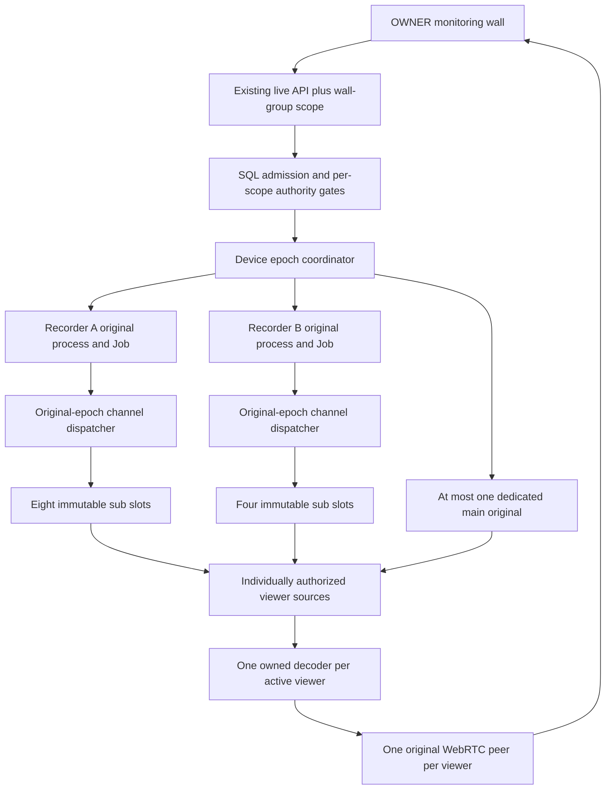

# Stage 2: per-recorder live multiplexer — architectural design draft

Date: 2026-10-06 Asia/Seoul. **DRAFT FOR WRITTEN-SPEC REVIEW; NOT IMPLEMENTATION
APPROVAL.** Prepared using Superpowers brainstorming. Root published this
portable draft after c12 retirement; it is frozen for fresh independent spec
review. User approval of the reviewed written spec is required before an
implementation plan is written. The approved stage-1 plan explicitly excludes
this subsystem. No product code, dependency, native call or test run was changed
while drafting. The original ignored author draft is retained as historical
working evidence; this project Markdown is the reviewable design authority.

## 1. Intent, baseline and success

Known user intent: one OWNER watches two owned stores' eight plus four channels
simultaneously on the existing React/Python/Tailwind monitoring wall, hosted on
Windows. Grid uses substreams; one enlarged tile uses main, then returns to sub.
Initial scope is the existing owned-device/local-network workflow. Protocol work
must come from the retained APK/source/ABI evidence, inert protocol tests and
authorized owned-recorder probes; vendor SDK documentation is not a prerequisite.

The architectural boundary changes: native connection ownership becomes per
recorder, while permission and displayed-media ownership remain per channel and
viewer. This draft proposes one wall group for one actor/web session. Multiple
users/tabs sharing a camera, encode fan-out, staff roles, TURN, cloud devices,
audio/playback/PTZ and production bootstrap are excluded.

Current source baseline is HEAD6436748 plus the reviewed uncommitted Stage 1
changes through R143. Root reports c12 has now normally retired: all90 issued
leases CLOSED/confirmed, original Chrome/coordinator exited0/reaped, API/worker
settled, context removed, source unchanged/private0. Its observer passed the
strict COMPLETE/hash gate with zero errors/omissions. Nine streams advanced
3008–3009 frames each across a common300.849s window; nine remained PLAYING with
progress at live elapsed1091.28s. Main1280×1936 and return-to-sub worked; ten rapid
focus/return operations settled. Twelve streams still did not open: login BUSY
remains observed. This is **nine-stream evidence**, not twelve-stream acceptance
or proof of a universal five-login device cap. c11's two502s were pre-login
connect/greeting failures, not lost BUSY. See canonical service analysis and
the c11 native-open diagnosis for earlier qualified evidence.

Stage 2 succeeds only when two original native recorder connections carry all
twelve sub tasks for at least five common minutes with per-tile frame progress,
measured bounded resources and confirmed original cleanup. Focus may use one
additional bounded native original under the decision below.

## 2. Alternatives and recommendation

| Approach | Benefit | Cost / qualification | Decision |
| --- | --- | --- | --- |
| Immutable channel tasks inside a recorder epoch; stop retires a local viewer and parks its task; one dedicated main lane | Two base logins, independent normal tile stops, stable channel-to-task association despite taskless media | Parked tasks retain network/device capacity; separate upstream and viewer cleanup semantics; main needs one extra login | **Recommended**, subject to explicit user acceptance of parking semantics and proof gates below |
| Destroy/recreate the whole recorder epoch whenever a channel task must be replaced | Old packets cannot cross a confirmed native-process/socket boundary | Stop/focus on one channel interrupts all channels of that recorder; repeated login/BUSY/first-frame delay | Explicit recovery fallback only; not normal focus/stop |
| Close/reopen tasks on the same shared connection; infer task from channel or presumed close ACK | Closest superficial resemblance to APK task map replacement | ep3 has no task fence; a delayed old picture can be attributed to a replacement task | **Rejected for current evidence**. A future wire-incarnation proof would require a new spec/review |

The older parity roadmap's preference for route2/task fencing is not evidence
that these recorders supply it. Stage 1 actually accepts route0 under an exclusive
first-task assertion. Stage 2 must establish a different, narrow assertion:
**one immutable task for each requested channel on one original connection epoch**.
It must not simply turn off `exclusive_first_task` or synthesize task IDs in media.

## 3. Proposed ownership model

An epoch is one original child process, Job, native socket/login, callback owner,
transport generation and accepted same-session inventory/permission proof.
Its registry key includes tenant/tenant epoch, actor, web-session scope, wall
group, store/device/connection, connection generation, secret version, inventory
revision and worker epoch. Never pool merely by address, serial or device ID.



Three authority/resource objects are deliberately distinct:

- **DeviceEpoch** owns the physical original and transport-only maintenance.
  Login success or this record's existence grants no arbitrary channel delivery.
- **ChannelSlot** owns one immutable `(epoch, channel, stream=sub, task)` and its
  lifetime wire index/raw-time/mapped-time state. It has a separately checked
  channel retention/control grant; it is created only for a requested channel.
- **ViewerLease** owns exactly one active registration, decoder and peer. Its
  current grant alone permits publication. Stage 2 still permits one viewer
  per channel; this is ownership separation needed for multiplexing, not fan-out.

The slot's DecodeBinding uses the real original epoch/session/channel/task.
Dimensions are not identity. A sequential viewer attachment gets a new local
lease/registration generation, not an invented native task or connection binding.
The coordinator retains exact original Popen/Job/IPC/thread owners. Unconfirmed
owners continue consuming quota; no registry clear or PID rediscovery releases it.

## 4. Parked tasks: explicit product decision

Normal tile Stop means **stop this viewer**, including its decoder/peer and all
retained media. While another same-device wall reference remains, the physical
sub task is parked rather than closed/reopened on the wire. Incoming parked
media is structurally validated for its known immutable slot, counted and
discarded without decoding or publication. No media history is stored.

Parking is not free: the recorder may continue sending that substream and the
slot remains charged against task/transport quotas. This tradeoff must appear
in the written-spec approval. The UI must not promise that an individual Stop
disconnected that physical upstream. Stop All and the last device reference do
retire the complete native original.

Each parked slot keeps an explicit bounded retention/control grant, distinct
from its closed viewer. Its expiry is at most30s and no later than the wall/web
session, credential/configuration validity or master expiry. Renewal requires
a valid same-owner wall heartbeat **and that slot's own current channel rights**;
a socket keepalive, another channel's True or historical inventory does not renew
it. Absence of a valid wall heartbeat lets these grants expire. Parked slots alone
never keep a master alive after its last active device viewer/focus-return
reservation disappears. Slot count is bounded, even while parked.

A permission, role, web-session, credential-version or generation revocation is
not a normal park. Deny publication immediately. Because physical per-task
cessation is not proved by a close ACK, retire the **whole original master**
when a channel's required retention authority is revoked/expired. This interrupts
other channels on that recorder; the other recorder continues. Do not return a
false native-cleanup receipt to hide that cost. Restored rights require fresh
admission after the old epoch actually retires.

## 5. Dispatch and wire contract

Proposed `MultiplexLiveCodec` is a new explicit profile, leaving the existing
exclusive single-task profile usable for the dedicated main lane and rollback.

- Keep one bounded outer framing/fragment assembler per original transport.
  Never feed a shared byte stream independently into twelve single-task codecs.
- Map validated media by original epoch plus `ep3.e` channel GUID, then require
  the registered slot's selected stream kind. A channel GUID in another recorder
  or a known inventory channel that was never opened is not an admitted slot.
- Allocate a task once per slot for the whole epoch. Serial control commands use
  one connection-wide monotonic sequence allocator and a bounded pending-command
  map. Success ACKs require their actual command/sequence/epoch; failure replies
  require the actual retained task as provided by the existing class3 parser.
- No routing echo, ignored header field, timestamp, pixel resemblance, presumed
  close ACK or local viewer generation supplies a missing wire task fence.
- Do not open a second task for the same channel on a live master. Main/sub
  replacement on that socket is forbidden in this version. On denied/failed
  physical-slot retirement, retain a tombstone until the original epoch is reaped.
- Preserve complete outer/fragment bounds, channel/stream/encryption checks,
  codec/profile validation and increasing per-channel raw frame index. A common
  device counter cannot substitute for each channel's independent order state.
- Preserve R142: raw device time must be valid and nondecreasing; mapped decoder/
  RTP time advances by the reviewed minimum24us. Both clocks and slot ordinals
  persist across parking. Backwards/invalid raw time is still a failure.
- Preserve R137 dimension adaptation: same codec, self-contained parameter sets
  plus random-access picture, five-second transition bound, at most16 decoder
  rotations per rolling60s, exact old decoder settlement before replacement.

Malformed outer framing, unknown channel/task or ambiguous control correlation
fences the master; do not skip it to preserve the appearance of playback. A
channel-local codec/decode failure may retire its viewer only when the dispatcher
has already proved the complete envelope's immutable slot association and its
control grant remains valid. Any scope/authority uncertainty retires the master.

### Reattachment watermark

Before a new viewer can attach to a normally parked slot: redeem its new ticket,
check all current scopes and request a serialized ingress cut from the exact
original native child. A parent validated-picture ordinal alone is insufficient.
The new private control response binds master epoch, slot, new registration,
control sequence, child-local ingress watermark and expiry. It is local
provenance, not a field claimed to exist in the recorder wire protocol.

At entry to each application-visible native callback/read, assign a monotonically
increasing child ingress ordinal before copying/enqueueing its bytes. Cut markers
serialize against that assignment using only a short RAM operation; no callback
wait, SQL or native reentry is added. Preserve first/last contributing ordinals
through callback FIFO, IPC envelope, partial outer/fragment assembly and complete
picture validation. A picture and all its required parameter sets must originate
strictly after the acknowledged cut. A packet/key partly copied before the cut
and completed afterward is ineligible, even if its validated picture ordinal is
new. Existing siblings' buffers are preserved and charged; only eligibility for
this viewer changes. Ordinal overflow, foreign epoch or ambiguous provenance
fails closed; no reset/relabel can make retained bytes fresh.

Discard this viewer's old queued/returned-but-uncommitted units and RGB. Recheck
grant/current/cancellation/expiry after cut acknowledgement, at decoder admission
and publication. Accept only a complete self-contained post-cut key with required
parameter sets; no cached key or pre-cut parameter-set fragment seeds it. Every
decoder result also carries the new registration generation. The slot's raw
wire-order/time state persists across parking. Cut/control wait and first-key
wait consume the existing caller/authority budgets, without extending them.
If no qualifying key arrives within the remaining10s key phase, return the
reviewed bounded no-media failure; missing/invalid cut is a protocol/authority
failure and cannot be reclassified NO_SIGNAL or open another upstream task.

This defines post-admission **local ingress**, not camera capture freshness.
Bytes buffered in the network/OS/opaque SDK before application-visible ingress
cannot be dated from existing evidence. No wire viewer timestamp or flush ACK
is invented. The enforceable guarantee excludes application-retained pre-cut
callback/IPC/assembler/key/RGB material, including cross-cut partial pictures.

## 6. Main focus and return

Focus serializes old sub-viewer Stop → local cleanup receipt → dedicated main
start. Its sub ChannelSlot becomes parked; other sub tasks do not change. The
dedicated main lane uses the existing exclusive original-native profile and
requires its own channel-specific current grant, login permission proof and caps.
At most one focus lane exists for the qualified wall. BUSY remains BUSY and must
not stop or restart the base master to force a main login through.

Return serializes dedicated main Stop and **confirmed original native reap** →
fresh sub viewer admission to the same parked slot using the watermark rule.
A separate typed transition reference closes the sole-viewer authority gaps.
Before sub Stop can remove the last base reference, admit FORWARD_PENDING
atomically under current same-actor/channel/wall/slot rights. Before main Stop,
admit RETURN_PENDING under those rights while the main viewer is still current,
atomically replacing and consuming MAIN_ACTIVE before main Stop begins. No
independently renewable MAIN_ACTIVE reference survives that return transition.
Neither is a viewer or a publication grant; neither depends on a main viewer
already existing or continuing after CLOSED. Main/sub issuance still follows
the respective cleanup barriers above.

Each transition reference has a hard maximum20s from admission, clipped to its
original caller deadline and wall/channel/session/credential authority expiry.
It cannot renew, extend, or be replaced while pending by repeated clicks. This
may expire during an unusually slow26s stop phase; then the base retires if it
has no other references. Expiry is a bounded handoff failure, not permission to
retain the base without authority or adopt it after STOPPING.

After a successful main attachment, transfer FORWARD_PENDING atomically to the
explicit MAIN_ACTIVE reference with current same-scope rights and the bounded
wall/slot retention lifetime. It does not authorize sub publication. After a
successful returning sub attachment, consume RETURN_PENDING atomically into
the new current sub reference. Missing/BUSY/failed/cancelled/expired handoff
settles its pending reference; if no other current device reference remains,
retire the original base epoch. A desired return may use a fresh base only after
its exact original retirement; it cannot quietly reopen the old channel task.
Dedicated-main uncertainty retains that original's custody and blocks returning
sub issuance. Stop All revokes pending/active focus references as well as viewers.

The existing one-nonclosed-viewer-per-channel rule is preserved: the old sub
viewer must be CLOSED before the main viewer is issued, and the main viewer must
be CLOSED before the returning sub viewer is issued. A parked upstream slot is
a different resource row, not a second active viewer that evades uniqueness.

## 7. Authority, admission and lifetime

Use separate immutable typed grants for master transport maintenance, per-slot
retention/control and per-viewer publication. Each has tenant/actor/session,
connection/configuration/inventory/generation/worker-epoch scope and expiry.
Keep the100ms start-anchored call-entry SQL-observation contract and sticky denial
for each grant; keep the existing200ms emission-permit lifetime/expiry checks
and transport fencing. R120/R133 permits a slow successful observation to
authorize its eligible invocation even after freshness elapsed; its reusable
cache remains immediately expired. These values are not an end-to-end100/200ms
revocation SLA during slow SQL. Known local channel denial immediately overrides
cached master True and never revives; caller/lease/permit expiry remains checked
at its separate emission boundary. A stronger return-time or revocation deadline
would require a separately designed/reviewed mechanism, not an inherited claim.

The master transport may stay alive only while at least one current authorized
device reference exists. That permits socket maintenance and bounded routing,
not delivery of all channels. Every open, frame admission, decoder operation and
publication checks the relevant per-channel/viewer grant independently. A parent
decision sent to the child must name its validated purpose/slot and expiry;
there is no reusable blanket all-channel allow response.

The first creator reserves the epoch under a short coordinator lock, then performs
credential/native work outside that lock and outside long media reads. Followers
wait on the same construction result within their own caller budget. Credentials
are decrypted only for original login, then discarded; retain only sealed actor/
version identity and same-session permission evidence. A changed secret version
or expired web session invalidates the epoch; no stored plaintext or hidden relogin.

Keep native orphan renewal at at most30s and six-second original-connection
keepalive, anchored in unexpired current authority. A renewal never revives an
expired/denied original. Each channel's own expiry wins over another viewer's
heartbeat. No SQL transaction or coordinator lock spans SDK waits/stream reads.
The existing eight-long-start reservation and8+8 admission pool remain; channel
attachments after master establishment use short scoped transactions.

## 8. Buffers, backpressure and resource ceilings

Proposed initial proof profile: at most2 base recorder originals,1 dedicated main
original,12 active viewer/decoder sources,16 registered physical slots including
parked/tombstoned slots. These are narrower than existing overall16-owner/source
ceilings, not permission to bypass actor16/global64 lease admission.

| Resource | Proposed hard boundary |
| --- | --- |
| Per-channel encoded pipeline |16 pictures /4MiB total credit across parent/source/returned-but-uncommitted batches; one ledger, not one extra FIFO at each hop |
| Global retained encoded bytes |64MiB across16 slots; credit reserved before reading/copying |
| Native callback per original |Existing256 chunks /1MiB; no callback wait, SQL or native reentry |
| Envelope and partial assembly |Existing1MiB envelope/assembler bounds; bounded slot map and single pending control operation per master |
| RGB and decoder output |Latest RGB1 per active viewer,16MiB/frame,32MiB/response; reserve/account pending outputs and conversion buffers before accepting them |
| Shared host retained media |Proposed1GiB hard credit across encoded/RGB/inflight conversion bytes; reject admission or wait boundedly, never allocate outside its ledger |
| Decoder originals |Existing512MiB process/Job cap each; one live-or-retiring decoder per source |
| Native process memory |Proposed512MiB cap per original in addition to current active-process1/kill-on-close Job; requires explicit native review/probe because current native Job has no memory cap |
| Media worker memory |Proposed2GiB process bound under its original supervisor; nested original-child Job compatibility must be proved before enabling this profile |

At12 decoders plus3 native originals, child limits sum to7.5GiB; adding the host
process limit gives a9.5GiB worst-case process-memory ceiling, not predicted RSS
or an upfront allocation. The selected Windows host must qualify this budget
and OS headroom, or a lower separately tested profile must be approved. Do not
silently relax limits or claim the existing machine is sized from source alone.

One native socket has inherent head-of-line pressure: when a channel has no
credit, the dispatcher cannot consume unlimited later bytes to reach another
channel. Keep bounded global receive pause and current/stop checks at most50ms,
with the existing five-second pressure/earlier lease deadlines. Do not drop
arbitrary active inter pictures or conceal another pending batch. A callback/
assembler/global budget failure fences the original epoch. Shared failure impact
is a stated tradeoff; its ability to sustain twelve channels is a required probe,
not a solved assumption. Serialize cold channel startup per recorder and keep
decoding independent of routing/authority; do not add decoder prewarming or a
new decoder protocol merely to conceal a failed sizing gate.

## 9. Cleanup and receipts: required schema change

Legacy `cleanup_confirmed` currently includes native-session plus media cleanup.
It must not silently be reused to mean that a parked physical task disappeared.
Add typed internal cleanup scope and separately durable resource ownership:

- Wall group: actor/web-session identity, desired approved retention scope,
  expiry and terminal state. Browser Stop All revokes its intent.
- Device epoch: original native generation/custodian, credential and inventory
  revisions, state STARTING/ACTIVE/STOPPING/QUARANTINED/CLOSED and separately
  confirmed original-process/Job/IPC completion.
- Channel slot: epoch/channel/stream/task, accepted-open state, per-slot grant,
  active/parked/tombstoned state, bounded retention expiry and counters.
- Viewer lease: exact slot or dedicated original, one active registration,
  existing media states, and required cleanup scope (`VIEWER`, `DEDICATED_NATIVE`,
  or `LAST_VIEWER_AND_DEVICE_EPOCH`). These are internal receipt semantics; no
  raw identities are exposed in the public UI.

Viewer-only CLOSED requires publication fenced, old registration removed,
original decoder/source/peer tasks actually settled, and SQL completion. It
explicitly does **not** certify a physical channel close. Parked upstream custody
remains visible/charged in its slot and master rows. Stop All/last reference and
dedicated main Stop require original native retirement too; their last viewer
stays STOPPING until that barrier is confirmed. Wire1282 is best-effort only and
never proves callback quiescence or native cleanup.

Concurrent last-detach/new-attach is serialized by an epoch state transition:
once STOPPING, no new attachment or grant joins it. A replacement waits for the
exact original to settle; no handle/PID lookup, generation reset or new master
overwrites pending custody. A native crash fences all that master's grants,
retains original Popen/Job/IO owners and quarantines until actual retirement.
Other established recorder streams continue. Keep conservative existing global
uncertain-native creation fencing unless a separate scoped proof permits looser
per-recorder startup isolation.

An additive migration after0015 is required; proposed name
`0016_tvt_device_media_epochs.py`. Earlier fan-out0016 was a future placeholder
and must move later in the eventual plan. Do not edit applied0013–0015 or relabel
their pending/quarantined rows as confirmed. Legacy leases keep their old full
native cleanup meaning until closed. Single-viewer uniqueness must continue to
block while an old viewer is STOPPING. Upstream rows never weaken RLS/current
checks or actor/global quotas. A worker crash without retained original custody
does not permit automatic SQL cleanup confirmation; general production recovery
is outside this version.

## 10. API/module boundaries and normal sequence

| Proposed boundary | Responsibility / affected source |
| --- | --- |
| `DeviceEpochCoordinator` |Reserve/join/retire exact device epochs and budgets; new core module beside `local_media_service.py` |
| `MultiplexLiveCodec` / immutable slot proof |Connection framing/control dispatch plus per-channel invariant state; new explicit profile/module beside `local_live.py`; leave legacy profile intact |
| Native master provider/session |One original login/catalog; `open_channel`, `attach_viewer`, `park_viewer`, `renew`, `close_epoch`; bridge provider/IPC/worker changes with new protected receipt |
| SQL admission |Wall/epoch/slot/viewer grants, typed cleanup, per-channel current checks and uniqueness; additive migration and `local_media_admission.py` adapter |
| Media facade |Attach authorized packet source, keep decoder/R142 state correctly scoped, local vs last-owner retirement; `worker.py` and `native_source.py` |
| Web/API |Opaque owner wall-group scope on monitoring starts/heartbeat/Stop All; existing main/sub start/offer/playing/stop contracts otherwise retained; `/connections` may retain dedicated legacy mode |
| Owned runtime/observation |Budget admission, safe master/slot/viewer counts, exact original closure evidence; R143 bounded writer/terminal/hash gate retained |

No browser selects a native GUID, task, process, actor or retained handle.
Proposed group create/renew/stop operations use the existing authenticated OWNER
session and CSRF protections. Group renewal checks every retained slot's scope;
it is not an all-channel grant. Main/sub remains an explicit requested selector.

```mermaid
sequenceDiagram
  participant B as Owner wall
  participant A as Admission
  participant C as Coordinator
  participant N as Original native master
  participant D as Decoder and peer
  B->>A: Start sub with one-use ticket and wall scope
  A->>C: Sealed current actor and channel grant
  C->>N: Create master if absent, otherwise join exact epoch
  N-->>C: Same-session catalog and channel permission proof
  C->>N: Open immutable sub task once with unique sequence
  N-->>C: Valid matching ACK and channel-keyed media
  C->>D: Current grant and fresh complete key after watermark
  D-->>B: Authorized WebRTC frames
  B->>A: Presented-frame report
  A-->>B: PLAYING receipt
  B->>C: Stop this viewer
  C->>D: Fence and settle exact local owners
  C-->>B: Viewer-only CLOSED; upstream slot parked
  B->>C: Stop last device reference
  C->>N: Best-effort closes then original Stop/Destroy/Quit/reap
  N-->>C: Exact native/IPC/Job retirement confirmed
  C-->>B: Last-viewer and epoch CLOSED receipts
```

All waits consume the original caller deadline: existing startup20s, original
custody/attempt wait at most10s, accepted-open key wait10s, source first decoded
frame10s, pressure/format wait5s. Do not add these as unconditional new time
allowances. ACK, first media, decoded output, peer connection, presented frame
and SQL PLAYING remain separate milestones. Missing ACK is not evidence of
NO_SIGNAL; valid352×240 placeholder media is not absence of signal.

## 11. Evidence and stage-specific proof gates

The following are explicit open proof obligations, not requests for unavailable
SDK documentation and not an implementation task list. Architectural source
review precedes written-spec approval. After approval, the implementation plan
defines finite inert/SQL/custody tests; after their reviewed source gates, owned
native probes advance two/four tasks before the final8+4 browser acceptance.
Every probe has an explicit bounded run deadline and confirmed original cleanup.

1. **APK/source:** recheck `fu3.I5/J5`, `cw3.jb/kb`, `cw3.s7`, `Z9/X7` and `m8`
   for shared connection dispatch, sequence ownership, fragment behavior and
   warning/refusal correlation. Preserve the fact that route0 has no task and
   the APK close path does not supply a trustworthy fence.
2. **Inert protocol:** interleave at least twelve original channel streams,
   ACK/refusal/fragment traffic and cross-device equal channel values. Prove that
   unknown/foreign/late-epoch frames, substituted task/stream, malformed messages
   and stale grants cannot reach another slot. Prove no second wire open of a
   channel in an epoch and no parked/pre-cut frame publication. Hold a complete
   key in callback/IPC, a partial key/parameter set in assembly and a returned
   uncommitted picture before admission; release after cut acknowledgement.
   None may initialize the new decoder, even with a new validation ordinal.
   A genuinely post-cut self-contained key succeeds within remaining budget;
   sibling order/credit remains valid. Reject late old-registration decoder output.
3. **Original-custody/SQL:** concurrent first creation, last detach vs attach,
   failed construction, full budgets, cancellation, role/channel/secret/session
   invalidation, native crash and uncertain reap. Typed viewer cleanup must never
   satisfy an epoch/native barrier. Legacy pending rows retain their meaning.
   Test a slow successful SQL answer beyond freshness and separately beyond
   lease expiry, denial racing that result, no renewed freshness window and no
   expired sender permit. Measure call-entry/return/emission boundaries separately.
   Test sole-viewer forward/return reservations before and after every barrier:
   exact20s cap/expiry clipping, repeated-click nonrenewal, cancel/BUSY/failure
   settlement, last-master retirement and no second active channel viewer.
4. **Owned recorder probe:** one fresh reviewed master, two then four unique
   sub tasks, proving actual route/kind/channel/ACK behavior before eight-plus-four.
   Test normal park/resume after a genuine post-admission key and independent
   main-lane coexistence. If evidence violates the immutable-task assertion,
   stop and revise the spec; do not invent routing fields or fall back to unsafe
   in-place task replacement.
5. **Pressure/memory:** first decode/dynamic size changes under shared callback
   load, credit exhaustion, stalled channel and control progress; prove the
   proposed process/aggregate budgets and Windows Job relationships with original
   handles. A failure is a capacity/protocol finding, not permission to hide drops.

## 12. Acceptance matrix

- Two original base native recorder owners; twelve sub tasks all presented and
  advancing for at least five common minutes, with no silent tile reduction.
- One additional dedicated main owner at most; at least one fully presented
  main-to-sub handoff must show sibling grid frames advancing. Return follows
  actual dedicated-owner reap and the new sub ingress cut/key. Separately run
  ten rapid focus/return request pairs; report attempted, acknowledged, presented,
  cancelled and settled counts. Those requests test cancellation/uniqueness;
  they cannot be reported as ten successful main opens without ten presentations.
- Stop one viewer leaves other tiles live and records local cleanup honestly;
  verify its parked slot is bounded/charged and sends no viewer pixels. Stop the
  last device reference/Stop All confirms original native/Job/IPC retirement.
- Dynamic valid resolutions pass existing rotation gates. Test real missing
  media only on an actual acknowledged no-frame case; do not relabel valid
  placeholder frames. Retain first-frame deadline negatives independently.
- Individual/global authority preserves the qualified100ms call-entry observation
  and200ms permit-expiry contracts under delayed SQL, without asserting a100ms
  end-to-end revocation guarantee. Local denial never revives. Channel retention
  revocation deliberately retires that whole master; verify original retirement.
- Reject foreign/unknown/late-epoch packets, stream changes and malformed control;
  quarantine exact native crashes/uncertain cleanup without PID reacquisition.
- Measure1/4/12 SQL transactions per live stream (retain target≤25), CPU per
  original process family, memory, startup/presentation p50/p95, parked traffic,
  callback/encoded pressure and retirement durations. Include the focus case.
- End with every scoped lease/slot/epoch disposition, all required original
  resources actually settled, no private occurrences/source drift, and complete
  bounded observation terminal/hash evidence. Exceptional cleanup is FAILED,
  never a replacement for this normal-cleanup acceptance gate.

## 13. Source references and specification decisions

Current source citations (paths/lines; vendor code is not copied):

- `docs/analysis/2026-10-04-apk-feature-parity-review.md:380` and`:503`: APK
  connection/layout model and earlier roadmap, with current limits at`:464`.
- `docs/superpowers/plans/2026-10-05-multiview-stage1-plan.md:716`: explicit
  multiplexing/fan-out exclusions and corrected actual no-signal qualifications.
- `packages/core/src/wso_core/tvt/local_live.py:450`: ACK/state and route handling;
  `:491` route0 exclusive contract;`:512` task-correlated refusal;`:531` channel/
  stream/media validation;`:575` wire index monotonicity. New mux proof is absent.
- `services/tvt-bridge/src/wso_tvt_bridge/local_live_ipc.py:200,:279`: current
  single-selection setup and parent credit/authority pump;`:33` existing bounds.
- `services/tvt-bridge/src/wso_tvt_bridge/windows_socket_worker.py:1008,:1042,
  :1073,:1263`: exclusive serve loop, first-task claim, keepalive, callback bound.
- `services/tvt-bridge/src/wso_tvt_bridge/windows_socket.py:853,:877`: original
  Job custody and current one-process/kill-on-close limits.
- `packages/core/src/wso_core/tvt/local_media_service.py:268,:332,:360,:461`:
  existing whole-session cleanup, attached media barrier, reads and closure.
- `packages/core/src/wso_core/tvt/local_media_admission.py:38,:422,:454,:514`:
 100ms authority observations, expiry clipping and sticky close.
- `infra/migrations/versions/0013_tvt_local_media_leases.py:24,:37,:129,:264`:
  scope fields, channel uniqueness, pending-lease rejection and cleanup semantics.
- `services/tvt-media/src/wso_tvt_media/native_source.py:40,:46,:166,:284`:
  pressure/rotation bounds and raw/mapped clocks; decoder limits in
  `packages/core/src/wso_core/tvt/windows_decode.py:168`.
- `docs/integrations/tvt-local-live-codec.md:88` and
  `docs/integrations/tvt-windows-socket-abi.md`, callback/lifetime and Send sections:
  source-derived taskless routing, borrowed buffers and unproved wire shutdown.
- APK1.18.1: `VideoManagerLayout.e1/L0`; `fu3.I5/J5/N1`; `cw3.jb:2512`,
  `kb:6641–6688`, `m8:6974–7014,7093–7122`, `v5:8011–8020`; `X7` decoded
  offsets1822–1840 and `s7(ep3.e)`, per retained APK notes. These support direction,
  not new recorder acceptance. Do not copy the literal GUID elsewhere in cw3.

User-visible decisions requiring written-spec approval: parked upstream resource
semantics; whole-recorder interruption on unprovable per-channel revocation;
one extra focus login and its possible BUSY result; single OWNER/wall scope;
proposed memory/admission profile. Proof-gate failure requires a spec revision,
not a quiet fallback. No implementation plan is part of this draft.

Self-review: route0 task absence is explicit; physical and viewer cleanup are
typed separately; parked work has per-channel authority/expiry and remains
charged; focus uniqueness and last-owner barriers are stated; memory and shared
pressure assumptions are acceptance gates. This remains a proposal requiring
independent spec review, portable publication by Root and user approval.
