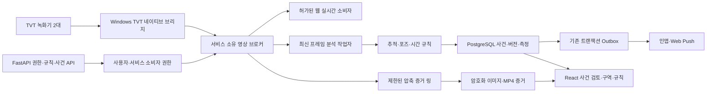

# CCTV 서비스 완성과 이상행동·사건 처리 설계

작성일: 2026-10-08, Asia/Seoul.
상태: **연구 결과를 반영한 검토용 설계안. 새 기능 구현·실기 인수 완료를 의미하지 않는다.**

## 1. 목표와 이번 구현 범위

사용자가 선택한 다음 기능을 실제 FE → BE → 장치/작업자 → 저장/조회 흐름으로 완성한다.

1. 12채널 동시 재생, 공통 300초 진행, 1/4/12 부하 측정, 화질 전환·반복 전환·중지·재연결·정리.
2. 녹화 검색·달력·타임라인·재생·탐색·속도·백업·내보내기.
3. 스냅샷·로컬 녹화·APK 분할 화면·채널/즐겨찾기 그룹 페이지·지원 화질 선택.
4. PTZ·프리셋·장치 설정·방범·스케줄·펌웨어 관련 흐름.
5. 계정 보안·공유 생성/회수·추가 등록/검색·알람 수신함·푸시·사진/영상 파일 관리.
6. **주요 기능: CCTV 이상행동 후보 탐지 → 사건 생성 → 증거 저장 → 알림 → 관리자 검토.**

24시간 감시는 브라우저가 열려 있을 때만 작동하는 기능으로 만들지 않는다.
우선 행동은 원래 서비스 계획의 냉동고 올라가기/앉기, 달리기, 손 흔들기/도움 요청 후보다.
사람/구역 감지 자체와 행동 판정은 구분한다. 단순 구역 진입 구현으로 행동 기능을 완료 처리하지 않는다.

React/Next.js·Tailwind, Python/FastAPI, PostgreSQL, **Windows 서버**를 유지한다.
지속 영상 분석은 로컬 모델과 시간 규칙으로 수행한다. 기존 계획의 CLI 요약은 사건 증거가 생성된
뒤 별도 작업으로 실행하며, 요약 실패가 최초 사건/알림을 지연하거나 삭제하지 않는다.

## 2. 기존 설계·소스·연구 권위

- 원래 제품 설계: `SERVICE_PLAN.md`.
- 원래 구현 계획: 2026-09-21 T17–T23/T30/T31, 2026-09-27 W06–W08/W10–W15/W20/W23–W25.
- 이번 조사: `docs/analysis/2026-10-08-cctv-incident-research.md`,
  `docs/analysis/2026-10-08-apk-selected-features-research.md`.
- 현재 소스: 별도 worktree `codex/superlive-web-service`, HEAD6436748와 검토된 미커밋 변경.
- 현재 저장된 사실: stage2 소스 Tasks1–11 검토 완료, raw2/raw4 정상 인수, Chrome 8/4 인벤토리 확인.
- 미완료: 12개 디코딩/표시 스트림의 공통 300초, 분석과 동시 부하, 선택 기능 전체, APK 동등성 비교.

원래 계획을 폐기하거나 범위를 임의 축소하지 않는다. 이 문서는 선택 기능과 주요 사건 기능의
새 인터페이스/운영 설계를 구체화한다. 오더퀸·상품 등록 등 별도 서비스 범위는 기존 장부에 보존한다.

## 3. 권장 접근과 대안

| 접근 | 장점 | 제약/판정 |
| --- | --- | --- |
| **서비스 소유 영상 브로커 + 소비자별 권한** | 장치당 공유 원본을 유지하면서 웹·분석·증거를 함께 제공, 항상 켜진 감시 가능 | 현재 사용자/세션 소유 권한과 다른 설계다. 새 서비스 주체·발행 권한·정리 계약을 별도로 구현/검토해야 한다. **최종 권장안** |
| 별도 RTSP/ONVIF 분석 경로 | 기존 웹 경로의 세션 권한을 유지하며 분리 가능 | 실제 두 녹화기의 주소·외부/LAN 도달·추가 연결 용량이 입증되지 않았다. 존재한다고 가정하지 않는다 |
| 웹과 분석에 각각 별도 TVT 원본 | 구현 경계가 단순 | 현재 전역 base2 한도에서 두 분석 연결과 두 웹 연결이 공존하지 못한다. 한도를 몰래 복제/증가하지 않는다 |

현재 `MuxOriginalBudget`를 작업자마다 복제하면 물리 원본 한도를 지킨 것이 아니다.
브라우저 OWNER 세션/쿠키를 배경 분석의 인증으로 재사용하지 않는다.
새 브로커를 구현하기 전에도 승인된 기존 live 검증과 규칙/사건/증거의 결정적 테스트는 독립적으로 진행한다.

## 4. 아키텍처와 데이터 흐름

녹화기 검색/재생은 live lease를 바꾸어 재사용하지 않는다. 전용 playback 권한·상태·시간/파일
검증 경로를 만든다. 장치 명령과 계정/공유 쓰기는 기존 durable operation 엔진과 실제 읽기 확인을 연결한다.

## 5. 영상 원본과 소비자 권한

브로커 원본 키는 tenant, connection, credential generation, 입증된 native principal,
worker epoch로 제한한다. 원본을 다른 tenant/장치 자격 증명과 공유하지 않는다.

- 서비스 분석 권한: OWNER가 허가한 connection/store/channel/rule 범위와 기능을 저장한다.
  처음 허가할 때 현재 사용자 권한을 검사하고, 이후 작업자는 전용 서비스 주체로 갱신한다.
- 웹 소비자 권한: 현재 사용자·세션·매장·채널·wall/lease·registration·만료를 별도 검사한다.
  서비스 원본의 넓은 장치 권한이 웹 소비자의 권한이 되지 않는다.
- 압축 증거 소비자 권한: 사건/채널/시간 창과 저장 목적에 한정한다.
- 서비스 허가 철회, 장치 credential generation 변경, 장치 권한 상실은 해당 원본과 소비자를 종료한다.
- 사용자 logout/revoke는 해당 웹 소비자를 종료한다. 유효하게 허가된 배경 분석은 사용자 logout만으로 중지하지 않는다.

기존 ingress cut·key/parameter provenance·clock·credit·원본 핸들 정리를 보존한다.
새 웹 소비자가 첫 표시 프레임을 받기 전에 그 소비자의 컷 이후 완전한 키/파라미터 기원을 증명한다.
분석이 이미 디코딩 중이라는 이유로 과거 RGB 프레임을 새 웹 소비자의 첫 프레임으로 허용하지 않는다.

SQL 역할/함수는 서비스 source intent, 서비스 grant, 사용자 publication grant, 갱신·철회·정리를
각각 분리한다. 클라이언트 JSON은 서비스 주체/원본 정리 완료/권한 증명을 지정할 수 없다.
전역 물리 원본·슬롯·작업자/디코더·메모리 한도는 합산한다. 기존 한도를 바꿔야 하면 새로운 프로필과
실제 하드웨어 측정/원본 정리 검증을 먼저 수행한다.

## 6. 프레임·분석 작업자 계약

새 단위는 `services/video-worker/src/wso_video/`와 `packages/rules/src/wso_rules/`에 둔다.
현재 `NativeDecodedSource.recv`의 RGB 반환은 정확히 원본 프레임을 release해야 하는 소비 계약이다.
임의의 배경 구독/아카이브 API로 간주하지 않는다.

프레임 manifest 필드:

- tenant/store/camera/source identity, source epoch, sequence, source dimensions;
- ingress provenance, registration/cut, codec/time basis;
- validated receipt monotonic time, server UTC observation time;
- capture UTC는 실제 보정이 입증될 때만 설정, 그 외 `capture_clock=UNVERIFIED`;
- 규칙·모델·calibration revision과 픽셀/좌표 변환.

원래 2초 추론 지연 제한은 우선 **검증된 수신 → 추론** 경과로 측정한다.
네이티브 PTS를 촬영 UTC나 물리적 촬영 지연으로 오인하지 않는다.
카메라당 최신 대기 프레임 하나, 고정 크기 전역 큐, 오래된 프레임 폐기, 카메라별 공정한 스케줄을 사용한다.
브라우저 표시가 분석 대기 때문에 막히지 않도록 별도 backpressure/credit과 종료 barrier를 둔다.
분석·웹·저장에 실제 보유된 모든 버퍼를 합산하며 큐 제한을 실제 RSS 제한으로 설명하지 않는다.

Windows 작업자는 별도 프로세스로 실행하고 기존 원본 Job/Popen 보유 패턴을 적용한다.
모델 불러오기/추론도 취소·시간 초과·메모리 상한·정리 여부를 추적한다.
Windows 영상 작업자를 지원 검증 없이 Celery prefork 작업자로 바꾸지 않는다.

## 7. 모델과 행동 규칙

기존 T19의 YOLOX + ByteTrack를 기본으로 하고, 포즈가 필요한 행동에 RTMPose를 추가한다.
모델은 사람/관절/추적 구성요소다. 냉동고·달리기·도움 요청을 이미 학습한 완성 모델이라고 표시하지 않는다.

- 기준 실행: ONNX Runtime CPU, CUDA/DirectML은 별도 설치·호환·측정 프로필.
- 모델별 source URL, code/weight/data terms, SHA256, input/output schema, preprocessing,
  runtime/provider, fixture 결과를 manifest로 고정한다. 모델 다운로드/설치 완료는 아직 아니다.
- 우선 artifact: YOLOX tiny/s, ByteTrack, COCO 17-keypoint RTMPose-s 후보.
  다른 데이터가 섞인 가중치는 동일 조건이라고 취급하지 않는다.
- 자동 GPU/CPU 전환으로 FPS·품질 계약을 바꾸지 않는다. 선택 프로필을 실행할 수 없으면 상태를 표시한다.

| 행동 | 필요한 측정 | 불확실한 경우 |
| --- | --- | --- |
| 냉동고 올라가기/앉기 | 냉동고 바닥/상단 구역, 발/신체 지지·포즈, 관측 지속 시간 | 사람 box 중첩만으로 판정하지 않음; 가림/포즈 부족은 후보 또는 UNCERTAIN |
| 달리기 | 보정된 바닥 이동 속도 또는 신체 크기로 정규화한 변위, 지속 관측 | 원근/속도 보정 부족을 표시; 픽셀 속도를 실제 m/s로 표시하지 않음 |
| 손 흔들기/도움 후보 | 손목의 반복 이동, 신체/손 가시성, 시간 패턴 | 손 한 프레임만으로 도움 의도를 확정하지 않음 |

구역은 정규화 polygon으로 버전 관리하고 교차/빈 면적을 거부한다. 해상도/회전과 좌표변환을 기록한다.
연결 재시작은 track epoch를 새로 만들고 서로 다른 epoch의 사람 track을 병합하지 않는다.
누락/가림/오래된 관측으로 체류 시간을 계속 늘리지 않는다. 초기 병합 cooldown은 원래 계획의 15초다.
동작 threshold는 버전 있는 매장/카메라 calibration과 검증 클립으로 고정하고 변경 이력을 남긴다.

## 8. 증거·사건·파일

기존 private asset는 JPEG/PNG용이다. MP4를 이름만 바꿔 저장/검증 완료로 취급하지 않는다.
새 video validation/encryption/retention/download Range 경로를 만들고 codec·duration·timestamp·파일 무결성을 확인한다.

원래 목표는 사건 전 10초와 후 10초다. 압축 링은 항상 bounded이며 실제 키프레임·시간 창으로 묶는다.
연결 직후나 누락된 영상은 실제 커버리지를 표시한다. 사건 발생 뒤 main 스트림을 열어서 과거 main 영상을
확보했다고 주장하지 않는다. main이 허가/가용할 때만 사용할 수 있고 sub 증거는 실제 품질로 표시한다.
FFmpeg 분할은 키프레임에 따라 정확한 경계를 벗어날 수 있으므로 실제 시작/끝을 저장한다.

사건에는 camera/store, rule/model/calibration revision, track epoch, 측정값, 신뢰도/불확실성,
대표 이미지/클립, 시간 기준/커버리지, 최초/최종 관측을 저장한다.
상태는 원래 계획의 `NEW → ACKNOWLEDGED → RESOLVED`와 `FALSE_POSITIVE`를 사용한다.
검토/규칙 수정은 expected revision을 검사하고 변경 이력을 남긴다.

직원 모드는 지정 규칙의 알림만 TTL 동안 억제한다. 증거·사건·피드백을 버리지 않으며 자동 만료한다.
얼굴 신원/나이/범죄·결제 오류를 영상만으로 확정하는 기능으로 만들지 않는다.

## 9. API·화면 단위

새 공개 계약은 OpenAPI→TypeScript 생성과 Python Pydantic의 strict schema를 함께 사용한다.
권한/역할은 기존 tenant/store 인증을 재사용하며 카메라·증거 객체를 매번 검증한다.

| 단위 | 공개 흐름 | 파일 책임 |
| --- | --- | --- |
| 카메라 분석 설정 | 목록/상태, 허가/중지, 프로필·구역·규칙 revision | `camera_sources` 계약·core, API cameras/analysis, React analysis settings |
| 규칙/구역 | 저장/미리보기/버전 충돌/비활성화 | `wso_rules` pure engine, API rules, React zone/rule editor |
| 사건 | 필터 목록/상세/확인/오탐/해결 | incidents 계약·core·API, React list/detail/review |
| 증거/파일 | 메타데이터·허가된 이미지/MP4·Range·다운로드·보존 삭제 | evidence 계약·validator/storage, API evidence/assets, React media viewer |
| 전달 | 사건 커밋과 outbox, 수신자 상태, 실시간 인앱/SSE·Web Push | delivery handler, subscriptions/API, service worker·inbox |
| 녹화 재생 | 검색/달력/시간 구간, 전용 playback session, seek/speed/export | local playback 계약·admission·codec/worker·API·BFF·React |
| 장치 명령 | capability 조회, typed 명령, 결과/읽기 확인 | controls/settings 계약·core·bridge·API·BFF·React |
| 계정/공유 | protected adapter + admission/readback, 공개 workflow | security/directory 계약·vault·worker·API·BFF·React |

inbox/push는 사건 DB 커밋 이후 outbox에서 전달한다. 중복 source ID의 같은 사건만 중복 제거한다.
푸시에는 원본 이미지/자격 증명 대신 권한 검사를 거쳐 열 수 있는 사건 참조를 넣는다.
단말 알람과 영상 분석 사건은 각각 source kind와 provenance를 보존한다.

## 10. 선택 APK 기능의 구현 경계

연구 보고서의 JNI/native signature와 request source를 작업별 계약 출발점으로 사용한다.
현재 Windows 실행기는 inventory/live만 제공한다. playback/PTZ/config/event 함수가 이미 실행 가능하다고
가정하지 않는다. 미해결 wire byte는 해당 JNI/core를 추가 분석하고 인코딩/응답 golden vector를 고정한다.

- local playback/event는 전용 권한 타입이며 live `MediaLease.kind` 검사를 약하게 만들지 않는다.
- 분할/페이지는 실제 APK의 장치 채널·즐겨찾기 그룹 의미를 따른다.
- 화질은 장치가 보고한 지원 encode/config 목록과 실제 적용 결과를 연결한다.
- snapshot/local recording은 실제 수신/디코딩 영상에서 생성하고 playable bytes를 인수한다.
- 공유·계정 보안은 복구된 serializer를 durable intent/반복 제출 방지/읽기 확인/API/UI에 연결한다.
- PTZ는 누름/놓음/timeout stop을 검증하고, 설정 저장은 실제 장치 상태로 확인한다.
- 펌웨어·공유·삭제·계정 변경은 코드/통제된 테스트부터 구현한다. 실제 위험한 변경은 해당 동작의 범위와
  복구/확인 조건이 갖춰진 실행 단계에서 수행한다. 네트워크 timeout을 성공이나 재시도 안전으로 가정하지 않는다.
- LAN 검색은 복구된 포트/패킷과 nonce·응답 검증을 먼저 완성한다. 임의 host 스캔으로 대체하지 않는다.

## 11. 구현 순서와 병렬 경계

1. **기존 live 인수 재개**: 정리/새 런타임/제어 가능한 Chrome, 1/4/12 측정과 공통 300초.
2. **공유 서비스 원본·배경 분석 권한**: 새 브로커/SQL/publication 계약, 동시 웹/분석 capacity.
3. **주요 사건 최소 완성 경로**: 모델 manifest/adapter·추적/규칙·bounded evidence·사건 API/UI·outbox 전달.
4. **녹화·파일·영상 기능**: 검색/재생/export, snapshot/local recording, 분할/페이지/quality.
5. **장치·계정/공유·알람**: 개별 decoded protocol과 UI/API/장치 readback.
6. **동시 부하·운영 인수**: 12화면+분석, 재시작·복구·보존·권한 철회·24시간 안정성, APK 비교와 publication.

공유 계약과 migration 번호는 먼저 고정한다. 이후 독립 파일 책임별 주/서브 에이전트가 병렬 작업한다.
영상 원본·권한/cleanup 계약의 여러 동시 writer를 허용하지 않는다. 완료한 코드를 다시 구현하지 않는다.
모든 화면은 실제 처리/오류 상태를 표시하며 mock/데모를 실제 CCTV/모델 완료라고 표시하지 않는다.

## 12. 완료 판정

**코드/보안:** meaningful RED→GREEN, 타입/계약/권한/RLS·token/role/epoch/취소·오래된 프레임·크레딧/정리
테스트, 독립 리뷰. tenant/store/사용자·서비스 grant를 바꾸어 다른 영상/증거를 얻는 경우는 불허한다.

**주요 사건:** 정상 보행/냉동고 옆 서기/교차·가림·카메라 흔들림·단순 손 들기 등을 음성 예제로 검증하고,
세 행동군의 허가된 양성 클립과 보류 데이터에서 precision/recall/false alerts·판정 지연/실제 coverage를 기록한다.
정확도가 입증되지 않은 행동은 UI에서 calibrated/enabled로 표시하지 않는다.

**실기:** 실제12개가 모두 표시된 뒤 공통300초 프레임 진행, 1/4/12 및 분석 동시 FPS/CPU/RSS/DB·lag/드롭,
화질/반복/중지/재연결, 각 기능의 장치/파일/수신자 실제 결과를 확인한다. 서비스 분석은 브라우저 종료 후도
유효한 서비스 허가로 계속되고, 허가 철회/재시작에서는 epoch/정리가 정확해야 한다.

**최종:** 24시간 Windows 감시와 장애/복구, 실제 이미지·MP4/원본 시각·Range/보존, outbox 재전송/중복,
API/worker/SDK/Job/브라우저·소비자/DB/context 정리, source/private 검사, APK 비교 기록,
검토된 변경 커밋·푸시·main 통합·통합 후 검증을 각각 완료한다.
설계 문서/테스트 fixture 통과만으로 서비스 완성이나 APK 100% 동등성을 선언하지 않는다.

## 13. 현재 실행 조건

2026-10-08 Chrome 제어는 연결됐지만 현재 localhost3543 서비스는 연결 거부다.
이번 세션에서 최신 구현 worktree와 Git metadata는 읽기 전용이다. 정상 테스트 실행기가 생성하는
auth-state/빌드/증거 기록과 코드/Git 작업은 쓰기 가능한 구현 workspace에서 진행해야 한다.
현재 primary checkout에 연구/검토 문서를 작성한 것이 최신 구현을 통합한 상태는 아니다.

Superpowers brainstorming의 새 아키텍처 검토 절차에 따라 이 문서는 먼저 사용자가 검토할 설계안이다.
승인 후 `writing-plans`로 하위 시스템별 실행 계획/파일·인터페이스·테스트를 고정하고 구현한다.
현재 문서 작성이 새 브로커/분석/증거/사건 기능을 이미 구현한 것으로 해석되지 않도록 한다.

## 14. 자체 검토

- [x] 사용자가 선택한 모든 기능과 주요 이상행동·사건 경로를 보존.
- [x] Windows/React/Python/Tailwind와 기존 원래 계획의 시간·권한·증거 원칙 유지.
- [x] 현재 웹 세션 소유 source와 새 배경 분석 grant/원본 공존 충돌을 명시.
- [x] 원본 예산 복제/무단 cross-user pooling/과거 RGB 첫 표시를 금지.
- [x] 촬영 시간/수신 시간, 설정 한도/실제 RSS, raw 수신/브라우저 인수를 구분.
- [x] JPEG/PNG 기반과 새 MP4/Range/보존 계약 차이를 명시.
- [x] 모델/포즈/규칙 구성요소를 완성된 행동 분류기로 설명하지 않음.
- [x] 실제 모델 artifact·실기 데이터·장치 wire 미해결 항목을 실행/비교 단계에 할당.
- [x] 현재 쓰기 권한/서버 상태와 완료하지 않은 구현·인수 범위를 기록.

수치 근거와 공식 원문: 두 연구 보고서의 근접 인용과 원래 서비스 계획 §7.3/T19/T20.
모델/라이브러리 버전·hash는 실제 artifact 검증/lock 단계에서 고정하며 지금 다운로드/검증됐다고 기재하지 않는다.
